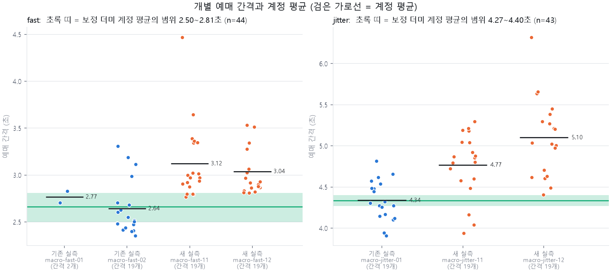
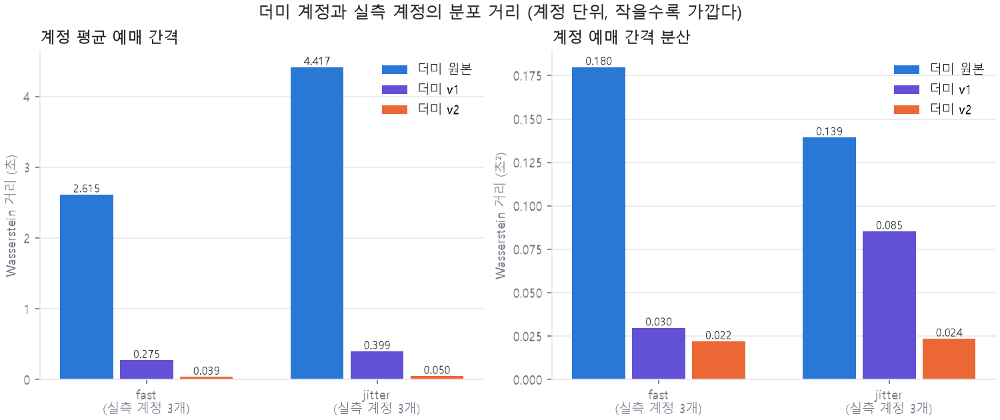
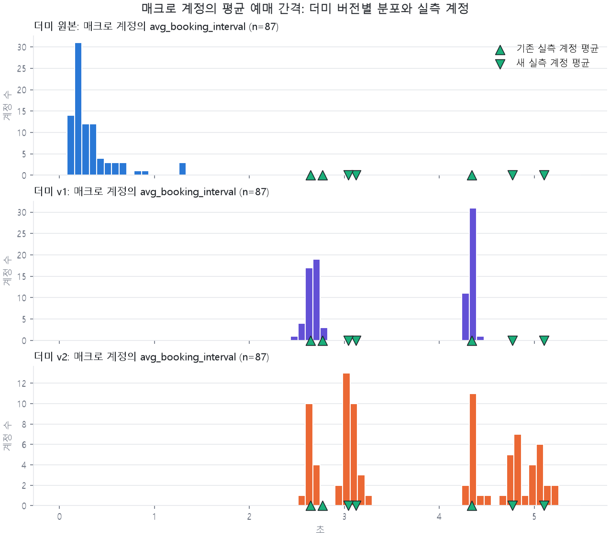
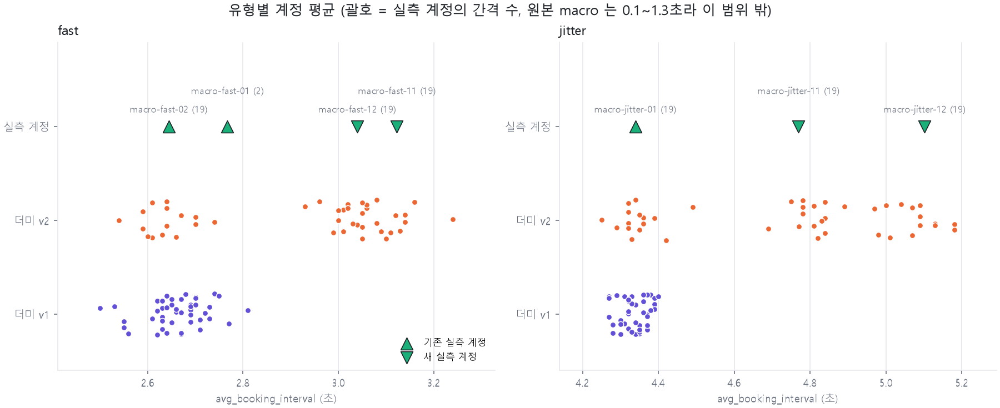
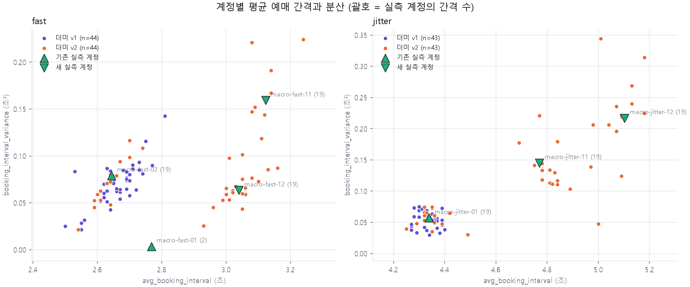

# 실측 기반 더미데이터 검증 및 보정 (Issue #16 최종 보고서)

작성일 2026-11-23. `experiments/issue16-booking-interval/` 에 저장된 CSV 의 값을 정리한 문서다.
각 표 아래에 출처 파일을 적었다. 3절의 분포 거리는 저장된 데이터셋과 실측 계정 Feature 에서 `scripts/validation_stats.py` 로 계산했다 (새 수집·데이터셋 생성·모델 학습 없음).

## 요약

이 이슈의 목적은 **기존 더미데이터가 실제 매크로 행동과 얼마나 비슷한지 검증하고, 실측에 근거해 더 현실적인 더미데이터로 보정하는 것**이다.
모델 성능을 측정하거나 높이는 것은 목적이 아니다.

| 결론 | 근거 |
|---|---|
| 기존 더미의 매크로 평균 예매 간격은 실측보다 지나치게 짧았다 | 더미 0.10~1.31초 대 실측 계정 평균 Fast 2.64~3.12초, Jitter 4.34~5.10초. 실측 6계정 중 더미 범위 안에 드는 계정 0개 |
| v1 은 평균 수준을 맞췄지만 계정 간 변동성을 담지 못했다 | 계정 평균의 표준편차 v1 0.06 / 0.04초 대 실측 0.26 / 0.38초. v1 과 독립인 새 실측 4계정 중 v1 범위 안에 드는 계정 0개 |
| v2 는 실측 계정별 차이를 반영해 분포가 실측에 가까워졌다 | 계정 평균의 분포 거리 원본 2.6 / 4.4초 → v1 0.28 / 0.40초 → v2 0.04 / 0.05초 |
| v2 와 실측의 일치는 독립 검증이 아니다 | v2 는 비교에 쓴 바로 그 실측 계정들로 만들었다 |
| 새로운 계정에 대한 일반화에는 한계가 있다 | 실측 계정 하나를 빼고 만들면 그 계정의 평균이 범위 안에 든 것은 6개 중 3개 |
| 검증 범위가 좁다 | 검증한 Feature 는 2개, 실측 계정은 유형당 3개. 나머지 Feature 는 검증하지 않았다 |

---

## 1. 검증 대상과 범위

### 검증한 Feature

| Feature | 정의 | 단위 |
|---|---|---|
| `avg_booking_interval` | 한 계정의 예매 간격의 평균 | 초 |
| `booking_interval_variance` | 같은 간격의 모분산 (n 으로 나눔) | 초² |

- **예매 간격**은 같은 계정의 연속한 예매 시도 시작 시각(attemptId 별 첫 `BOOKING_ATTEMPT`)의 차이다. 예매 1건에 걸린 시간이 아니다.
- 계산식은 BTS `FeatureAggregationService` 와 같다 (#14 의 `extract_features.py` 를 그대로 사용).

### 검증하지 않은 것

**실측으로 검증한 것은 위 두 Feature 뿐이다.** 아래는 이번 이슈에서 실측과 비교하지 않았고, 보정본에서도 원본 값 그대로다.

- 매크로 계정의 나머지 Feature: `seat_selection_latency`, `cancel_rate`, `card_reuse_count`, `ip_booking_density`, `booking_count`
- 정상 사용자 4개 시나리오(`normal`, `fast_normal`, `shared_ip`, `frequent_cancel`)의 모든 Feature
- 다른 이상 시나리오(`hold_cancel`, `multi_account`)의 모든 Feature
- Human-like 매크로 (실측은 했지만 더미 보정에는 넣지 않았다)

---

## 2. 실험 과정

### 2.1 기존 더미데이터의 생성 방식과 한계

원본(`ml_experiment/data/fairticket_synthetic_features.csv`, 1,000행)은 `ml_experiment/generate_dummy_data.py` 가 계정 1행마다 Feature 값을 분포에서 직접 뽑아 만든다.
매크로(`scenario = macro`, 87행)의 두 Feature 는 다음과 같다.

| Feature | 생성식 | 결과 (87행) |
|---|---|---|
| `avg_booking_interval` | 지수분포(scale 0.2) + 0.1 | 0.10~1.31초, 평균 0.320, 중앙값 0.230 |
| `booking_interval_variance` | 균등분포(0.01, 0.5) | 0.012~0.498초², 중앙값 0.278 |

한계:

- 값의 근거가 실제 측정이 아니다.
- 평균과 분산을 서로 독립으로 뽑는다 (순위상관 −0.11). 실제로는 같은 간격들에서 함께 계산되는 값이다.
- 매크로의 유형(Fast, Jitter 등) 구분이 없다.

### 2.2 Fast/Jitter 매크로 실측 수집

- **환경**: 격리 E2E 스택(일회성 DB, BTS + Demo 백엔드 + 프론트). 기존 개발 DB 는 쓰지 않았다.
- **매크로**: `demo-ticketing/macro/macro.js` (Playwright). 클릭 지연 프로파일 Fast / Jitter, 좌석 1석, 테스트 카드 A, 창을 띄운 상태.
- **연속 예매**: 한 계정이 브라우저와 로그인을 유지한 채 20회 이어서 예매한다 (`--repeat 20`).
  예매마다 브라우저를 새로 띄우는 방식은 브라우저 실행과 로그인 시간이 간격에 들어가(Fast 평균 5.92초) 보정에 쓰지 않았다.
- **수집과 계산**: `scripts/collect.py` 가 매크로를 실행하고 BTS 의 `behavior_event` 를 내보낸 뒤 Feature 를 계산한다.

| 실행 | demo-ticketing | 계정 | 성공 / 시도 |
|---|---|---|---|
| `20261122-continuous` (기존 실측) | `9dd0146` + 당시 미커밋 매크로 변경 | fast 2 (3회, 20회), jitter 1 (20회) | 43 / 43 |
| `20261123-remeasure` (새 실측) | `d07820f` | fast 2, jitter 2 (각 20회) | 80 / 80 |

기존 실측에는 Human-like 1계정(20회)도 있었지만 이 보고서의 범위 밖이다.

실측 계정별 Feature:

| 실행 | 유형 | 계정 | 간격 수 | `avg_booking_interval` | `booking_interval_variance` | 중앙값 | 최소 | 최대 |
|---|---|---|---|---|---|---|---|---|
| 기존 | Fast | macro-fast-01 | 2 | 2.768 | 0.004 | 2.768 | 2.707 | 2.828 |
| 기존 | Fast | macro-fast-02 | 19 | 2.644 | 0.079 | 2.515 | 2.354 | 3.307 |
| 새 | Fast | macro-fast-11 | 19 | 3.123 | 0.159 | 2.972 | 2.768 | 4.470 |
| 새 | Fast | macro-fast-12 | 19 | 3.040 | 0.063 | 2.917 | 2.808 | 3.531 |
| 기존 | Jitter | macro-jitter-01 | 19 | 4.339 | 0.057 | 4.305 | 3.909 | 4.818 |
| 새 | Jitter | macro-jitter-11 | 19 | 4.770 | 0.145 | 4.857 | 3.939 | 5.297 |
| 새 | Jitter | macro-jitter-12 | 19 | 5.102 | 0.217 | 5.035 | 4.408 | 6.321 |

`macro-fast-01` 은 간격이 2개뿐이라 아래 비교에서는 뺐다 (간격 5개 이상인 계정만 사용: 유형당 3개).
출처: `dummy_adjusted/v2/real_account_features.csv`

### 2.3 기존 더미와 실측의 차이 확인

기존 실측(1회차)과 비교했을 때, 실측 계정의 평균 예매 간격(2.64~4.34초)은 더미 매크로의 최댓값(1.31초)보다 모두 길었다.
예매 1건에는 화면 이동과 시연용 결제 지연 1.2초가 들어가므로, 이 사이트에서는 가장 빠른 설정에서도 간격이 2.3초 아래로 내려가지 않았다.

### 2.4 v1 보정 방법과 한계

방법 (`scripts/make_adjusted_dummy.py`, seed 42):

1. 원본의 `macro` 87행을 섞어 `fast` 44행, `jitter` 43행으로 나누고 `scenario` 값을 바꾼다 (44/43 은 정해 준 값).
2. 행마다 `booking_count − 1` 개의 간격을 **그 유형의 기존 실측 간격 전체**(fast 21개, jitter 19개)에서 복원추출한다.
3. 뽑은 간격의 평균과 모분산을 두 Feature 에 넣는다. 두 값이 같은 표본에서 나오므로 서로 맞물린다.

한계: 한 유형의 모든 더미 계정이 같은 간격 풀에서 15~48개를 뽑아 평균하므로 **계정 평균이 유형 평균 근처에 좁게 모인다.**
실측 계정이 유형당 1~2개뿐이어서 계정 간 차이를 넣을 근거가 없었다.

### 2.5 최신 사이트 재측정

좌석 수 확대(96 → 700석), 좌석 배치도 UI 변경, 연속 예매 409 수정 이후 다시 측정했다. 80건 모두 성공했고 예매 실패·선점 재시도·HTTP 409 는 0건이었다.

개별 예매 간격끼리의 비교 (같은 단위):

| 유형 | 간격 수 (기존 / 새) | 평균 | 중앙값 | 표준편차 | Wasserstein 거리 |
|---|---|---|---|---|---|
| Fast | 21 / 38 | 2.656 → 3.081초 (+0.426) | 2.552 → 2.952 (+0.400) | 0.277 → 0.341 | 0.426초 |
| Jitter | 19 / 38 | 4.339 → 4.936초 (+0.597) | 4.305 → 4.948 (+0.643) | 0.245 → 0.463 | 0.597초 |



- 새 실측 4계정의 평균은 하나도 v1 의 계정 평균 범위(Fast 2.50~2.81초, Jitter 4.27~4.40초)에 들지 않았다.
- 같은 실행 안에서도 Jitter 두 계정의 평균이 0.33초 달랐다.
- 두 실행 사이에 사이트 변경, `--debug` 사용 여부, 매크로의 sessionStorage 정리 제거, 수집 시각이 함께 달라졌고 한 번씩만 측정했으므로 **차이의 원인은 가려낼 수 없다.**

출처: `runs/20261123-remeasure/dummy_comparison/summary_by_type.csv`

### 2.6 v2: 계정별 계층적 복원추출

v1 과 같은 절차에서 2번만 바꿨다 (`--method account-hierarchical`, seed 42).

1. 유형 배정은 v1 과 같다 (같은 행이 fast / jitter).
2. 유형마다 **실측 계정 하나를 더미 행에 붙인다.** 실측 계정(유형당 3개)을 차례로 돌아가며 붙여 계정당 14~15행이 되게 했다.
3. 행마다 `booking_count − 1` 개의 간격을 **그 실측 계정의 간격에서만** 복원추출해 평균과 모분산을 넣는다.

- 기존 실측과 새 실측을 모두 썼다 (fast 간격 59개, jitter 57개). 더미 87행 중 30행이 기존 실측 계정, 57행이 새 실측 계정에서 나왔다.
- 분포의 모양이나 계정 간 분산의 크기는 따로 가정하지 않았다. 실측 계정의 평균 수준과 분산이 더미 계정에 그대로 옮겨진다.
- 간격이 2개인 `macro-fast-01` 은 쓰지 않았다.

### 2.7 데이터셋 동일성

| | 원본 | v1 | v2 |
|---|---|---|---|
| 경로 | `ml_experiment/data/fairticket_synthetic_features.csv` | `dummy_adjusted/v1/fairticket_synthetic_features_adjusted.csv` | `dummy_adjusted/v2/fairticket_synthetic_features_adjusted.csv` |
| sha256 | `2e1e27c1…` | `b371a8cc…` | `426a0967…` |
| 매크로 행 | `macro` 87 | `fast` 44, `jitter` 43 | `fast` 44, `jitter` 43 |

보정본은 1,000행, 같은 행 순서, 같은 `is_anomaly`(이상 비율 0.199)를 갖는다.
원본과 다른 것은 원본의 `macro` 87행의 `scenario`, `avg_booking_interval`, `booking_interval_variance` 세 컬럼뿐이고, 생성 스크립트가 쓰기 전에 이를 확인한다.

출처: `dummy_adjusted/v1/generation.json`, `dummy_adjusted/v2/generation.json`

---

## 3. 정량적 검증

### 비교 단위

더미데이터의 한 행은 **계정 1개의 Feature** 다. 그래서 실측도 **계정별 Feature**(계정 평균, 계정 모분산)로 맞춰 비교했다.
더미에는 개별 예매 간격이 없으므로, 개별 간격끼리의 비교는 실측 실행 사이에서만 했다 (2.5절).

- 실측 쪽은 간격 5개 이상인 계정이며 유형당 3개(기존 1, 새 2)다.
- 원본에는 유형이 없으므로 `macro` 87행 전체를 각 유형의 실측과 비교했다.
- 실측 계정이 3개뿐이라 아래 거리는 크기를 가늠하는 값이지 정밀한 추정이 아니다.

### 3.1 계정 평균 (`avg_booking_interval`)

| 유형 | 데이터 | 계정 수 | 평균 | 중앙값 | 표준편차 | 범위 (최소~최대) |
|---|---|---|---|---|---|---|
| Fast | 실측 계정 | 3 | 2.936 | 3.040 | 0.256 | 2.644~3.123 |
| | 원본 macro | 87 | 0.320 | 0.230 | 0.247 | 0.100~1.310 |
| | v1 | 44 | 2.661 | 2.665 | 0.062 | 2.500~2.810 |
| | v2 | 44 | 2.917 | 3.015 | 0.212 | 2.540~3.240 |
| Jitter | 실측 계정 | 3 | 4.737 | 4.770 | 0.382 | 4.339~5.102 |
| | 원본 macro | 87 | 0.320 | 0.230 | 0.247 | 0.100~1.310 |
| | v1 | 43 | 4.338 | 4.340 | 0.037 | 4.270~4.400 |
| | v2 | 43 | 4.732 | 4.810 | 0.311 | 4.250~5.180 |

실측 계정과의 차이 (더미 − 실측):

| 유형 | 데이터 | 평균 차이 | 중앙값 차이 | 계정 평균의 표준편차 (더미 / 실측) | Wasserstein 거리 | 실측 계정 중 더미 범위 안 |
|---|---|---|---|---|---|---|
| Fast | 원본 | −2.615초 | −2.810초 | 0.247 / 0.256 | 2.615초 | 0 / 3 |
| | v1 | −0.275초 | −0.375초 | 0.062 / 0.256 | 0.275초 | 1 / 3 |
| | v2 | −0.018초 | −0.025초 | 0.212 / 0.256 | 0.039초 | 3 / 3 |
| Jitter | 원본 | −4.417초 | −4.540초 | 0.247 / 0.382 | 4.417초 | 0 / 3 |
| | v1 | −0.399초 | −0.430초 | 0.037 / 0.382 | 0.399초 | 1 / 3 |
| | v2 | −0.005초 | +0.040초 | 0.311 / 0.382 | 0.050초 | 3 / 3 |

Wasserstein 거리는 두 분포를 서로 맞추려면 값을 평균 몇 초 옮겨야 하는지를 뜻한다. 작을수록 가깝다.
원본의 표준편차 0.247초는 실측과 비슷해 보이지만, 0.1~1.3초 구간 안에서의 퍼짐이라 위치가 전혀 다르다.







### 3.2 계정 분산 (`booking_interval_variance`)

| 유형 | 데이터 | 평균 | 중앙값 | 범위 (최소~최대) | 평균 차이 | 중앙값 차이 | Wasserstein 거리 | 실측 계정 중 더미 범위 안 |
|---|---|---|---|---|---|---|---|---|
| Fast | 실측 계정 | 0.101 | 0.079 | 0.063~0.159 | — | — | — | — |
| | 원본 macro | 0.276 | 0.278 | 0.012~0.498 | +0.175 | +0.199 | 0.180초² | 3 / 3 |
| | v1 | 0.071 | 0.072 | 0.021~0.142 | −0.030 | −0.007 | 0.030초² | 2 / 3 |
| | v2 | 0.087 | 0.072 | 0.022~0.224 | −0.014 | −0.007 | 0.022초² | 3 / 3 |
| Jitter | 실측 계정 | 0.140 | 0.145 | 0.057~0.217 | — | — | — | — |
| | 원본 macro | 0.276 | 0.278 | 0.012~0.498 | +0.136 | +0.133 | 0.139초² | 3 / 3 |
| | v1 | 0.054 | 0.054 | 0.030~0.075 | −0.085 | −0.091 | 0.085초² | 1 / 3 |
| | v2 | 0.134 | 0.118 | 0.030~0.344 | −0.006 | −0.027 | 0.024초² | 3 / 3 |

원본은 분산의 범위(0.012~0.498)가 넓어서 실측 계정이 모두 그 안에 들지만, 중심은 실측보다 0.13~0.20초² 크다.



출처: `final_validation/account_level_comparison.csv`, `dummy_adjusted/v2/distribution_stats.csv`, `dummy_adjusted/v2/between_account_variability.csv`

### 3.3 독립인 비교와 독립이 아닌 비교

위 표는 실측 계정 전체(유형당 3개)와 비교한 것인데, v1 과 v2 는 그중 일부 또는 전부로 만들어졌다.
더미를 만들 때 쓰지 않은 실측 계정과의 비교만 독립 검증이다.

계정 평균의 Wasserstein 거리(초)를 비교 대상별로 나누면:

| 유형 | 데이터 | 기존 실측 계정 (1개) | 새 실측 계정 (2개) |
|---|---|---|---|
| Fast | 원본 | 2.324 (독립) | 2.761 (독립) |
| | v1 | 0.050 (생성에 사용) | **0.420 (독립)** |
| | v2 | 0.289 (생성에 사용) | 0.173 (생성에 사용) |
| Jitter | 원본 | 4.019 (독립) | 4.616 (독립) |
| | v1 | 0.031 (생성에 사용) | **0.598 (독립)** |
| | v2 | 0.403 (생성에 사용) | 0.216 (생성에 사용) |

- 원본은 어느 실측과도 독립이며, 거리는 2.3~4.6초다.
- v1 은 만들 때 쓴 기존 실측과는 0.03~0.05초로 가깝지만, **쓰지 않은 새 실측과는 0.42~0.60초** 떨어져 있다. 원본보다는 훨씬 가깝고, 자기 표본에 맞춘 만큼 가깝지는 않다.
- v2 는 모든 실측 계정을 썼으므로 **독립인 비교가 없다.** 3.1절의 0.04~0.05초는 v2 가 자기 재료를 얼마나 고르게 재현했는지를 보여 줄 뿐이다.
  (v2 가 기존 실측 한 계정과는 0.29~0.40초 떨어진 것은 v2 에 새 실측 계정에서 나온 행이 더 많기 때문이다.)

출처: `final_validation/account_level_comparison.csv`

### 3.4 Leave-One-Account-Out 검증

v2 방식이 본 적 없는 계정에도 맞는지 보려고, 실측 계정 하나를 숨기고 나머지 계정으로 같은 방법·같은 seed 로 더미를 만든 뒤 숨긴 계정이 그 더미의 범위(최소~최대) 안에 드는지 확인했다.
이 검증은 v2 를 만들 때 함께 계산해 저장한 결과다.

| 유형 | 숨긴 계정 | 숨긴 계정의 평균 | 나머지로 만든 더미의 평균 범위 | 범위 안 | 벗어난 거리 | 숨긴 계정의 분산 | 더미의 분산 범위 | 범위 안 |
|---|---|---|---|---|---|---|---|---|
| Fast | macro-fast-02 (기존) | 2.644 | 2.95~3.35 | 아니오 | 0.306초 | 0.079 | 0.014~0.292 | 예 |
| Fast | macro-fast-11 (새) | 3.123 | 2.59~3.16 | 예 | — | 0.159 | 0.041~0.117 | 아니오 |
| Fast | macro-fast-12 (새) | 3.040 | 2.59~3.25 | 예 | — | 0.063 | 0.025~0.343 | 예 |
| Jitter | macro-jitter-01 (기존) | 4.339 | 4.68~5.32 | 아니오 | 0.341초 | 0.057 | 0.078~0.348 | 아니오 |
| Jitter | macro-jitter-11 (새) | 4.770 | 4.25~5.32 | 예 | — | 0.145 | 0.023~0.348 | 예 |
| Jitter | macro-jitter-12 (새) | 5.102 | 4.25~5.00 | 아니오 | 0.102초 | 0.217 | 0.023~0.220 | 예 |

- 평균이 범위 안에 든 계정은 **6개 중 3개**, 분산이 범위 안에 든 계정은 **6개 중 4개**다.
- 기존 실측 계정을 숨기면(남는 것은 새 실측 계정뿐) 평균이 0.31~0.34초 벗어났다. 실행 사이의 차이를 다른 실행의 계정으로는 메우지 못한다.
- 범위 안에 든 3개 중 2개는 양쪽에 다른 계정이 있는 가운데 값이었다. 가장 큰 값(`macro-jitter-12`)은 벗어났다.

출처: `dummy_adjusted/v2/leave_one_account_out.csv`

---

## 4. 결과 해석

**기존 더미는 실측보다 평균 예매 간격이 지나치게 짧았다.**
더미 매크로의 계정 평균은 0.10~1.31초이고 실측 계정 평균은 2.64~5.10초다. 두 범위는 겹치지 않고, 계정 평균의 분포 거리는 Fast 2.6초, Jitter 4.4초다.
분산은 실측보다 중앙값 기준 0.13~0.20초² 컸다.

**v1 은 평균을 보정했지만 계정 간 변동성을 충분히 반영하지 못했다.**
평균 차이는 −2.6 / −4.4초에서 −0.28 / −0.40초로 줄었다. 그러나 계정 평균의 표준편차가 0.062 / 0.037초로 실측(0.256 / 0.382초)의 1/4~1/10 이었다.
v1 을 만들 때 쓰지 않은 새 실측 4계정은 하나도 v1 의 평균 범위에 들지 않았고, 그 계정들과의 거리는 0.42 / 0.60초였다.

**v2 는 실측 계정별 차이를 반영해 분포 유사도가 개선됐다.**
계정 평균의 표준편차가 0.212 / 0.311초로 실측에 가까워졌고, 분포 거리는 0.039 / 0.050초로 줄었다. 분산의 분포 거리도 v1 의 0.030 / 0.085초² 에서 0.022 / 0.024초² 로 줄었다.
평균과 분산을 같은 표본에서 계산하므로 둘의 관계도 실측 계정과 같은 자리에 놓인다.

**다만 v2 와 실측 계정의 일치는 독립 검증 결과가 아니다.**
v2 는 비교에 쓴 실측 계정 6개로 만들었다. 실측 계정이 모두 v2 범위 안에 드는 것과 거리가 작은 것은 만든 방법에서 나오는 결과다.
또 v2 의 계정 평균은 연속적으로 퍼진 것이 아니라 실측 계정 수만큼의 덩어리로 나타난다. 덩어리 사이의 빈 구간은 관측이 없다는 뜻이지 그런 계정이 없다는 뜻이 아니다.

**새로운 계정에 대한 일반화에는 한계가 있다.**
계정 하나를 숨기고 만들면 그 계정의 평균이 범위 안에 든 것은 절반이었다. v2 방식은 본 적 있는 계정 수준 주변만 재현한다.
새 계정이 기존 관측의 바깥쪽에 있으면 0.1~0.3초 정도 벗어날 수 있다는 것이 지금 데이터가 말해 주는 범위다.

**실측 계정 수가 적고 나머지 Feature 는 검증되지 않았다.**
계정은 유형당 3개, 계정당 간격은 19개이고, 같은 PC 에서 이틀에 걸쳐 실행당 한 번씩 수집했다.
두 실측의 0.4~0.6초 차이가 사이트 변경 때문인지 실행 조건 때문인지 분리되지 않은 채 v2 의 계정 간 차이로 들어갔다.
검증한 Feature 는 두 개뿐이고, 매크로의 나머지 Feature 와 다른 시나리오는 원본의 임의 값 그대로다.
따라서 v2 는 "매크로의 예매 간격 두 Feature 가 이 환경의 실측과 맞는 더미"이지, 전체가 현실적이라고 검증된 더미가 아니다.

---

## 5. 한계와 후속 과제

### 한계

- **환경**: 격리된 로컬 환경(대기열 없음, CAPTCHA 꺼짐, 네트워크 지연 없음, 시연용 결제 지연 1.2초)에서의 값이다. 실제 서비스에서의 매크로 간격과 같다고 볼 수 없다.
- **표본**: 실측 계정 6개(간격 5개 이상), 실행 2회. 계정 간 분포의 모양과 폭은 이 수로는 알 수 없다.
- **유형**: Fast 44행 / Jitter 43행의 비율은 정해 준 값이다. Human-like 매크로(실측 평균 12.83초)는 넣지 않았다.
- **실행별 비중**: v2 는 실측 계정마다 같은 비중을 줬다(기존 30행, 새 57행). 최신 사이트만 반영하거나 실행마다 같은 비중을 주면 결과가 달라진다.
- **다른 시나리오와의 위치**: 보정 뒤 매크로의 평균 간격(2.5~5.2초)은 `hold_cancel`(2.2~8.0초), `multi_account`(3.0~10.0초)와 같은 구간에 놓인다.
  v2 유형별 범위 안에 드는 계정은 `hold_cancel` 의 14.3%(fast 범위)·19.6%(jitter 범위), `multi_account` 의 5.4%·8.9% 다. 이 두 시나리오의 값은 검증되지 않았다.
- **사람 데이터**: 정상 사용자의 실측은 이번에 수집하지 않았다.

### 후속 과제

1. 유형당 계정 수와 실행 횟수를 늘리고 다른 날·다른 PC 에서 반복해, 계정 간 차이와 실행 간 차이를 따로 추정한다.
2. 사이트 버전만 바꾸고 나머지 조건을 고정한 반복 측정으로 좌석 수·UI 변경의 영향을 확인한다.
3. 새로 수집한 계정으로 v2 를 독립 검증한다 (v2 를 만들 때 쓰지 않은 계정이 범위 안에 드는지).
4. 매크로의 나머지 Feature(취소율, 카드·IP 수, 예매 횟수, 좌석 선택 지연)도 실측 이벤트에서 계산해 더미와 비교한다.
5. Human-like 매크로와 사람(정상 사용자) 데이터를 같은 방식으로 수집해 검증 범위를 넓힌다.

---

## 참고 실험: 모델 판정에 미치는 영향 (이 이슈의 핵심 결과가 아님)

보정이 Isolation Forest 판정에 주는 영향을 참고로 확인했다. 기존 학습 스크립트와 같은 조건으로 원본·v1·v2 를 각각 학습·평가했고, 기존 학습·서빙 코드와 서비스용 모델은 건드리지 않았다.

- 세 데이터셋의 F1 은 0.807 / 0.826 / 0.817 이고, 모델 seed 20개에서 F1 의 표준편차는 0.041~0.049 였다. seed 흔들림보다 큰 차이는 관찰되지 않았다.
- 두 예매 간격 Feature 를 뺀 구성에서도 F1 이 0.835 로 유지됐다.
- 학습과 평가 모두 합성 데이터이므로 이 수치는 실제 서비스의 탐지 성능이 아니다.

자세한 내용은 `model_comparison/if-original-v1-v2/REPORT.md` 에 있다.

---

## 부록: 결과 파일과 재현

| 내용 | 위치 |
|---|---|
| 기존 실측 (연속 예매) | `runs/20261122-continuous/` |
| 새 실측 + 기존 실측·v1 과의 비교 | `runs/20261123-remeasure/`, `runs/20261123-remeasure/dummy_comparison/` |
| 보정 데이터셋 v1 | `dummy_adjusted/v1/` |
| 보정 데이터셋 v2 (LOO 검증 포함) | `dummy_adjusted/v2/` |
| 이 보고서의 계정 단위 비교·분포 거리 | `final_validation/` |
| 참고 실험 | `model_comparison/if-original-v1-v2/` |
| 실행 방법 | `README.md` |

```powershell
cd ai\experiments\issue16-booking-interval
$py = "..\issue14-real-validation\.venv\Scripts\python"

# 실측 수집 (격리 E2E 스택이 떠 있어야 한다. README 1절)
& $py scripts\collect.py --run-id <run-id> --continuous --macro-debug --baseline-run 20261122-continuous `
    --plan macro-fast-11:fast:20,macro-fast-12:fast:20,macro-jitter-11:jitter:20,macro-jitter-12:jitter:20

# 보정 데이터셋
& $py scripts\make_adjusted_dummy.py --version v1 --force
& $py scripts\make_adjusted_dummy.py --version v2 --method account-hierarchical `
    --run-id 20261122-continuous --run-id 20261123-remeasure --compare-version v1 --force

# 이 보고서의 통계 (읽기만 함)
& $py scripts\validation_stats.py
```

`runs/` 아래의 실측 원본 CSV(`booking_intervals.csv` 등)는 이 폴더의 `.gitignore` 로 git 에서 제외된다.
다른 PC 에서 보정 데이터셋을 다시 만들려면 각 버전 폴더의 `real_interval_pool.csv` 에 남아 있는 간격을 쓰거나 실측을 다시 수집해야 한다.
