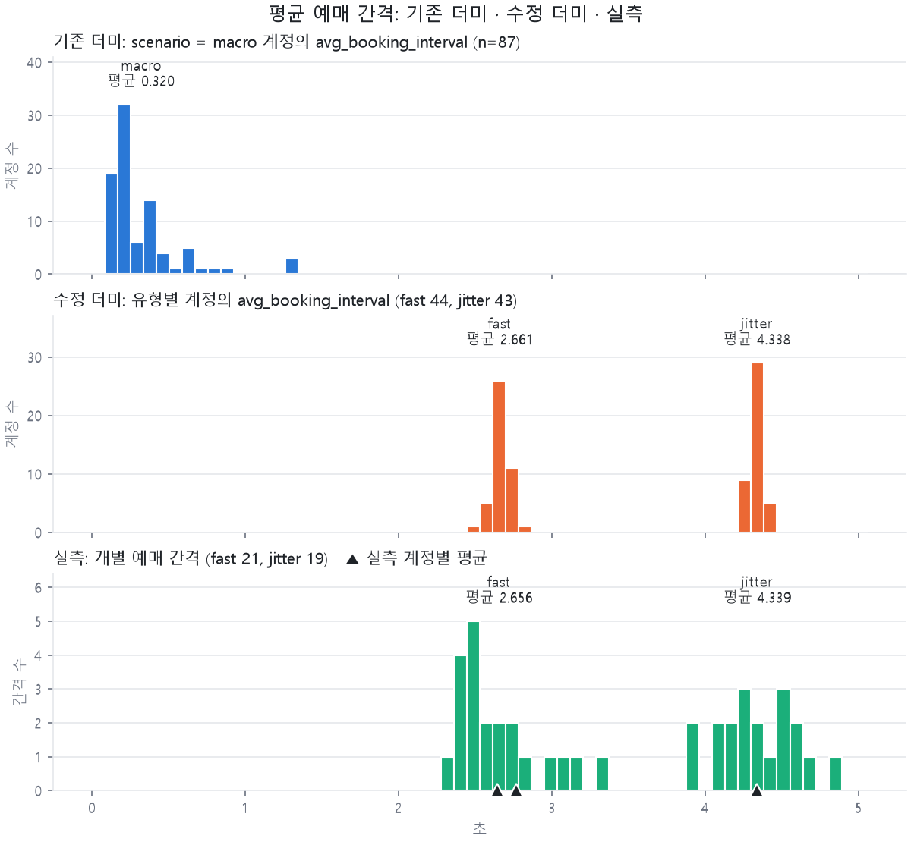
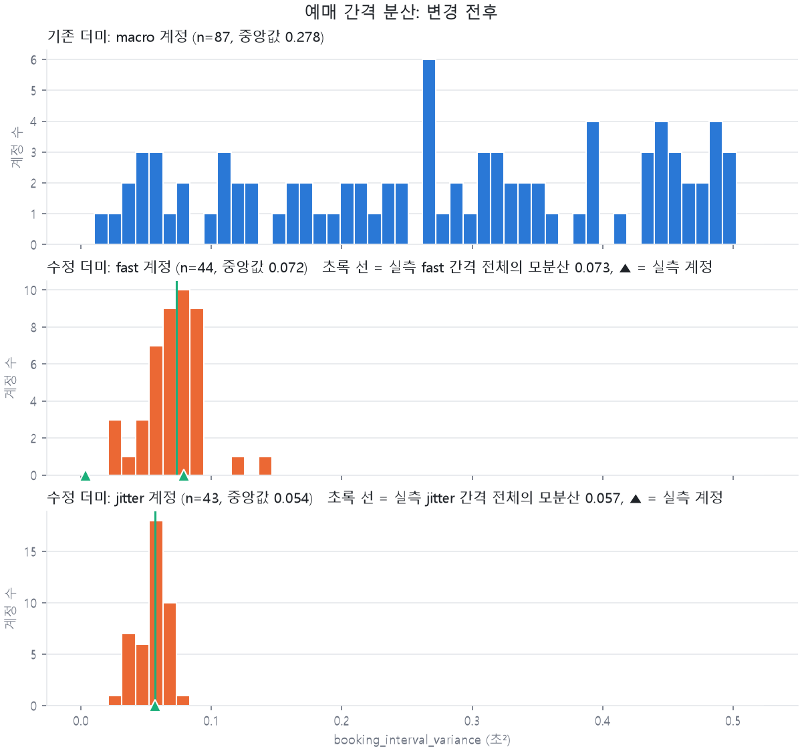
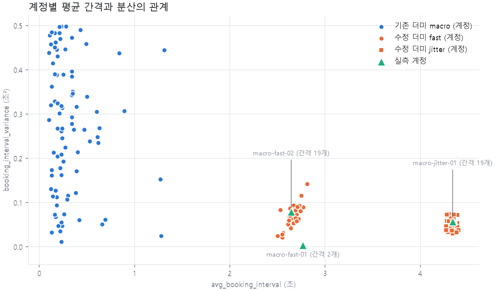
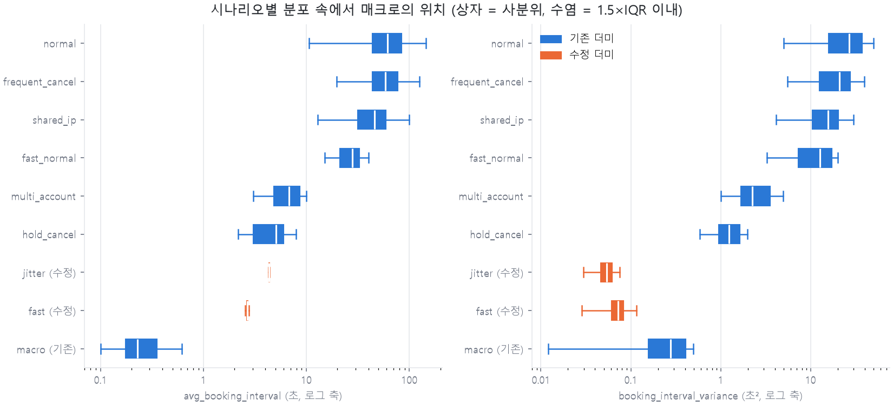

# 수정 더미데이터 v1: 매크로를 Fast/Jitter 로 나누고 예매 간격을 실측으로 조정

자동 생성 (`scripts/make_adjusted_dummy.py`, 방식 `typed-split`). 모델 학습·평가는 하지 않았다.

## 무엇을 바꿨나

- 원본: `ml_experiment/data/fairticket_synthetic_features.csv` (sha256 `2e1e27c1ebd4…`, 수정하지 않음)
- 수정본: `experiments/issue16-booking-interval/dummy_adjusted/v1/fairticket_synthetic_features_adjusted.csv`
- 원본의 `scenario = macro` 87행을 fast 44행, jitter 43행으로 나누고 `scenario` 값을 유형 이름으로 바꿨다. 수정본에는 `macro` 값이 없다. `is_anomaly` 는 그대로 1이다.
- 이 87행의 `avg_booking_interval`, `booking_interval_variance` 을 다시 계산했다. 바뀐 컬럼은 `scenario` 를 포함해 세 개뿐이다.
- 실측: 실행 20261122-continuous 의 간격 — fast 21개, jitter 19개. 각 계정은 배정된 유형의 간격만 쓴다.
- 배정: seed 42 (`numpy.random.default_rng`)로 87행의 순서를 한 번 섞어 앞에서부터 fast 44행, jitter 43행 순으로 잘랐다. 어느 행이 어느 유형인지는 `macro_rows_before_after.csv` 에 있다. 배정은 무작위이며 원본의 다른 Feature 값과 무관하다.
- 계산: 같은 난수 생성기로 이어서, 파일의 행 순서대로 `booking_count − 1` 개를 복원추출 → 평균과 모분산.
- 반올림·하한은 원본 생성 코드와 같다 (평균 소수 2자리·하한 0.1, 분산 소수 4자리·하한 0.01). 하한이 적용된 행: 평균 0개, 분산 0개.
- `booking_count < 2` 인 매크로 행: 없음

## 원본과의 동일성 확인

| 항목 | 결과 |
|---|---|
| 행 수 | 1000 → 1000 |
| 컬럼 이름·순서·자료형 | 같음 |
| `scenario` 와 두 Feature 를 뺀 모든 컬럼 (전 행) | 같음 |
| 원본에서 macro 가 아니던 행 (전 컬럼) | 같음 |
| `is_anomaly` (전 행) | 같음, 이상 비율 0.199 → 0.199 |
| 다른 시나리오의 행 수 | 같음 |
| 유형별 행 수 | fast 44, jitter 43 (남은 `macro` 0) |
| 값이 바뀐 행 | 평균 87 / 분산 87 (대상 87) |

## 평균 예매 간격



| group | unit | n | mean | median | std | variance | min | q05 | q25 | q75 | q95 | max |
|---|---|---|---|---|---|---|---|---|---|---|---|---|
| 기존 더미 macro (계정 평균) | 초 | 87 | 0.320 | 0.230 | 0.247 | 0.061 | 0.100 | 0.120 | 0.175 | 0.355 | 0.795 | 1.310 |
| 수정 더미 fast (계정 평균) | 초 | 44 | 2.661 | 2.665 | 0.062 | 0.004 | 2.500 | 2.550 | 2.630 | 2.700 | 2.748 | 2.810 |
| 실측 fast (개별 간격) | 초 | 21 | 2.656 | 2.552 | 0.277 | 0.077 | 2.354 | 2.398 | 2.474 | 2.707 | 3.189 | 3.307 |
| 수정 더미 jitter (계정 평균) | 초 | 43 | 4.338 | 4.340 | 0.037 | 0.001 | 4.270 | 4.271 | 4.315 | 4.370 | 4.390 | 4.400 |
| 실측 jitter (개별 간격) | 초 | 19 | 4.339 | 4.305 | 0.245 | 0.060 | 3.909 | 3.940 | 4.158 | 4.512 | 4.672 | 4.818 |
| 수정 더미 fast+jitter 전체 (계정 평균) | 초 | 87 | 3.490 | 2.810 | 0.845 | 0.714 | 2.500 | 2.575 | 2.665 | 4.340 | 4.387 | 4.400 |
| 실측 fast+jitter 전체 (개별 간격) | 초 | 40 | 3.455 | 3.248 | 0.890 | 0.792 | 2.354 | 2.408 | 2.543 | 4.283 | 4.621 | 4.818 |

더미의 한 값은 계정 1개의 평균이고, 실측 개별 간격의 한 값은 간격 1개다. 단위가 다르다는 점을 감안해 읽어야 한다.

### 실측과의 거리

| group | reference | mean_diff | median_diff | wasserstein | ks_statistic | share_within_reference_range |
|---|---|---|---|---|---|---|
| 기존 더미 macro | 실측 fast (개별 간격) | -2.336 | -2.322 | 2.336 | 1.000 | 0.000 |
| 수정 더미 fast | 실측 fast (개별 간격) | 0.005 | 0.113 | 0.174 | 0.458 | 1.000 |
| 기존 더미 macro | 실측 jitter (개별 간격) | -4.019 | -4.075 | 4.019 | 1.000 | 0.000 |
| 수정 더미 jitter | 실측 jitter (개별 간격) | -0.001 | 0.035 | 0.171 | 0.421 | 1.000 |
| 기존 더미 macro | 실측 fast+jitter 전체 (개별 간격) | -3.135 | -3.018 | 3.135 | 1.000 | 0.000 |
| 수정 더미 전체 | 실측 fast+jitter 전체 (개별 간격) | 0.034 | -0.438 | 0.181 | 0.243 | 1.000 |

- `wasserstein`: 두 분포를 서로 맞추려면 값을 평균 몇 초 옮겨야 하는지. 작을수록 가깝다.
- `share_within_reference_range`: 더미 계정 중 기준 실측값의 최소~최대 범위 안에 들어가는 비율.
- 기존 더미에는 유형이 없으므로, 기존 더미 행은 macro 87행 전체를 각 유형의 실측과 비교한 것이다.

### 계정 평균의 분포는 개별 간격의 분포보다 좁다

수정 더미의 계정 평균은 유형의 실측 간격에서 15~48개를 뽑아 평균한 값이다. 표본 평균은 뽑는 개수가 많을수록 그 유형의 평균으로 모이므로, 계정 평균의 퍼짐은 개별 간격의 퍼짐보다 훨씬 좁다.

- fast: 실측 개별 간격은 2.35~3.31초(표준편차 0.277)인데, 수정 더미의 계정 평균은 2.50~2.81초(표준편차 0.062)다.
- jitter: 실측 개별 간격은 3.91~4.82초(표준편차 0.245)인데, 수정 더미의 계정 평균은 4.27~4.40초(표준편차 0.037)다.

즉 유형별 평균 수준과 유형 안에서의 간격 변동은 실측을 따르지만, **같은 유형의 계정끼리는 평균이 거의 같다.** 실제로 계정마다(PC, 네트워크, 매크로 설정) 평균이 얼마나 다른지는 계정이 유형당 1~2개뿐이라 측정되지 않았고, 수정 더미에도 들어 있지 않다.

## 예매 간격 분산



| group | unit | n | mean | median | std | variance | min | q05 | q25 | q75 | q95 | max |
|---|---|---|---|---|---|---|---|---|---|---|---|---|
| 기존 더미 macro (계정 분산) | 초² | 87 | 0.276 | 0.278 | 0.148 | 0.022 | 0.012 | 0.048 | 0.158 | 0.406 | 0.485 | 0.498 |
| 수정 더미 fast (계정 분산) | 초² | 44 | 0.071 | 0.072 | 0.022 | 0.000 | 0.021 | 0.029 | 0.061 | 0.083 | 0.094 | 0.142 |
| 수정 더미 jitter (계정 분산) | 초² | 43 | 0.054 | 0.054 | 0.012 | 0.000 | 0.030 | 0.033 | 0.046 | 0.062 | 0.073 | 0.075 |

유형별로 실측과 나란히 보면:

| type | real_pool_variance | real_account_variances | original_median | adjusted_median | adjusted_min | adjusted_max | adjusted_median_minus_real_pool |
|---|---|---|---|---|---|---|---|
| fast | 0.073 | 0.004 (2), 0.079 (19) | 0.278 | 0.072 | 0.021 | 0.142 | -0.002 |
| jitter | 0.057 | 0.057 (19) | 0.278 | 0.054 | 0.030 | 0.075 | -0.003 |

- `real_pool_variance`: 그 유형의 실측 간격 전체의 모분산. `real_account_variances`: 실측 계정별 분산 (괄호 안은 간격 수).
- 수정 더미의 분산은 그 유형 실측 분산의 근처에 모인다. 기존 더미(중앙값 0.278초²)보다 작고 실측 계정의 범위와 같은 수준이다.
- 복원추출한 표본의 모분산은 평균적으로 원래 분산의 (n−1)/n 배라서 실측보다 조금 작게 나온다 (n = 15~48 이라 2~7%).

## 평균과 분산의 관계



- 기존 더미: 두 값을 서로 독립으로 뽑았다 (순위상관 -0.11).
- 수정 더미: 같은 표본에서 평균과 분산을 함께 계산했다. 유형 안의 순위상관은 fast +0.64, jitter -0.27. 부호는 그 유형 실측 간격의 치우침을 따른다: 긴 쪽으로 꼬리가 있으면 긴 간격을 많이 뽑은 계정의 평균과 분산이 함께 커진다(양수).
- 분산이 음수이거나 유형의 실측 간격 범위로 가능한 상한을 넘는 계정은 없다.
- 간격이 19개인 실측 계정은 수정 더미의 덩어리 안에 놓인다. 간격이 2개뿐인 실측 계정은 분산이 훨씬 작게 나와 덩어리 밖에 있다 (수정 더미 계정은 간격이 최소 15개다).

## 다른 시나리오와의 위치



| scenario | is_anomaly | n | min | median | max | share_within_fast_range | share_within_jitter_range |
|---|---|---|---|---|---|---|---|
| hold_cancel | 1 | 56 | 2.180 | 5.050 | 7.960 | 0.036 | 0.036 |
| multi_account | 1 | 56 | 3.040 | 6.800 | 9.960 | 0.000 | 0.000 |
| fast_normal | 0 | 122 | 15.140 | 28.030 | 39.980 | 0.000 | 0.000 |
| shared_ip | 0 | 110 | 12.840 | 46.075 | 153.260 | 0.000 | 0.000 |
| frequent_cancel | 0 | 42 | 19.720 | 58.435 | 167.740 | 0.000 | 0.000 |
| normal | 0 | 527 | 10.600 | 61.750 | 218.260 | 0.000 | 0.000 |

`share_within_<유형>_range` 는 그 시나리오의 계정 중 `avg_booking_interval` 이 수정 더미 해당 유형의 범위(fast 2.50~2.81초, jitter 4.27~4.40초) 안에 드는 비율이다. 수정 더미의 유형별 범위가 좁아서 이 비율 자체는 작다. 다만 기존 더미에서는 매크로만 0.1~1.3초로 떨어져 있었고, 수정 더미의 매크로는 `hold_cancel`·`multi_account` 가 있는 2~10초 구간 안에 놓인다. 모델 성능에 어떤 영향을 주는지는 이번에 확인하지 않았다.

## 한계

- 실측은 같은 PC·같은 날 1회 수집이고 계정은 fast 2개, jitter 1개다. 계정 사이의 차이는 측정되지 않았다.
- 유형별 행 수(fast 44행, jitter 43행)는 실측에서 나온 값이 아니라 정해 준 값이다. 실제 매크로의 유형 비율은 알 수 없다.
- 사람처럼 느린 매크로(Human-like, 평균 12.83초)는 이번 조정에 넣지 않았다.
- 매크로 행의 나머지 Feature(`seat_selection_latency`, `cancel_rate`, `booking_count` 등)는 기존 더미 값 그대로다. 예: 기존 `seat_selection_latency` 는 0.1~0.8초인데 평균 예매 간격은 이제 2.6초 / 4.3초 수준이다.
- 정상 사용자와 다른 이상 시나리오의 값은 그대로다. 이들이 현실적인지는 이 작업의 범위가 아니다.

## 다시 만들기 / 새 실측 반영

```powershell
& $py scripts\make_adjusted_dummy.py --version v1 --force      # 같은 결과를 다시 생성 (폴더를 비우고 새로 씀)
& $py scripts\make_adjusted_dummy.py --version v2 --run-id <새 run-id>       # 새 실측으로 새 버전
& $py scripts\make_adjusted_dummy.py --version v3 --run-id A --run-id B --split fast:30,jitter:30,human:27
```

`real_interval_pool.csv` 에 이 버전에 쓴 실측 간격이 그대로 들어 있다.
