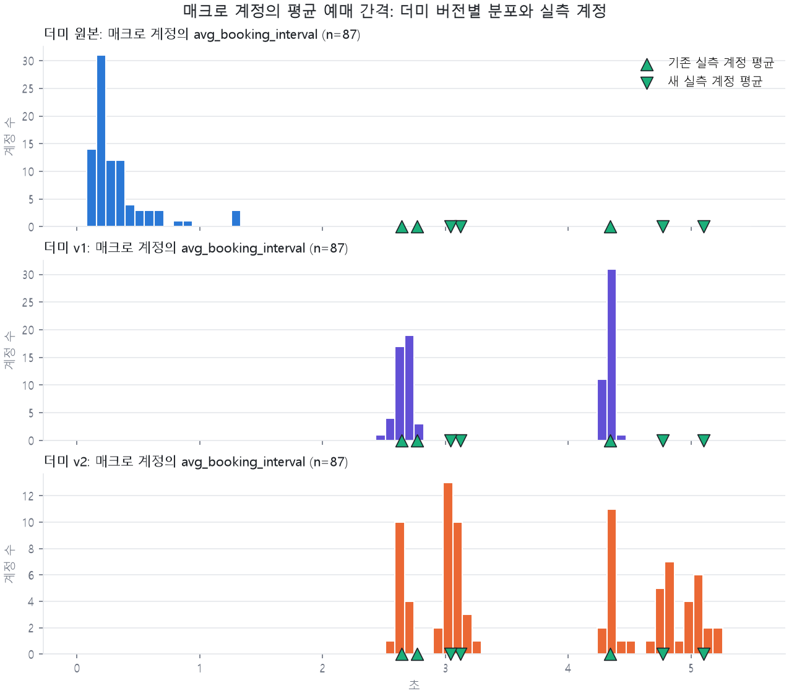
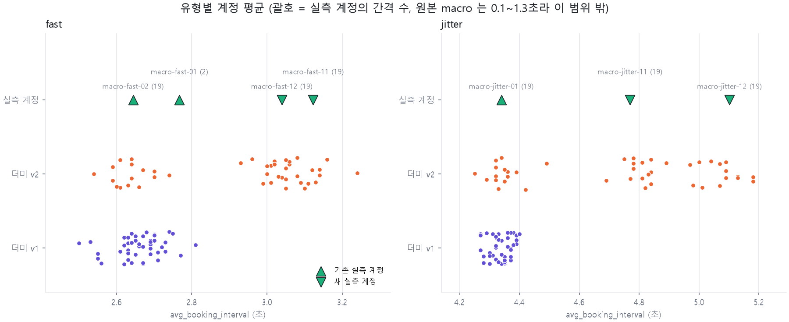
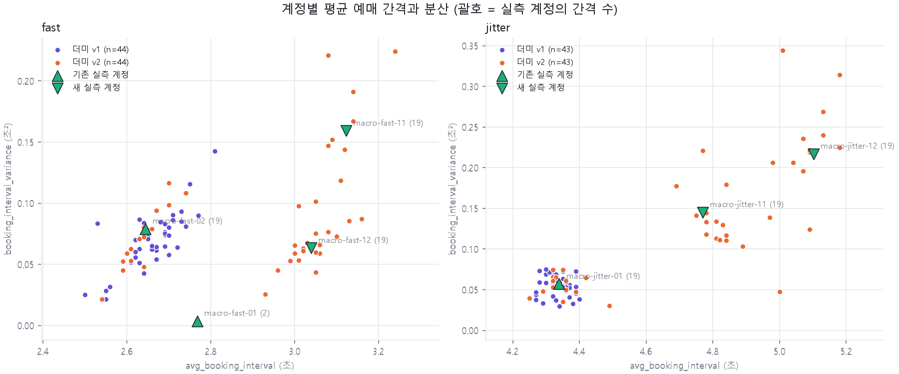

# 수정 더미데이터 v2: 두 번의 실측을 계정 단위로 반영

자동 생성 (`scripts/make_adjusted_dummy.py --method account-hierarchical`). 모델 학습·평가는 하지 않았다.

## 무엇을 바꿨나

- 원본: `ml_experiment/data/fairticket_synthetic_features.csv` (sha256 `2e1e27c1ebd4…`, 수정하지 않음)
- 수정본: `experiments/issue16-booking-interval/dummy_adjusted/v2/fairticket_synthetic_features_adjusted.csv` (sha256 `426a0967dc59…`)
- 원본의 `scenario = macro` 87행을 fast 44행, jitter 43행으로 나누고, 이 행들의 `avg_booking_interval`, `booking_interval_variance` 을 다시 계산했다. 바뀐 컬럼은 `scenario` 를 포함해 세 개뿐이고 `is_anomaly` 는 그대로 1이다.
- 실측 출처: `runs/20261122-continuous/booking_intervals.csv` (기존 실측: fast 21개, jitter 19개); `runs/20261123-remeasure/booking_intervals.csv` (새 실측: fast 38개, jitter 38개). 쓴 간격은 `real_interval_pool.csv` 에 그대로 있다.

## 생성 방법

1. **유형 배정**: seed 42 로 87행의 순서를 섞어 앞에서부터 fast 44행, jitter 43행. v1 과 같은 절차라 행별 유형이 v1 과 같다.
2. **실측 계정 배정**: 유형마다 그 유형의 더미 행을 한 번 더 섞어, 같은 유형의 실측 계정(간격 5개 이상)을 차례로 돌아가며 붙인다. 실측 계정마다 붙는 더미 행 수가 고르게 된다.
3. **간격 복원추출**: 더미 행마다 `booking_count − 1` 개를 **그 실측 계정의 간격에서만** 복원추출해 평균과 모분산을 넣는다.

실측 계정의 평균 수준과 분산이 더미 계정에 그대로 옮겨지므로, 실측 계정 사이의 차이(실행 간 차이 포함)가 더미에 남는다. 정규분포 같은 분포 모양이나 계정 간 분산의 크기를 따로 가정하지 않았다. 더미 계정의 평균은 실측 계정 평균 주변에만 생긴다.

| mode | run | account | n_intervals | avg_booking_interval | booking_interval_variance | median | std | min | max | used_for_generation | dummy_rows_assigned |
|---|---|---|---|---|---|---|---|---|---|---|---|
| fast | 기존 실측 | macro-fast-01 | 2 | 2.768 | 0.004 | 2.768 | 0.086 | 2.707 | 2.828 | False | 0 |
| fast | 기존 실측 | macro-fast-02 | 19 | 2.644 | 0.079 | 2.515 | 0.289 | 2.354 | 3.307 | True | 15 |
| jitter | 기존 실측 | macro-jitter-01 | 19 | 4.339 | 0.057 | 4.305 | 0.245 | 3.909 | 4.818 | True | 15 |
| fast | 새 실측 | macro-fast-11 | 19 | 3.123 | 0.159 | 2.972 | 0.410 | 2.768 | 4.470 | True | 15 |
| fast | 새 실측 | macro-fast-12 | 19 | 3.040 | 0.063 | 2.917 | 0.259 | 2.808 | 3.531 | True | 14 |
| jitter | 새 실측 | macro-jitter-11 | 19 | 4.770 | 0.145 | 4.857 | 0.392 | 3.939 | 5.297 | True | 14 |
| jitter | 새 실측 | macro-jitter-12 | 19 | 5.102 | 0.217 | 5.035 | 0.479 | 4.408 | 6.321 | True | 14 |

- `avg_booking_interval` 은 그 계정 간격의 평균, `booking_interval_variance` 은 모분산이다.
- 실측 계정마다 같은 비중을 줬다. 그 결과 더미 행의 실행별 비중은 기존 실측 30행, 새 실측 57행이다.
- 제외한 실측 계정: macro-fast-01 (간격 2개). 간격이 5개 미만이면 복원추출한 분산이 그 몇 개의 값으로만 정해지기 때문이다. 아래 비교에는 표시한다.
- 반올림·하한은 원본 생성 코드와 같다. 하한이 적용된 행: 평균 0개, 분산 0개. `booking_count < 2` 인 매크로 행: 0개.
- 행별 유형과 실측 계정 배정은 `macro_rows_before_after.csv` 에 있다 (데이터셋에는 컬럼을 추가하지 않았다).

## 원본과의 동일성 확인

| 항목 | 결과 |
|---|---|
| 행 수 | 1000 → 1000 |
| 컬럼 이름·순서·자료형 | 같음 |
| `scenario` 와 두 Feature 를 뺀 모든 컬럼 (전 행) | 같음 |
| 원본에서 macro 가 아니던 행 (전 컬럼) | 같음 |
| `is_anomaly` (전 행) | 같음, 이상 비율 0.199 → 0.199 |
| 다른 시나리오의 행 수 | 같음 |
| 유형별 행 수 | fast 44, jitter 43 (남은 `macro` 0) |
| 값이 바뀐 행 | 평균 87 / 분산 87 (대상 87) |

## 분포 비교





### 평균 예매 간격 (계정 평균)

| type | group | unit | n | mean | median | std | min | q05 | q25 | q75 | q95 | max |
|---|---|---|---|---|---|---|---|---|---|---|---|---|
| fast | 더미 원본 (macro 전체, 계정) | 초 | 87 | 0.320 | 0.230 | 0.247 | 0.100 | 0.120 | 0.175 | 0.355 | 0.795 | 1.310 |
| fast | 더미 v1 (fast, 계정) | 초 | 44 | 2.661 | 2.665 | 0.062 | 2.500 | 2.550 | 2.630 | 2.700 | 2.748 | 2.810 |
| fast | 더미 v2 (fast, 계정) | 초 | 44 | 2.917 | 3.015 | 0.212 | 2.540 | 2.591 | 2.667 | 3.080 | 3.140 | 3.240 |
| fast | 실측 계정 (간격 5개 이상) | 초 | 3 | 2.936 | 3.040 | 0.256 | 2.644 | 2.684 | 2.842 | 3.081 | 3.115 | 3.123 |
| jitter | 더미 원본 (macro 전체, 계정) | 초 | 87 | 0.320 | 0.230 | 0.247 | 0.100 | 0.120 | 0.175 | 0.355 | 0.795 | 1.310 |
| jitter | 더미 v1 (jitter, 계정) | 초 | 43 | 4.338 | 4.340 | 0.037 | 4.270 | 4.271 | 4.315 | 4.370 | 4.390 | 4.400 |
| jitter | 더미 v2 (jitter, 계정) | 초 | 43 | 4.732 | 4.810 | 0.311 | 4.250 | 4.320 | 4.360 | 5.005 | 5.130 | 5.180 |
| jitter | 실측 계정 (간격 5개 이상) | 초 | 3 | 4.737 | 4.770 | 0.382 | 4.339 | 4.382 | 4.554 | 4.936 | 5.069 | 5.102 |

### 예매 간격 분산 (계정 분산)

| type | group | unit | n | mean | median | std | min | q05 | q25 | q75 | q95 | max |
|---|---|---|---|---|---|---|---|---|---|---|---|---|
| fast | 더미 원본 (macro 전체, 계정) | 초² | 87 | 0.276 | 0.278 | 0.148 | 0.012 | 0.048 | 0.158 | 0.406 | 0.485 | 0.498 |
| fast | 더미 v1 (fast, 계정) | 초² | 44 | 0.071 | 0.072 | 0.022 | 0.021 | 0.029 | 0.061 | 0.083 | 0.094 | 0.142 |
| fast | 더미 v2 (fast, 계정) | 초² | 44 | 0.087 | 0.072 | 0.047 | 0.021 | 0.044 | 0.059 | 0.099 | 0.188 | 0.224 |
| fast | 실측 계정 (간격 5개 이상) | 초² | 3 | 0.101 | 0.079 | 0.051 | 0.063 | 0.065 | 0.071 | 0.119 | 0.151 | 0.159 |
| jitter | 더미 원본 (macro 전체, 계정) | 초² | 87 | 0.276 | 0.278 | 0.148 | 0.012 | 0.048 | 0.158 | 0.406 | 0.485 | 0.498 |
| jitter | 더미 v1 (jitter, 계정) | 초² | 43 | 0.054 | 0.054 | 0.012 | 0.030 | 0.033 | 0.046 | 0.062 | 0.073 | 0.075 |
| jitter | 더미 v2 (jitter, 계정) | 초² | 43 | 0.134 | 0.118 | 0.081 | 0.030 | 0.040 | 0.063 | 0.201 | 0.266 | 0.344 |
| jitter | 실측 계정 (간격 5개 이상) | 초² | 3 | 0.140 | 0.145 | 0.080 | 0.057 | 0.066 | 0.101 | 0.181 | 0.210 | 0.217 |

### 실측 개별 간격 (참고)

| type | group | unit | n | mean | median | std | min | q05 | q25 | q75 | q95 | max |
|---|---|---|---|---|---|---|---|---|---|---|---|---|
| fast | 기존 실측 (개별 간격) | 초 | 21 | 2.656 | 2.552 | 0.277 | 2.354 | 2.398 | 2.474 | 2.707 | 3.189 | 3.307 |
| fast | 새 실측 (개별 간격) | 초 | 38 | 3.081 | 2.952 | 0.341 | 2.768 | 2.799 | 2.871 | 3.327 | 3.548 | 4.470 |
| jitter | 기존 실측 (개별 간격) | 초 | 19 | 4.339 | 4.305 | 0.245 | 3.909 | 3.940 | 4.158 | 4.512 | 4.672 | 4.818 |
| jitter | 새 실측 (개별 간격) | 초 | 38 | 4.936 | 4.947 | 0.463 | 3.939 | 4.146 | 4.620 | 5.211 | 5.640 | 6.321 |

원본에는 유형이 없어 macro 87행 전체를 각 유형 옆에 적었다. 실측 계정 통계는 계정이 3개씩이라 분위수는 참고용이다.



## 실측 계정이 더미 범위에 포함되는 비율

| type | dummy | real_accounts | n_real_accounts | mean_within_min_max | mean_within_q05_q95 | variance_within_min_max | variance_within_q05_q95 | dummy_mean_min | dummy_mean_max | dummy_variance_min | dummy_variance_max |
|---|---|---|---|---|---|---|---|---|---|---|---|
| fast | 원본 | 전체 | 4 | 0 | 0 | 3 | 3 | 0.100 | 1.310 | 0.012 | 0.498 |
| fast | 원본 | 간격 5개 이상 | 3 | 0 | 0 | 3 | 3 | 0.100 | 1.310 | 0.012 | 0.498 |
| fast | v1 | 전체 | 4 | 2 | 1 | 2 | 2 | 2.500 | 2.810 | 0.021 | 0.142 |
| fast | v1 | 간격 5개 이상 | 3 | 1 | 1 | 2 | 2 | 2.500 | 2.810 | 0.021 | 0.142 |
| fast | v2 | 전체 | 4 | 4 | 4 | 3 | 3 | 2.540 | 3.240 | 0.021 | 0.224 |
| fast | v2 | 간격 5개 이상 | 3 | 3 | 3 | 3 | 3 | 2.540 | 3.240 | 0.021 | 0.224 |
| jitter | 원본 | 전체 | 3 | 0 | 0 | 3 | 3 | 0.100 | 1.310 | 0.012 | 0.498 |
| jitter | 원본 | 간격 5개 이상 | 3 | 0 | 0 | 3 | 3 | 0.100 | 1.310 | 0.012 | 0.498 |
| jitter | v1 | 전체 | 3 | 1 | 1 | 1 | 1 | 4.270 | 4.400 | 0.030 | 0.075 |
| jitter | v1 | 간격 5개 이상 | 3 | 1 | 1 | 1 | 1 | 4.270 | 4.400 | 0.030 | 0.075 |
| jitter | v2 | 전체 | 3 | 3 | 3 | 3 | 3 | 4.250 | 5.180 | 0.030 | 0.344 |
| jitter | v2 | 간격 5개 이상 | 3 | 3 | 3 | 3 | 3 | 4.250 | 5.180 | 0.030 | 0.344 |

- 값은 계정 수다. 간격 5개 이상인 실측 계정 기준으로 더미 범위(최소~최대) 안에 드는 계정: 원본 — 평균 0/6, 분산 6/6; v1 — 평균 2/6, 분산 3/6; v2 — 평균 6/6, 분산 6/6.
- **v2 의 포함 비율은 만든 방법에서 나오는 결과다.** 더미가 바로 그 실측 계정들에서 만들어졌으므로 포함되는 것이 당연하고, 새로운 계정에도 맞는다는 근거가 아니다. 그 점은 아래 검증으로 따로 본다.

### 실측 계정 하나를 빼고 만들면

실측 계정 하나를 숨기고 나머지로 같은 방법·같은 seed 로 더미를 만든 뒤, 숨긴 계정이 그 더미 범위 안에 드는지 본 것이다 (파일로 저장하지 않음).

| type | held_out_run | held_out_account | held_out_mean | dummy_mean_min | dummy_mean_max | mean_within | mean_gap_to_range | held_out_variance | dummy_variance_min | dummy_variance_max | variance_within |
|---|---|---|---|---|---|---|---|---|---|---|---|
| fast | 기존 실측 | macro-fast-02 | 2.644 | 2.950 | 3.350 | False | 0.306 | 0.079 | 0.014 | 0.292 | True |
| jitter | 기존 실측 | macro-jitter-01 | 4.339 | 4.680 | 5.320 | False | 0.341 | 0.057 | 0.078 | 0.348 | False |
| fast | 새 실측 | macro-fast-11 | 3.123 | 2.590 | 3.160 | True | 0.000 | 0.159 | 0.041 | 0.117 | False |
| fast | 새 실측 | macro-fast-12 | 3.040 | 2.590 | 3.250 | True | 0.000 | 0.063 | 0.025 | 0.343 | True |
| jitter | 새 실측 | macro-jitter-11 | 4.770 | 4.250 | 5.320 | True | 0.000 | 0.145 | 0.023 | 0.348 | True |
| jitter | 새 실측 | macro-jitter-12 | 5.102 | 4.250 | 5.000 | False | 0.102 | 0.217 | 0.023 | 0.220 | True |

숨긴 계정 6개 중 평균이 범위 안에 든 계정은 3개, 분산이 범위 안에 든 계정은 4개다. 이 방법은 본 적 있는 계정 수준 주변만 만들기 때문에, 본 적 없는 수준의 계정은 범위 밖에 놓일 수 있다. `mean_gap_to_range` 는 범위에서 벗어난 거리(초)다.

## 계정 간 변동성

| type | group | n | account_mean_avg | account_mean_std | account_mean_min | account_mean_max | account_mean_range_width | account_variance_median | account_variance_min | account_variance_max |
|---|---|---|---|---|---|---|---|---|---|---|
| fast | 실측 계정 (간격 5개 이상) | 3 | 2.936 | 0.256 | 2.644 | 3.123 | 0.479 | 0.079 | 0.063 | 0.159 |
| fast | 더미 원본 | 87 | 0.320 | 0.247 | 0.100 | 1.310 | 1.210 | 0.278 | 0.012 | 0.498 |
| fast | 더미 v1 | 44 | 2.661 | 0.062 | 2.500 | 2.810 | 0.310 | 0.072 | 0.021 | 0.142 |
| fast | 더미 v2 | 44 | 2.917 | 0.212 | 2.540 | 3.240 | 0.700 | 0.072 | 0.021 | 0.224 |
| jitter | 실측 계정 (간격 5개 이상) | 3 | 4.737 | 0.382 | 4.339 | 5.102 | 0.763 | 0.145 | 0.057 | 0.217 |
| jitter | 더미 원본 | 87 | 0.320 | 0.247 | 0.100 | 1.310 | 1.210 | 0.278 | 0.012 | 0.498 |
| jitter | 더미 v1 | 43 | 4.338 | 0.037 | 4.270 | 4.400 | 0.130 | 0.054 | 0.030 | 0.075 |
| jitter | 더미 v2 | 43 | 4.732 | 0.311 | 4.250 | 5.180 | 0.930 | 0.118 | 0.030 | 0.344 |

- fast: 계정 평균의 표준편차는 실측 계정 0.256초, v1 0.062초, v2 0.212초. 범위 폭은 실측 0.479초, v1 0.310초, v2 0.700초.
- jitter: 계정 평균의 표준편차는 실측 계정 0.382초, v1 0.037초, v2 0.311초. 범위 폭은 실측 0.763초, v1 0.130초, v2 0.930초.

v1 에서 부족했던 계정 간 변동성은 v2 에서 실측 계정 사이의 차이만큼 늘었다. 다만 그 변동은 연속적으로 퍼진 것이 아니라 실측 계정 수만큼의 덩어리로 나타난다 (그래프 참고). 덩어리 사이의 빈 구간에 실제 계정이 없다는 뜻이 아니라, 그 구간을 채울 관측이 없다는 뜻이다.

## 다른 시나리오와의 위치

| scenario | is_anomaly | n | min | median | max | share_within_fast_range | share_within_jitter_range |
|---|---|---|---|---|---|---|---|
| hold_cancel | 1 | 56 | 2.180 | 5.050 | 7.960 | 0.143 | 0.196 |
| multi_account | 1 | 56 | 3.040 | 6.800 | 9.960 | 0.054 | 0.089 |
| fast_normal | 0 | 122 | 15.140 | 28.030 | 39.980 | 0.000 | 0.000 |
| shared_ip | 0 | 110 | 12.840 | 46.075 | 153.260 | 0.000 | 0.000 |
| frequent_cancel | 0 | 42 | 19.720 | 58.435 | 167.740 | 0.000 | 0.000 |
| normal | 0 | 527 | 10.600 | 61.750 | 218.260 | 0.000 | 0.000 |

`share_within_<유형>_range`: 그 시나리오의 계정 중 `avg_booking_interval` 이 v2 해당 유형의 범위(fast 2.54~3.24초, jitter 4.25~5.18초) 안에 드는 비율. 모델 성능에 어떤 영향을 주는지는 확인하지 않았다.

## 한계

- 실측 계정이 유형당 fast 3개, jitter 3개뿐이다. 계정 간 분포의 모양(연속적인지, 얼마나 넓은지)은 이 수로는 알 수 없고, 더미는 관측된 계정 수준만 재현한다.
- 두 실측은 같은 PC 에서 하루 간격으로 한 번씩 수집했다. 실행 간 차이(약 0.4~0.6초)가 사이트 변경 때문인지 실행 조건 때문인지 분리되지 않은 채 섞여 들어갔다.
- 실측 계정마다 같은 비중을 준 것은 선택이다. 최신 사이트만 반영하거나 실행마다 같은 비중을 주면 결과가 달라진다.
- 유형별 행 수(fast 44행, jitter 43행)는 정해 준 값이고, 사람처럼 느린 매크로(Human-like)는 넣지 않았다.
- 매크로 행의 나머지 Feature 와 다른 시나리오의 값은 원본 그대로다.

## 다시 만들기

```powershell
& $py scripts\make_adjusted_dummy.py --version v2 --method account-hierarchical --run-id 20261122-continuous --run-id 20261123-remeasure --compare-version v1 --force
& $py scripts\make_adjusted_dummy.py --version v1 --force      # v1 (typed-split) 은 기존 명령 그대로 재현된다
```
