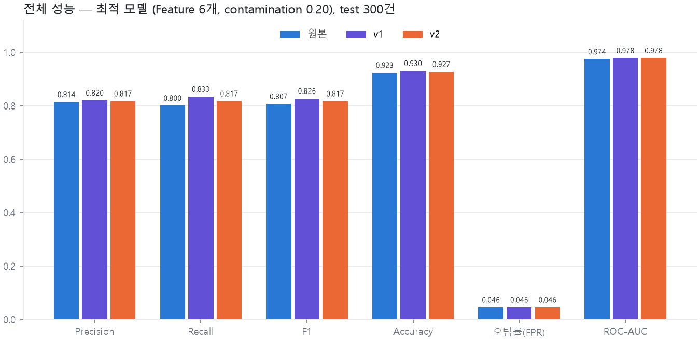
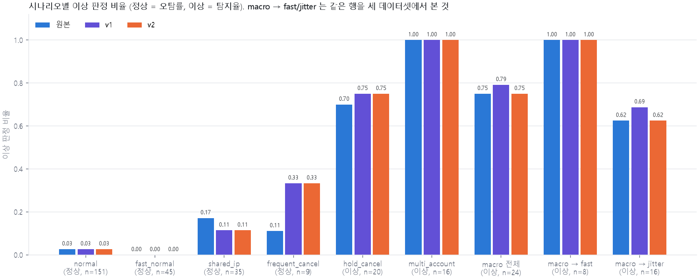
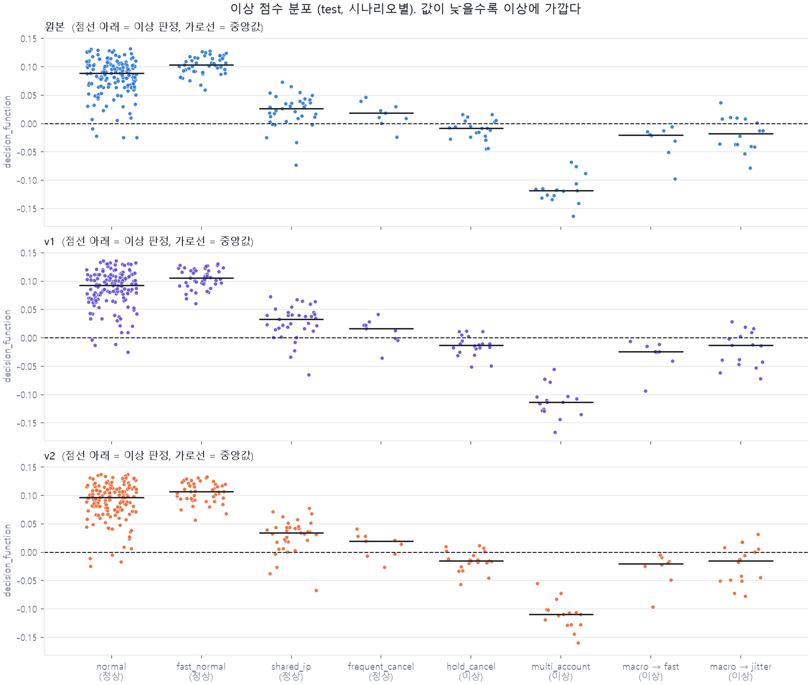
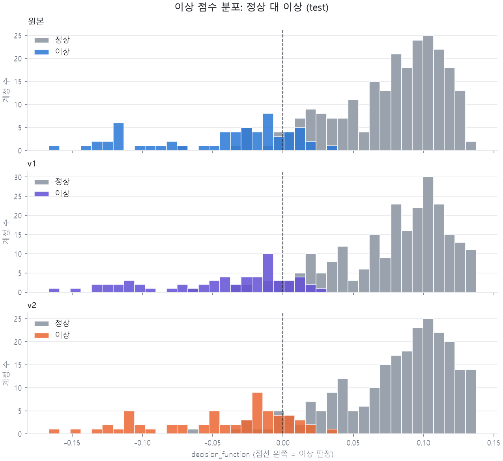
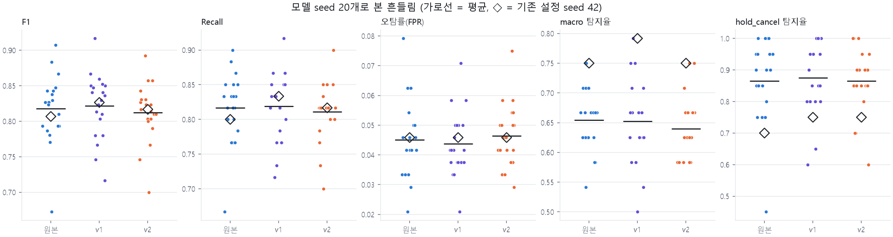

# Isolation Forest 비교: 원본 · v1 · v2

자동 생성 (`scripts/compare_if_models.py`). 합성 데이터 안에서의 비교이며, 실제 환경의 탐지 성능을 뜻하지 않는다.

## 실험 조건 (`ml_experiment/train_and_evaluate_if.py` 와 같음)

| 항목 | 값 |
|---|---|
| Feature | 기준 구성은 6개: avg_booking_interval, booking_interval_variance, cancel_rate, card_reuse_count, ip_booking_density, booking_count (`seat_selection_latency` 제외) |
| 전처리 | 없음. 스케일링·변환 없이 원래 값 그대로 |
| 분할 | `train_test_split(test_size=0.3, random_state=42, stratify=is_anomaly)` → train 700 / test 300 (test 이상 비율 20.0%) |
| 모델 | `IsolationForest(n_estimators=100, random_state=42, contamination=0.2)`, 나머지 기본값 |
| 학습 | train 전체로 학습 (이상 계정 포함, 레이블은 쓰지 않음) |
| 예측 | `predict == -1` → 이상(1) |
| 점수 | `decision_function` (0 미만이면 이상 판정). ROC-AUC 는 test 안에서 0~1 로 정규화한 점수로 계산 |
| 버전 | scikit-learn 1.9.1, numpy 2.4.6, pandas 3.1.1 |

세 데이터셋에 같은 행 번호(`split_indices.csv`)를 썼다. 모델 파일은 저장하지 않았다.

### 데이터셋

| 데이터셋 | 경로 | sha256 |
|---|---|---|
| 원본 | `ml_experiment/data/fairticket_synthetic_features.csv` | `2e1e27c1ebd43467…` |
| v1 | `experiments/issue16-booking-interval/dummy_adjusted/v1/fairticket_synthetic_features_adjusted.csv` | `b371a8ccae738f4a…` |
| v2 | `experiments/issue16-booking-interval/dummy_adjusted/v2/fairticket_synthetic_features_adjusted.csv` | `426a0967dc59c0fc…` |

| dataset | rows | user_id_order_identical | is_anomaly_identical | columns_identical | rows_differing_in_model_features | features_differing |
|---|---|---|---|---|---|---|
| 원본 | 1000 | True | True | True | 0 | - |
| v1 | 1000 | True | True | True | 87 | avg_booking_interval, booking_interval_variance |
| v2 | 1000 | True | True | True | 87 | avg_booking_interval, booking_interval_variance |

## 전체 성능 (기준 구성, test)



| dataset | precision | recall | f1 | accuracy | fpr | roc_auc | TP | FP | TN | FN | flagged |
|---|---|---|---|---|---|---|---|---|---|---|---|
| 원본 | 0.814 | 0.800 | 0.807 | 0.923 | 0.046 | 0.974 | 48 | 11 | 229 | 12 | 59 |
| v1 | 0.820 | 0.833 | 0.826 | 0.930 | 0.046 | 0.978 | 50 | 11 | 229 | 10 | 61 |
| v2 | 0.817 | 0.817 | 0.817 | 0.927 | 0.046 | 0.978 | 49 | 11 | 229 | 11 | 60 |

- v1: F1 0.807 → 0.826 (+0.020), Recall 0.800 → 0.833 (TP 48 → 50), Precision 0.814 → 0.820, 오탐률 0.046 → 0.046 (FP 11 → 11), Accuracy 0.923 → 0.930.
- v2: F1 0.807 → 0.817 (+0.010), Recall 0.800 → 0.817 (TP 48 → 49), Precision 0.814 → 0.817, 오탐률 0.046 → 0.046 (FP 11 → 11), Accuracy 0.923 → 0.927.

## 시나리오별 이상 판정 (기준 구성, test)



| group | actual | n_test | 원본 | v1 | v2 |
|---|---|---|---|---|---|
| normal | 정상 | 151 | 4 (2.6%) | 4 (2.6%) | 4 (2.6%) |
| fast_normal | 정상 | 45 | 0 (0.0%) | 0 (0.0%) | 0 (0.0%) |
| shared_ip | 정상 | 35 | 6 (17.1%) | 4 (11.4%) | 4 (11.4%) |
| frequent_cancel | 정상 | 9 | 1 (11.1%) | 3 (33.3%) | 3 (33.3%) |
| hold_cancel | 이상 | 20 | 14 (70.0%) | 15 (75.0%) | 15 (75.0%) |
| multi_account | 이상 | 16 | 16 (100.0%) | 16 (100.0%) | 16 (100.0%) |
| macro 전체 | 이상 | 24 | 18 (75.0%) | 19 (79.2%) | 18 (75.0%) |
| macro → fast | 이상 | 8 | 8 (100.0%) | 8 (100.0%) | 8 (100.0%) |
| macro → jitter | 이상 | 16 | 10 (62.5%) | 11 (68.8%) | 10 (62.5%) |

- 값은 `이상 판정 수 (비율)`. 정상 시나리오에서는 오탐률, 이상 시나리오에서는 탐지율이다.
- `macro → fast`, `macro → jitter` 는 보정본에서 fast / jitter 가 된 **같은 행**이다. 원본 열은 그 행들이 원본 값(0.1~1.3초)일 때의 결과다.

### 원본 대비 판정이 바뀐 test 행

| dataset | group | actual | n_test | flagged_to_not | not_to_flagged |
|---|---|---|---|---|---|
| v1 | normal | 정상 | 151 | 0 | 0 |
| v1 | fast_normal | 정상 | 45 | 0 | 0 |
| v1 | shared_ip | 정상 | 35 | 2 | 0 |
| v1 | frequent_cancel | 정상 | 9 | 0 | 2 |
| v1 | hold_cancel | 이상 | 20 | 0 | 1 |
| v1 | multi_account | 이상 | 16 | 0 | 0 |
| v1 | macro → fast | 이상 | 8 | 0 | 0 |
| v1 | macro → jitter | 이상 | 16 | 0 | 1 |
| v2 | normal | 정상 | 151 | 0 | 0 |
| v2 | fast_normal | 정상 | 45 | 0 | 0 |
| v2 | shared_ip | 정상 | 35 | 2 | 0 |
| v2 | frequent_cancel | 정상 | 9 | 0 | 2 |
| v2 | hold_cancel | 이상 | 20 | 0 | 1 |
| v2 | multi_account | 이상 | 16 | 0 | 0 |
| v2 | macro → fast | 이상 | 8 | 0 | 0 |
| v2 | macro → jitter | 이상 | 16 | 0 | 0 |

## 이상 점수 분포





| dataset | group | n_test | mean | median | std | min | q25 | q75 | max | share_below_0 |
|---|---|---|---|---|---|---|---|---|---|---|
| 원본 | 정상 전체 | 240 | 0.076 | 0.086 | 0.039 | -0.073 | 0.051 | 0.104 | 0.132 | 0.046 |
| 원본 | 이상 전체 | 60 | -0.044 | -0.025 | 0.051 | -0.163 | -0.081 | -0.007 | 0.037 | 0.800 |
| v1 | 정상 전체 | 240 | 0.079 | 0.089 | 0.040 | -0.065 | 0.056 | 0.108 | 0.136 | 0.046 |
| v1 | 이상 전체 | 60 | -0.044 | -0.025 | 0.049 | -0.167 | -0.074 | -0.011 | 0.029 | 0.833 |
| v2 | 정상 전체 | 240 | 0.081 | 0.091 | 0.040 | -0.067 | 0.060 | 0.111 | 0.137 | 0.046 |
| v2 | 이상 전체 | 60 | -0.044 | -0.025 | 0.048 | -0.159 | -0.078 | -0.011 | 0.032 | 0.817 |

| group | dataset | n_test | flagged | flag_rate | decision_median | decision_min | decision_max |
|---|---|---|---|---|---|---|---|
| hold_cancel | 원본 | 20 | 14 | 0.700 | -0.008 | -0.044 | 0.016 |
| multi_account | 원본 | 16 | 16 | 1.000 | -0.118 | -0.163 | -0.068 |
| macro 전체 | 원본 | 24 | 18 | 0.750 | -0.020 | -0.097 | 0.037 |
| macro → fast | 원본 | 8 | 8 | 1.000 | -0.020 | -0.097 | -0.005 |
| macro → jitter | 원본 | 16 | 10 | 0.625 | -0.017 | -0.079 | 0.037 |
| hold_cancel | v1 | 20 | 15 | 0.750 | -0.013 | -0.051 | 0.012 |
| multi_account | v1 | 16 | 16 | 1.000 | -0.114 | -0.167 | -0.055 |
| macro 전체 | v1 | 24 | 19 | 0.792 | -0.019 | -0.093 | 0.029 |
| macro → fast | v1 | 8 | 8 | 1.000 | -0.024 | -0.093 | -0.006 |
| macro → jitter | v1 | 16 | 11 | 0.688 | -0.013 | -0.072 | 0.029 |
| hold_cancel | v2 | 20 | 15 | 0.750 | -0.015 | -0.057 | 0.012 |
| multi_account | v2 | 16 | 16 | 1.000 | -0.109 | -0.159 | -0.055 |
| macro 전체 | v2 | 24 | 18 | 0.750 | -0.018 | -0.097 | 0.032 |
| macro → fast | v2 | 8 | 8 | 1.000 | -0.021 | -0.097 | -0.005 |
| macro → jitter | v2 | 16 | 10 | 0.625 | -0.015 | -0.077 | 0.032 |

## 기존 스크립트의 다른 구성

| config | dataset | precision | recall | f1 | accuracy | fpr | roc_auc | TP | FP | TN | FN |
|---|---|---|---|---|---|---|---|---|---|---|---|
| 실험1: Feature 7개, contamination 0.05 | 원본 | 1.000 | 0.217 | 0.356 | 0.843 | 0.000 | 0.911 | 13 | 0 | 240 | 47 |
| 실험1: Feature 7개, contamination 0.05 | v1 | 1.000 | 0.217 | 0.356 | 0.843 | 0.000 | 0.916 | 13 | 0 | 240 | 47 |
| 실험1: Feature 7개, contamination 0.05 | v2 | 1.000 | 0.217 | 0.356 | 0.843 | 0.000 | 0.914 | 13 | 0 | 240 | 47 |
| 실험1: Feature 7개, contamination 0.10 | 원본 | 0.818 | 0.300 | 0.439 | 0.847 | 0.017 | 0.911 | 18 | 4 | 236 | 42 |
| 실험1: Feature 7개, contamination 0.10 | v1 | 0.864 | 0.317 | 0.463 | 0.853 | 0.013 | 0.916 | 19 | 3 | 237 | 41 |
| 실험1: Feature 7개, contamination 0.10 | v2 | 0.864 | 0.317 | 0.463 | 0.853 | 0.013 | 0.914 | 19 | 3 | 237 | 41 |
| 실험1·2: Feature 7개, contamination 0.20 | 원본 | 0.597 | 0.617 | 0.607 | 0.840 | 0.104 | 0.911 | 37 | 25 | 215 | 23 |
| 실험1·2: Feature 7개, contamination 0.20 | v1 | 0.632 | 0.600 | 0.615 | 0.850 | 0.087 | 0.916 | 36 | 21 | 219 | 24 |
| 실험1·2: Feature 7개, contamination 0.20 | v2 | 0.617 | 0.617 | 0.617 | 0.847 | 0.096 | 0.914 | 37 | 23 | 217 | 23 |
| 실험2: 시간/분산 제외, contamination 0.20 | 원본 | 0.791 | 0.883 | 0.835 | 0.930 | 0.058 | 0.971 | 53 | 14 | 226 | 7 |
| 실험2: 시간/분산 제외, contamination 0.20 | v1 | 0.791 | 0.883 | 0.835 | 0.930 | 0.058 | 0.971 | 53 | 14 | 226 | 7 |
| 실험2: 시간/분산 제외, contamination 0.20 | v2 | 0.791 | 0.883 | 0.835 | 0.930 | 0.058 | 0.971 | 53 | 14 | 226 | 7 |
| 실험2: 메타 식별자 제외, contamination 0.20 | 원본 | 0.534 | 0.517 | 0.525 | 0.813 | 0.113 | 0.895 | 31 | 27 | 213 | 29 |
| 실험2: 메타 식별자 제외, contamination 0.20 | v1 | 0.537 | 0.483 | 0.509 | 0.813 | 0.104 | 0.877 | 29 | 25 | 215 | 31 |
| 실험2: 메타 식별자 제외, contamination 0.20 | v2 | 0.545 | 0.500 | 0.522 | 0.817 | 0.104 | 0.887 | 30 | 25 | 215 | 30 |

`시간/분산 제외` 구성은 바뀐 두 Feature 를 쓰지 않으므로 세 데이터셋의 결과가 같아야 한다 (같으면 비교 절차가 올바르다는 확인이 된다).

## 보조: 모델 seed 에 따른 흔들림



기존 설정은 seed 42 하나다. 차이가 seed 우연인지 보려고 모델 seed 만 0~19 로 바꿔 다시 학습했다 (분할과 나머지 설정은 그대로).

| dataset | metric | mean | std | min | max |
|---|---|---|---|---|---|
| 원본 | f1 | 0.818 | 0.049 | 0.672 | 0.908 |
| 원본 | recall | 0.817 | 0.051 | 0.667 | 0.900 |
| 원본 | fpr | 0.045 | 0.013 | 0.021 | 0.079 |
| 원본 | recall_macro 전체 | 0.654 | 0.054 | 0.542 | 0.750 |
| 원본 | recall_macro → fast | 0.756 | 0.149 | 0.375 | 1.000 |
| 원본 | recall_macro → jitter | 0.603 | 0.031 | 0.562 | 0.625 |
| 원본 | recall_hold_cancel | 0.865 | 0.133 | 0.450 | 1.000 |
| 원본 | recall_multi_account | 1.000 | 0.000 | 1.000 | 1.000 |
| v1 | f1 | 0.821 | 0.046 | 0.717 | 0.917 |
| v1 | recall | 0.819 | 0.051 | 0.717 | 0.917 |
| v1 | fpr | 0.044 | 0.011 | 0.021 | 0.071 |
| v1 | recall_macro 전체 | 0.652 | 0.071 | 0.500 | 0.792 |
| v1 | recall_macro → fast | 0.744 | 0.174 | 0.375 | 1.000 |
| v1 | recall_macro → jitter | 0.606 | 0.046 | 0.500 | 0.688 |
| v1 | recall_hold_cancel | 0.875 | 0.114 | 0.600 | 1.000 |
| v1 | recall_multi_account | 1.000 | 0.000 | 1.000 | 1.000 |
| v2 | f1 | 0.812 | 0.041 | 0.700 | 0.893 |
| v2 | recall | 0.811 | 0.043 | 0.700 | 0.900 |
| v2 | fpr | 0.046 | 0.011 | 0.029 | 0.075 |
| v2 | recall_macro 전체 | 0.640 | 0.053 | 0.583 | 0.750 |
| v2 | recall_macro → fast | 0.725 | 0.126 | 0.500 | 1.000 |
| v2 | recall_macro → jitter | 0.597 | 0.043 | 0.500 | 0.625 |
| v2 | recall_hold_cancel | 0.865 | 0.104 | 0.600 | 1.000 |
| v2 | recall_multi_account | 1.000 | 0.000 | 1.000 | 1.000 |

## 해석에 쓴 값: train 의 이상 시나리오 중앙값

| dataset | group | n_train | avg_booking_interval_median | booking_interval_variance_median |
|---|---|---|---|---|
| v1 | hold_cancel | 36 | 4.790 | 1.243 |
| v2 | hold_cancel | 36 | 4.790 | 1.243 |
| 원본 | hold_cancel | 36 | 4.790 | 1.243 |
| v1 | macro → fast | 36 | 2.655 | 0.072 |
| v2 | macro → fast | 36 | 3.010 | 0.074 |
| 원본 | macro → fast | 36 | 0.260 | 0.225 |
| v1 | macro → jitter | 27 | 4.350 | 0.056 |
| v2 | macro → jitter | 27 | 4.820 | 0.124 |
| 원본 | macro → jitter | 27 | 0.230 | 0.293 |
| v1 | multi_account | 40 | 6.320 | 2.205 |
| v2 | multi_account | 40 | 6.320 | 2.205 |
| 원본 | multi_account | 40 | 6.320 | 2.205 |

## 분석

### 성능 변화의 크기

- v1: 기존 설정(seed 42)에서 F1 차이는 +0.020, TP 차이는 +2건, FP 차이는 +0건이다. 모델 seed 20개의 평균 F1 은 원본 0.818 대 v1 0.821 이다.
- v2: 기존 설정(seed 42)에서 F1 차이는 +0.010, TP 차이는 +1건, FP 차이는 +0건이다. 모델 seed 20개의 평균 F1 은 원본 0.818 대 v2 0.812 이다.
- 같은 데이터셋에서 모델 seed 만 바꿔도 F1 이 표준편차 0.049 만큼 움직인다 (원본 기준). 데이터셋 사이의 차이는 이보다 작으므로, **이 실험으로는 보정이 성능을 높였다고도 낮췄다고도 말할 수 없다.**
- test 는 300건이고 이상은 60건이다. 1건이 바뀌면 Recall 이 0.017 움직인다.

### 가능한 해석 (이 실험에서 확인한 것과 추정을 구분)

- **확인**: 두 Feature 를 아예 빼도 F1 이 0.835 이다 (`시간/분산 제외` 구성). 이 모델에서 매크로를 포함한 이상 계정의 판정은 예매 간격보다 다른 Feature(취소율, 카드·IP 수, 예매 횟수)에 더 기대고 있다.
- **확인**: 전처리가 없어서 Feature 는 원래 단위 그대로 쓰인다. train 에서 `avg_booking_interval` 은 0.1~218초, `booking_interval_variance` 는 0.01~50초² 에 걸쳐 있다. 매크로의 값이 0.1~1.3초에서 2.5~5.2초로 옮겨져도 이 범위의 아래쪽 끝에 그대로 있다.
- **추정**: Isolation Forest 는 Feature 범위 안에서 무작위로 나누는 위치를 고르므로, 범위의 아래쪽 끝에서 몇 초 옮겨진 것은 나뉘는 깊이를 거의 바꾸지 않는다. 그래서 매크로 행의 판정이 거의 그대로였을 것이다.
- **추정**: 보정 뒤 매크로는 `hold_cancel`·`multi_account` 와 같은 2~10초 구간에 놓인다. 이 구간의 계정이 늘어 서로를 덜 고립시킬 수 있지만, 이번 결과에서는 그 영향이 seed 흔들림보다 크게 나타나지 않았다.
- **확인**: 정상 사용자의 오탐 총수는 세 데이터셋에서 같고, 시나리오 안에서 1~2건씩 자리가 바뀌었다. contamination 이 고정이라 train 점수의 하위 20% 를 이상으로 자르는데, 매크로 행의 점수가 조금 달라지면 경계 근처의 다른 행이 넘어오거나 빠진다.
- `macro → fast` 와 `macro → jitter` 의 탐지율이 원본에서도 다른 것은, 원본에서는 두 묶음이 같은 분포에서 나온 행이므로 행 수가 적어서(test 8건, 16건) 생긴 차이다.

### 이 결과가 말해 주지 않는 것

- 평가 데이터도 같은 합성 데이터다. 매크로의 예매 간격만 실측에 맞췄고, 나머지 Feature 와 정상 사용자·다른 이상 시나리오는 임의로 만든 값 그대로다.
- 따라서 여기의 수치는 실제 서비스에서의 탐지율·오탐률이 아니다. 실제 매크로 계정의 취소율·예매 횟수 등이 더미와 다르면 결과는 달라진다.

## 재현

```powershell
cd ai\experiments\issue16-booking-interval
$py = "..\issue14-real-validation\.venv\Scripts\python"
& $py scripts\compare_if_models.py --name if-original-v1-v2 --versions v1 v2 --force
```
