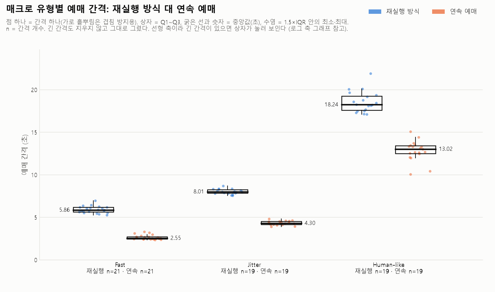
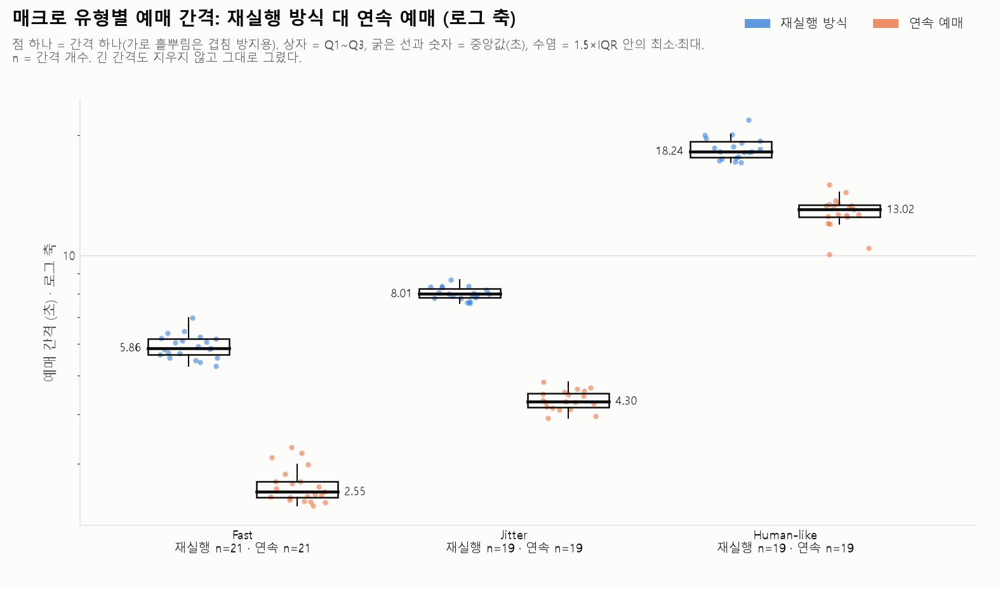
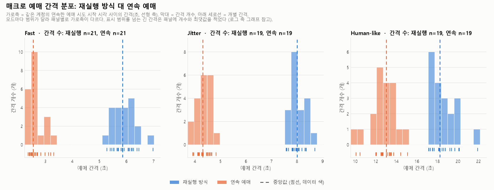
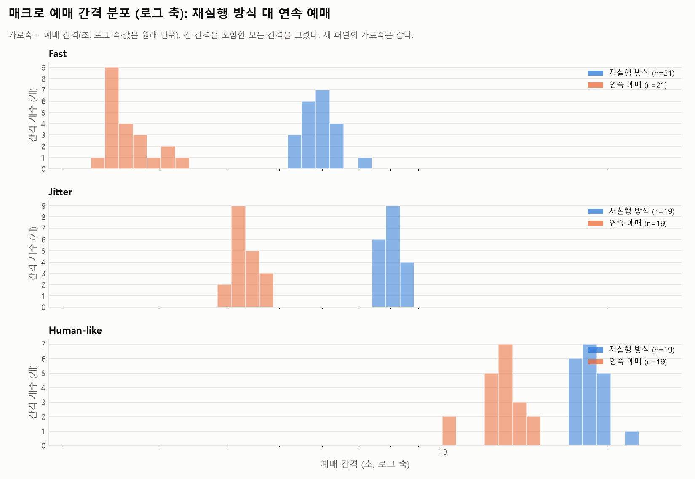
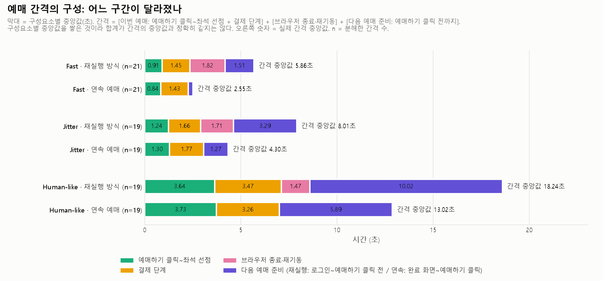
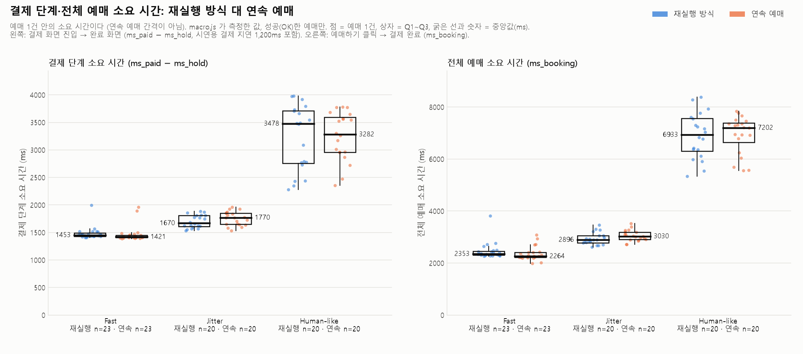
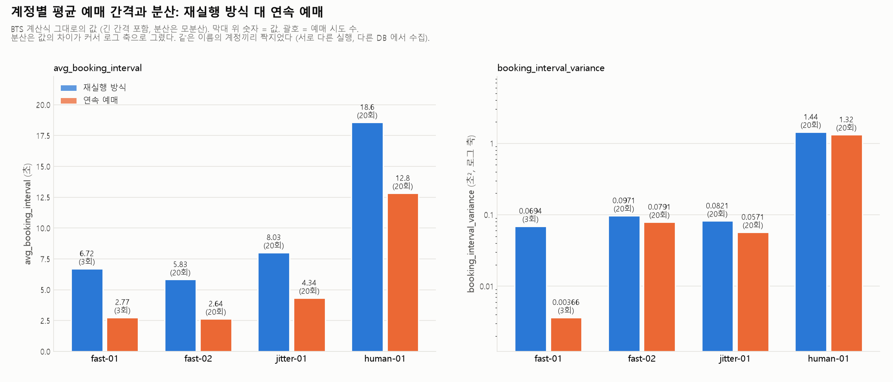
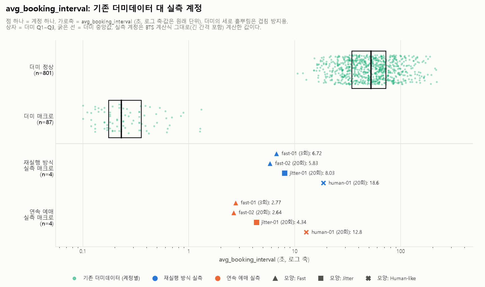
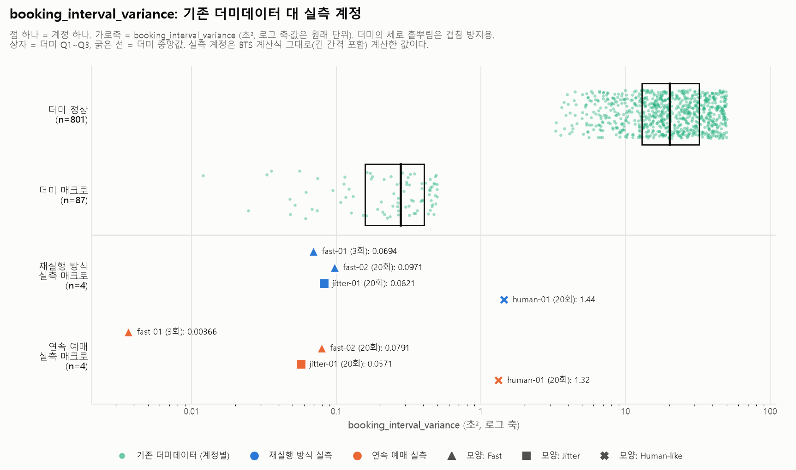

# 이슈 #16 연속 예매(브라우저 재사용) 측정 보고서 — 실행 `20261122-continuous`

비교 기준: `runs/20261122-main` (재실행 방식). 생성 스크립트 `scripts/analyze.py --baseline-run 20261122-main` (자동 생성 문서. 직접 고치지 말고 `notes.md` 에 메모를 적은 뒤 다시 생성한다)

## 0. 요약: 재실행 방식 대 연속 예매

예매 간격 = 같은 계정의 연속한 예매 시도 시작 시각 사이의 간격 (BTS `avg_booking_interval` 의 재료, 두 방식 모두 같은 계산식). 개별 간격 기준.

| 모드 | 평균 (초) 재실행 → 연속 | 평균 변화 | 중앙값 (초) | 중앙값 변화 | 표준편차 (초) | 간격 수 |
|---|---|---|---|---|---|---|
| Fast | 5.92 → 2.66 | -3.26 (-55.1%) | 5.86 → 2.55 | -3.31 (-56.4%) | 0.41 → 0.28 | 21 / 21 |
| Jitter | 8.03 → 4.34 | -3.69 (-45.9%) | 8.01 → 4.30 | -3.70 (-46.2%) | 0.29 → 0.25 | 19 / 19 |
| Human-like | 18.58 → 12.83 | -5.75 (-30.9%) | 18.24 → 13.02 | -5.22 (-28.6%) | 1.23 → 1.18 | 19 / 19 |

- 연속 예매 계정의 `avg_booking_interval` 은 2.64~12.83초다. 기존 더미 매크로는 0.10~1.31초(중앙값 0.23초)로, 4계정 중 4계정이 더미 매크로의 최댓값보다 크다.
- 줄어든 시간의 출처는 4장의 구간별 표에 있다. 두 실행은 같은 PC·같은 날·같은 코드(매크로만 수정)에서 수집했지만 각각 1회 수집이다.

## 1. 실험 환경과 두 방식의 차이

| 레포 | 커밋 | 브랜치 | 커밋되지 않은 변경 | 기준 실행(20261122-main)의 커밋 |
|---|---|---|---|---|
| ai | `c9637c5` | test/#14/real-data-validation | ?? experiments/issue16-booking-interval/ | `c9637c5` |
| demo-ticketing | `9dd0146` | feat/#56/saved-card-selection | M macro/README.md;  M macro/macro.js; ?? macro/package-lock.json | `9dd0146` |
| ticket-fds-admin | `dc8e8ad` | fix/#57/admin-summary-api-path | 없음 | `dc8e8ad` |

- BTS: 체크아웃의 파일 내용이 `origin/dev`(`b4d3d4e`)와 같다.
- 프론트 `.env`: `VITE_USE_MOCK_TICKETING=false`, `VITE_USE_MOCK_BTS=false`, `VITE_API_BASE_URL=`, `VITE_MOCK_QR=false`, `VITE_USE_MOCK_QUEUE=true`, `VITE_MOCK_QUEUE_START=`, `VITE_USE_MOCK_CARDS=true` (mock 티켓팅·BTS 비활성).
- 스택: `demo-ticketing/e2e` 의 일회성 DB(tmpfs, `cdbts-e2e-bts-mysql`) + BTS + Demo. 기존 개발 DB 는 쓰지 않았다. 수집 시작 전 이 DB 의 이벤트 수: 42건 (점검용 다른 계정의 이벤트. 이번 계정의 간격에는 섞이지 않는다).
- `macro.js` sha256: 기준 실행 `9bd5f82a9470…`, 이번 실행 `895961c28023…` (다름: 연속 예매 모드 `--repeat` 를 추가한 수정본. 1회 예매 경로의 동작 순서와 지연 설정은 바꾸지 않았다).
- node v24.3.0, Playwright 1.65.1, 창 표시: 창을 띄움(headed), 옵션 `--seats 1 --concert 0 --card 1`.

| 항목 | 재실행 방식 | 연속 예매 |
|---|---|---|
| 매크로 실행 | python subprocess: 예매 1건마다 `node macro.js` 1회 (#14 는 PowerShell ForEach-Object 반복) | python subprocess: 계정마다 `node macro.js --repeat N` 1회 (브라우저·로그인 유지, 연속 예매) |
| 브라우저 | 예매 1건마다 node·브라우저를 새로 실행하고 종료 | 계정당 1번 실행해 끝까지 유지 (계정이 바뀌면 새 브라우저 컨텍스트) |
| 로그인 | 예매 1건마다 로그인 | 계정당 1번. 이후에는 같은 페이지에서 로그인 상태 유지 |
| 다음 예매로 가는 길 | 새 브라우저 → 로그인 → 공연 목록 → 공연 → 예매하기 | 완료 화면 → `공연 목록으로` → 공연 → 예매하기 |
| 클릭·입력 지연 (Fast/Jitter/Human-like 프로파일) | PROFILES 그대로 | PROFILES 그대로 (변경 없음) |
| 결제 | 기본 테스트 카드 A | 기본 테스트 카드 A (`--card` 옵션 동작 동일) |
| BTS 이벤트 수집·Feature 계산 | `export_events` SQL, `extract_features.extract` | 같음 (변경 없음) |

- 연속 예매에서는 다음 예매로 넘어가기 전에 끝난 시도의 진행 기록(`sessionStorage` 의 `fds.attempt.v1.<계정>.<공연>`)을 매크로가 지운다. 이 기록이 남아 있으면 같은 탭에서 두 번째 예매의 `예매하기` 가 409(요청이 현재 리소스 상태와 충돌)로 막힌다 (#14 README 에 적힌 현상과 같다). 새 탭을 여는 것과 같은 효과이고 로그인 세션은 건드리지 않는다. 프론트엔드 코드는 수정하지 않았다.

**실행 메모** (`notes.md`)

- 수집 중 사람이 개입하지 않았다. 같은 e2e DB 에서 직전에 매크로 점검용 계정(`smoke-*`, `probe-*`)으로 예매 7건을 먼저 했다. 계정이 달라 간격에는 섞이지 않고, 공연 0번 좌석 7석과 `card_reuse_count`·`ip_booking_density` 에만 포함된다 (기준 실행도 파일럿 7건이 먼저 있었다).
- 첫 점검에서 연속 예매 2번째 건이 `TIMEOUT` (화면 오류 "요청이 현재 리소스 상태와 충돌합니다") 으로 멈췄고, 매크로는 원인을 기록한 뒤 남은 건을 실행하지 않았다. 응답을 추적해 보니 완료된 시도(attemptId)로 `POST /booking-attempts/{id}/transitions` 가 다시 전송되어 409 가 났다. 결제 화면의 PAYMENT 단계 전송이 예매 전에 나가지 않고 `sessionStorage` 에 미전송으로 남아 있다가, 같은 탭에서 공연 화면에 다시 들어올 때 전송되는 것으로 보인다 (BTS 이벤트에도 PAYMENT 단계가 없다). 원인으로 `frontend/src/api/bookingAttempts.ts` 의 `flushStages` 가 진행 중인 전송이 있으면 새로 쌓인 단계를 보내지 않고 끝나는 점을 의심하지만, 프론트엔드를 고쳐서 확인하지는 않았다.
- 이번 측정은 프론트엔드를 수정하지 않고, 매크로가 다음 예매 전에 끝난 시도의 `sessionStorage` 기록을 지우는 방식으로 진행했다 (#14 README 의 수동 우회 방법과 같다).

## 2. 수집 건수와 연속 예매 가능 여부

| 계정 | 모드 | 계획 | 성공 | 실패 | 미실행 | 예매 시도(attemptId) | BOOKING | 간격 수 | 좌석 선점 재시도 | 결제 식별자 | 연속 예매 |
|---|---|---|---|---|---|---|---|---|---|---|---|
| macro-fast-01 | Fast | 3 | 3 | 0 | 0 | 3 | 3 | 2 | 0 | test-pay-shared-01 | 가능 (3/3 연속 성공) |
| macro-fast-02 | Fast | 20 | 20 | 0 | 0 | 20 | 20 | 19 | 0 | test-pay-shared-01 | 가능 (20/20 연속 성공) |
| macro-jitter-01 | Jitter | 20 | 20 | 0 | 0 | 20 | 20 | 19 | 0 | test-pay-shared-01 | 가능 (20/20 연속 성공) |
| macro-human-01 | Human-like | 20 | 20 | 0 | 0 | 20 | 20 | 19 | 0 | test-pay-shared-01 | 가능 (20/20 연속 성공) |

- Outbox: {'SENT': 420}. 성공한 예매 63건 중 BTS 에 저장된 BOOKING 63건 (누락 없음).
- 실패·타임아웃: 없음. 모든 계정이 계획한 횟수를 한 브라우저·한 로그인으로 끝까지 예매했다.
- 사람(실제 사용자) 데이터는 수집하지 않았다.

## 3. 예매 간격 비교

**개별 간격 통계 (초)**

| 데이터 | 집단 | 구분 | n | 평균 | 중앙값 | 표준편차 | 최소 | Q1 | Q3 | 최대 |
|---|---|---|---|---|---|---|---|---|---|---|
| 재실행 방식 | 전체 매크로 | 원본 | 59 | 10.68 | 7.98 | 5.62 | 5.27 | 6.15 | 17.52 | 21.91 |
| 재실행 방식 | Fast | 원본 | 21 | 5.92 | 5.86 | 0.41 | 5.27 | 5.64 | 6.18 | 6.98 |
| 재실행 방식 | Jitter | 원본 | 19 | 8.03 | 8.01 | 0.29 | 7.57 | 7.83 | 8.25 | 8.70 |
| 재실행 방식 | Human-like | 원본 | 19 | 18.58 | 18.24 | 1.23 | 17.13 | 17.59 | 19.27 | 21.91 |
| 재실행 방식 | 계정 macro-fast-01 | 원본 | 2 | 6.72 | 6.72 | 0.37 | 6.45 | 6.58 | 6.85 | 6.98 |
| 재실행 방식 | 계정 macro-fast-02 | 원본 | 19 | 5.83 | 5.83 | 0.32 | 5.27 | 5.59 | 6.09 | 6.39 |
| 재실행 방식 | 계정 macro-jitter-01 | 원본 | 19 | 8.03 | 8.01 | 0.29 | 7.57 | 7.83 | 8.25 | 8.70 |
| 재실행 방식 | 계정 macro-human-01 | 원본 | 19 | 18.58 | 18.24 | 1.23 | 17.13 | 17.59 | 19.27 | 21.91 |
| 연속 예매 | 전체 매크로 | 원본 | 59 | 6.48 | 4.28 | 4.53 | 2.35 | 2.71 | 12.27 | 15.07 |
| 연속 예매 | Fast | 원본 | 21 | 2.66 | 2.55 | 0.28 | 2.35 | 2.47 | 2.71 | 3.31 |
| 연속 예매 | Jitter | 원본 | 19 | 4.34 | 4.30 | 0.25 | 3.91 | 4.16 | 4.51 | 4.82 |
| 연속 예매 | Human-like | 원본 | 19 | 12.83 | 13.02 | 1.18 | 10.06 | 12.51 | 13.41 | 15.07 |
| 연속 예매 | 계정 macro-fast-01 | 원본 | 2 | 2.77 | 2.77 | 0.09 | 2.71 | 2.74 | 2.80 | 2.83 |
| 연속 예매 | 계정 macro-fast-02 | 원본 | 19 | 2.64 | 2.52 | 0.29 | 2.35 | 2.46 | 2.69 | 3.31 |
| 연속 예매 | 계정 macro-jitter-01 | 원본 | 19 | 4.34 | 4.30 | 0.25 | 3.91 | 4.16 | 4.51 | 4.82 |
| 연속 예매 | 계정 macro-human-01 | 원본 | 19 | 12.83 | 13.02 | 1.18 | 10.06 | 12.51 | 13.41 | 15.07 |

표준편차는 표본 표준편차다. "긴 간격 제외 (가상)" 은 관측값이 아니라 표시된 긴 간격을 빼고 다시 계산한 값이다.

## 4. 구간별 소요 시간

**간격을 이루는 구간** (초, 간격 단위로 분해. 차이 = 신규 − 기준)

| 모드 | 구간 | n | 중앙값 재실행 | 중앙값 연속 | 중앙값 차 | 평균 재실행 | 평균 연속 | 평균 차 |
|---|---|---|---|---|---|---|---|---|
| Fast | 예매 간격 (전체) | 21 / 21 | 5.86 | 2.55 | -3.31 | 5.92 | 2.66 | -3.26 |
| Fast | ① 예매하기 클릭~좌석 선점 | 21 / 21 | 0.91 | 0.84 | -0.06 | 0.99 | 0.90 | -0.09 |
| Fast | ② 결제 단계 | 21 / 21 | 1.45 | 1.43 | -0.03 | 1.49 | 1.48 | -0.01 |
| Fast | ③ 예매 완료 → 다음 예매하기 클릭 (= ③a + ③b) | 21 / 21 | 3.39 | 0.24 | -3.15 | 3.44 | 0.28 | -3.16 |
| Fast | ③a 브라우저 종료·재기동 | 21 / 21 | 1.82 | -0.01 | -1.83 | 1.86 | -0.01 | -1.87 |
| Fast | ③b 다음 예매 준비 (예매하기 클릭 전까지) | 21 / 21 | 1.51 | 0.23 | -1.27 | 1.58 | 0.30 | -1.29 |
| Jitter | 예매 간격 (전체) | 19 / 19 | 8.01 | 4.30 | -3.70 | 8.03 | 4.34 | -3.69 |
| Jitter | ① 예매하기 클릭~좌석 선점 | 19 / 19 | 1.24 | 1.30 | +0.05 | 1.23 | 1.29 | +0.06 |
| Jitter | ② 결제 단계 | 19 / 19 | 1.66 | 1.77 | +0.11 | 1.70 | 1.74 | +0.05 |
| Jitter | ③ 예매 완료 → 다음 예매하기 클릭 (= ③a + ③b) | 19 / 19 | 5.01 | 1.27 | -3.74 | 5.10 | 1.31 | -3.79 |
| Jitter | ③a 브라우저 종료·재기동 | 19 / 19 | 1.71 | 0.00 | -1.71 | 1.73 | -0.00 | -1.73 |
| Jitter | ③b 다음 예매 준비 (예매하기 클릭 전까지) | 19 / 19 | 3.29 | 1.27 | -2.02 | 3.37 | 1.31 | -2.06 |
| Human-like | 예매 간격 (전체) | 19 / 19 | 18.24 | 13.02 | -5.22 | 18.58 | 12.83 | -5.75 |
| Human-like | ① 예매하기 클릭~좌석 선점 | 19 / 19 | 3.64 | 3.73 | +0.10 | 3.63 | 3.70 | +0.06 |
| Human-like | ② 결제 단계 | 19 / 19 | 3.47 | 3.26 | -0.21 | 3.18 | 3.22 | +0.04 |
| Human-like | ③ 예매 완료 → 다음 예매하기 클릭 (= ③a + ③b) | 19 / 19 | 11.74 | 5.90 | -5.84 | 11.77 | 5.91 | -5.85 |
| Human-like | ③a 브라우저 종료·재기동 | 19 / 19 | 1.47 | 0.00 | -1.47 | 1.58 | -0.00 | -1.59 |
| Human-like | ③b 다음 예매 준비 (예매하기 클릭 전까지) | 19 / 19 | 10.02 | 5.89 | -4.13 | 10.18 | 5.91 | -4.27 |

- ③b 는 재실행 방식에서는 `로그인 → 공연 목록 → 공연 → 예매하기 클릭 전`, 연속 예매에서는 `완료 화면 → 공연 목록 → 공연 → 예매하기 클릭 전` 이다.
- 연속 예매의 ③a 는 브라우저를 다시 띄우지 않으므로 실제 구간이 아니라 계산 잔차다 (서버가 기록한 시도 시작 시각과 매크로가 잰 클릭 시각의 차이 수준).
- ①·② 는 두 방식에서 같은 화면·같은 지연 설정이다. 여기서 차이가 나면 방식 차이가 아니라 실행 간 변동으로 본다.

**브라우저 최초 실행과 로그인 시간**

연속 예매 — 계정(세션)당 1번만 발생:

| 계정 | 모드 | 브라우저 실행 (ms) | 컨텍스트·페이지 생성 (ms) | 로그인: 접속~공연 목록 표시 (ms) | 첫 예매: 시작~예매하기 클릭 전 (ms) | 세션 전체 실행 시간 (ms) |
|---|---|---|---|---|---|---|
| macro-fast-01 | Fast | 460 | 244 | 1,074 | 1,165 | 10,672 |
| macro-fast-02 | Fast | 386 | 281 | 1,327 | 1,494 | 56,101 |
| macro-jitter-01 | Jitter | 580 | 310 | 2,555 | 3,433 | 91,290 |
| macro-human-01 | Human-like | 597 | 414 | 7,824 | 11,614 | 264,653 |

재실행 방식 — 예매 1건마다 발생:

| 모드 | 예매 수 | 로그인 중앙값 (ms) | 로그인 최소 | 로그인 최대 | 브라우저 종료·재기동 중앙값 (ms) | 재기동 최대 (ms) |
|---|---|---|---|---|---|---|
| Fast | 23 | 1,324 | 1,219 | 1,963 | 1,822 | 2,173 |
| Jitter | 20 | 2,547 | 2,038 | 2,932 | 1,711 | 2,004 |
| Human-like | 20 | 6,814 | 4,921 | 8,279 | 1,473 | 2,714 |

재실행 방식의 재기동 시간은 직접 잰 값이 아니라 `간격 − 예매 소요 시간 − 다음 실행의 클릭 전 구간` 으로 계산한 나머지다 (브라우저 종료 + node 시작 + 브라우저 실행).

**예매 완료 후 다음 예매 시작까지** (③, 초)

| 데이터 | 모드 | n | 평균 | 중앙값 | 표준편차 | 최소 | Q1 | Q3 | 최대 |
|---|---|---|---|---|---|---|---|---|---|
| 재실행 방식 | Fast | 21 | 3.44 | 3.39 | 0.30 | 3.01 | 3.23 | 3.66 | 4.00 |
| 재실행 방식 | Jitter | 19 | 5.10 | 5.01 | 0.30 | 4.74 | 4.87 | 5.31 | 5.76 |
| 재실행 방식 | Human-like | 19 | 11.77 | 11.74 | 0.98 | 9.95 | 11.27 | 12.27 | 13.73 |
| 연속 예매 | Fast | 21 | 0.28 | 0.24 | 0.11 | 0.17 | 0.22 | 0.39 | 0.49 |
| 연속 예매 | Jitter | 19 | 1.31 | 1.27 | 0.23 | 0.89 | 1.12 | 1.51 | 1.73 |
| 연속 예매 | Human-like | 19 | 5.91 | 5.90 | 0.78 | 4.50 | 5.54 | 6.31 | 7.71 |

`booking_intervals.csv` 의 `after_paid_to_next_begin_s`. 연속 예매는 `macro_runs.csv` 의 `ms_prev_paid_to_begin` (매크로가 직접 잰 값) 과 같은 구간이다.

## 5. 계정별 Feature 와 더미데이터 대비 위치

| 계정 | 데이터 | 시도 수 | 간격 수 | avg_booking_interval (초) | booking_interval_variance (초²) | 표준편차 (초) | 간격 중앙값 | 최소 | 최대 | 긴 간격 수 |
|---|---|---|---|---|---|---|---|---|---|---|
| macro-fast-01 | 연속 예매 | 3 | 2 | 2.768 | 0.004 | 0.060 | 2.768 | 2.71 | 2.83 | 0 |
| macro-fast-01 | 재실행 방식 | 3 | 2 | 6.716 | 0.069 | 0.264 | 6.716 | 6.45 | 6.98 | 0 |
| macro-fast-02 | 연속 예매 | 20 | 19 | 2.644 | 0.079 | 0.281 | 2.515 | 2.35 | 3.31 | 0 |
| macro-fast-02 | 재실행 방식 | 20 | 19 | 5.834 | 0.097 | 0.312 | 5.833 | 5.27 | 6.39 | 0 |
| macro-human-01 | 연속 예매 | 20 | 19 | 12.833 | 1.321 | 1.149 | 13.023 | 10.06 | 15.07 | 0 |
| macro-human-01 | 재실행 방식 | 20 | 19 | 18.584 | 1.439 | 1.200 | 18.241 | 17.13 | 21.91 | 0 |
| macro-jitter-01 | 연속 예매 | 20 | 19 | 4.339 | 0.057 | 0.239 | 4.305 | 3.91 | 4.82 | 0 |
| macro-jitter-01 | 재실행 방식 | 20 | 19 | 8.028 | 0.082 | 0.286 | 8.009 | 7.57 | 8.70 | 0 |

BTS 계산식 그대로 (긴 간격 포함, 분산은 모분산).

- 재실행 방식 `avg_booking_interval`: 5.834~18.584초. 더미 매크로 범위(0.100~1.310) 안 0/4계정, 더미 정상 범위(10.600~218.260) 안 1/4계정.
- 재실행 방식 `booking_interval_variance`: 0.069~1.439초². 더미 매크로 범위(0.012~0.498) 안 3/4계정, 더미 정상 범위(3.282~49.938) 안 0/4계정.
- 연속 예매 `avg_booking_interval`: 2.644~12.833초. 더미 매크로 범위(0.100~1.310) 안 0/4계정, 더미 정상 범위(10.600~218.260) 안 1/4계정.
- 연속 예매 `booking_interval_variance`: 0.004~1.321초². 더미 매크로 범위(0.012~0.498) 안 2/4계정, 더미 정상 범위(3.282~49.938) 안 0/4계정.
- 실측 계정은 모드당 1~2개다. 분포의 모양이 아니라 값의 위치만 본다.

## 6. 이상치와 측정 한계

긴 간격 표시 기준: 같은 계정의 간격이 5개 이상일 때 `Q3 + 3×IQR` 와 계정 중앙값의 2배를 모두 넘는 간격. 표시만 하고 지우지 않았다.

- 두 실행 모두 기준을 넘는 긴 간격이 없다.
- 연속 예매의 간격에는 브라우저 실행·로그인이 들어가지 않지만, 예매 1건의 전체 흐름(대기열 → 좌석 → 선점 → 결제 지연 1.2초)과 완료 화면에서 공연으로 돌아가는 이동은 들어 있다.
- 두 실행은 각각 1회 수집이고 모드당 계정 1~2개다. 실행 간 변동 폭은 알 수 없으므로 수백 ms 수준의 차이는 방식 차이로 해석하지 않는다.
- 연속 예매의 첫 건만 로그인을 포함한다. 간격은 시도 시작 시각의 차이이므로 첫 건의 로그인 시간은 어떤 간격에도 들어가지 않는다.
- 공연의 남은 좌석이 줄어드는 정도(96석 중 약 70석 사용)는 두 실행이 비슷하다. Fast 는 항상 목록의 첫 좌석을, Jitter·Human-like 는 무작위 좌석을 고른다.
- 검증: 기준 실행 Feature 재계산이 runs/20261122-main/feature_summary.csv 와 일치 = True; 이번 실행 Feature 계산 기준 시각(UTC) = 2026-11-22T14:57:42; 성공한 예매 수 = BOOKING 수 = 63 = 63; feature_service_unchanged = 변경 없음.

## 7. 더미데이터 분포를 수정할 때 참고할 사항

이번 작업에서는 더미 생성 로직과 모델을 바꾸지 않았다.

| 방식 | 모드 | 간격 수 | 평균 (초) | 중앙값 (초) | 표준편차 (초) | 변동계수 | 범위 (초) |
|---|---|---|---|---|---|---|---|
| 재실행 방식 | Fast | 21 | 5.92 | 5.86 | 0.41 | 0.070 | 5.27~6.98 |
| 재실행 방식 | Jitter | 19 | 8.03 | 8.01 | 0.29 | 0.037 | 7.57~8.70 |
| 재실행 방식 | Human-like | 19 | 18.58 | 18.24 | 1.23 | 0.066 | 17.13~21.91 |
| 연속 예매 | Fast | 21 | 2.66 | 2.55 | 0.28 | 0.104 | 2.35~3.31 |
| 연속 예매 | Jitter | 19 | 4.34 | 4.30 | 0.25 | 0.057 | 3.91~4.82 |
| 연속 예매 | Human-like | 19 | 12.83 | 13.02 | 1.18 | 0.092 | 10.06~15.07 |

- 기존 더미 매크로의 `avg_booking_interval` 은 0.10~1.31초다. 브라우저와 로그인을 유지하는 매크로의 실측 간격은 위 표의 연속 예매 줄이다.
- 브라우저를 매번 다시 띄우는 매크로와 유지하는 매크로는 둘 다 있을 수 있는 유형이다. 더미의 매크로 간격 범위를 정할 때 두 방식의 실측을 하한(연속)과 상한(재실행) 쪽 참고값으로 함께 쓸 수 있다.
- 연속 예매의 하한은 `예매하기 클릭~좌석 선점 + 결제 지연 1.2초 + 화면 이동` 이다 (구성 그래프). 이보다 짧은 간격은 화면을 거치지 않고 API 를 직접 호출하는 경우이며 이번 실측으로 확인되지 않았다.
- 간격의 흩어짐(표준편차·변동계수)은 위 표를 참고한다. 분산을 평균과 따로 뽑지 말고 개별 간격을 생성해 계산하는 편이 실측과 맞는다.
- 분포를 바꾸기 전에 같은 조건으로 2~3회 더 수집해 실행 간 변동을 확인하는 것이 좋다.

## 파일

| 파일 | 내용 |
|---|---|
| `booking_intervals.csv` | 예매 간격 1개당 한 줄 (두 실행 모두): 간격, 구간 분해, 완료→다음 시작, 긴 간격 표시 |
| `feature_summary.csv` | 계정별 Feature (BTS 계산식) 와 민감도 |
| `bookings.csv` | 예매 1건당 한 줄: 시작·완료 시각, 단계별 소요 시간, 브라우저 실행·로그인 시간, 실패 원인 |
| `distribution_stats.csv`, `comparison_vs_baseline.csv` | 요약 통계, 모드별 차이 (`_base` = 기준 실행, `_new` = 이번 실행) |
| `macro_runs.csv`, `macro-results-<계정>.csv`, `macro_stdout.log` | 매크로 실행 기록 원본 |
| `raw_events.csv`, `users.csv`, `export_summary.json`, `environment.json` | BTS 이벤트 내보내기, 실행 환경 |
| `figures/interval_by_macro.png`, `interval_distribution.png` (+ `_log`) | 매크로 유형별 예매 간격 분포 |
| `figures/account_comparison.png` | 기준 실행 대비 계정별 평균·분산 |
| `figures/gap_breakdown.png`, `payment_duration.png` | 구간별 소요 시간 비교 |
| `figures/feature_mean_comparison.png`, `feature_variance_comparison.png` | 더미데이터 대비 위치 |
