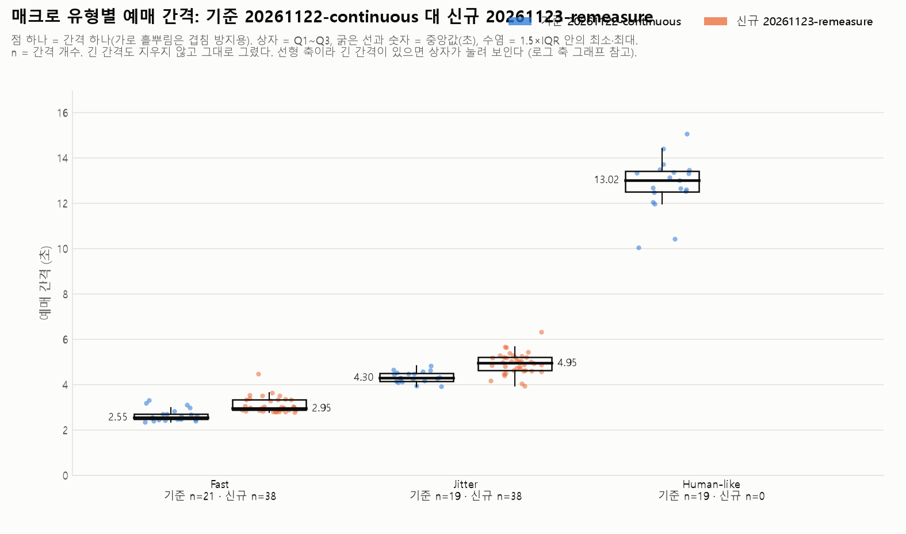
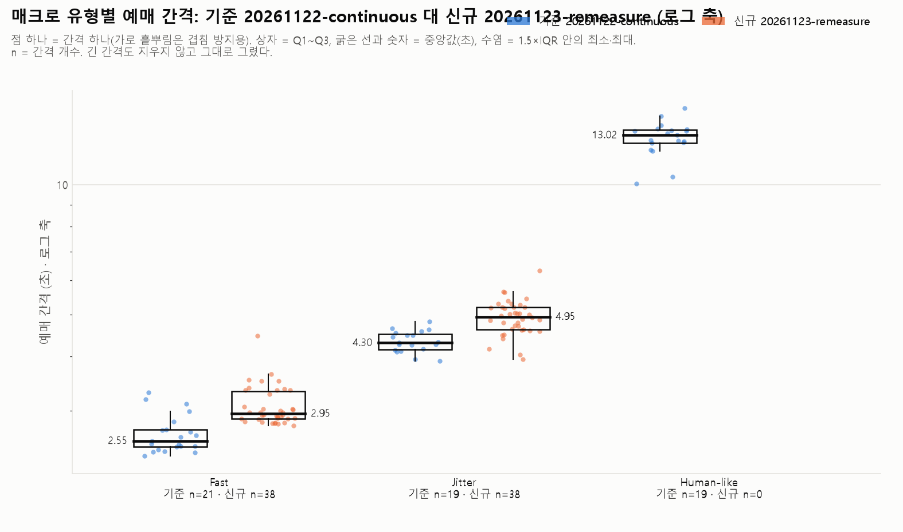
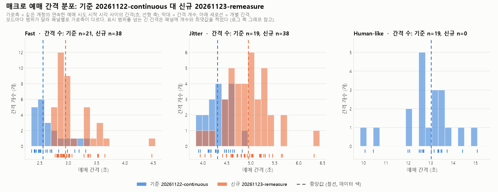
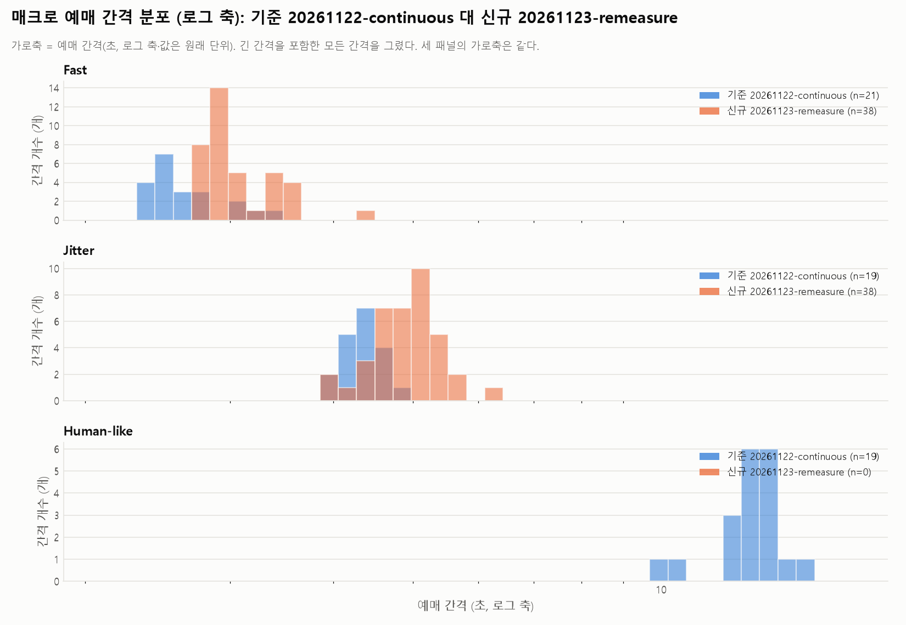
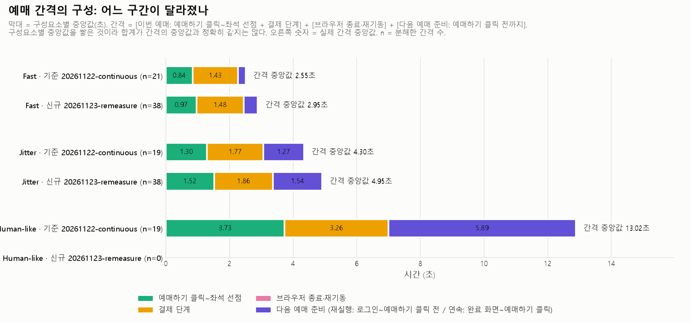
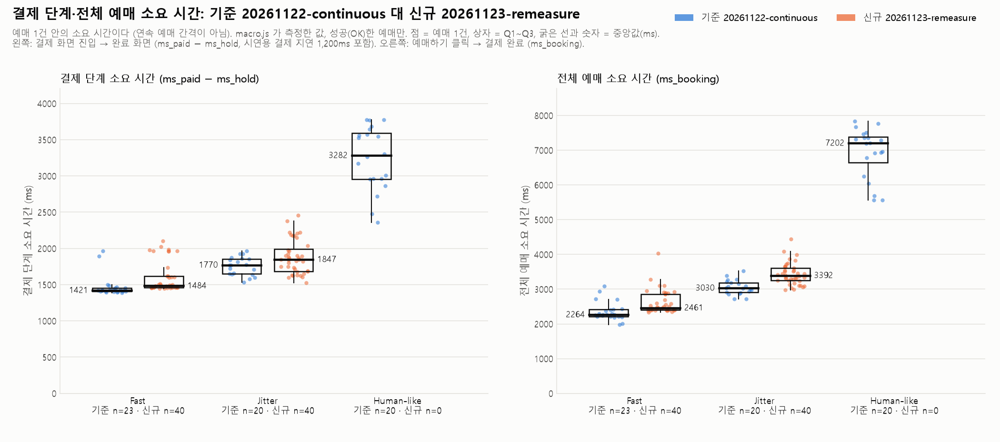
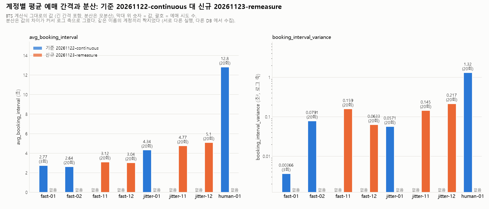
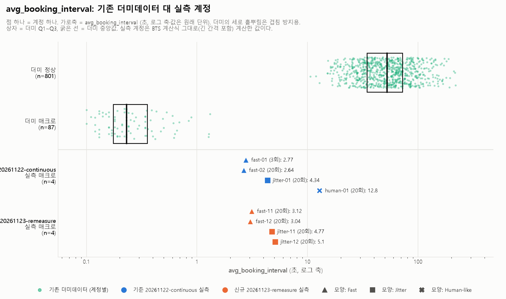
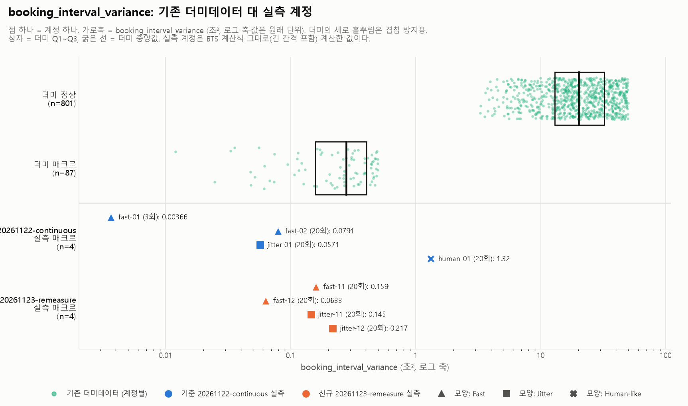

# 이슈 #16 연속 예매(브라우저 재사용) 측정 보고서 — 실행 `20261123-remeasure`

비교 기준: `runs/20261122-continuous` (기준 20261122-continuous). 생성 스크립트 `scripts/analyze.py --baseline-run 20261122-continuous` (자동 생성 문서. 직접 고치지 말고 `notes.md` 에 메모를 적은 뒤 다시 생성한다)

## 0. 요약: 기준 20261122-continuous 대 신규 20261123-remeasure

예매 간격 = 같은 계정의 연속한 예매 시도 시작 시각 사이의 간격 (BTS `avg_booking_interval` 의 재료, 두 방식 모두 같은 계산식). 개별 간격 기준.

| 모드 | 평균 (초) 기준 → 신규 | 평균 변화 | 중앙값 (초) | 중앙값 변화 | 표준편차 (초) | 간격 수 |
|---|---|---|---|---|---|---|
| Fast | 2.66 → 3.08 | +0.43 (+16.0%) | 2.55 → 2.95 | +0.40 (+15.7%) | 0.28 → 0.34 | 21 / 38 |
| Jitter | 4.34 → 4.94 | +0.60 (+13.8%) | 4.30 → 4.95 | +0.64 (+14.9%) | 0.25 → 0.46 | 19 / 38 |

- 신규 20261123-remeasure 계정의 `avg_booking_interval` 은 3.04~5.10초다. 기존 더미 매크로는 0.10~1.31초(중앙값 0.23초)로, 4계정 중 4계정이 더미 매크로의 최댓값보다 크다.
- 줄어든 시간의 출처는 4장의 구간별 표에 있다. 두 실행은 같은 PC·같은 날·같은 코드(매크로만 수정)에서 수집했지만 각각 1회 수집이다.

## 1. 실험 환경과 두 방식의 차이

| 레포 | 커밋 | 브랜치 | 커밋되지 않은 변경 | 기준 실행(20261122-continuous)의 커밋 |
|---|---|---|---|---|
| ai | `90fc110` | test/#16/booking-interval-distribution | ?? experiments/issue16-booking-interval/ | `c9637c5` (다름) |
| demo-ticketing | `d07820f` | feat/#58/macro-test-improvements | 없음 | `9dd0146` (다름) |
| ticket-fds-admin | `dc8e8ad` | fix/#57/admin-summary-api-path | 없음 | `dc8e8ad` |

- BTS: 체크아웃의 파일 내용이 `origin/dev`(`b4d3d4e`)와 같다.
- 프론트 `.env`: `VITE_USE_MOCK_TICKETING=false`, `VITE_USE_MOCK_BTS=false`, `VITE_API_BASE_URL=`, `VITE_MOCK_QR=false`, `VITE_USE_MOCK_QUEUE=true`, `VITE_MOCK_QUEUE_START=`, `VITE_USE_MOCK_CARDS=true` (mock 티켓팅·BTS 비활성).
- 스택: `demo-ticketing/e2e` 의 일회성 DB(tmpfs, `cdbts-e2e-bts-mysql`) + BTS + Demo. 기존 개발 DB 는 쓰지 않았다. 수집 시작 전 이 DB 의 이벤트 수: 43건 (점검용 다른 계정의 이벤트. 이번 계정의 간격에는 섞이지 않는다).
- `macro.js` sha256: 기준 실행 `895961c28023…`, 이번 실행 `328f186d835a…` (다름: 연속 예매 모드 `--repeat` 를 추가한 수정본. 1회 예매 경로의 동작 순서와 지연 설정은 바꾸지 않았다).
- node v24.3.0, Playwright 1.65.1, 창 표시: 창을 띄움(headed), 옵션 `--seats 1 --concert 0 --card 1`.

| 항목 | 기준 20261122-continuous | 신규 20261123-remeasure |
|---|---|---|
| 매크로 실행 | python subprocess: 계정마다 `node macro.js --repeat N` 1회 (브라우저·로그인 유지, 연속 예매) | python subprocess: 계정마다 `node macro.js --repeat N` 1회 (브라우저·로그인 유지, 연속 예매) |
| 브라우저 | 예매 1건마다 node·브라우저를 새로 실행하고 종료 | 계정당 1번 실행해 끝까지 유지 (계정이 바뀌면 새 브라우저 컨텍스트) |
| 로그인 | 예매 1건마다 로그인 | 계정당 1번. 이후에는 같은 페이지에서 로그인 상태 유지 |
| 다음 예매로 가는 길 | 새 브라우저 → 로그인 → 공연 목록 → 공연 → 예매하기 | 완료 화면 → `공연 목록으로` → 공연 → 예매하기 |
| 클릭·입력 지연 (Fast/Jitter/Human-like 프로파일) | PROFILES 그대로 | PROFILES 그대로 (변경 없음) |
| 결제 | 기본 테스트 카드 A | 기본 테스트 카드 A (`--card` 옵션 동작 동일) |
| BTS 이벤트 수집·Feature 계산 | `export_events` SQL, `extract_features.extract` | 같음 (변경 없음) |

- 연속 예매에서는 다음 예매로 넘어가기 전에 끝난 시도의 진행 기록(`sessionStorage` 의 `fds.attempt.v1.<계정>.<공연>`)을 매크로가 지운다. 이 기록이 남아 있으면 같은 탭에서 두 번째 예매의 `예매하기` 가 409(요청이 현재 리소스 상태와 충돌)로 막힌다 (#14 README 에 적힌 현상과 같다). 새 탭을 여는 것과 같은 효과이고 로그인 세션은 건드리지 않는다. 프론트엔드 코드는 수정하지 않았다.

**실행 메모** (`notes.md`)

좌석 700석 확대·좌석 배치도 UI 변경·연속 예매 409 수정(demo-ticketing #58) 이후 재측정. Fast 2계정, Jitter 2계정, 계정당 20회 연속 예매. 실행 중이던 격리 E2E 스택(BTS 18080, Demo 18081, Vite 5173)을 그대로 사용. macro.js --debug 로 브라우저 오류를 기록(기준 실행은 --debug 없이 수집).

## 2. 수집 건수와 연속 예매 가능 여부

| 계정 | 모드 | 계획 | 성공 | 실패 | 미실행 | 예매 시도(attemptId) | BOOKING | 간격 수 | 좌석 선점 재시도 | 결제 식별자 | 연속 예매 |
|---|---|---|---|---|---|---|---|---|---|---|---|
| macro-fast-11 | Fast | 20 | 20 | 0 | 0 | 20 | 20 | 19 | 0 | test-pay-shared-01 | 가능 (20/20 연속 성공) |
| macro-fast-12 | Fast | 20 | 20 | 0 | 0 | 20 | 20 | 19 | 0 | test-pay-shared-01 | 가능 (20/20 연속 성공) |
| macro-jitter-11 | Jitter | 20 | 20 | 0 | 0 | 20 | 20 | 19 | 0 | test-pay-shared-01 | 가능 (20/20 연속 성공) |
| macro-jitter-12 | Jitter | 20 | 20 | 0 | 0 | 20 | 20 | 19 | 0 | test-pay-shared-01 | 가능 (20/20 연속 성공) |

- Outbox: {'SENT': 603}. 성공한 예매 80건 중 BTS 에 저장된 BOOKING 80건 (누락 없음).
- 실패·타임아웃: 없음. 모든 계정이 계획한 횟수를 한 브라우저·한 로그인으로 끝까지 예매했다.
- 사람(실제 사용자) 데이터는 수집하지 않았다.

## 3. 예매 간격 비교

**개별 간격 통계 (초)**

| 데이터 | 집단 | 구분 | n | 평균 | 중앙값 | 표준편차 | 최소 | Q1 | Q3 | 최대 |
|---|---|---|---|---|---|---|---|---|---|---|
| 기준 20261122-continuous | 전체 매크로 | 원본 | 59 | 6.48 | 4.28 | 4.53 | 2.35 | 2.71 | 12.27 | 15.07 |
| 기준 20261122-continuous | Fast | 원본 | 21 | 2.66 | 2.55 | 0.28 | 2.35 | 2.47 | 2.71 | 3.31 |
| 기준 20261122-continuous | Jitter | 원본 | 19 | 4.34 | 4.30 | 0.25 | 3.91 | 4.16 | 4.51 | 4.82 |
| 기준 20261122-continuous | Human-like | 원본 | 19 | 12.83 | 13.02 | 1.18 | 10.06 | 12.51 | 13.41 | 15.07 |
| 기준 20261122-continuous | 계정 macro-fast-01 | 원본 | 2 | 2.77 | 2.77 | 0.09 | 2.71 | 2.74 | 2.80 | 2.83 |
| 기준 20261122-continuous | 계정 macro-fast-02 | 원본 | 19 | 2.64 | 2.52 | 0.29 | 2.35 | 2.46 | 2.69 | 3.31 |
| 기준 20261122-continuous | 계정 macro-jitter-01 | 원본 | 19 | 4.34 | 4.30 | 0.25 | 3.91 | 4.16 | 4.51 | 4.82 |
| 기준 20261122-continuous | 계정 macro-human-01 | 원본 | 19 | 12.83 | 13.02 | 1.18 | 10.06 | 12.51 | 13.41 | 15.07 |
| 신규 20261123-remeasure | 전체 매크로 | 원본 | 76 | 4.01 | 3.99 | 1.02 | 2.77 | 2.96 | 4.93 | 6.32 |
| 신규 20261123-remeasure | Fast | 원본 | 38 | 3.08 | 2.95 | 0.34 | 2.77 | 2.87 | 3.33 | 4.47 |
| 신규 20261123-remeasure | Jitter | 원본 | 38 | 4.94 | 4.95 | 0.46 | 3.94 | 4.62 | 5.21 | 6.32 |
| 신규 20261123-remeasure | 계정 macro-fast-11 | 원본 | 19 | 3.12 | 2.97 | 0.41 | 2.77 | 2.89 | 3.34 | 4.47 |
| 신규 20261123-remeasure | 계정 macro-fast-12 | 원본 | 19 | 3.04 | 2.92 | 0.26 | 2.81 | 2.87 | 3.17 | 3.53 |
| 신규 20261123-remeasure | 계정 macro-jitter-11 | 원본 | 19 | 4.77 | 4.86 | 0.39 | 3.94 | 4.59 | 5.04 | 5.30 |
| 신규 20261123-remeasure | 계정 macro-jitter-12 | 원본 | 19 | 5.10 | 5.04 | 0.48 | 4.41 | 4.67 | 5.34 | 6.32 |

표준편차는 표본 표준편차다. "긴 간격 제외 (가상)" 은 관측값이 아니라 표시된 긴 간격을 빼고 다시 계산한 값이다.

## 4. 구간별 소요 시간

**간격을 이루는 구간** (초, 간격 단위로 분해. 차이 = 신규 − 기준)

| 모드 | 구간 | n | 중앙값 기준 | 중앙값 신규 | 중앙값 차 | 평균 기준 | 평균 신규 | 평균 차 |
|---|---|---|---|---|---|---|---|---|
| Fast | 예매 간격 (전체) | 21 / 38 | 2.55 | 2.95 | +0.40 | 2.66 | 3.08 | +0.43 |
| Fast | ① 예매하기 클릭~좌석 선점 | 21 / 38 | 0.84 | 0.97 | +0.12 | 0.90 | 1.02 | +0.13 |
| Fast | ② 결제 단계 | 21 / 38 | 1.43 | 1.48 | +0.06 | 1.48 | 1.61 | +0.13 |
| Fast | ③ 예매 완료 → 다음 예매하기 클릭 (= ③a + ③b) | 21 / 38 | 0.24 | 0.44 | +0.20 | 0.28 | 0.45 | +0.17 |
| Fast | ③a 브라우저 종료·재기동 | 21 / 38 | -0.01 | -0.00 | +0.01 | -0.01 | -0.00 | +0.01 |
| Fast | ③b 다음 예매 준비 (예매하기 클릭 전까지) | 21 / 38 | 0.23 | 0.44 | +0.20 | 0.30 | 0.45 | +0.16 |
| Jitter | 예매 간격 (전체) | 19 / 38 | 4.30 | 4.95 | +0.64 | 4.34 | 4.94 | +0.60 |
| Jitter | ① 예매하기 클릭~좌석 선점 | 19 / 38 | 1.30 | 1.52 | +0.22 | 1.29 | 1.55 | +0.27 |
| Jitter | ② 결제 단계 | 19 / 38 | 1.77 | 1.86 | +0.09 | 1.74 | 1.89 | +0.15 |
| Jitter | ③ 예매 완료 → 다음 예매하기 클릭 (= ③a + ③b) | 19 / 38 | 1.27 | 1.55 | +0.28 | 1.31 | 1.49 | +0.18 |
| Jitter | ③a 브라우저 종료·재기동 | 19 / 38 | 0.00 | -0.00 | -0.00 | -0.00 | -0.00 | +0.00 |
| Jitter | ③b 다음 예매 준비 (예매하기 클릭 전까지) | 19 / 38 | 1.27 | 1.54 | +0.26 | 1.31 | 1.49 | +0.18 |

- ③b 는 재실행 방식에서는 `로그인 → 공연 목록 → 공연 → 예매하기 클릭 전`, 연속 예매에서는 `완료 화면 → 공연 목록 → 공연 → 예매하기 클릭 전` 이다.
- 연속 예매의 ③a 는 브라우저를 다시 띄우지 않으므로 실제 구간이 아니라 계산 잔차다 (서버가 기록한 시도 시작 시각과 매크로가 잰 클릭 시각의 차이 수준).
- ①·② 는 두 방식에서 같은 화면·같은 지연 설정이다. 여기서 차이가 나면 방식 차이가 아니라 실행 간 변동으로 본다.

**브라우저 최초 실행과 로그인 시간**

신규 20261123-remeasure — 계정(세션)당 1번만 발생:

| 계정 | 모드 | 브라우저 실행 (ms) | 컨텍스트·페이지 생성 (ms) | 로그인: 접속~공연 목록 표시 (ms) | 첫 예매: 시작~예매하기 클릭 전 (ms) | 세션 전체 실행 시간 (ms) |
|---|---|---|---|---|---|---|
| macro-fast-11 | Fast | 593 | 542 | 1,511 | 1,674 | 66,514 |
| macro-fast-12 | Fast | 498 | 327 | 1,156 | 1,386 | 63,916 |
| macro-jitter-11 | Jitter | 584 | 406 | 3,100 | 4,206 | 100,770 |
| macro-jitter-12 | Jitter | 488 | 383 | 3,052 | 4,243 | 106,741 |

기준 20261122-continuous — 예매 1건마다 발생:

| 모드 | 예매 수 | 로그인 중앙값 (ms) | 로그인 최소 | 로그인 최대 | 브라우저 종료·재기동 중앙값 (ms) | 재기동 최대 (ms) |
|---|---|---|---|---|---|---|
| Fast | 2 | 1,200 | 1,074 | 1,327 | -12 | 61 |
| Jitter | 1 | 2,555 | 2,555 | 2,555 | 0 | 33 |

재실행 방식의 재기동 시간은 직접 잰 값이 아니라 `간격 − 예매 소요 시간 − 다음 실행의 클릭 전 구간` 으로 계산한 나머지다 (브라우저 종료 + node 시작 + 브라우저 실행).

**예매 완료 후 다음 예매 시작까지** (③, 초)

| 데이터 | 모드 | n | 평균 | 중앙값 | 표준편차 | 최소 | Q1 | Q3 | 최대 |
|---|---|---|---|---|---|---|---|---|---|
| 기준 20261122-continuous | Fast | 21 | 0.28 | 0.24 | 0.11 | 0.17 | 0.22 | 0.39 | 0.49 |
| 기준 20261122-continuous | Jitter | 19 | 1.31 | 1.27 | 0.23 | 0.89 | 1.12 | 1.51 | 1.73 |
| 신규 20261123-remeasure | Fast | 38 | 0.45 | 0.44 | 0.05 | 0.36 | 0.42 | 0.48 | 0.62 |
| 신규 20261123-remeasure | Jitter | 38 | 1.49 | 1.55 | 0.25 | 0.85 | 1.34 | 1.64 | 1.88 |

`booking_intervals.csv` 의 `after_paid_to_next_begin_s`. 연속 예매는 `macro_runs.csv` 의 `ms_prev_paid_to_begin` (매크로가 직접 잰 값) 과 같은 구간이다.

## 5. 계정별 Feature 와 더미데이터 대비 위치

| 계정 | 데이터 | 시도 수 | 간격 수 | avg_booking_interval (초) | booking_interval_variance (초²) | 표준편차 (초) | 간격 중앙값 | 최소 | 최대 | 긴 간격 수 |
|---|---|---|---|---|---|---|---|---|---|---|
| macro-fast-01 | 기준 20261122-continuous | 3 | 2 | 2.768 | 0.004 | 0.060 | 2.768 | 2.71 | 2.83 | 0 |
| macro-fast-02 | 기준 20261122-continuous | 20 | 19 | 2.644 | 0.079 | 0.281 | 2.515 | 2.35 | 3.31 | 0 |
| macro-fast-11 | 신규 20261123-remeasure | 20 | 19 | 3.123 | 0.159 | 0.399 | 2.972 | 2.77 | 4.47 | 0 |
| macro-fast-12 | 신규 20261123-remeasure | 20 | 19 | 3.040 | 0.063 | 0.252 | 2.917 | 2.81 | 3.53 | 0 |
| macro-human-01 | 기준 20261122-continuous | 20 | 19 | 12.833 | 1.321 | 1.149 | 13.023 | 10.06 | 15.07 | 0 |
| macro-jitter-01 | 기준 20261122-continuous | 20 | 19 | 4.339 | 0.057 | 0.239 | 4.305 | 3.91 | 4.82 | 0 |
| macro-jitter-11 | 신규 20261123-remeasure | 20 | 19 | 4.770 | 0.145 | 0.381 | 4.857 | 3.94 | 5.30 | 0 |
| macro-jitter-12 | 신규 20261123-remeasure | 20 | 19 | 5.102 | 0.217 | 0.466 | 5.035 | 4.41 | 6.32 | 0 |

BTS 계산식 그대로 (긴 간격 포함, 분산은 모분산).

- 기준 20261122-continuous `avg_booking_interval`: 2.644~12.833초. 더미 매크로 범위(0.100~1.310) 안 0/4계정, 더미 정상 범위(10.600~218.260) 안 1/4계정.
- 기준 20261122-continuous `booking_interval_variance`: 0.004~1.321초². 더미 매크로 범위(0.012~0.498) 안 2/4계정, 더미 정상 범위(3.282~49.938) 안 0/4계정.
- 신규 20261123-remeasure `avg_booking_interval`: 3.040~5.102초. 더미 매크로 범위(0.100~1.310) 안 0/4계정, 더미 정상 범위(10.600~218.260) 안 0/4계정.
- 신규 20261123-remeasure `booking_interval_variance`: 0.063~0.217초². 더미 매크로 범위(0.012~0.498) 안 4/4계정, 더미 정상 범위(3.282~49.938) 안 0/4계정.
- 실측 계정은 모드당 1~2개다. 분포의 모양이 아니라 값의 위치만 본다.

## 6. 이상치와 측정 한계

긴 간격 표시 기준: 같은 계정의 간격이 5개 이상일 때 `Q3 + 3×IQR` 와 계정 중앙값의 2배를 모두 넘는 간격. 표시만 하고 지우지 않았다.

- 두 실행 모두 기준을 넘는 긴 간격이 없다.
- 연속 예매의 간격에는 브라우저 실행·로그인이 들어가지 않지만, 예매 1건의 전체 흐름(대기열 → 좌석 → 선점 → 결제 지연 1.2초)과 완료 화면에서 공연으로 돌아가는 이동은 들어 있다.
- 두 실행은 각각 1회 수집이고 모드당 계정 1~2개다. 실행 간 변동 폭은 알 수 없으므로 수백 ms 수준의 차이는 방식 차이로 해석하지 않는다.
- 연속 예매의 첫 건만 로그인을 포함한다. 간격은 시도 시작 시각의 차이이므로 첫 건의 로그인 시간은 어떤 간격에도 들어가지 않는다.
- 공연의 남은 좌석이 줄어드는 정도(96석 중 약 70석 사용)는 두 실행이 비슷하다. Fast 는 항상 목록의 첫 좌석을, Jitter·Human-like 는 무작위 좌석을 고른다.
- 검증: 기준 실행 Feature 재계산이 runs/20261122-continuous/feature_summary.csv 와 일치 = False; 이번 실행 Feature 계산 기준 시각(UTC) = 2026-11-22T16:48:43; 성공한 예매 수 = BOOKING 수 = 80 = 80; feature_service_unchanged = 변경 없음.

## 7. 더미데이터 분포를 수정할 때 참고할 사항

이번 작업에서는 더미 생성 로직과 모델을 바꾸지 않았다.

| 방식 | 모드 | 간격 수 | 평균 (초) | 중앙값 (초) | 표준편차 (초) | 변동계수 | 범위 (초) |
|---|---|---|---|---|---|---|---|
| 기준 20261122-continuous | Fast | 21 | 2.66 | 2.55 | 0.28 | 0.104 | 2.35~3.31 |
| 기준 20261122-continuous | Jitter | 19 | 4.34 | 4.30 | 0.25 | 0.057 | 3.91~4.82 |
| 신규 20261123-remeasure | Fast | 38 | 3.08 | 2.95 | 0.34 | 0.111 | 2.77~4.47 |
| 신규 20261123-remeasure | Jitter | 38 | 4.94 | 4.95 | 0.46 | 0.094 | 3.94~6.32 |

- 기존 더미 매크로의 `avg_booking_interval` 은 0.10~1.31초다. 브라우저와 로그인을 유지하는 매크로의 실측 간격은 위 표의 신규 20261123-remeasure 줄이다.
- 브라우저를 매번 다시 띄우는 매크로와 유지하는 매크로는 둘 다 있을 수 있는 유형이다. 더미의 매크로 간격 범위를 정할 때 두 방식의 실측을 하한(연속)과 상한(재실행) 쪽 참고값으로 함께 쓸 수 있다.
- 연속 예매의 하한은 `예매하기 클릭~좌석 선점 + 결제 지연 1.2초 + 화면 이동` 이다 (구성 그래프). 이보다 짧은 간격은 화면을 거치지 않고 API 를 직접 호출하는 경우이며 이번 실측으로 확인되지 않았다.
- 간격의 흩어짐(표준편차·변동계수)은 위 표를 참고한다. 분산을 평균과 따로 뽑지 말고 개별 간격을 생성해 계산하는 편이 실측과 맞는다.
- 분포를 바꾸기 전에 같은 조건으로 2~3회 더 수집해 실행 간 변동을 확인하는 것이 좋다.

## 파일

| 파일 | 내용 |
|---|---|
| `booking_intervals.csv` | 예매 간격 1개당 한 줄 (두 실행 모두): 간격, 구간 분해, 완료→다음 시작, 긴 간격 표시 |
| `feature_summary.csv` | 계정별 Feature (BTS 계산식) 와 민감도 |
| `bookings.csv` | 예매 1건당 한 줄: 시작·완료 시각, 단계별 소요 시간, 브라우저 실행·로그인 시간, 실패 원인 |
| `distribution_stats.csv`, `comparison_vs_baseline.csv` | 요약 통계, 모드별 차이 (`_base` = 기준 실행, `_new` = 이번 실행) |
| `macro_runs.csv`, `macro-results-<계정>.csv`, `macro_stdout.log` | 매크로 실행 기록 원본 |
| `raw_events.csv`, `users.csv`, `export_summary.json`, `environment.json` | BTS 이벤트 내보내기, 실행 환경 |
| `figures/interval_by_macro.png`, `interval_distribution.png` (+ `_log`) | 매크로 유형별 예매 간격 분포 |
| `figures/account_comparison.png` | 기준 실행 대비 계정별 평균·분산 |
| `figures/gap_breakdown.png`, `payment_duration.png` | 구간별 소요 시간 비교 |
| `figures/feature_mean_comparison.png`, `feature_variance_comparison.png` | 더미데이터 대비 위치 |
