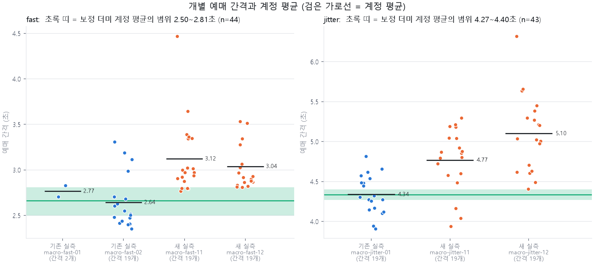
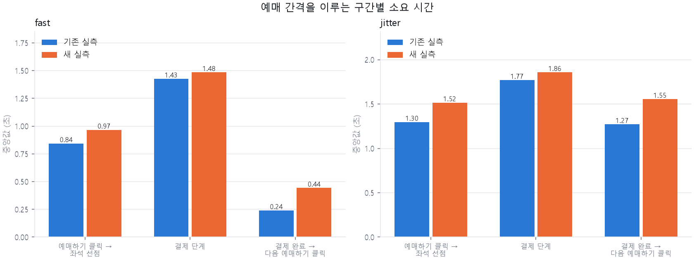
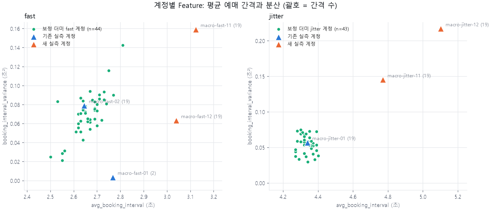

# 재측정 비교: 20261122-continuous · 20261123-remeasure · 보정 더미 v1

자동 생성 (`scripts/compare_remeasure.py`). 더미데이터 재생성과 모델 학습은 하지 않았다.

## 실행 조건

| | 기존 실측 | 새 실측 |
|---|---|---|
| run-id | `20261122-continuous` | `20261123-remeasure` |
| demo-ticketing 커밋 | `9dd0146` | `d07820f` |
| ticket-fds-admin 커밋 | `dc8e8ad` | `dc8e8ad` |
| 계획 | macro-fast-01×3, macro-fast-02×20, macro-jitter-01×20, macro-human-01×20 | macro-fast-11×20, macro-fast-12×20, macro-jitter-11×20, macro-jitter-12×20 |
| macro.js `--debug` | 아니오 | 예 |
| 예매 시도 1건의 단계 기록 | STARTED → QUEUE → SEAT_SELECTION → SEAT_HOLD → COMPLETED (63건) | STARTED → QUEUE → SEAT_SELECTION → SEAT_HOLD → PAYMENT → COMPLETED (80건) |

## 성공·실패

| account | mode | attempted | OK | failed_or_not_run | hold_retries |
|---|---|---|---|---|---|
| macro-fast-11 | fast | 20 | 20 | 0 | 0 |
| macro-fast-12 | fast | 20 | 20 | 0 | 0 |
| macro-jitter-11 | jitter | 20 | 20 | 0 | 0 |
| macro-jitter-12 | jitter | 20 | 20 | 0 | 0 |

- 결과 CSV 에 오류 문구가 있는 예매: 0건 (그중 409·충돌: 0건)
- 매크로 로그의 브라우저 오류 줄: 0개, HTTP 409 줄: 0개
- `hold_retries`: 좌석 선점을 다시 시도한 횟수

## 계정별 통계 (개별 간격, 초)

| source | mode | account | n | mean | median | std | variance_population | min | q05 | q25 | q75 | q95 | max |
|---|---|---|---|---|---|---|---|---|---|---|---|---|---|
| 기존 실측 | fast | macro-fast-01 | 2 | 2.768 | 2.768 | 0.086 | 0.004 | 2.707 | 2.713 | 2.737 | 2.798 | 2.822 | 2.828 |
| 기존 실측 | fast | macro-fast-02 | 19 | 2.644 | 2.515 | 0.289 | 0.079 | 2.354 | 2.394 | 2.456 | 2.692 | 3.201 | 3.307 |
| 기존 실측 | jitter | macro-jitter-01 | 19 | 4.339 | 4.305 | 0.245 | 0.057 | 3.909 | 3.940 | 4.158 | 4.512 | 4.672 | 4.818 |
| 새 실측 | fast | macro-fast-11 | 19 | 3.123 | 2.972 | 0.410 | 0.159 | 2.768 | 2.793 | 2.890 | 3.345 | 3.728 | 4.470 |
| 새 실측 | fast | macro-fast-12 | 19 | 3.040 | 2.917 | 0.259 | 0.063 | 2.808 | 2.814 | 2.867 | 3.171 | 3.519 | 3.531 |
| 새 실측 | jitter | macro-jitter-11 | 19 | 4.770 | 4.857 | 0.392 | 0.145 | 3.939 | 4.030 | 4.590 | 5.043 | 5.221 | 5.297 |
| 새 실측 | jitter | macro-jitter-12 | 19 | 5.102 | 5.035 | 0.479 | 0.217 | 4.408 | 4.483 | 4.668 | 5.341 | 5.726 | 6.321 |

계정 Feature 는 `avg_booking_interval` = mean, `booking_interval_variance` = variance_population 이다. std 는 표본 표준편차.

## 기존 실측 대 새 실측



| mode | n_base | n_new | mean_base | mean_new | mean_diff | mean_diff_pct | median_base | median_new | median_diff | std_base | std_new | share_new_above_base_max | mannwhitney_p | wasserstein_s |
|---|---|---|---|---|---|---|---|---|---|---|---|---|---|---|
| fast | 21 | 38 | 2.656 | 3.081 | 0.426 | 16.023 | 2.552 | 2.952 | 0.400 | 0.277 | 0.341 | 0.263 | 5.3e-06 | 0.426 |
| jitter | 19 | 38 | 4.339 | 4.936 | 0.597 | 13.751 | 4.305 | 4.947 | 0.643 | 0.245 | 0.463 | 0.605 | 3.4e-06 | 0.597 |

- `mean_diff_pct`: 기존 대비 변화율(%). `share_new_above_base_max`: 새 간격 중 기존 최댓값보다 큰 비율.
- `mannwhitney_p`: 두 실행의 간격이 같은 분포에서 나왔다고 볼 때 이만큼의 차이가 날 확률. 같은 계정 안의 간격은 서로 독립이 아니므로 참고용이다.

### 어느 구간이 달라졌나



| mode | segment_label | median_base | median_new | median_diff |
|---|---|---|---|---|
| fast | 예매하기 클릭 → 좌석 선점 | 0.843 | 0.966 | 0.123 |
| fast | 결제 단계 | 1.426 | 1.484 | 0.058 |
| fast | 결제 완료 → 다음 예매하기 클릭 | 0.240 | 0.443 | 0.202 |
| jitter | 예매하기 클릭 → 좌석 선점 | 1.296 | 1.515 | 0.219 |
| jitter | 결제 단계 | 1.769 | 1.857 | 0.088 |
| jitter | 결제 완료 → 다음 예매하기 클릭 | 1.271 | 1.555 | 0.284 |

세 구간의 합이 예매 간격이다. 변화의 원인은 이 데이터만으로는 가려낼 수 없다. 두 실행 사이에 달라진 조건은 실행 조건 표의 커밋 차이(좌석 수, 좌석 배치도 UI, 연속 예매 수정으로 단계 기록이 1개 늘어남), `--debug` 사용 여부, 매크로의 sessionStorage 정리 제거, 수집 시각과 PC 상태이며, 한 번씩만 측정했다.

## 새 실측 대 보정 더미



| mode | group | unit | n | mean | median | std | variance_population | min | q05 | q25 | q75 | q95 | max |
|---|---|---|---|---|---|---|---|---|---|---|---|---|---|
| fast | 기존 실측 (개별 간격) | 초 | 21 | 2.656 | 2.552 | 0.277 | 0.073 | 2.354 | 2.398 | 2.474 | 2.707 | 3.189 | 3.307 |
| fast | 새 실측 (개별 간격) | 초 | 38 | 3.081 | 2.952 | 0.341 | 0.113 | 2.768 | 2.799 | 2.871 | 3.327 | 3.548 | 4.470 |
| fast | 보정 더미 (계정 평균) | 초 | 44 | 2.661 | 2.665 | 0.062 | 0.004 | 2.500 | 2.550 | 2.630 | 2.700 | 2.748 | 2.810 |
| fast | 보정 더미 (계정 분산) | 초² | 44 | 0.071 | 0.072 | 0.022 | 0.000 | 0.021 | 0.029 | 0.061 | 0.083 | 0.094 | 0.142 |
| jitter | 기존 실측 (개별 간격) | 초 | 19 | 4.339 | 4.305 | 0.245 | 0.057 | 3.909 | 3.940 | 4.158 | 4.512 | 4.672 | 4.818 |
| jitter | 새 실측 (개별 간격) | 초 | 38 | 4.936 | 4.947 | 0.463 | 0.209 | 3.939 | 4.146 | 4.620 | 5.211 | 5.640 | 6.321 |
| jitter | 보정 더미 (계정 평균) | 초 | 43 | 4.338 | 4.340 | 0.037 | 0.001 | 4.270 | 4.271 | 4.315 | 4.370 | 4.390 | 4.400 |
| jitter | 보정 더미 (계정 분산) | 초² | 43 | 0.054 | 0.054 | 0.012 | 0.000 | 0.030 | 0.033 | 0.046 | 0.062 | 0.073 | 0.075 |

| mode | account_means_base | account_means_new | dummy_mean_avg | dummy_mean_min | dummy_mean_max | new_mean_minus_dummy_mean | new_accounts_mean_within_dummy_range |
|---|---|---|---|---|---|---|---|
| fast | 2.768, 2.644 | 3.123, 3.040 | 2.661 | 2.500 | 2.810 | 0.420 | 0/2 |
| jitter | 4.339 | 4.770, 5.102 | 4.338 | 4.270 | 4.400 | 0.598 | 0/2 |

| mode | account_variances_base | account_variances_new | dummy_variance_median | dummy_variance_min | dummy_variance_max | new_account_variance_avg_minus_dummy_median | new_accounts_variance_within_dummy_range |
|---|---|---|---|---|---|---|---|
| fast | 0.004, 0.079 | 0.159, 0.063 | 0.072 | 0.021 | 0.142 | 0.040 | 1/2 |
| jitter | 0.057 | 0.145, 0.217 | 0.054 | 0.030 | 0.075 | 0.127 | 0/2 |

- `..._within_dummy_range`: 새 실측 계정 중 Feature 값이 보정 더미 계정의 최소~최대 안에 드는 계정 수.
- `share_dummy_accounts_within_new_interval_range` (summary_by_type.csv): 더미 계정 평균 중 새 실측 개별 간격의 범위 안에 드는 비율 — fast 5%, jitter 100%.

## 재보정 판단

- 새 실측 계정 4개 중 평균이 더미 범위 안에 드는 계정: **0개**, 분산이 더미 범위 안에 드는 계정: **1개**.
- 유형별 평균 차이(새 실측 − 더미): fast +0.420초, jitter +0.598초.
- 같은 유형의 새 실측 계정끼리의 평균 차이: fast 0.083초, jitter 0.332초. 보정 더미 v1 의 같은 유형 계정 평균 범위 폭: fast 0.310초, jitter 0.130초.

새 실측 계정의 평균이 하나도 더미 범위 안에 들지 않으므로, 보정 더미는 **현재 사이트의 매크로 간격을 그대로 반영하지는 못한다.** 더미의 계정 평균 범위가 좁은 것은 기존 실측 1회(유형당 계정 1~2개)의 간격만으로 만들었기 때문이고, 이번 재측정으로 실행·계정 사이의 차이가 그 범위보다 크다는 것이 확인됐다.

재보정을 한다면 한 실행의 값으로 옮기기보다, 두 실행의 간격을 함께 써서 계정 사이의 차이를 넣는 쪽이 근거가 있다 (`make_adjusted_dummy.py --run-id 20261122-continuous --run-id 20261123-remeasure --version v2`). 이 차이가 모델 판정에 영향을 주는지는 이번에 확인하지 않았다.

## 한계

- 두 실행 모두 같은 PC 에서 한 번씩 수집했다. 실행 사이의 차이와 사이트 변경의 효과를 분리할 수 없다.
- 계정 수가 유형당 1~2개(기존), 2개(새)라 계정 사이의 분포를 추정하기에는 적다.
- 기존 실행은 `--debug` 없이, 새 실행은 `--debug` 로 수집했다 (단계와 브라우저 오류를 로그에 남기는 옵션).

## 다시 만들기

```powershell
& $py scripts\compare_remeasure.py --run-id 20261123-remeasure --baseline-run 20261122-continuous --dummy-version v1
```
