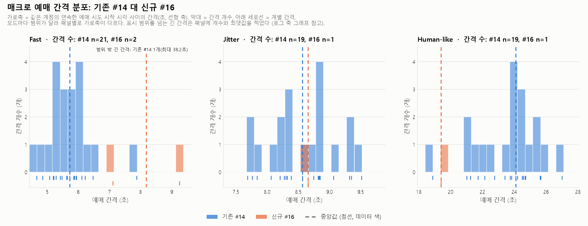
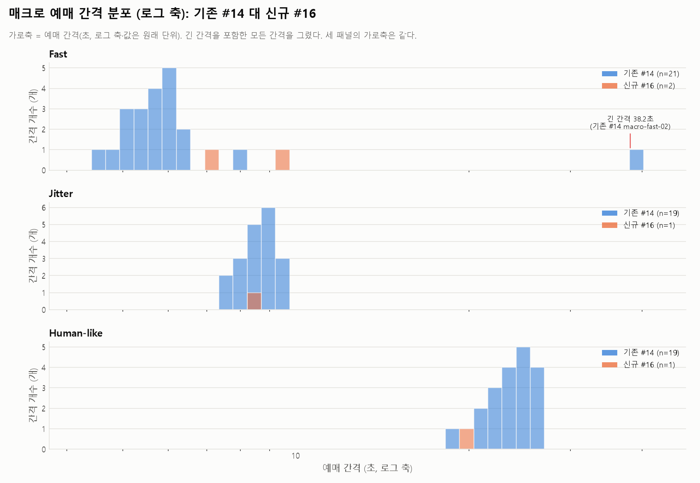
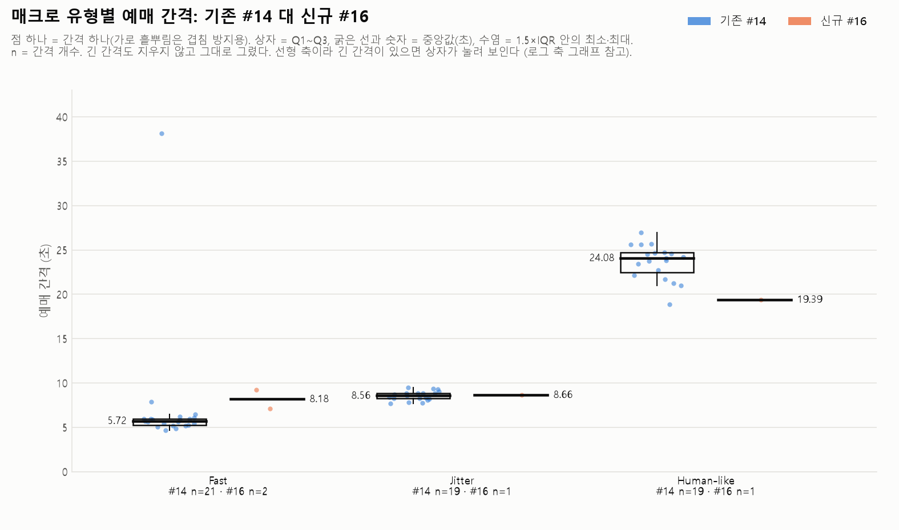
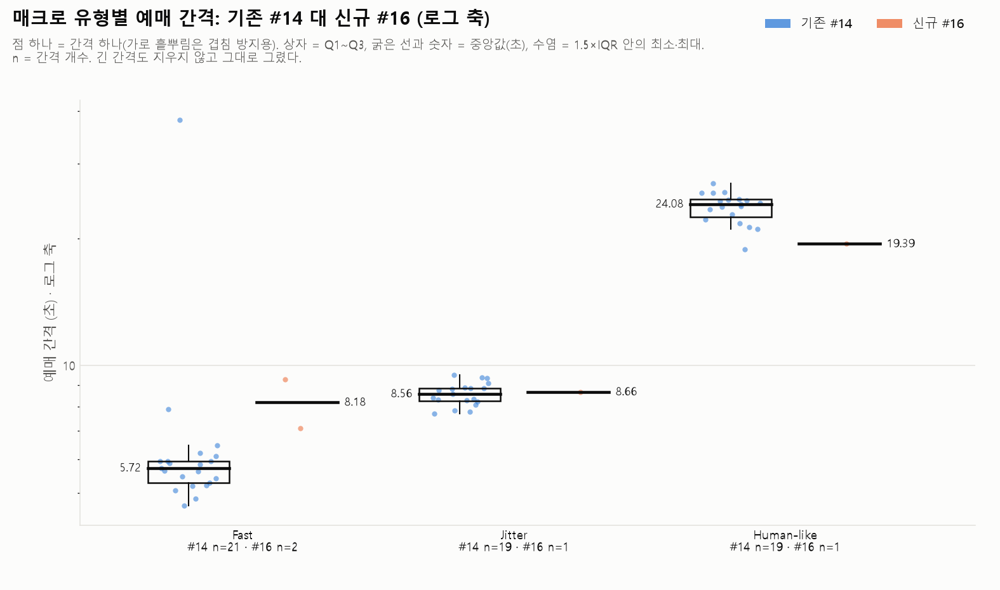
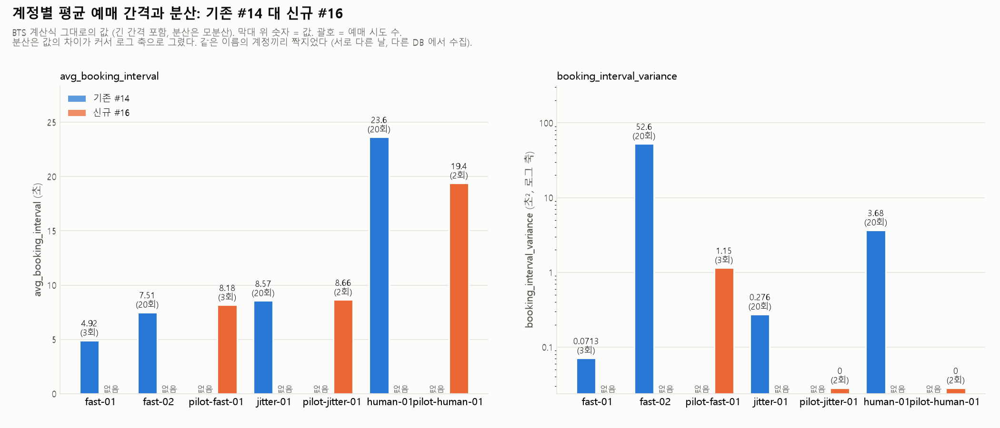
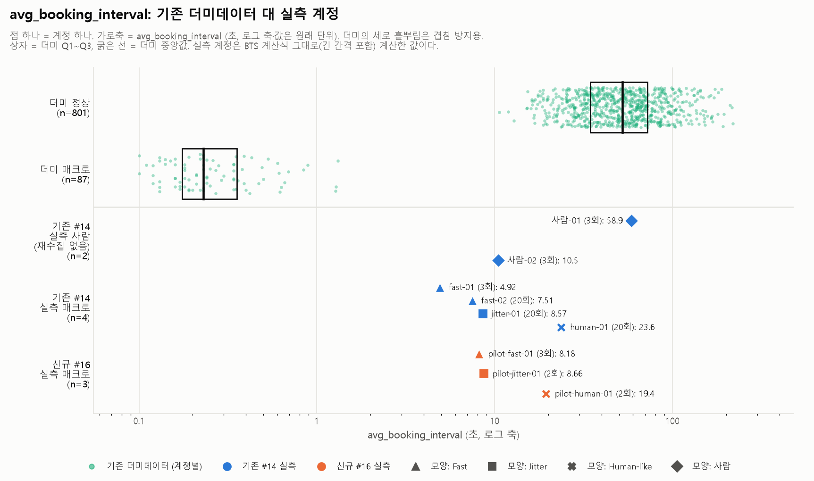
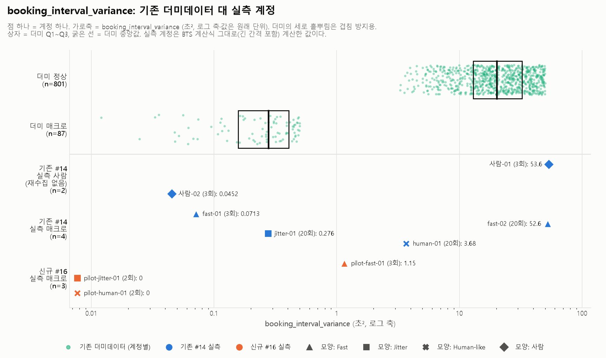
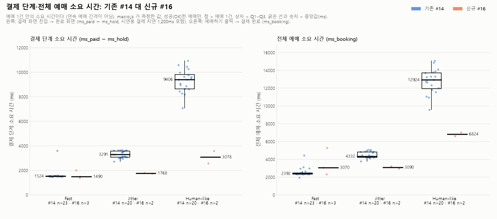
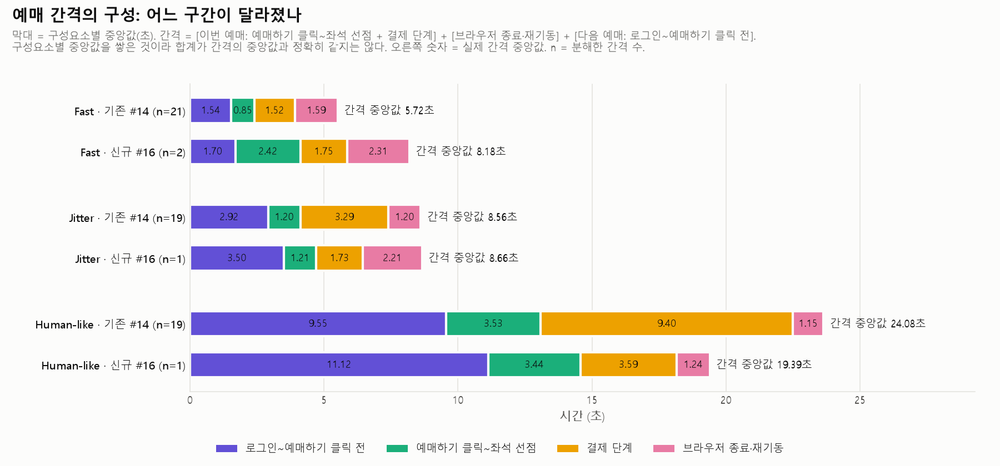

# 이슈 #16 예매 간격 재측정 보고서 — 실행 `pilot-01`

생성 스크립트 `scripts/analyze.py` (자동 생성 문서. 직접 고치지 말고 `notes.md` 에 메모를 적은 뒤 다시 생성한다)

## 0. 요약: 기존 #14 대비 매크로 예매 간격

예매 간격 = 같은 계정의 연속한 예매 시도 시작 시각 사이의 간격 (BTS `avg_booking_interval` 의 재료). 개별 간격 기준.

| 모드 | 평균 (초) #14 → #16 | 평균 변화 | 중앙값 (초) #14 → #16 | 중앙값 변화 | 평균, 긴 간격 제외 (가상) | 간격 수 #14 / #16 |
|---|---|---|---|---|---|---|
| Fast | 7.26 → 8.18 | +0.92 (+12.7%) | 5.72 → 8.18 | +2.46 (+43.1%) | 5.72 → 8.18 | 21 / 2 |
| Jitter | 8.56 → 8.66 | +0.09 (+1.1%) | 8.56 → 8.66 | +0.09 (+1.1%) | 8.56 → 8.66 | 19 / 1 |
| Human-like | 23.65 → 19.39 | -4.25 (-18.0%) | 24.08 → 19.39 | -4.69 (-19.5%) | 23.65 → 19.39 | 19 / 1 |

- 신규 #16 매크로 계정의 `avg_booking_interval` 은 8.18~19.39초다. 기존 더미 매크로는 0.10~1.31초(중앙값 0.23초)로, 신규 실측 3계정 중 3계정이 더미 매크로의 최댓값보다 크다.
- 표본은 모드당 계정 1~2개, 간격 19~21개이며 한 PC 에서 한 번 수집한 결과다. 아래 차이는 경향으로만 읽는다.

## 1. 실험 환경

| 레포 | 커밋 | 브랜치 | 커밋 제목 | 커밋되지 않은 변경 |
|---|---|---|---|---|
| ai | `c9637c5` | test/#14/real-data-validation | test: 실제 예매 데이터 기반 더미데이터 현실성 검증 (#14) | ?? experiments/issue16-booking-interval/ |
| demo-ticketing | `9dd0146` | feat/#56/saved-card-selection | feat: 저장된 테스트 카드 선택 및 매크로 결제 흐름 개선 (#56) | ?? macro/package-lock.json |
| ticket-fds-admin | `dc8e8ad` | fix/#57/admin-summary-api-path | fix: 관리자 요약 API 경로 불일치 수정 (#57) | 없음 |

- BTS: 체크아웃한 커밋의 파일 내용이 `origin/dev`(`b4d3d4e`)와 같다 (`git diff HEAD origin/dev` 기준).
- 프론트 `.env`: `VITE_USE_MOCK_TICKETING=false`, `VITE_USE_MOCK_BTS=false`, `VITE_API_BASE_URL=`, `VITE_MOCK_QR=false`, `VITE_USE_MOCK_QUEUE=true`, `VITE_MOCK_QUEUE_START=`, `VITE_USE_MOCK_CARDS=true`.
  - `VITE_USE_MOCK_TICKETING=false`, `VITE_USE_MOCK_BTS=false` 이면 공연·좌석·예매·대기열·BTS 연동이 모두 실제 백엔드를 쓴다 (대기열 mock 은 티켓팅 mock 이 켜져 있을 때만 동작).
  - `VITE_USE_MOCK_CARDS` 는 마이페이지 등록 카드 목록에만 해당한다. 이번 결제에 쓴 테스트 카드는 프론트 상수이고 결제 확정은 실제 Demo 백엔드로 간다.
- 스택: `demo-ticketing/e2e` 의 일회성 DB(tmpfs, `cdbts-e2e-bts-mysql`) + BTS + Demo, 프론트 `http://localhost:5173`. 기존 개발 DB 는 쓰지 않았다.
- 매크로: `macro.js` sha256 `9bd5f82a9470…`, node v24.3.0, Playwright 1.65.1, Windows-10-10.0.26300-SP0.
- 실행 방식: python subprocess: 예매 1건마다 `node macro.js` 1회 (#14 는 PowerShell ForEach-Object 반복). 창 표시: 창을 띄움(headed).
- 수집 시작 전 이 DB 의 이벤트 수: 0건.

**실행 메모** (`notes.md`)

파이프라인 점검용 파일럿. 본 수집과 다른 계정(pilot-*).

## 2. 매크로별 실행 조건과 수집 건수

공통 옵션: `--seats 1 --concert 0 --card 1 --timeout 60`. 계정마다 `node macro.js` 를 예매 1건당 1번 실행했고, 실행 사이에 따로 쉬지 않았다.

| 계정 | 모드 | 매크로 실행 | 결과 | 예매 시도(attemptId) | BOOKING | BOOKING_ATTEMPT 이벤트 | 간격 수 | 결제 식별자 | 한 실행에 시도 2건 이상 |
|---|---|---|---|---|---|---|---|---|---|
| pilot-fast-01 | Fast | 3 | OK 3 | 3 | 3 | 15 | 2 | test-pay-shared-01 | 0 |
| pilot-jitter-01 | Jitter | 2 | OK 2 | 2 | 2 | 10 | 1 | test-pay-shared-01 | 0 |
| pilot-human-01 | Human-like | 2 | OK 2 | 2 | 2 | 10 | 1 | test-pay-shared-01 | 0 |

- Outbox: {'SENT': 42}. 성공한 예매 7건 중 BTS 에 저장된 BOOKING 7건 (누락 없음).
- 실패·재시도·타임아웃: 없음 (모든 실행이 OK).
- 사람(실제 사용자) 데이터는 **이번에 새로 수집하지 않았다.** 그래프와 표의 사람 계정은 모두 기존 #14 의 human-01, human-02 다.

**기존 #14 와의 조건 차이** (같다고 가정하지 않고 기록)

| 항목 | 기존 #14 | 신규 #16 |
|---|---|---|
| 매크로 스크립트 | ee5a44e (2026-11-19, 카드번호 15자리 직접 입력) | `9dd0146` (기본 테스트 카드가 선택된 상태에서 바로 결제) |
| 결제 수단 | 직접 입력 123456789012345 → test-pay-shared-03 | 저장된 테스트 카드 A(`--card 1`) → test-pay-shared-01 |
| BTS | ticket-fds-admin feat/#40/risk-assessment-credit-pipeline @46f8c67 | `dc8e8ad` (fix/#57/admin-summary-api-path) |
| Feature 계산식 | `FeatureAggregationService.calculate` @46f8c67 | 같은 파일 (46f8c67 이후 변경 없음: 변경 없음) |
| 반복 실행 방식 | PowerShell `1..N | ForEach-Object { node macro.js ... }` | python subprocess: 예매 1건마다 `node macro.js` 1회 (#14 는 PowerShell ForEach-Object 반복) |
| 계정·횟수 | fast-01 3회, fast-02·jitter-01·human-01 각 20회 | pilot-fast-01 3회, pilot-jitter-01 2회, pilot-human-01 2회 |
| Demo 백엔드·프론트 커밋 | 기록 없음 (#14 보고서에 남아 있지 않음) | `9dd0146` |
| 수집 순서·시점 | 2026-11-19, 사람 예매·파일럿과 같은 DB 에서 fast-01 → (사람) → fast-02 → jitter-01 → human-01 | 2026-11-22T14:22:32.692Z 시작, 계획 순서대로 연속 실행 |
| Playwright / node | node_modules 설치 시각 2026-11-19 (버전 기록 없음) | Playwright 1.65.1 / node v24.3.0 |

- 요청서에는 테스트 카드 A/B/C 로 적혀 있으나, 현재 결제 화면에 있는 저장된 테스트 카드는 A·B 두 장이다 (`frontend/src/api/paymentId.ts`). 결제 식별자는 3종(01~03)이 있고 03 은 직접 입력으로만 나온다.

## 3. 기존 #14 대비 예매 간격 변화

**개별 간격 통계 (초)**

| 데이터 | 집단 | 구분 | n | 평균 | 중앙값 | 표준편차 | 최소 | Q1 | Q3 | 최대 |
|---|---|---|---|---|---|---|---|---|---|---|
| 기존 #14 | 전체 매크로 | 원본 | 59 | 12.96 | 8.56 | 8.62 | 4.66 | 5.94 | 22.44 | 38.16 |
| 기존 #14 | 전체 매크로 | 긴 간격 제외 (가상) | 58 | 12.52 | 8.48 | 8.01 | 4.66 | 5.93 | 22.03 | 27.00 |
| 기존 #14 | Fast | 원본 | 21 | 7.26 | 5.72 | 7.11 | 4.66 | 5.28 | 5.94 | 38.16 |
| 기존 #14 | Fast | 긴 간격 제외 (가상) | 20 | 5.72 | 5.68 | 0.69 | 4.66 | 5.26 | 5.93 | 7.87 |
| 기존 #14 | Jitter | 원본 | 19 | 8.56 | 8.56 | 0.54 | 7.68 | 8.24 | 8.85 | 9.51 |
| 기존 #14 | Human-like | 원본 | 19 | 23.65 | 24.08 | 1.97 | 18.86 | 22.44 | 24.70 | 27.00 |
| 기존 #14 | 사람 | 원본 | 4 | 34.67 | 31.12 | 28.57 | 10.26 | 10.58 | 55.20 | 66.19 |
| 기존 #14 | 계정 human-01 | 원본 | 2 | 58.86 | 58.86 | 10.35 | 51.54 | 55.20 | 62.53 | 66.19 |
| 기존 #14 | 계정 macro-fast-01 | 원본 | 2 | 4.92 | 4.92 | 0.38 | 4.66 | 4.79 | 5.06 | 5.19 |
| 기존 #14 | 계정 human-02 | 원본 | 2 | 10.48 | 10.48 | 0.30 | 10.26 | 10.37 | 10.58 | 10.69 |
| 기존 #14 | 계정 macro-fast-02 | 원본 | 19 | 7.51 | 5.84 | 7.45 | 4.85 | 5.44 | 6.03 | 38.16 |
| 기존 #14 | 계정 macro-fast-02 | 긴 간격 제외 (가상) | 18 | 5.80 | 5.78 | 0.66 | 4.85 | 5.43 | 5.94 | 7.87 |
| 기존 #14 | 계정 macro-jitter-01 | 원본 | 19 | 8.56 | 8.56 | 0.54 | 7.68 | 8.24 | 8.85 | 9.51 |
| 기존 #14 | 계정 macro-human-01 | 원본 | 19 | 23.65 | 24.08 | 1.97 | 18.86 | 22.44 | 24.70 | 27.00 |
| 신규 #16 | 전체 매크로 | 원본 | 4 | 11.10 | 8.96 | 5.60 | 7.11 | 8.27 | 11.79 | 19.39 |
| 신규 #16 | Fast | 원본 | 2 | 8.18 | 8.18 | 1.52 | 7.11 | 7.65 | 8.72 | 9.26 |
| 신규 #16 | Jitter | 원본 | 1 | 8.66 | 8.66 | – | 8.66 | 8.66 | 8.66 | 8.66 |
| 신규 #16 | Human-like | 원본 | 1 | 19.39 | 19.39 | – | 19.39 | 19.39 | 19.39 | 19.39 |
| 신규 #16 | 계정 pilot-fast-01 | 원본 | 2 | 8.18 | 8.18 | 1.52 | 7.11 | 7.65 | 8.72 | 9.26 |
| 신규 #16 | 계정 pilot-jitter-01 | 원본 | 1 | 8.66 | 8.66 | – | 8.66 | 8.66 | 8.66 | 8.66 |
| 신규 #16 | 계정 pilot-human-01 | 원본 | 1 | 19.39 | 19.39 | – | 19.39 | 19.39 | 19.39 | 19.39 |

표준편차는 표본 표준편차다. "긴 간격 제외 (가상)" 은 관측값이 아니라 표시된 긴 간격을 빼고 다시 계산한 값이다.

**모드별 차이** (`comparison_14_vs_16.csv`)

| 모드 | 구분 | n #14 / #16 | 평균 #14 | 평균 #16 | 평균 차 | 변화율 | 중앙값 #14 | 중앙값 #16 | 중앙값 차 | Mann–Whitney p (탐색용) |
|---|---|---|---|---|---|---|---|---|---|---|
| Fast | 원본 | 21 / 2 | 7.26 | 8.18 | +0.92 | +12.7% | 5.72 | 8.18 | +2.46 | – |
| Fast | 긴 간격 제외 (가상) | 20 / 2 | 5.72 | 8.18 | +2.47 | +43.2% | 5.68 | 8.18 | +2.50 | – |
| Jitter | 원본 | 19 / 1 | 8.56 | 8.66 | +0.09 | +1.1% | 8.56 | 8.66 | +0.09 | – |
| Jitter | 긴 간격 제외 (가상) | 19 / 1 | 8.56 | 8.66 | +0.09 | +1.1% | 8.56 | 8.66 | +0.09 | – |
| Human-like | 원본 | 19 / 1 | 23.65 | 19.39 | -4.25 | -18.0% | 24.08 | 19.39 | -4.69 | – |
| Human-like | 긴 간격 제외 (가상) | 19 / 1 | 23.65 | 19.39 | -4.25 | -18.0% | 24.08 | 19.39 | -4.69 | – |

Mann–Whitney p 는 참고용이다. 계정이 모드당 1~2개이고 한 계정 안의 간격은 서로 독립이 아니므로 유의성 판단에 쓰지 않는다.

**계정별 Feature** (BTS 계산식, 긴 간격 포함)

| 계정 | 데이터 | 시도 수 | 간격 수 | avg_booking_interval (초) | booking_interval_variance (초²) | 간격 중앙값 | 최소 | 최대 | 긴 간격 수 | 평균, 긴 간격 제외 (가상) | 분산, 긴 간격 제외 (가상) |
|---|---|---|---|---|---|---|---|---|---|---|---|
| human-01 | 기존 #14 | 3 | 2 | 58.865 | 53.612 | 58.865 | 51.54 | 66.19 | 0 | – | – |
| human-02 | 기존 #14 | 3 | 2 | 10.476 | 0.045 | 10.476 | 10.26 | 10.69 | 0 | – | – |
| macro-fast-01 | 기존 #14 | 3 | 2 | 4.924 | 0.071 | 4.924 | 4.66 | 5.19 | 0 | – | – |
| macro-fast-02 | 기존 #14 | 20 | 19 | 7.506 | 52.599 | 5.845 | 4.85 | 38.16 | 1 | 5.803 | 0.415 |
| macro-human-01 | 기존 #14 | 20 | 19 | 23.647 | 3.684 | 24.084 | 18.86 | 27.00 | 0 | – | – |
| macro-jitter-01 | 기존 #14 | 20 | 19 | 8.565 | 0.276 | 8.565 | 7.68 | 9.51 | 0 | – | – |
| pilot-fast-01 | 신규 #16 | 3 | 2 | 8.182 | 1.155 | 8.182 | 7.11 | 9.26 | 0 | – | – |
| pilot-human-01 | 신규 #16 | 2 | 1 | 19.394 | 0.000 | 19.394 | 19.39 | 19.39 | 0 | – | – |
| pilot-jitter-01 | 신규 #16 | 2 | 1 | 8.656 | 0.000 | 8.656 | 8.66 | 8.66 | 0 | – | – |

## 4. 기존 더미데이터와 신규 실측 분포 차이

| Feature | 데이터 | 집단 | 구분 | n (계정) | 평균 | 중앙값 | 표준편차 | 최소 | Q1 | Q3 | 최대 |
|---|---|---|---|---|---|---|---|---|---|---|---|
| `avg_booking_interval` (초) | 기존 #14 | 실측 매크로 계정 | 원본 | 4 | 11.161 | 8.036 | 8.464 | 4.924 | 6.861 | 12.336 | 23.647 |
| `avg_booking_interval` (초) | 기존 #14 | 실측 매크로 계정 | 긴 간격 제외 (가상) | 4 | 10.735 | 7.184 | 8.747 | 4.924 | 5.583 | 12.336 | 23.647 |
| `booking_interval_variance` (초²) | 기존 #14 | 실측 매크로 계정 | 원본 | 4 | 14.158 | 1.980 | 25.681 | 0.071 | 0.225 | 15.913 | 52.599 |
| `booking_interval_variance` (초²) | 기존 #14 | 실측 매크로 계정 | 긴 간격 제외 (가상) | 4 | 1.111 | 0.345 | 1.721 | 0.071 | 0.225 | 1.232 | 3.684 |
| `avg_booking_interval` (초) | 신규 #16 | 실측 매크로 계정 | 원본 | 3 | 12.078 | 8.656 | 6.341 | 8.182 | 8.419 | 14.025 | 19.394 |
| `avg_booking_interval` (초) | 신규 #16 | 실측 매크로 계정 | 긴 간격 제외 (가상) | 3 | 12.078 | 8.656 | 6.341 | 8.182 | 8.419 | 14.025 | 19.394 |
| `booking_interval_variance` (초²) | 신규 #16 | 실측 매크로 계정 | 원본 | 3 | 0.385 | 0.000 | 0.667 | 0.000 | 0.000 | 0.577 | 1.155 |
| `booking_interval_variance` (초²) | 신규 #16 | 실측 매크로 계정 | 긴 간격 제외 (가상) | 3 | 0.385 | 0.000 | 0.667 | 0.000 | 0.000 | 0.577 | 1.155 |
| `avg_booking_interval` (초) | 기존 더미 | 더미 정상 | 원본 | 801 | 59.195 | 52.400 | 33.873 | 10.600 | 34.610 | 72.440 | 218.260 |
| `avg_booking_interval` (초) | 기존 더미 | 더미 매크로 | 원본 | 87 | 0.320 | 0.230 | 0.247 | 0.100 | 0.175 | 0.355 | 1.310 |
| `booking_interval_variance` (초²) | 기존 더미 | 더미 정상 | 원본 | 801 | 23.054 | 20.139 | 12.653 | 3.282 | 12.985 | 32.340 | 49.938 |
| `booking_interval_variance` (초²) | 기존 더미 | 더미 매크로 | 원본 | 87 | 0.276 | 0.278 | 0.148 | 0.012 | 0.158 | 0.406 | 0.498 |

- `avg_booking_interval`: 신규 실측 매크로 8.182~19.394초. 더미 매크로 범위 0.100~1.310초 안에 드는 계정 0/3개, 더미 정상 범위 10.600~218.260초 안에 드는 계정 1/3개.
- `booking_interval_variance`: 신규 실측 매크로 0.000~1.155초². 더미 매크로 범위 0.012~0.498초² 안에 드는 계정 0/3개, 더미 정상 범위 3.282~49.938초² 안에 드는 계정 0/3개.
- 더미는 계정 단위 값(계정당 한 점)이고, 실측 계정은 모드당 1~2개뿐이다. 분포의 모양을 비교할 수 있는 표본이 아니므로 "실측 값이 더미 분포의 어디에 놓이는가"만 본다.

## 5. 카드번호 직접 입력 제거에 따른 변화

예매 1건 안의 소요 시간(ms, 성공한 예매)과 간격 구성요소. 차이 = #16 − #14.

| 모드 | 구간 | n #14 / #16 | 평균 #14 (ms) | 평균 #16 (ms) | 평균 차 (ms) | 중앙값 #14 (ms) | 중앙값 #16 (ms) | 중앙값 차 (ms) |
|---|---|---|---|---|---|---|---|---|
| Fast | 결제 단계 (ms_paid − ms_hold) | 23 / 3 | 1,612 | 1,634 | +22 | 1,524 | 1,490 | -34 |
| Fast | 예매하기 클릭~좌석 선점 | 23 / 3 | 932 | 1,919 | +987 | 849 | 1,052 | +203 |
| Fast | 로그인~예매하기 클릭 전 | 23 / 3 | 2,029 | 2,430 | +400 | 1,561 | 1,958 | +397 |
| Fast | 전체 예매 소요 시간 (ms_booking) | 23 / 3 | 2,544 | 3,553 | +1,009 | 2,392 | 3,070 | +678 |
| Fast | 실행 시작~결제 완료 (ms_total) | 23 / 3 | 4,574 | 5,983 | +1,409 | 4,041 | 5,028 | +987 |
| Fast | 브라우저 종료·재기동 | 21 / 2 | 2,896 | 2,314 | -582 | 1,592 | 2,314 | +722 |
| Jitter | 결제 단계 (ms_paid − ms_hold) | 20 / 2 | 3,300 | 1,768 | -1,532 | 3,291 | 1,768 | -1,523 |
| Jitter | 예매하기 클릭~좌석 선점 | 20 / 2 | 1,179 | 1,322 | +144 | 1,196 | 1,322 | +127 |
| Jitter | 로그인~예매하기 클릭 전 | 20 / 2 | 2,857 | 3,716 | +860 | 2,872 | 3,716 | +845 |
| Jitter | 전체 예매 소요 시간 (ms_booking) | 20 / 2 | 4,479 | 3,090 | -1,388 | 4,332 | 3,090 | -1,241 |
| Jitter | 실행 시작~결제 완료 (ms_total) | 20 / 2 | 7,335 | 6,807 | -528 | 7,342 | 6,807 | -535 |
| Jitter | 브라우저 종료·재기동 | 19 / 1 | 1,215 | 2,208 | +993 | 1,199 | 2,208 | +1,009 |
| Human-like | 결제 단계 (ms_paid − ms_hold) | 20 / 2 | 9,283 | 3,078 | -6,205 | 9,406 | 3,078 | -6,327 |
| Human-like | 예매하기 클릭~좌석 선점 | 20 / 2 | 3,505 | 3,745 | +240 | 3,530 | 3,745 | +214 |
| Human-like | 로그인~예매하기 클릭 전 | 20 / 2 | 9,675 | 9,960 | +285 | 9,580 | 9,960 | +380 |
| Human-like | 전체 예매 소요 시간 (ms_booking) | 20 / 2 | 12,788 | 6,824 | -5,965 | 12,924 | 6,824 | -6,100 |
| Human-like | 실행 시작~결제 완료 (ms_total) | 20 / 2 | 22,463 | 16,784 | -5,680 | 22,524 | 16,784 | -5,740 |
| Human-like | 브라우저 종료·재기동 | 19 / 1 | 1,260 | 1,240 | -20 | 1,150 | 1,240 | +90 |

**간격 변화 중 결제 단계가 차지하는 몫** (중앙값 기준)

| 모드 | 간격 중앙값 차 (초) | 결제 단계 차 (초) | 클릭~선점 차 (초) | 클릭 전 구간 차 (초) | 브라우저 재기동 차 (초) | 결제 단계 차 ÷ 간격 차 | 코드상 기대되는 결제 단계 차 (초) |
|---|---|---|---|---|---|---|---|
| Fast | +2.46 | -0.03 | +0.20 | +0.40 | +0.72 | -1% | -0.02 |
| Jitter | +0.09 | -1.52 | +0.13 | +0.84 | +1.01 | – (간격 차 0.3초 미만) | -1.28 |
| Human-like | -4.69 | -6.33 | +0.21 | +0.38 | +0.09 | 135% | -5.75 |

- "결제 단계 차 ÷ 간격 차"가 100% 를 넘으면, 결제 단계가 줄어든 만큼 간격이 줄지 않았다는 뜻이다 (다른 구간이 늘어 일부를 상쇄).
- "코드상 기대되는 결제 단계 차"는 `macro.js` 의 두 버전을 비교해 계산한 값이다. 기존에는 결제 화면에서 `직접 입력 선택 → 쉼 → 15자리 입력 → 쉼 → 결제하기` 였고, 지금은 바로 `결제하기` 다. 줄어든 쉼 2회와 글자 입력 시간의 기댓값(각 모드 지연 범위의 중간값)만 더했다. 관측값이 아니다.
- 결제 단계의 관측 변화가 이 기대값과 가까우면, 결제 단계의 변화는 입력 절차가 없어진 것과 방향·크기가 맞는다는 뜻이다. 다만 이것만으로 간격 변화 전체의 원인을 카드 UI 변경으로 단정할 수는 없다. 아래 요인이 함께 바뀌었다.
  - 클릭 전 구간(로그인~공연 진입)과 브라우저 재기동 시간은 카드 UI 와 무관한데도 실행마다 달라진다. 위 표의 해당 열이 0 이 아니면 그만큼은 다른 요인이다.
  - BTS·Demo 백엔드 커밋, 반복 실행 방식(PowerShell → Python), 수집 일시와 PC 상태가 다르다 (2장 표).
  - 두 수집 모두 모드당 계정 1~2개, 1회 수집이라 실행 간 변동 폭을 알 수 없다.
- 시연용 결제 지연 1,200ms(`PAY_DELAY_MS`)는 두 버전 모두 결제 단계에 들어 있어, 결제 단계는 이 값 아래로 내려가지 않는다.

## 6. 이상치와 측정 한계

긴 간격 표시 기준: 같은 계정의 간격이 5개 이상일 때 `Q3 + 3×IQR` 와 계정 중앙값의 2배를 모두 넘는 간격. 표시만 하고 지우지 않았다. 원본 통계가 기본이고, 제외한 값은 "가상"으로 따로 적었다.

| 데이터 | 계정 | 간격 번호 | 간격 (초) | 예매하기 클릭~결제 완료 (초) | 다음 실행 클릭 전 (초) | 브라우저 종료·재기동 (초) | 앞 시도 시작 (UTC) |
|---|---|---|---|---|---|---|---|
| 기존 #14 | macro-fast-02 | 2 | 38.16 | 4.43 | 5.06 | 28.67 | 2026-11-19T12:08:26.599 |

- 기존 #14: 긴 간격 1개.
- 신규 #16: 긴 간격 0개 (이번 기준으로는 없음).

**긴 간격 민감도** (가상: 표시된 간격을 빼고 다시 계산)

| 데이터 | 계정 | 긴 간격 수 | 평균 원본 | 평균 가상 | 분산 원본 | 분산 가상 |
|---|---|---|---|---|---|---|
| 기존 #14 | macro-fast-02 | 1 | 7.506 | 5.803 | 52.599 | 0.415 |

- 기존 #14 브라우저 종료·재기동 구간: 중앙값 1.27초, 최대 28.67초 (간격 59개).
- 신규 #16 브라우저 종료·재기동 구간: 중앙값 2.12초, 최대 2.60초 (간격 4개).
- 모든 간격에는 브라우저·node 재기동 시간이 들어 있다. 한 브라우저 안에서 연속 예매하는 매크로라면 간격이 이보다 짧을 수 있다.
- 간격은 "시도 시작" 기준이므로, 앞 예매의 소요 시간 전체와 다음 예매의 로그인·공연 진입 시간이 포함된다.
- 실측 계정 수가 모드당 1~2개다. 계정 단위 Feature(평균·분산)의 분포는 추정할 수 없고, 값의 위치만 볼 수 있다.
- 시도 2~3건인 계정(fast-01)은 간격이 1~2개라 평균·분산이 불안정하다.
- 사람 데이터는 재수집하지 않았다. 사람과 매크로의 비교는 이번 실행의 결과가 아니다.
- 검증: #14 Feature 재계산이 기존 real_features.csv 와 일치 = True; #16 Feature 계산 기준 시각(UTC) = 2026-11-22T14:24:56; #16 성공한 실행 수 = BOOKING 수 = 7 = 7; feature_service_unchanged = 변경 없음.

## 7. 다음 단계에서 더미데이터 분포를 수정할 때 참고할 사항

이번 작업에서는 더미 생성 로직과 모델을 바꾸지 않았다. 아래는 수정할 때 쓸 수 있는 실측 수치다.

| 모드 (신규 #16) | 간격 수 | 평균 (초) | 중앙값 (초) | 표준편차 (초) | 변동계수 | 범위 (초) |
|---|---|---|---|---|---|---|
| Fast | 2 | 8.18 | 8.18 | 1.52 | 0.186 | 7.11~9.26 |
| Jitter | 1 | 8.66 | 8.66 | – | – | 8.66~8.66 |
| Human-like | 1 | 19.39 | 19.39 | – | – | 19.39~19.39 |

- 기존 더미 매크로의 `avg_booking_interval` 은 `exponential(0.2) + 0.1` 로 0.10~1.31초다. 브라우저를 조작하는 매크로의 실측 간격은 카드 입력을 없앤 뒤에도 위 표의 범위다. 더미 매크로 간격의 하한·범위를 정할 때 이 표를 기준으로 삼을 수 있다.
- 실측 간격의 하한은 `결제 지연 1.2초 + 페이지 이동·좌석 선점 + 브라우저 재기동`으로 정해진다 (구성 그래프 참고). 더미에서 이보다 짧은 간격을 유지하려면 "브라우저 없이 API 를 직접 호출하는 매크로" 같은 별도 가정이 필요하며, 그 가정은 이번 실측으로 검증되지 않았다.
- 분산은 평균과 따로 뽑지 말고 개별 간격을 생성한 뒤 계산하는 편이 실측과 맞는다 (#14 결론과 같음). 모드 안에서의 흩어짐은 위 표의 표준편차·변동계수를 참고한다.
- 긴 간격 하나가 평균·분산을 크게 바꾼다 (6장 민감도 표). 더미에 드문 긴 간격을 넣을지, Feature 를 중앙값·IQR 처럼 덜 민감한 값으로 바꿀지는 별도 결정이 필요하다.
- Human-like 모드의 간격이 더미 정상 범위와 겹치는지는 4장의 범위 비교를 본다. 겹친다면 평균 간격만으로는 그 유형을 정상과 구분할 수 없다.
- 분포를 바꾸기 전에 같은 조건으로 2~3회 더 수집해 실행 간 변동을 확인하는 것이 좋다 (`collect.py` 를 다시 실행하면 `runs/` 에 새 폴더가 생긴다).

## 파일

| 파일 | 내용 |
|---|---|
| `environment.json` | 커밋, 옵션, 프론트 mock 설정, 버전 |
| `macro_runs.csv`, `macro-results-<계정>.csv`, `macro_stdout.log` | 매크로 실행 기록 (실행 시작·종료 시각 포함) |
| `raw_events.csv`, `users.csv`, `export_summary.json` | BTS `behavior_event` 내보내기 (BOOKING, BOOKING_ATTEMPT) |
| `bookings.csv` | 예매 1건당 한 줄: 시작·완료 시각, 단계별 소요 시간, 카드, 실패 여부 (#14 포함) |
| `booking_intervals.csv` | 연속 예매 간격 1개당 한 줄 + 구성요소 + 긴 간격 표시 (#14 포함) |
| `feature_summary.csv` | 계정별 Feature 와 긴 간격 제외 민감도 |
| `distribution_stats.csv`, `comparison_14_vs_16.csv` | 요약 통계, 모드별 차이 |
| `figures/` | 그래프 PNG |
