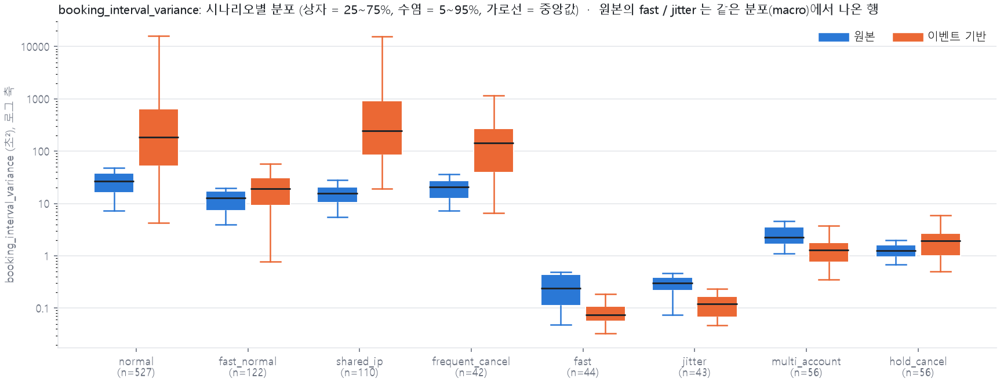
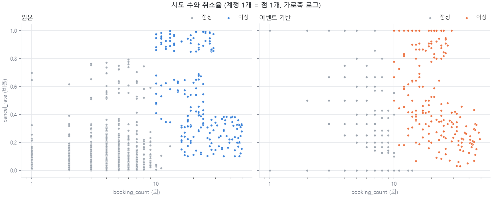
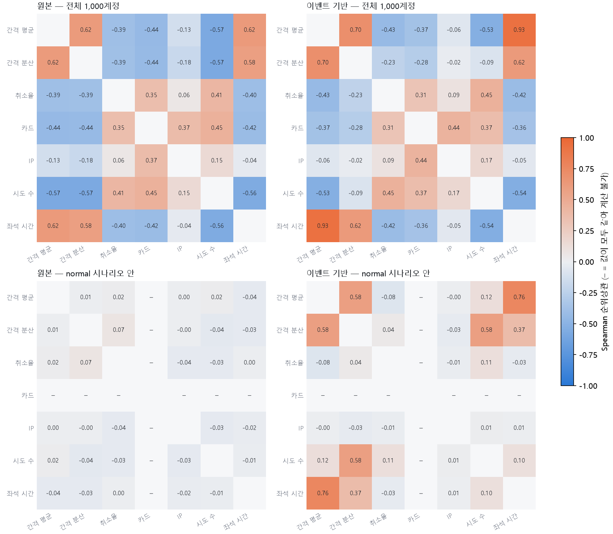
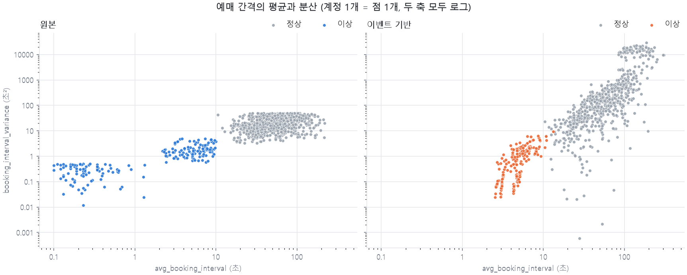
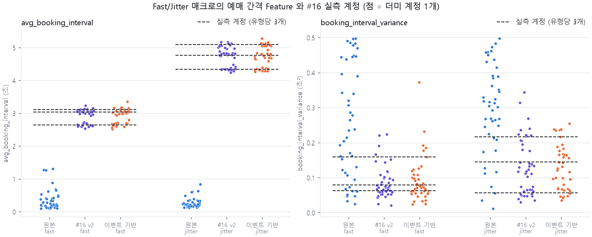
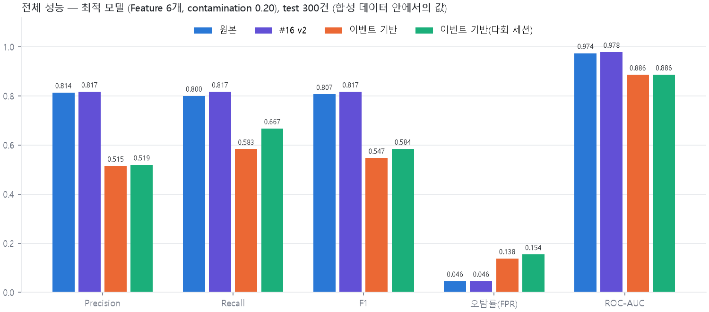
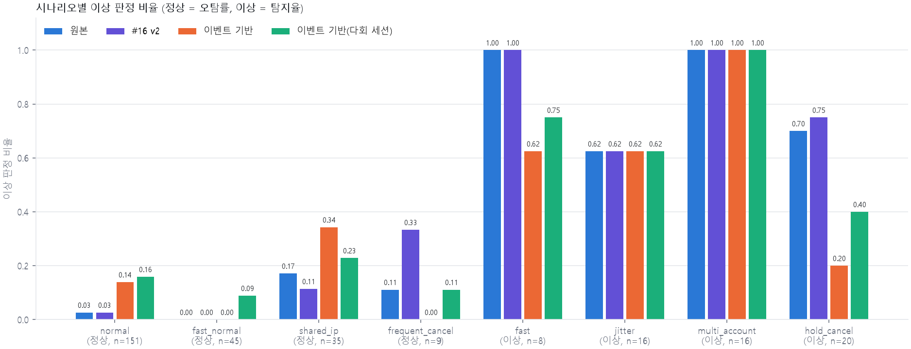
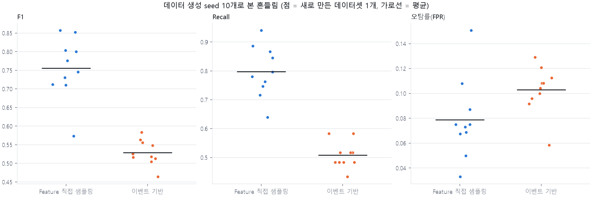

# 이벤트 기반 더미데이터 생성 및 이상탐지 성능 비교 (Issue #17 보고서)

작성일 2026-11-23. `experiments/issue17-event-based-dummy/` 에 저장된 파일의 값을 정리한 문서다. 각 절에 출처 파일을 적었다.
실행 방법은 [`README.md`](README.md) 에 있다.

## 요약

기존 더미데이터는 계정 1행마다 Feature 값을 서로 독립인 분포에서 직접 뽑는다.
이번에는 계정의 행동 이벤트(예매 시도 단계, 예매 완료, 취소)를 먼저 만들고, 그 이벤트에서 기존 추출 로직으로 Feature 를 계산해 별도의 데이터셋을 만들었다.
기존 데이터셋과 #14·#16 의 결과는 바뀌지 않았다 (실행 전후 sha256 동일).

| 질문 | 답 | 근거 |
|---|---|---|
| 1. 이벤트 기반 방식이 행동과 Feature 사이의 관계를 더 일관되게 반영하는가 | **그렇다. 다만 "일관된다"는 것이지 "현실적이다"는 것이 아니다** | 한 행 안에서 판정할 수 있는 관계 5가지를 원본은 34~996행에서 어기고, 이벤트 기반은 0행이다. 시나리오 안에서 간격 평균–분산의 순위상관이 원본 −0.16~0.09, 이벤트 기반 0.41~0.81 이다 |
| 2. 생성 방식의 변경이 Isolation Forest 평가에 어떤 영향을 주는가 | **같은 조건에서 지표가 뚜렷하게 낮아졌다.** F1 0.807 → 0.547, 오탐률 0.046 → 0.138, ROC-AUC 0.974 → 0.886 | 모델 seed 20개, 데이터 생성 seed 10개의 흔들림보다 큰 차이다. 생성 가정 5가지를 하나씩 바꿔도 F1 은 0.51~0.60 이었다 |

두 번째 답을 읽을 때 지켜야 할 것:

- 두 데이터셋은 생성 방식만 다른 것이 아니다. 정상 사용자의 시간 분포, 시도 결과 확률, 결제 비율 같은 **새 가정이 함께 들어갔고 분포도 달라졌다.** 지표 차이가 "생성 방식" 때문이라고 단정할 수 없다.
- 학습과 평가가 모두 합성 데이터다. **여기의 수치는 실제 사용자에 대한 탐지 성능이 아니다.** 원본의 높은 지표도, 이벤트 기반의 낮은 지표도 실제 성능을 말해 주지 않는다.
- 실측 근거가 있는 것은 Fast/Jitter 매크로의 시간뿐이다 (#16, 유형당 3계정). 나머지 Feature 와 시나리오는 현실성이 검증되지 않았다.

---

## 1. 기존 코드와 데이터 구조

| 항목 | 위치 | 확인한 내용 |
|---|---|---|
| 더미 생성 | `ml_experiment/generate_dummy_data.py` | 계정마다 시나리오를 뽑고, 7개 컬럼을 시나리오별 분포에서 **서로 독립으로** 뽑는다. seed 42, 1,000행. 이 코드를 seed 42 로 다시 실행하면 커밋된 파일과 같다 (확인함) |
| 데이터셋 | `ml_experiment/data/fairticket_synthetic_features.csv` | `user_id, scenario, is_anomaly` + Feature 7개. 이상 19.9%. 시나리오 7개. #16 v2 는 `macro` 87행을 `fast` 44 / `jitter` 43 으로 나누고 간격 Feature 2개만 실측으로 바꾼 것 |
| Feature 계산 (BTS) | `ticket-fds-admin` `FeatureAggregationService.calculate`, `BehaviorEventRepository` | `behavior_event` 의 최근 30일 이벤트에서 6개를 계산한다 |
| Feature 계산 (AI 레포) | `experiments/issue14-real-validation/scripts/extract_features.py` | BTS 식을 그대로 옮긴 것. BTS 의 단위 테스트를 옮긴 테스트 10개가 있다 |
| 학습·평가 | `ml_experiment/train_and_evaluate_if.py` | 전처리 없음, 7:3 분할(seed 42, stratify), `IsolationForest(n_estimators=100, random_state=42)`. 최적 모델은 `seat_selection_latency` 를 뺀 6개 · contamination 0.20 |
| 이전 실험 | `experiments/issue14-…`, `experiments/issue16-…` | #14: 실측 이벤트 추출·점수. #16: Fast/Jitter 예매 간격 실측과 보정 더미 v1·v2, 같은 조건의 모델 비교 스크립트 |

참고: `docs/predict_feature_spec.md` 와 `backend` 레포의 `FeatureAggregationService` 는 이전 스펙(`cancelCount`, `shortIntervalBookingCount` 등)이다. 현재 6개 Feature 의 기준은 `ticket-fds-admin` 쪽 코드다.

### Feature 6개는 이벤트에서 계산되는가

| Feature | BTS 계산 | 필요한 이벤트 | 계산할 수 없는 경우 |
|---|---|---|---|
| `booking_count` | 고유 `attemptId` 수 | `BOOKING_ATTEMPT` | 없음 (0 이상) |
| `avg_booking_interval` | 연속한 시도 시작 시각 차이의 평균 (초, 밀리초 단위) | `BOOKING_ATTEMPT` | 시도 2건 미만 → null |
| `booking_interval_variance` | 같은 간격의 모분산 | `BOOKING_ATTEMPT` | 시도 2건 미만 → null. 시도 2건이면 항상 0 |
| `cancel_rate` | 취소된 완료 예매 / 완료 예매 | `BOOKING`, `CANCEL` | 완료 예매 0건 → null |
| `card_reuse_count` | 내가 쓴 결제 식별자로 예매한 고유 계정 수의 최댓값 | `BOOKING` 의 `paymentIdentifier` | 완료 예매 0건 → 기본값 1 |
| `ip_booking_density` | 내가 쓴 IP 로 예매한 고유 계정 수의 최댓값 | `BOOKING` 의 `ipAddress` | 완료 예매 0건 → 기본값 1 |

**6개 모두 이벤트에서 계산된다.** 7번째 컬럼 `seat_selection_latency` 는 BTS 가 계산하지 않고 기존 정의도 없다.
단계 이벤트로 계산할 수는 있어서 컬럼을 맞추려고 넣었지만 (선점 성공 − 좌석 선택 진입, 계정 평균) 그 정의는 이 실험의 가정이고, 기준 모델은 이 컬럼을 쓰지 않는다.

이벤트로 옮기면서 드러난 점:

- 기존 더미의 `hold_cancel` 은 주석에 "미입금 취소 반복"이라고 돼 있지만, **결제하지 않은 선점은 `BOOKING`·`CANCEL` 이벤트를 만들지 않아 `cancel_rate` 에 잡히지 않는다.** 높은 취소율이 나오려면 결제까지 한 뒤 취소해야 한다.
- 카드·IP 공유 수는 상대 계정이 실제로 있어야 하는 값이다. 계정마다 숫자를 따로 뽑으면 "나와 같은 카드를 쓰는 계정"이 데이터 안에 없다.

---

## 2. 이벤트 생성

### 흐름

1. **계정**: #16 v2 의 1,000계정을 그대로 쓴다 (같은 `user_id`, 시나리오, 레이블).
2. **공유 관계**: 시나리오 안에서 같은 IP 를 쓰는 계정 묶음과 카드를 먼저 만든다. 이벤트보다 먼저 정해지는 것은 "누가 누구와 무엇을 같이 쓰는가"와 계정의 행동 성향뿐이다.
3. **시도**: 계정은 티켓 오픈 시각 이후에 접속해 시도를 차례로 진행한다. 다음 시도는 이전 시도를 떠난 뒤에 시작한다.
   시도 1건 = `STARTED → QUEUE → SEAT_SELECTION → SEAT_HOLD → PAYMENT → (BOOKING) → COMPLETED`.
   중간 결과는 좌석 선택 중 이탈, 결제 화면 이탈, 결제 화면에서 선점 만료(5분), 선점만 해 두고 다음 좌석으로 이동 4가지다.
4. **취소**: 완료된 예매는 계정의 취소 성향에 따라 나중에 `CANCEL` 된다. 계산 시각 이후의 취소는 아직 일어나지 않은 일이므로 이벤트를 만들지 않는다 (12건).
5. Feature 값은 어디에서도 입력으로 쓰지 않는다. 생성 설정과 생성기 코드에 Feature 컬럼 이름이 등장하지 않는 것을 테스트가 확인한다.

이벤트 형식은 #16 실측에서 내보낸 `behavior_event` 와 같다 (이벤트 종류, 단계·상태 이름, metadata 키).

| 생성 결과 (기본 데이터셋) | 값 |
|---|---|
| 이벤트 | 56,910건 (`BOOKING_ATTEMPT` 47,657 / `BOOKING` 7,185 / `CANCEL` 2,068) |
| 시도 | 8,322건: 완료 7,185, 좌석 선택 중 이탈 454, 선점만 두고 이동 404, 결제 화면 이탈 184, 결제 화면에서 선점 만료 95 |
| 기간 | 2026-10-27 ~ 2026-11-22 (계산 시각 2026-11-23T00:00Z, 분석 기간 30일 안) |
| 공유 묶음 | normal 2인 가구, shared_ip 4~6계정(23곳), fast·jitter 운영자당 1~3계정, multi_account 링 7개(5~11계정, 카드당 4~7계정), hold_cancel 1~2계정 |

출처: `data/single_session/generation.json`, `accounts.csv`, `attempts.csv`

### 시나리오와 값의 근거

값의 근거는 `config/scenarios.json` 에 항목마다 적혀 있다. 요약하면:

| 근거 | 뜻 | 해당하는 값 |
|---|---|---|
| **실측** (#16) | 격리 환경에서 매크로를 돌려 측정 | Fast/Jitter 의 시도별 단계 소요 시간, 다음 시도까지의 간격, 시도가 모두 완료됨 |
| **코드** | 데모 코드에서 확인 | 선점 유효 시간 5분, 이벤트 형식 |
| **기존 더미 승계** | 기존 생성 코드의 분포를 그대로 가져옴. 실측 근거 없음 | 시도 수, 계정의 취소 성향, IP·카드 공유 범위, 좌석 선택 시간의 수준, 정상 사용자 계정 간 속도 차이 |
| **새 가정** | 이번에 임시로 둔 값. 실측 근거 없음 | 정상·다중 계정·선점 후 취소의 단계별 시간(좌석 선택 제외), 시도 안에서의 시간 변동, 시도 결과 확률, 선점 후 취소의 결제 비율(0.4~0.9), 취소까지의 지연, 접속 시각, 티켓 오픈 일정, 계정당 오픈 1회 참여 |

| 시나리오 | 계정 | 행동 | 시간의 근거 |
|---|---|---|---|
| `normal` 정상 사용자 | 527 | 시도 1 + Poisson(3)회. 좌석 선택 약 20초, 결제 약 15초, 다음 시도까지 약 20초. 80% 완료 | 승계 + 새 가정 |
| `fast_normal` 빠른 정상 | 122 | 좌석 선택 약 2초, 결제 약 7초. 90% 완료 | 승계 + 새 가정 |
| `shared_ip` 동일 IP 정상 | 110 | normal 보다 조금 빠름. 4~6계정이 한 IP | 승계 + 새 가정 |
| `frequent_cancel` 취소 잦은 정상 | 42 | normal 과 비슷한 속도, 완료한 예매의 50~80% 를 취소 | 승계 + 새 가정 |
| `fast` Fast 매크로 | 44 | 시도 15~49회, 모두 완료. 실측 계정 하나를 배정하고 그 계정의 실측 시도를 통째로 복원추출 | **실측** |
| `jitter` Jitter 매크로 | 43 | 같은 방식, Jitter 실측 계정 | **실측** |
| `multi_account` 다중 계정 | 56 | 링 안에서 IP 와 카드를 공유. 시도 10~24회, 좌석 선택 약 1.1초 | 승계 + 새 가정 |
| `hold_cancel` 선점 후 취소 | 56 | 시도 10~29회. 좌석을 선점한 뒤 계정별 비율(0.4~0.9)로 결제 후 대부분 취소, 나머지는 결제 없이 선점만 두고 이동(5분 뒤 만료) | 승계 + 새 가정 |

Fast/Jitter 에서 실측이 아닌 것: 시도 수(실측은 20회로 정해 놓고 돌림), 취소(실측은 취소하지 않음), 카드·IP 공유(실측 환경은 모든 계정이 같은 카드·IP).

---

## 3. Feature 추출 검증

추출은 #14 의 `extract(events, calculated_at, …)` 를 import 해서 그대로 불렀다. 계산식은 바꾸지 않았다.

| 확인 | 결과 |
|---|---|
| 추출기가 BTS 계산식과 같은가 | #14 의 BTS 일치 테스트 10개 통과. Java 코드와 추출기를 직접 대조해 같은 식임을 확인 (시도 묶기, 밀리초 간격, 모분산, 취소율 분모, 공유 계정 수의 최댓값·최소 1) |
| 다른 방식으로 다시 계산한 값과 같은가 | 6개 Feature 모두 1,000계정에서 일치 (표 연산으로 독립 재계산) |
| 생성 기록과 맞는가 | 시도 수 = 생성한 시도 수, 완료·취소 예매 수 = 생성 기록, 카드·IP 공유 수 = 공유 묶음 안에서 완료 예매가 있는 계정 수. 모두 전 계정 일치 |
| 모든 이벤트가 분석 기간 안인가 | 56,910건 모두 안 |
| 형식 | 컬럼·자료형·행 순서·`is_anomaly` 가 원본과 같고 `scenario` 가 #16 v2 와 같음 |

### 계산할 수 없는 값

임의로 채우지 않고 빈 칸으로 두었다. 원인은 모두 BTS 계산식의 정의에서 나온다.

| 시나리오 | 계정 | 간격·분산 null (시도 1건) | 분산이 식으로 0 (시도 2건) | 취소율 null (완료 예매 0건) | 모델 입력에 결측이 있는 계정 |
|---|---|---|---|---|---|
| normal | 527 | 30 | 71 | 13 | 35 |
| shared_ip | 110 | 5 | 7 | 2 | 5 |
| fast_normal | 122 | 0 | 4 | 0 | 0 |
| 그 밖 5개 | 241 | 0 | 0 | 0 | 0 |
| 전체 | 1,000 | 35 | 82 | 15 | 40 |

- 결측은 정상 사용자에게만 생긴다. 시도 수가 적은 계정이 정상 쪽에만 있기 때문이다.
- 완료 예매가 없는 15계정은 카드·IP 공유 수가 기본값 1 이다. 공용 IP 를 쓰는 계정이라도 예매를 완료하지 못하면 `ip_booking_density` 가 1 로 나온다.
- 기존 더미에는 결측이 없다. 기존 학습 스크립트에도 결측 대체 단계가 없다 (6절에서 영향을 따로 본다).

출처: `output/feature_extraction/single_session/validation.json`, `null_report.csv`

---

## 4. 새 데이터셋

| | 원본 | #16 v2 | 이벤트 기반 (기본) |
|---|---|---|---|
| 경로 | `ml_experiment/data/fairticket_synthetic_features.csv` | `experiments/issue16-…/dummy_adjusted/v2/…_adjusted.csv` | `data/single_session/fairticket_event_based_features.csv` |
| sha256 | `2e1e27c1…` | `426a0967…` | `f430317a…` |
| 계정 / 이상 비율 | 1,000 / 0.199 | 같음 | 같음 |
| 생성 | Feature 직접 샘플링 | 원본 + 매크로 간격 2개만 실측 복원추출 | 이벤트 생성 → 추출 |

seed 42 로 다시 만들면 이벤트·계정·시도 파일과 Feature 데이터셋이 바이트 단위로 같다 (테스트 12개 통과).

### 기존 데이터셋과 비교할 수 있는 것과 어려운 것

| 구분 | 내용 |
|---|---|
| 그대로 비교 가능 | 계정, 행 순서, 레이블, 시나리오별 계정 수, 컬럼. 따라서 같은 행 번호로 train/test 를 나눌 수 있다 |
| 분포가 거의 같아 비교 가능 | `booking_count`, `card_reuse_count`, `ip_booking_density` — 기존 분포를 승계했고 결과도 비슷하다 (5절) |
| 실측과도 비교 가능 | Fast/Jitter 의 `avg_booking_interval`, `booking_interval_variance` |
| 직접 비교하기 어려움 | 정상·다중 계정·선점 후 취소의 간격·분산: 단계별 시간이라는 새 가정에서 나온 값이라, 차이가 생성 방식 때문인지 가정 때문인지 나눌 수 없다 |
| | `cancel_rate`: 이벤트 기반은 "취소 건수 / 완료 예매 수"라 띄엄띄엄한 값만 나오고, 원본은 연속값이다 |
| | 결측: 이벤트 기반에만 있다 |
| | `seat_selection_latency`: 정의가 이 실험의 가정이다 |
| | 원본의 `macro`: 원본에는 Fast/Jitter 구분이 없다. 같은 87행을 #16 v2 의 배정대로 나눠서 봤다 |

---

## 5. 데이터 분포 비교

세 데이터셋(원본, #16 v2, 이벤트 기반)은 같은 1,000계정이다. 아래 표는 원본과 이벤트 기반을 나란히 놓았다. 모든 통계량은 `output/distribution_comparison/feature_stats.csv` 에 있다 (시나리오별 포함).

### 5.1 전체 · 정상 · 이상

**전체 (1,000계정)**

| Feature | 데이터 | 결측 | 평균 | 중앙값 | 표준편차 | 최소 | 최대 |
|---|---|---|---|---|---|---|---|
| `avg_booking_interval` | 원본 | 0 | 48.08 | 42.59 | 37.67 | 0.100 | 218.3 |
| | 이벤트 기반 | 35 | 56.04 | 43.96 | 51.26 | 2.52 | 367.1 |
| `booking_interval_variance` | 원본 | 0 | 18.71 | 16.60 | 14.30 | 0.012 | 49.94 |
| | 이벤트 기반 | 35 | 1,297 | 34.26 | 4,025 | 0.000 | 28,994 |
| `cancel_rate` | 원본 | 0 | 0.204 | 0.111 | 0.240 | 0.000 | 0.998 |
| | 이벤트 기반 | 15 | 0.203 | 0.000 | 0.292 | 0.000 | 1.00 |
| `card_reuse_count` | 원본 | 0 | 1.30 | 1.00 | 1.10 | 1.00 | 7.00 |
| | 이벤트 기반 | 0 | 1.26 | 1.00 | 1.01 | 1.00 | 7.00 |
| `ip_booking_density` | 원본 | 0 | 2.15 | 1.00 | 1.94 | 1.00 | 11.00 |
| | 이벤트 기반 | 0 | 2.19 | 1.00 | 2.01 | 1.00 | 11.00 |
| `booking_count` | 원본 | 0 | 8.38 | 5.00 | 9.44 | 1.00 | 49.00 |
| | 이벤트 기반 | 0 | 8.32 | 5.00 | 8.97 | 1.00 | 49.00 |
| `seat_selection_latency` (실험 가정) | 원본 | 0 | 21.21 | 10.25 | 28.06 | 0.100 | 224.2 |
| | 이벤트 기반 | 9 | 17.04 | 14.29 | 17.59 | 0.400 | 145.2 |

**정상 (801계정) / 이상 (199계정)** — 차이가 큰 Feature 만

| Feature | 집단 | 데이터 | 평균 | 중앙값 | 표준편차 | 최소 | 최대 |
|---|---|---|---|---|---|---|---|
| `avg_booking_interval` | 정상 | 원본 | 59.20 | 52.40 | 33.87 | 10.60 | 218.3 |
| | | 이벤트 기반 | 69.32 | 54.63 | 49.54 | 10.41 | 367.1 |
| | 이상 | 원본 | 3.32 | 2.93 | 3.11 | 0.100 | 9.96 |
| | | 이벤트 기반 | 4.93 | 4.69 | 1.86 | 2.52 | 13.25 |
| `booking_interval_variance` | 정상 | 원본 | 23.05 | 20.14 | 12.65 | 3.28 | 49.94 |
| | | 이벤트 기반 | 1,634 | 90.51 | 4,457 | 0.000 | 28,994 |
| | 이상 | 원본 | 1.21 | 0.868 | 1.17 | 0.012 | 4.93 |
| | | 이벤트 기반 | 1.09 | 0.500 | 1.42 | 0.024 | 9.30 |
| `cancel_rate` | 정상 | 원본 | 0.128 | 0.084 | 0.147 | 0.000 | 0.795 |
| | | 이벤트 기반 | 0.126 | 0.000 | 0.230 | 0.000 | 1.00 |
| | 이상 | 원본 | 0.508 | 0.388 | 0.297 | 0.101 | 0.998 |
| | | 이벤트 기반 | 0.508 | 0.414 | 0.311 | 0.029 | 1.00 |

### 5.2 시나리오별 (중앙값 [최소~최대])

| Feature | 데이터 | normal | fast_normal | shared_ip | frequent_cancel | fast | jitter | multi_account | hold_cancel |
|---|---|---|---|---|---|---|---|---|---|
| `avg_booking_interval` | 원본 | 61.75 [10.60~218.3] | 28.03 [15.14~39.98] | 46.08 [12.84~153.3] | 58.44 [19.72~167.7] | 0.250 [0.100~1.31] | 0.230 [0.120~0.840] | 6.80 [3.04~9.96] | 5.05 [2.18~7.96] |
| | 이벤트 기반 | 67.71 [10.78~367.1] | 23.46 [10.41~52.76] | 58.84 [16.70~308.0] | 56.95 [22.03~225.4] | 3.02 [2.52~3.36] | 4.72 [4.27~5.29] | 5.87 [3.46~13.25] | 5.08 [2.67~10.74] |
| `booking_interval_variance` | 원본 | 26.71 [5.00~49.94] | 12.76 [3.28~19.95] | 15.56 [4.14~29.85] | 20.83 [5.50~39.49] | 0.237 [0.025~0.498] | 0.305 [0.012~0.498] | 2.25 [1.01~4.93] | 1.24 [0.583~1.99] |
| | 이벤트 기반 | 130.9 [0.000~28,994] | 18.49 [0.000~137.4] | 224.9 [0.000~18,225] | 143.3 [0.733~8,282] | 0.074 [0.024~0.372] | 0.121 [0.035~0.255] | 1.30 [0.255~9.30] | 1.93 [0.302~6.37] |
| `cancel_rate` | 원본 | 0.078 [0.000~0.517] | 0.084 [0.002~0.415] | 0.076 [0.003~0.335] | 0.639 [0.510~0.795] | 0.229 [0.102~0.388] | 0.246 [0.101~0.383] | 0.487 [0.308~0.689] | 0.927 [0.850~0.998] |
| | 이벤트 기반 | 0.000 [0.000~1.00] | 0.000 [0.000~0.800] | 0.000 [0.000~1.00] | 0.667 [0.000~1.00] | 0.232 [0.029~0.457] | 0.250 [0.029~0.481] | 0.464 [0.182~0.867] | 0.946 [0.643~1.00] |
| `card_reuse_count` | 원본 | 1 [1~1] | 1 [1~1] | 1 [1~1] | 1 [1~1] | 1.5 [1~2] | 1 [1~2] | 6 [4~7] | 1 [1~1] |
| | 이벤트 기반 | 1 [1~1] | 1 [1~1] | 1 [1~1] | 1 [1~1] | 1 [1~2] | 1 [1~2] | 5 [4~7] | 1 [1~1] |
| `ip_booking_density` | 원본 | 1 [1~2] | 1 [1~1] | 5 [4~6] | 1 [1~1] | 2 [1~3] | 2 [1~3] | 8 [5~11] | 1 [1~2] |
| | 이벤트 기반 | 1 [1~2] | 1 [1~1] | 5 [1~6] | 1 [1~1] | 2 [1~3] | 2 [1~3] | 9 [5~11] | 1.5 [1~2] |
| `booking_count` | 원본 | 4 [1~9] | 6 [1~13] | 5 [1~10] | 5 [1~9] | 32 [16~49] | 33 [16~49] | 18 [10~24] | 19 [10~29] |
| | 이벤트 기반 | 4 [1~11] | 6 [2~14] | 5 [1~10] | 5 [3~10] | 31 [15~49] | 32 [15~48] | 15.5 [10~24] | 20 [10~29] |
| `seat_selection_latency` (실험 가정) | 원본 | 22.13 [1.03~224.2] | 2.24 [1.22~3.00] | 24.49 [1.06~152.6] | 22.75 [1.99~97.90] | 0.460 [0.100~0.770] | 0.430 [0.110~0.770] | 1.19 [0.520~1.97] | 0.790 [0.310~1.17] |
| | 이벤트 기반 | 20.77 [2.30~145.2] | 2.14 [1.19~4.15] | 16.48 [4.70~114.0] | 16.80 [6.29~58.20] | 0.530 [0.460~0.690] | 1.11 [0.920~1.24] | 1.07 [0.560~2.29] | 0.735 [0.400~1.48] |

원본의 `fast` / `jitter` 는 같은 분포(`macro`)에서 나온 행이다.

분포 차이의 요점 (KS 통계량은 `distance_vs_event.csv`):

- **거의 같다**: `booking_count`, `card_reuse_count`, `ip_booking_density` (시나리오별 KS 0.00~0.27). 기존 분포를 승계했기 때문이다.
- **중심은 비슷하고 퍼짐이 다르다**: 정상 사용자의 `avg_booking_interval` (KS 0.15~0.29). 중앙값은 가깝지만 이벤트 기반의 꼬리가 길다 (최대 218초 → 367초).
- **크게 다르다**: 정상 사용자의 `booking_interval_variance` (KS 0.46~0.82). 원본은 5~50초² 에 갇혀 있고, 이벤트 기반은 0~28,994초² 에 걸쳐 있다.
  원본은 평균 약 60초인 간격의 표준편차가 2~7초라는 뜻인데, 이벤트 기반은 단계 시간의 변동과 긴 대기(선점 만료 5분)가 그대로 분산에 들어간다.
  결제 화면에서 선점 만료까지 기다린 시도가 있는 정상 계정 88개는 분산의 중앙값이 13,073초² 이고, 없는 계정 678개는 63초² 이다.
- **모양이 다르다**: `cancel_rate`. 이벤트 기반 정상 사용자의 중앙값은 0 이다 (완료 예매 3~4건에 취소 성향 약 0.1 이면 대부분 0건 취소). 값은 0, 1/4, 1/3, 1/2, … 처럼 띄엄띄엄하고, 예매 1건을 취소한 정상 계정은 1.0 이 된다. 평균은 원본과 같다 (0.128 대 0.126).
- **실측으로 옮겨졌다**: `fast` / `jitter` 의 간격 (5.4절).

### 5.3 Feature 간 관계

전체 1,000계정의 상관은 두 데이터셋이 비슷하다. 시나리오가 섞이면서 생기는 상관(매크로는 간격이 짧고 시도가 많다)이 양쪽에 다 있기 때문이다.
차이는 **시나리오 안에서** 드러난다. 원본은 시나리오 안에서 모든 Feature 가 독립이고, 이벤트 기반은 같은 행동에서 나온 Feature 끼리 맞물린다.

| 시나리오 안의 Spearman 순위상관 | 원본 (8개 시나리오의 범위) | 이벤트 기반 (범위) |
|---|---|---|
| 간격 평균 – 간격 분산 | −0.16 ~ 0.09 | 0.41 ~ 0.81 |
| 간격 평균 – 좌석 선택 시간 | −0.05 ~ 0.10 | 0.76 ~ 0.97 |
| 간격 분산 – 시도 수 | −0.22 ~ 0.11 | 0.05 ~ 0.58 |
| 카드 공유 – IP 공유 (fast, jitter) | 0.05, −0.01 | 0.24, 0.39 |

출처: `correlations.csv`, `within_scenario_correlation.csv`

### 5.4 비현실적인 값과 행동 조합

행 하나의 값만으로 판정할 수 있는 관계만 골랐다. "현실적인가"가 아니라 "행동에서 나올 수 있는 값인가"를 보는 검사다.

| 검사 | 근거 | 원본 | #16 v2 | 이벤트 기반 |
|---|---|---|---|---|
| 시도 1건 이하인데 간격 값이 있음 | 간격은 시도 2건 이상에서만 정의된다 (BTS 는 null) | 34 / 34 | 34 / 34 | 0 / 35 |
| 시도 2건인데 분산이 0 이 아님 | 간격 1개의 모분산은 0 이다 | 85 / 85 | 85 / 85 | 0 / 82 |
| 분산이 수학적 상한을 넘음 | 음이 아닌 간격 n 개의 평균이 m 이면 모분산 ≤ m²·(n−1) | 91 / 966 | 85 / 966 | 0 / 965 |
| 취소율이 (정수 / 시도 수 이하의 정수)로 나올 수 없는 값 | 완료 예매 수는 시도 수 이하의 정수다 | 996 / 1,000 | 996 / 1,000 | 0 / 985 |
| 좌석 선택 시간 > 평균 예매 간격 | 한 번에 한 시도씩이면 다음 시도는 좌석 선택 뒤에 시작한다 (컬럼 정의는 실험 가정) | 172 / 1,000 | 112 / 1,000 | 0 / 964 |
| 카드·IP 공유 수의 상대 계정이 실제로 있음 | 공유 수 k 는 같은 값을 쓴 계정이 k 개라는 뜻이다 | 확인 불가 | 확인 불가 | 전 계정 일치 |

값은 `어긴 행 / 해당하는 행`. 원본은 누구와 공유하는지에 대한 정보가 없어 마지막 검사를 할 수 없다.
이벤트 기반에서 0 인 것은 만든 방법에서 나오는 결과다 (값이 이벤트에서 계산되므로 어길 수 없다). 다섯 번째 검사는 계정 평균끼리의 비교라 반드시 성립하는 관계는 아니다 (다회 세션 변형에서 1행이 어긴다).

이벤트 기반 데이터에서 눈여겨볼 조합:

- 예매 1건을 취소해서 취소율 1.0 이 된 정상 계정, 완료 예매가 없어 공용 IP 인데도 `ip_booking_density` 가 1 인 계정. BTS 계산식에서 실제로 나올 수 있는 값이다.
- 선점 만료를 한 번 기다린 정상 계정의 분산이 1만 초² 대로 커진다. 그런 시도의 비율(정상 3%)은 새 가정이다.

출처: `consistency_checks.csv`

### 5.5 예매 간격: 실측과의 비교 (Fast/Jitter)

#16 에서 실측으로 검증한 것은 이 두 Feature 뿐이다. 실측 계정은 유형당 3개(간격 19개씩)다.

| 유형 | Feature | 데이터 | 계정 수 | 평균 | 중앙값 | 표준편차 | 범위 | 실측과의 Wasserstein 거리 | 실측 계정 중 범위 안 |
|---|---|---|---|---|---|---|---|---|---|
| Fast | `avg_booking_interval` (초) | 실측 계정 | 3 | 2.936 | 3.040 | 0.256 | 2.644~3.123 | — | — |
| | | 원본 | 44 | 0.364 | 0.250 | 0.309 | 0.100~1.310 | 2.572 | 0 / 3 |
| | | #16 v2 | 44 | 2.917 | 3.015 | 0.212 | 2.540~3.240 | 0.039 | 3 / 3 |
| | | 이벤트 기반 | 44 | 2.931 | 3.025 | 0.221 | 2.520~3.360 | 0.050 | 3 / 3 |
| | `booking_interval_variance` (초²) | 실측 계정 | 3 | 0.101 | 0.079 | 0.051 | 0.063~0.159 | — | — |
| | | 원본 | 44 | 0.258 | 0.237 | 0.162 | 0.025~0.498 | 0.162 | 3 / 3 |
| | | #16 v2 | 44 | 0.087 | 0.072 | 0.047 | 0.022~0.224 | 0.022 | 3 / 3 |
| | | 이벤트 기반 | 44 | 0.093 | 0.074 | 0.063 | 0.024~0.372 | 0.026 | 3 / 3 |
| Jitter | `avg_booking_interval` (초) | 실측 계정 | 3 | 4.737 | 4.770 | 0.382 | 4.339~5.102 | — | — |
| | | 원본 | 43 | 0.276 | 0.230 | 0.153 | 0.120~0.840 | 4.461 | 0 / 3 |
| | | #16 v2 | 43 | 4.732 | 4.810 | 0.311 | 4.250~5.180 | 0.050 | 3 / 3 |
| | | 이벤트 기반 | 43 | 4.710 | 4.720 | 0.326 | 4.270~5.290 | 0.057 | 3 / 3 |

Jitter 의 분산과 그 밖의 값은 `macro_interval_vs_measured.csv` 에 있다.

- 이벤트 기반의 Fast/Jitter 간격은 #16 v2 와 같은 수준으로 실측에 가깝다. 같은 실측 계정을 같은 계층적 방식으로 썼기 때문이다.
- **이 일치는 독립 검증이 아니다.** 이벤트 기반도 v2 도 비교에 쓴 바로 그 실측 계정으로 만들었다. 독립인 비교는 원본뿐이다.
- 이벤트 기반에는 개별 간격이 있다 (기존 더미에는 없다). 생성된 개별 간격 2,631개는 모두 실측에서 관측된 값이고, 실측 개별 간격과의 Wasserstein 거리는 Fast 0.012초, Jitter 0.023초다.
- v2 와 다른 점: v2 는 두 Feature 만 바꿨고, 이벤트 기반은 같은 실측 시도에서 좌석 선택 시간·결제 시간도 함께 가져온다. 그래서 매크로 계정 안에서 간격과 좌석 선택 시간이 맞물린다 (순위상관 0.88, 0.90).

**실측 근거가 없는 나머지는 현실성이 검증되지 않았다.** 정상 사용자의 모든 Feature, `multi_account`·`hold_cancel` 의 모든 Feature, 매크로의 시도 수·취소율·카드·IP 가 여기에 해당한다.

---

## 6. Isolation Forest 성능 비교

### 조건

| 항목 | 값 |
|---|---|
| 기준 구성 | Feature 6개 (`seat_selection_latency` 제외), contamination 0.20 — 기존 스크립트의 "최적 모델" |
| 전처리 | 없음. 결측도 채우지 않고 그대로 넣는다 (기존 코드에 대체 단계가 없고, scikit-learn 1.9.1 의 Isolation Forest 는 결측을 받는다) |
| 분할 | `train_test_split(test_size=0.3, random_state=42, stratify=is_anomaly)` → train 700 / test 300 (이상 60). 모든 데이터셋에 같은 행 번호 |
| 모델 | `IsolationForest(n_estimators=100, random_state=42)`, 나머지 기본값. train 전체로 학습 (레이블 미사용) |
| 예측 · 점수 | `predict == -1` → 이상. ROC-AUC 는 `decision_function` 을 test 안에서 0~1 로 정규화한 점수로 계산 |

조건은 #16 `compare_if_models.py` 의 함수와 상수를 import 해서 그대로 썼다. 모델 파일은 저장하지 않았다.

### 6.1 전체 성능과 혼동행렬 (기준 구성, test 300건)

| 데이터셋 | Precision | Recall | F1 | 오탐률 | ROC-AUC | TP | FP | TN | FN |
|---|---|---|---|---|---|---|---|---|---|
| 원본 | 0.814 | 0.800 | 0.807 | 0.046 | 0.974 | 48 | 11 | 229 | 12 |
| #16 v2 | 0.817 | 0.817 | 0.817 | 0.046 | 0.978 | 49 | 11 | 229 | 11 |
| **이벤트 기반** | 0.515 | 0.583 | 0.547 | 0.138 | 0.886 | 35 | 33 | 207 | 25 |
| 이벤트 기반 (다회 세션, 참고) | 0.519 | 0.667 | 0.584 | 0.154 | 0.886 | 40 | 37 | 203 | 20 |

기존 스크립트의 다른 구성에서도 방향이 같다 (`metrics_all_configs.csv`).
예매 간격 2개를 뺀 구성에서는 차이가 작다: 원본 F1 0.835, 이벤트 기반 0.800.

### 6.2 시나리오별 이상 판정 (test)

| 시나리오 | 실제 | test 수 | 원본 | #16 v2 | 이벤트 기반 |
|---|---|---|---|---|---|
| normal | 정상 | 151 | 4 (2.6%) | 4 (2.6%) | 21 (13.9%) |
| fast_normal | 정상 | 45 | 0 | 0 | 0 |
| shared_ip | 정상 | 35 | 6 (17.1%) | 4 (11.4%) | 12 (34.3%) |
| frequent_cancel | 정상 | 9 | 1 (11.1%) | 3 (33.3%) | 0 |
| fast | 이상 | 8 | 8 (100%) | 8 (100%) | 5 (62.5%) |
| jitter | 이상 | 16 | 10 (62.5%) | 10 (62.5%) | 10 (62.5%) |
| multi_account | 이상 | 16 | 16 (100%) | 16 (100%) | 16 (100%) |
| hold_cancel | 이상 | 20 | 14 (70.0%) | 15 (75.0%) | 4 (20.0%) |

정상 시나리오의 값은 오탐, 이상 시나리오의 값은 탐지다. test 의 시나리오별 계정이 8~20개인 곳은 1~2건으로 비율이 크게 움직인다.

바뀐 것은 두 곳이다: **정상 사용자의 오탐이 늘었고 (normal 4 → 21, shared_ip 6 → 12), `hold_cancel` 의 탐지가 줄었다 (14 → 4).**
`multi_account` 와 `jitter` 는 그대로다.

### 6.3 차이가 우연인가

| 바꾼 것 | 원본 (또는 직접 샘플링) F1 | 이벤트 기반 F1 |
|---|---|---|
| 모델 seed 20개 (같은 데이터) | 평균 0.818, 표준편차 0.049, 0.672~0.908 | 평균 0.550, 표준편차 0.040, 0.488~0.619 |
| 데이터 생성 seed 10개 (데이터셋을 새로 만듦) | 평균 0.756, 표준편차 0.083, 0.574~0.857 | 평균 0.529, 표준편차 0.034, 0.464~0.583 |

- 생성 seed 반복에서 직접 샘플링 쪽은 기존 생성 코드를 seed 0~9 로 다시 돌린 것이다 (seed 마다 시나리오 배정도 달라지고, 매크로는 Fast/Jitter 로 나누지 않은 원래 분포다). 이벤트 기반 쪽은 계정·시나리오는 그대로 두고 이벤트만 새로 만들었다.
- 커밋된 원본(seed 42)의 F1 0.807 은 직접 샘플링 10개의 평균 0.756 보다 높은 쪽이다.
- 두 방식의 F1 범위는 거의 겹치지 않는다 (직접 샘플링의 최솟값 0.574, 이벤트 기반의 최댓값 0.583). **차이는 seed 흔들림보다 크다.**

### 6.4 무엇이 지표를 바꿨는가 (확인한 것과 추정을 구분)

**확인 1 — 결측 행은 전부 이상으로 판정됐다.**
이벤트 기반 test 에는 모델 입력에 결측이 있는 계정이 16개 있고 (모두 정상), 16개 모두 이상으로 판정됐다. 오탐 33건 중 16건이 이것이다.
결측 행을 빼고 같은 모델의 지표를 다시 세면 Precision 0.673, Recall 0.583, F1 0.625, 오탐률 0.076, ROC-AUC 0.916 이다.
즉 차이의 일부는 "시도가 1건뿐인 정상 계정을 어떻게 다루는가"에서 나온다. 서빙 코드(`inference.py`)는 이런 계정에 `INSUFFICIENT_DATA` 를 돌려주지만 학습·평가 스크립트에는 그 단계가 없다.

**확인 2 — 결측을 빼고 남는 오탐은 대부분 분산이 큰 정상 계정이다.**
결측이 없는 오탐 17건 중 16건이 `booking_interval_variance` 3,000초² 이상인 계정이다. 17건 중 14건은 결제 화면에서 선점 만료(5분)까지 기다린 시도가 있는 계정이다.

**확인 3 — Feature 묶음을 하나씩 바꿔 보면 간격 2개의 영향이 가장 크다.**
원본에 이벤트 기반의 값을 한 묶음씩만 넣어 다시 학습·평가했다 (같은 계정의 값으로 교체. 행 안의 일관성은 깨지므로 진단용이다).

| 원본에 넣은 이벤트 기반 값 | F1 (원본 0.807) | 오탐률 (0.046) | `hold_cancel` 탐지 (14/20) |
|---|---|---|---|
| 예매 간격 2개 | 0.567 | 0.108 | 6 / 20 |
| 취소율 | 0.721 | 0.046 | 7 / 20 |
| 카드·IP | 0.760 | 0.062 | 13 / 20 |
| 시도 수 | 0.823 | 0.054 | 17 / 20 |

**확인 4 — 한쪽으로 학습해 다른 쪽을 평가하면 판정 기준이 서로 맞지 않는다.**

| 학습 | 평가 | Precision | Recall | F1 | 오탐률 |
|---|---|---|---|---|---|
| 원본 | 원본 | 0.814 | 0.800 | 0.807 | 0.046 |
| 원본 | 이벤트 기반 | 0.388 | 0.833 | 0.529 | 0.329 |
| 이벤트 기반 | 원본 | 0.944 | 0.567 | 0.708 | 0.008 |
| 이벤트 기반 | 이벤트 기반 | 0.515 | 0.583 | 0.547 | 0.138 |

원본으로 학습한 모델은 이벤트 기반의 정상 사용자 240명 중 79명을 이상으로 본다 (shared_ip 83%, frequent_cancel 78%).
원본의 정상 사용자가 차지하는 좁은 범위(분산 5~50, 연속적인 낮은 취소율) 밖의 값이 이벤트 기반에는 많기 때문이다.

**확인 5 — 생성 가정을 하나씩 바꿔도 결과의 수준은 비슷하다.** (같은 seed, 기준 구성)

| 바꾼 가정 | F1 | 오탐률 | ROC-AUC | `hold_cancel` 탐지율 |
|---|---|---|---|---|
| 기본 설정 | 0.547 | 0.138 | 0.886 | 0.20 |
| 정상 사용자가 선점 만료까지 기다리는 시도 없음 | 0.600 | 0.129 | 0.911 | 0.40 |
| 정상 사용자의 시도 사이 시간 변동 절반 | 0.547 | 0.138 | 0.888 | 0.20 |
| 정상·다중 계정의 모든 시도가 완료 (이탈 없음) | 0.589 | 0.129 | 0.909 | 0.35 |
| 선점 후 취소가 항상 결제 후 취소 | 0.512 | 0.150 | 0.881 | 0.10 |
| 선점 후 취소가 대부분 미결제 (결제 비율 0.05~0.3) | 0.516 | 0.146 | 0.886 | 0.10 |

seed 하나씩의 결과라 0.03~0.05 의 차이는 흔들림 안이다. 마지막 설정에서는 `hold_cancel` 56계정 중 6계정의 취소율이 null 이 된다 (완료 예매가 없음).

**추정 (이 실험으로 확인하지 못함)**

- 전처리가 없어서 Isolation Forest 는 Feature 의 원래 범위 안에서 무작위로 나눌 위치를 고른다. 이벤트 기반의 분산은 0~28,994초² 이므로, 분산이 큰 소수의 정상 계정이 먼저 고립되고 contamination 0.20 의 몫을 차지한다. 그만큼 분산이 0~10초² 인 이상 계정은 정상 계정의 다수(중앙값 91초²)와 가까이 놓여 덜 고립된다.
- `hold_cancel` 의 탐지가 줄어든 것은, 원본에서는 취소율 0.85~1.0 이 이 시나리오만의 구간이었는데 이벤트 기반에서는 예매 1~2건을 모두 취소한 정상 계정도 1.0 이 되어 그 구간이 겹치기 때문일 수 있다.
- 로그 변환 같은 전처리를 넣으면 결과가 달라질 가능성이 크다. 기존 조건을 지키기 위해 이번에는 넣지 않았다.

출처: `output/model_comparison/` 의 `metrics.csv`, `confusion_matrix.csv`, `scenario_detection.csv`, `null_rows_effect.csv`, `model_seed_summary.csv`, `generation_seed_summary.csv`, `feature_swap.csv`, `cross_evaluation.csv`, `assumption_sensitivity.csv`

### 6.5 참고: 다회 세션 변형

계정이 30일 동안 오픈에 여러 번 참여한다고 두면(1 + Poisson(1)회), 오픈 사이의 며칠이 예매 간격에 들어간다.
`avg_booking_interval` 의 전체 중앙값이 44초에서 82,475초로, 분산의 중앙값이 34초² 에서 1.6×10¹⁰ 초² 로 바뀐다. Fast 매크로도 중앙값이 3.0초에서 39,020초가 된다.
BTS 계산식이 30일 전체의 시도 간격을 쓰기 때문이며, #14 가 실측에서 본 것과 같은 현상이다.
이 변형에서 기준 구성의 F1 은 0.584 다. 기존 더미의 간격 값(정상 약 60초, 매크로 수 초)은 "계정이 30일 동안 한 번의 연속된 세션에서만 시도한다"는 전제 위에서만 성립한다.

---

## 7. 결론

### 질문 1. 이벤트 기반 생성 방식이 기존 방식보다 행동 및 Feature 간 관계를 더 일관되게 반영하는가

**그렇다.** 확인한 것은 다음과 같다.

- 기존 방식은 Feature 를 독립으로 뽑아서, 행동에서 나올 수 없는 조합이 생긴다: 시도 1건인데 간격이 있는 34행, 시도 2건인데 분산이 0 이 아닌 85행, 분산이 수학적 상한을 넘는 91행, 정수 비로 나올 수 없는 취소율 996행. 이벤트 기반은 모두 0행이다.
- 기존 방식은 시나리오 안에서 Feature 끼리 상관이 없다 (−0.22~0.11). 이벤트 기반은 같은 시도에서 나온 Feature 가 맞물린다 (간격 평균–분산 0.41~0.81).
- 카드·IP 공유 수가 실제 공유 관계에서 나온다. 같은 카드를 쓰는 계정들이 데이터 안에 있고 서로의 값이 맞는다.
- BTS 계산식이 실제로 내는 결측(시도 1건의 간격, 완료 예매 0건의 취소율)과 띄엄띄엄한 취소율이 데이터에 나타난다.
- 이벤트 원본이 남아 있어서, Feature 정의가 바뀌면 같은 이벤트에서 다시 계산할 수 있다.

**다만 이것은 내부 일관성이지 현실성이 아니다.**

- 이벤트 기반에서 위 검사가 0 인 것은 만든 방법의 결과다. 값이 실제 사용자와 비슷하다는 뜻이 아니다.
- 실측으로 뒷받침되는 것은 Fast/Jitter 의 시간뿐이고, 그것도 생성에 쓴 실측과의 비교라 독립 검증이 아니다.
- 정상 사용자의 단계별 시간, 시도 결과 확률, 선점 후 취소의 결제 비율은 근거 없는 가정이다. 정상 사용자의 분산이 0~28,994초² 로 넓어진 것이 현실에 더 가까운지는 이 실험으로 알 수 없다.

### 질문 2. 데이터 생성 방식의 변경이 Isolation Forest 평가 결과에 어떤 영향을 주는가

**같은 학습·평가 조건에서 지표가 낮아졌다.** F1 0.807 → 0.547, Precision 0.814 → 0.515, Recall 0.800 → 0.583, 오탐률 0.046 → 0.138, ROC-AUC 0.974 → 0.886.
모델 seed 와 생성 seed 의 흔들림보다 큰 차이이고, 생성 가정 5가지를 하나씩 바꿔도 F1 은 0.51~0.60 이었다.

확인한 경로:

- 결측이 있는 정상 계정이 모두 이상으로 판정됐다 (오탐 33건 중 16건).
- 분산이 큰 정상 계정이 오탐이 됐다 (나머지 오탐 17건 중 16건).
- `hold_cancel` 의 탐지가 14/20 에서 4/20 으로 줄었다.
- 예매 간격 2개를 뺀 구성에서는 차이가 작다 (F1 0.835 대 0.800).

**이 차이를 "생성 방식 때문"이라고 단정할 수 없다.**

- 두 데이터셋은 생성 방식과 함께 분포도 다르다. 이벤트를 만들려면 기존 더미에 없던 가정(단계별 시간, 이탈, 결제 비율)이 필요했고, 지표를 바꾼 주된 요인인 "정상 사용자의 넓은 분산"과 "결측"은 그 가정과 BTS 계산식의 정의에서 나왔다.
- 다른 가정으로 이벤트를 만들면 다른 결과가 나올 수 있다. 확인한 범위는 가정 5가지를 하나씩 바꾼 것뿐이다.
- 지표의 수준은 전처리가 없다는 조건에 크게 기댄 것으로 보인다 (추정).

**합성 데이터에서의 탐지 성능은 실제 사용자에 대한 탐지 성능이 아니다.**
원본의 F1 0.807 은 정상과 이상이 각자 좁고 겹치지 않는 구간에 놓이도록 직접 뽑은 데이터에서의 값이다.
이벤트 기반의 0.547 도 검증되지 않은 가정 위의 값이다. 어느 쪽도 실제 서비스에서의 탐지율·오탐률을 말해 주지 않는다.
이 비교가 보여 주는 것은 **기존 평가 수치가 더미데이터를 만드는 방식에 크게 좌우된다**는 점이다.

---

## 8. 남은 한계

- **실측 범위**: 실측 근거는 Fast/Jitter 6계정(계정당 간격 19개, 격리 환경, 좌석 경쟁 없음)의 시간뿐이다. 정상 사용자 실측은 #14 의 한 사람(2계정 × 3회)뿐이라 생성에 쓰지 않았다.
- **가정의 수**: 이벤트를 만들기 위해 기존 더미보다 가정이 늘었다 (`config/scenarios.json` 의 assumption 항목). 일관성은 얻었지만 검증할 값도 늘었다.
- **승계한 값**: 시도 수, 취소 성향, 공유 범위는 기존 더미의 분포를 그대로 가져왔다. 이 값들의 현실성은 여전히 검증되지 않았다.
- **단일 세션 전제**: 기본 데이터셋은 계정이 30일 동안 오픈 1회에만 참여한다고 둔다. 이 전제를 풀면 간격 Feature 의 크기가 완전히 달라진다 (6.5절).
- **좌석 경쟁 없음**: 선점 실패(`SEAT_HOLD REJECTED`), 대기열 지연, CAPTCHA 같은 서버 쪽 상호작용은 만들지 않았다. 시도 결과는 확률로만 정했다.
- **공유 관계의 단순화**: IP·카드 묶음은 한 시나리오 안에서만 만들었고, 계정은 IP 하나·카드 하나만 쓴다. 정상 사용자와 이상 계정이 같은 IP 를 쓰는 경우는 없다.
- **`hold_cancel` 의 해석**: 미결제 선점은 `cancel_rate` 에 잡히지 않으므로 "결제 후 취소"를 섞어 해석했다. 실제 선점 반복 행동이 어느 쪽인지는 모른다. 미결제 선점을 잡으려면 BTS 에 새 Feature 가 필요하다 (이번 범위 밖, 기존 Feature 정의는 바꾸지 않았다).
- **`seat_selection_latency`**: 정의가 실험 가정이다. BTS 가 이 값을 계산하게 되면 그 정의로 다시 계산해야 한다.
- **모델 비교의 범위**: 기존 조건(전처리 없음, 결측 그대로)만 봤다. 결측 처리와 전처리를 바꾼 비교는 하지 않았다. test 의 이상 시나리오는 8~20계정이라 시나리오별 비율은 거칠다.
- **BTS 코드 기준**: 추출기는 #14 가 옮긴 시점의 계산식이다. 이후 `ticket-fds-admin` 의 `risk/`·`behavior/` 코드에 변경이 없는 것은 확인했지만, 계산식이 바뀌면 추출기와 이 데이터셋을 다시 만들어야 한다.

### 후속으로 해 볼 만한 것

1. 정상 사용자의 예매 이벤트를 실측해 단계별 시간과 이탈 비율의 가정을 바꾼다.
2. 결측 처리(시도 2건 미만 제외, 중앙값 대체)와 로그 변환을 넣은 조건에서 두 데이터셋을 다시 비교한다.
3. 좌석 경쟁과 선점 실패를 넣은 생성기로 매크로의 시도 결과를 만든다.

---

## 부록: 결과 파일

| 내용 | 위치 |
|---|---|
| 생성 설정·시나리오 정의 | `config/scenarios.json` |
| 실측 참조 (매크로 시도 120건) | `reference/macro_attempt_cycles.csv`, `reference_summary.json` |
| 이벤트 원본, 계정, 시도 | `data/single_session/events.csv`, `accounts.csv`, `attempts.csv` |
| Feature 데이터셋 | `data/single_session/fairticket_event_based_features.csv` |
| 추출 검증 | `output/feature_extraction/single_session/validation.json`, `null_report.csv` |
| 분포 비교 | `output/distribution_comparison/*.csv`, `figures/` (Feature 별 분포 7장 포함 12장) |
| 모델 비교 | `output/model_comparison/*.csv`, `figures/` (5장), `experiment_config.json` |
| 다회 세션 변형 | `data/multi_session/`, `output/feature_extraction/multi_session/` |
| 테스트 | `tests/test_event_dataset.py` (12개) |
| 실행 방법 | `README.md` |
