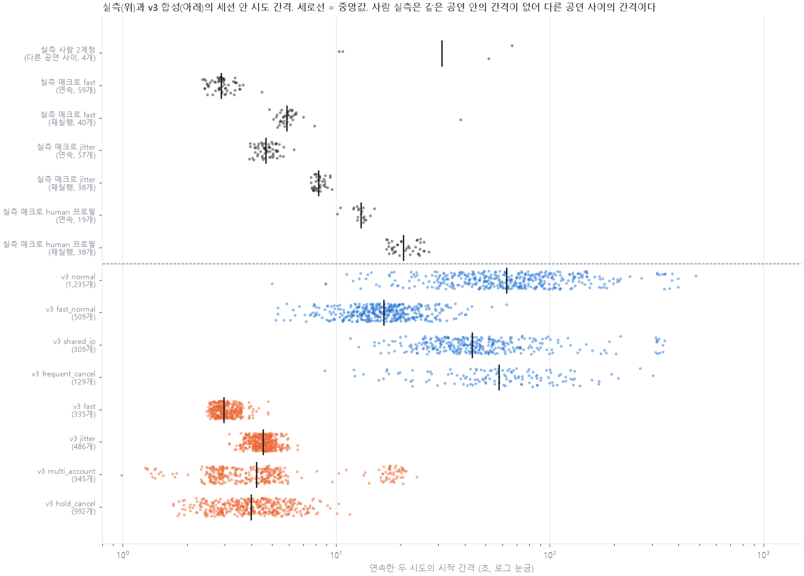
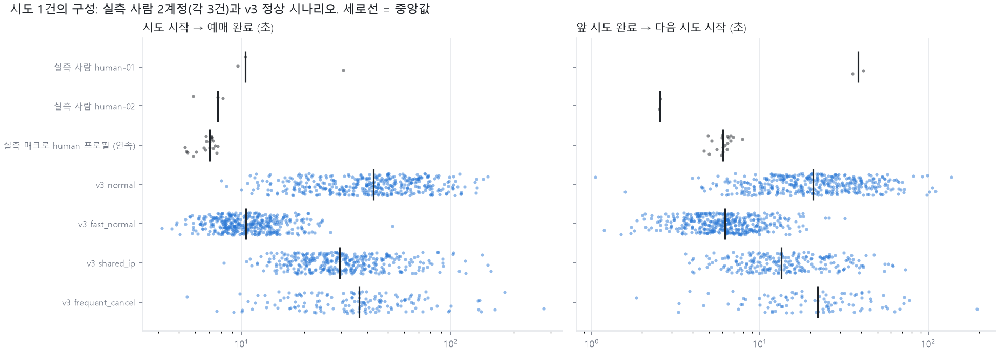

# 예매 간격 생성 규칙의 실측 검증 (Issue #17 분석 보고서)

작성일 2026-11-24. [`REPORT_V3_SESSION.md`](REPORT_V3_SESSION.md) 에서 세션 기준 `avg_booking_interval` 하나의 AUC 가 0.995 로 나왔다.
이 문서는 그 분리가 생성 규칙에서 나온 것인지 확인하기 위해, 합성 데이터(v3)의 예매 간격 규칙을 실측 이벤트(#14, #16)와 비교한 결과다.

**이번 단계는 분석과 개선안 제시까지다.** 데이터셋을 새로 만들지 않았고, 모델을 학습하지 않았고, 기존 데이터·생성기·추출 코드·모델·서빙 코드를 수정하지 않았다.
추가한 것은 읽기 전용 분석 스크립트(`scripts/analyze_interval_validation.py`)와 그 결과(`output/interval_validation/`)뿐이다. 모든 수치는 그 CSV 에서 가져왔다.

## 요약

| 질문 | 답 |
|---|---|
| "정상 8초 이상, 매크로 2~7초" 가 실측으로 뒷받침되는가 | **매크로 쪽 절반만, 그것도 조건부로.** "2~7초" 는 fast·jitter 프로필을 이 데모 환경에서 연속 실행했을 때의 값이다. 같은 도구의 human 프로필은 10~15초로 실측됐다. **정상 쪽은 근거가 없다**: 실측한 사람의 시도는 모두 서로 다른 공연이어서, 지금의 세션 정의로는 세션 안 간격이 0개다 |
| 실측 정상과 매크로는 겹치는가 | 사람의 간격(다른 공연 사이) 10.3~66.2초와 human 프로필 매크로 10.1~15.1초가 겹친다. fast·jitter(2.4~6.3초)와는 겹치지 않는다. 사람 표본은 1명의 2계정, 간격 4개다 |
| v3 에서 간격이 구조적으로 나뉘는 원인 | (1) 정상 사용자의 단계 시간이 실측한 사람보다 약 5배 길다 (가정). (2) 정상 사용자가 한 공연을 한 세션에 여러 번 **완료**한다: 정상의 세션 안 간격 중 80% 가 완료된 예매 다음의 간격이다. (3) 대기열 시간이 0 이다. (4) 느린 매크로는 다계정 링 하나(11계정)뿐이다 |
| v3 가 실측을 잘못 반영한 곳 | human 프로필 매크로. #16 에 연속 실행 실측(19개 간격, 평균 12.8초)이 있는데 v3 는 #14 의 값과 추정한 대기 시간을 써서 평균 17.3초로 만들었다 |
| 세션 정의 `concertId + 30분` 은 맞는가 | **실측 데이터에서 문제가 드러난다.** 실측한 사람과 매크로 1계정은 공연을 바꿔 가며 10초 간격으로 예매했고, 이 정의로는 세션 안 간격이 하나도 없다. 시간만으로 나누면(30분) 간격이 잡힌다 |
| 분산도 세션 기준으로 바꾸는 것이 타당한가 | 방향은 타당하다. 30일 분산은 "오픈에 여러 번 참여했는가" 를 나타내는 값이 된다 (참여 1회 계정의 중앙값 8.7, 2회 이상 8×10¹⁰). 다만 "모든 간격의 분산" 은 세션 사이의 평균 차이를 포함하므로 정의를 다시 정해야 한다 |

- AUC 0.995 는 탐지 성능의 근거로 쓸 수 없다. 정상 쪽 간격 분포가 실측이 아니라 가정이고, 그 가정은 실측한 한 사람보다 훨씬 느리다.
- 반대로 "실제로는 많이 겹친다" 고 말할 근거도 없다. 사람 표본이 1명이고 통제된 반복 예매였다.

---

## 1. 실측 데이터 분석

### 1.1 자료와 측정 조건

| 자료 | 내용 | 매크로 실행 방식 |
|---|---|---|
| #14 `data/count` | 사람 2계정, 매크로 fast 2계정 · jitter 1계정 · human 프로필 1계정 | 시도마다 프로세스를 새로 실행 (재기동·로그인이 간격에 들어간다) |
| #16 `20261122-main` | 매크로 fast 2 · jitter 1 · human 프로필 1 | 시도마다 재실행 |
| #16 `20261122-continuous` | 매크로 fast 2 · jitter 1 · human 프로필 1 | **연속 실행** (한 브라우저·한 로그인) |
| #16 `20261123-remeasure` | 매크로 fast 2 · jitter 2 (사이트 수정 후) | 연속 실행 |

- #14 의 다른 폴더(`pilot*`, `count_fast`, `count__*` 등)는 위 `count` 의 일부이거나 같은 계정의 스냅샷이라 중복으로 세지 않았다.
- 모든 측정은 격리된 로컬 환경이다: 대기열 대기 없음, CAPTCHA 꺼짐, 네트워크 지연 없음, 좌석 경쟁 없음, 시연용 결제 지연 1.2초.
- 간격 = 같은 계정의 연속한 두 시도의 시작 시각 차이. 시작 시각 = 그 `attemptId` 의 가장 이른 `BOOKING_ATTEMPT` 의 `occurredAt` (BTS 와 같다).

### 1.2 계정별 시도 횟수와 표본 수

세션 정의 두 가지로 간격을 셌다. "공연+30분" 은 `REPORT_V3_SESSION.md` 의 정의(공연이 같고 30분 이하), "30분만" 은 공연을 보지 않는다. 출처: `measured_accounts.csv`

| 자료 | 종류 | 계정 | 시도 | 공연 수 | 간격: 공연+30분 | 간격: 30분만 | 평균 간격 (초) | 범위 (초) |
|---|---|---|---|---|---|---|---|---|
| #14 | **사람** | human-01 | 3 | **3** | **0** | 2 | 58.9 | 51.5~66.2 |
| #14 | **사람** | human-02 | 3 | **3** | **0** | 2 | 10.5 | 10.3~10.7 |
| #14 | 매크로 fast (재실행) | macro-fast-01 | 3 | 3 | 0 | 2 | 4.92 | 4.66~5.19 |
| #14 | 매크로 fast (재실행) | macro-fast-02 | 20 | 1 | 19 | 19 | 7.51 | 4.85~38.2 |
| #14 | 매크로 jitter (재실행) | macro-jitter-01 | 20 | 1 | 19 | 19 | 8.56 | 7.68~9.51 |
| #14 | 매크로 human 프로필 (재실행) | macro-human-01 | 20 | 1 | 19 | 19 | 23.6 | 18.9~27.0 |
| #16 main | 매크로 fast (재실행) | macro-fast-01, -02 | 3, 20 | 1 | 2, 19 | 2, 19 | 6.72, 5.83 | 5.27~6.98 |
| #16 main | 매크로 jitter (재실행) | macro-jitter-01 | 20 | 1 | 19 | 19 | 8.03 | 7.57~8.70 |
| #16 main | 매크로 human 프로필 (재실행) | macro-human-01 | 20 | 1 | 19 | 19 | 18.6 | 17.1~21.9 |
| #16 continuous | 매크로 fast (연속) | macro-fast-01, -02 | 3, 20 | 1 | 2, 19 | 2, 19 | 2.77, 2.64 | 2.35~3.31 |
| #16 continuous | 매크로 jitter (연속) | macro-jitter-01 | 20 | 1 | 19 | 19 | 4.34 | 3.91~4.82 |
| #16 continuous | **매크로 human 프로필 (연속)** | macro-human-01 | 20 | 1 | **19** | 19 | **12.8** | **10.1~15.1** |
| #16 remeasure | 매크로 fast (연속) | macro-fast-11, -12 | 20, 20 | 1 | 19, 19 | 19, 19 | 3.12, 3.04 | 2.77~4.47 |
| #16 remeasure | 매크로 jitter (연속) | macro-jitter-11, -12 | 20, 20 | 1 | 19, 19 | 19, 19 | 4.77, 5.10 | 3.94~6.32 |

**실측 정상 사용자의 한계**

- 사람은 **1명**이 2계정으로 각 3건을 예매했다. 계정 2개는 독립 표본이 아니다 (#14 README).
- 3건은 **서로 다른 공연(c1, c2, c3)** 이다. 같은 공연을 다시 예매하려면 새 탭을 열어야 했기 때문에 공연을 바꿔 가며 예매했다 (#14 README 의 절차). 그래서 "같은 공연 안의 연속 시도" 는 한 건도 없다.
- 통제된 조건이다: 좌석 1석, 정해진 카드 번호, "끝나면 바로 다음" 이라는 지시, 실패·경쟁 없음, 모두 완료. 실제 티켓 오픈의 행동이 아니다.
- 그 밖에 #16 `remeasure` 에 사람이 직접 쓴 것으로 보이는 계정이 둘 있다 (`shot02`: 3건 모두 좌석 선택에서 이탈, 간격 23.3초와 104.5초 / `seoyeon`: 1건). 수집 목적의 측정이 아니고 누가 어떤 조건에서 썼는지 기록이 없어 정상 사용자의 표본으로 쓰지 않았다.

### 1.3 간격 분포

출처: `measured_gap_summary.csv`. 매크로는 한 공연에서만 돌렸으므로 두 세션 정의의 값이 같다 (#14 의 macro-fast-01 만 예외).

| 종류 | 조건 | 계정 | 간격 수 | 평균 | 중앙값 | 표준편차 | 최소 | 5% | 25% | 75% | 95% | 최대 |
|---|---|---|---|---|---|---|---|---|---|---|---|---|
| 사람 | 공연+30분 | 2 | **0** | — | — | — | — | — | — | — | — | — |
| 사람 | 30분만 (다른 공연 사이) | 2 | 4 | 34.7 | 31.1 | 28.6 | 10.3 | 10.3 | 10.6 | 55.2 | 64.0 | 66.2 |
| 매크로 fast | 연속 실행 | 4 | 59 | 2.93 | 2.88 | 0.38 | 2.35 | 2.41 | 2.71 | 3.04 | 3.52 | 4.47 |
| 매크로 jitter | 연속 실행 | 3 | 57 | 4.74 | 4.66 | 0.49 | 3.91 | 4.02 | 4.41 | 5.04 | 5.49 | 6.32 |
| 매크로 human 프로필 | 연속 실행 | 1 | 19 | 12.8 | 13.0 | 1.18 | 10.1 | 10.4 | 12.5 | 13.4 | 14.5 | 15.1 |
| 매크로 fast | 시도마다 재실행 | 2 | 40 | 6.67 | 5.85 | 5.13 | 4.85 | 5.20 | 5.53 | 6.13 | 7.02 | 38.2 |
| 매크로 jitter | 시도마다 재실행 | 1 | 38 | 8.30 | 8.24 | 0.51 | 7.57 | 7.65 | 7.90 | 8.66 | 9.33 | 9.51 |
| 매크로 human 프로필 | 시도마다 재실행 | 1 | 38 | 21.1 | 20.6 | 3.04 | 17.1 | 17.3 | 18.3 | 24.0 | 25.6 | 27.0 |



**시도 1건의 구성** (완료된 시도). 출처: `measured_stage_times.csv`

| 종류 | 시도 수 | 시작 → 예매 완료 (중앙값, 범위) | 좌석 선택 → 선점 | 선점 → 예매 완료 | 앞 시도 완료 → 다음 시작 |
|---|---|---|---|---|---|
| 사람 (2계정) | 6 | 8.85초 (5.87~30.6) | 1.86초 (1.20~7.38) | 6.61초 (4.46~21.6) | human-02: 2.5초 / human-01: 35.6~41.1초 |
| 매크로 fast (연속) | 63 | 2.23초 (1.78~3.27) | 0.52초 | 1.41초 | 0.61초 (0.38~1.20) |
| 매크로 jitter (연속) | 60 | 3.06초 (2.57~3.74) | 1.08초 | 1.68초 | 1.66초 (1.02~2.56) |
| 매크로 human 프로필 (연속) | 20 | 7.02초 (5.36~7.69) | 3.49초 (2.44~4.43) | 3.20초 (2.27~3.71) | 6.01초 (4.67~7.88) |

### 1.4 정상과 매크로가 겹치는 구간

| 비교 | 사람 (간격 4개, 다른 공연 사이) | 매크로 | 겹침 |
|---|---|---|---|
| fast, 연속 | 10.3~66.2초 | 2.35~4.47초 | 없음. 5.8초의 빈 구간 |
| jitter, 연속 | 10.3~66.2초 | 3.91~6.32초 | 없음. 3.9초의 빈 구간 |
| **human 프로필, 연속** | 10.3~66.2초 | **10.1~15.1초** | **있음.** human-02 의 두 간격(10.3, 10.7초)이 매크로의 범위 안 |
| jitter, 재실행 | 10.3~66.2초 | 7.57~9.51초 | 없음. 0.75초 차이 |
| human 프로필, 재실행 | 10.3~66.2초 | 17.1~27.0초 | 있음 (사람의 범위 안) |

- **시도 1건을 끝내는 시간은 더 가깝다.** 사람의 가장 빠른 3건(human-02: 5.87, 7.70, 8.15초)은 human 프로필 매크로(5.36~7.69초)와 같은 구간이고, fast 매크로(1.78~3.27초)의 2~3배다.
- 사람과 매크로의 차이가 가장 큰 것은 **다음 시도까지의 대기**다: 사람 2.5~41초, fast 0.4~1.2초, jitter 1.0~2.6초.
- "매크로 2~7초" 는 다음 조건에서만 성립한다: fast 또는 jitter 프로필, 연속 실행, 이 데모(대기열 0, 결제 지연 1.2초 고정). 같은 fast 프로필도 재실행 방식에서는 4.9~7.0초, human 프로필은 10~15초다. 매크로의 간격은 도구의 지연 설정과 사이트의 응답 시간이 정한다.
- "정상 8초 이상" 을 직접 뒷받침하는 실측은 없다. 가장 가까운 값은 한 사람이 공연을 바꿔 가며 낸 10.3초다.

---

## 2. v3 생성 규칙 검토

### 2.1 간격을 정하는 파라미터

v3 에서 한 세션 안의 간격은 `시도 1건의 소요 시간 + 다음 시도까지의 대기` 다. 출처: `config/scenarios_v3.json`, `scripts/generate_events_v3.py`, `generation_parameters.csv`

**정상 시나리오와 `hold_cancel` (가정한 시간)**

각 단계의 시간 = `하한 + (단계 중앙값 − 하한) × 계정 속도 × 시도별 변동`. 계정 속도와 시도별 변동은 로그정규다.

| 시나리오 | 단계 중앙값의 합 | 그중 좌석 선택 / 결제 | 대기 중앙값 | 중앙값 기준 간격 | 계정 속도의 로그 표준편차 | 시도별 변동 |
|---|---|---|---|---|---|---|
| normal | 37.1초 | 20 / 15초 | 20초 | 57.1초 | 0.5 | 0.5 |
| fast_normal | 10.3초 | 2 / 7초 | 6초 | 16.3초 | 0.35 | 0.35 |
| shared_ip | 28.1초 | 15 / 11초 | 15초 | 43.1초 | 0.5 | 0.5 |
| frequent_cancel | 30.1초 | 14 / 14초 | 19초 | 49.1초 | 0.5 | 0.5 |
| hold_cancel (이상) | 3.0초 | 0.7 / 1.6초 | 2.5초 | 5.5초 | 0.3 | 0.3 |

| 파라미터 | 값 | 근거 |
|---|---|---|
| normal 의 좌석 선택 20초 | 기존 더미의 Exp(30)+1 을 옮김 | **없음** (inherited) |
| 결제 15초, 대기 20초, 대기열 0.4초 등 | "합이 기존 더미의 평균 간격(약 60초)과 비슷하도록" | **없음** (assumption) |
| 계정 속도의 로그 표준편차 0.5 | 기존 더미의 값 | **없음** (inherited) |
| 시도별 변동 0.5 | | **없음** (assumption) |
| fast_normal 의 대기 6초, 속도 편차 0.35 | #14 사람의 대기 2.6초와 36~41초 사이 | 약함 (사람 1명) |
| 단계 하한 (좌석 0.298초, 결제 1.297초, 합 1.79초) | #16 실측 매크로 120건의 단계별 최솟값 | 실측 |
| 결제 입력 오류 3%, 선점 거절 위험률, 사람의 재선택 시간 | | **없음** (assumption) |
| 대기열 대기 시간 | 0.2~0.4초 (실측 환경의 값) | 실측이지만 대기열이 비어 있는 환경 |

**fast, jitter (실측한 시간)**

| 항목 | 반영 방식 | 근거 |
|---|---|---|
| 시도 1건의 단계 시간과 다음 시도까지의 간격 | 배정된 실측 계정의 시도 1건을 통째로 복원추출 (`reference/macro_attempt_cycles.csv`, #16 연속 실행 6계정 120건) | **실측** |
| 계정 간 속도 차이 | 실측 계정 평균 6개에서 유형별 로그 평균과 공통 로그 표준편차(0.085)를 추정하고, 계정마다 수준을 뽑아 시간 전체를 같은 비율로 조정 | **실측** (표본 6개). 같은 비율로 조정하는 것은 가정 |
| 시도 수, 오픈 참여 횟수, 취소 성향 | | 가정 (`REPORT_V3.md`) |

- fast·jitter 의 합성 간격은 실측을 그대로 따른다: v3 fast 2.46~4.77초(실측 2.35~4.47), jitter 3.15~6.56초(실측 3.91~6.32). 범위가 조금 넓은 것은 계정 수준을 뽑아 조정하기 때문이다.

**multi_account (도구 프로필)**

| 프로필 | 반영 방식 | v3 의 간격 | 실측 (연속) |
|---|---|---|---|
| fast, jitter | fast·jitter 시나리오와 같음 | 0.98~4.74, 2.35~5.92초 | 2.35~4.47, 3.91~6.32초 |
| **human** | 단계 시간: **#14** 의 20건. 대기: **추정** (실측 fast 대기 + pause 3번) | **평균 17.3초** (6.5~23.7) | **평균 12.8초** (10.1~15.1) |

**확인된 문제: human 프로필이 실측과 다르다.**

- #16 `20261122-continuous` 에 human 프로필의 연속 실행 실측(1계정, 간격 19개)이 있다. v3 는 이 자료를 쓰지 않았다. 참조 파일을 만들 때 fast·jitter 만 뽑았고(`build_reference_timings.py` 의 대상), v3 에서는 #14 의 값을 찾아 썼다.
- #14 의 "선점 → 예매 완료" 는 중앙값 9.3초이고 #16 연속 실행은 3.2초다. 두 측정 사이에 결제 단계의 소요 시간이 달라졌다 (데모나 매크로 도구가 바뀐 것으로 보이며, 무엇이 바뀌었는지는 확인하지 않았다). 추정한 대기(약 5.9초)는 실측(6.0초)과 맞았지만 단계 시간이 길어서 간격이 약 4.5초 길게 나왔다.
- `REPORT_V3.md` 는 이 대기를 "실측이 없다" 고 적었다. 사실과 다르다. 그 보고서는 수정하지 않았고, 다음 버전에서 #16 의 값으로 바꿔야 한다.
- 영향: v3 의 human 프로필 링(11계정)은 실제보다 느리게 만들어져 빠른 정상 사용자와 더 많이 겹친다. 실측대로면 10~15초이고 `fast_normal` 의 아래쪽(5% 8.1초, 25% 13.1초)과 겹친다.

### 2.2 시나리오별 세션 안 간격 (v3)

출처: `synthetic_gap_summary.csv`. "계정 평균" 은 `avg_booking_interval` 의 세션 기준 값에 해당한다.

| 시나리오 | 간격 수 | 간격: 중앙값 [5%~95%] | 최소 | 계정 평균: 중앙값 [5%~95%] | 7초 미만인 계정 | 10초 미만 | 15초 미만 |
|---|---|---|---|---|---|---|---|
| normal | 1,235 | 62.8 [23.3~198] | 5.0 | 68.9 [24.5~189] | 0% | 0% | 1% |
| fast_normal | 509 | 16.3 [8.1~30.6] | 5.2 | 16.8 [9.5~28.4] | 0% | 9% | 41% |
| shared_ip | 309 | 43.3 [20.9~177] | 11.6 | 49.1 [25.1~157] | 0% | 0% | 1% |
| frequent_cancel | 129 | 57.7 [17.2~149] | 8.8 | 56.8 [21.7~116] | 0% | 0% | 0% |
| fast | 335 | 2.96 [2.58~3.64] | 2.46 | 2.92 [2.69~3.72] | 100% | 100% | 100% |
| jitter | 486 | 4.52 [3.68~5.55] | 3.15 | 4.59 [3.89~5.52] | 100% | 100% | 100% |
| multi_account | 345 | 4.21 [2.32~19.0] | 0.98 | 4.10 [2.38~17.7] | 84% | 84% | 86% |
| hold_cancel | 992 | 3.96 [2.30~7.28] | 1.60 | 4.02 [2.67~6.21] | 98% | 100% | 100% |

- **계정 평균이 7초 미만인 정상 계정은 없고, 7초 이상인 이상 계정은 human 프로필 링과 `hold_cancel` 1계정뿐이다.** "정상 8초 이상, 매크로 2~7초" 는 규칙으로 적혀 있는 것이 아니라 위 파라미터에서 나온 결과다.

### 2.3 구조적으로 분리되는 원인

**(1) 정상 사용자의 단계 시간이 실측한 사람보다 훨씬 길다.** 출처: `synthetic_stage_times.csv`, `measured_stage_times.csv`

| | 시작 → 예매 완료 | 좌석 선택 → 선점 | 다음 시도까지의 대기 |
|---|---|---|---|
| 실측 사람 (6건) | 8.85초 (5.87~30.6) | 1.86초 (1.20~7.38) | 2.5초 / 35.6~41.1초 |
| v3 normal | 41.4초 [15.3~104] | 20.4초 [6.1~64.4] | 20.1초 [6.0~58.1] |
| v3 fast_normal | 10.6초 [6.3~19.7] | 1.96초 [1.11~3.63] | 6.2초 [2.6~14.2] |



- 실측한 사람의 속도는 v3 의 `fast_normal` 에 해당한다 (좌석 선택 1.86초 대 1.96초). `fast_normal` 은 정상 계정의 15%(122 / 801)뿐이고, 나머지 85% 는 4~5배 느리다.
- human-02 의 평균 간격 10.5초는 v3 정상 계정의 2.2% 위치다. human-01 의 58.9초는 55% 위치다 (`measured_position_in_v3.csv`).
- 실측한 사람이 평균적인 사용자보다 빨랐을 가능성이 높다 (프로젝트 구성원, 반복 예매, 익숙한 화면). 그래도 "사람은 좌석 선택에 20초" 라는 값에는 근거가 없다는 점은 같다.

**(2) 정상 사용자가 한 공연을 한 세션에 여러 번 완료한다.**

- v3 의 정상 사용자는 한 오픈에서 시도를 1 + Poisson(3~5)번 하고 그 75~91% 를 완료한다. 시도가 2건 이상인 정상 세션 753개 중 82% 에 완료된 예매가 2건 이상 있다.
- **정상의 세션 안 간격 2,182개 중 1,737개(80%)가 완료된 예매 다음의 간격이다.** 즉 v3 가 만드는 정상 간격의 대부분은 "예매를 마치고 같은 공연을 또 예매하러 들어오는 시간" 이다.
- 실제 사용자는 한 공연을 한 번 예매하는 것이 보통이다 (한 번에 4석까지 잡을 수 있다). 같은 공연에 다시 시도하는 것은 주로 **실패한 뒤**다: 좌석 선택에서 나감, 결제에서 나감, 선점 만료. 이때의 간격은 "예매 1건 전체 + 대기" 가 아니라 "실패까지 걸린 시간 + 다시 들어오는 시간" 이다.
- v3 에서 이탈 뒤의 간격은 중앙값 39~53초다. 이탈 뒤에 다시 들어오는 대기를 완료 뒤와 같은 분포(중앙값 20초)로 뒀기 때문이다. 이 값에도 근거가 없다.
- 이 전제("정상 사용자가 한 세션에 여러 건을 완료한다")는 기존 더미에서 물려받았고 `REPORT_V2.md` 와 `REPORT_V3.md` 의 한계에 적혀 있다. 세션 기준 Feature 에서는 이 전제가 간격 분포를 직접 정한다.

**(3) 대기열 시간이 0 이다.**

- 예매를 마치거나 이탈하면 다음 시도는 대기열을 다시 거친다 (코드: `PaymentPage.tsx` 가 완료 뒤 대기열에서 나간다).
- 실측과 v3 에서 대기열 단계는 0.06~0.4초다. 대기열이 비어 있는 환경이기 때문이다.
- 실제 티켓 오픈에서 대기열 대기가 W 초라면 **사람과 매크로 모두** 시도 간격에 W 가 더해진다. "매크로 3초, 사람 40초" 는 W = 0 일 때의 값이다. W 가 60초면 63초와 100초가 된다.

**(4) 느린 매크로가 거의 없다.**

- 매크로의 지연은 도구의 설정값이다 (macro.js 의 pause: fast 0~20ms, jitter 120~600ms, human 900~2,600ms). 설정은 연속적으로 바꿀 수 있는데 v3 에는 세 점만 있고, human 프로필은 다계정 링 7개 중 1개에만 배정됐다.
- fast·jitter 시나리오(87계정)는 정의상 빠른 프로필만 쓴다.

**(5) 분리를 막는 구조적 하한은 없다.** 정상 시도의 이론상 최솟값은 단계 하한의 합 1.79초 + 대기(하한 없음)다. v3 정상 간격의 최솟값은 5.0초다. 분리는 하한이 아니라 중앙값의 차이에서 나온다.

---

## 3. 개선 방향

분포를 겹치게 만들거나 지표를 올리기 위한 조정은 제안하지 않는다. 아래는 실측과 코드에서 확인한 사실에 맞추는 수정과, 근거가 없는 값을 범위로 다루는 방법이다.

### 3.1 실측·코드에 맞추는 수정 (값을 새로 정하지 않는다)

| | 수정 | 근거 |
|---|---|---|
| A1 | human 프로필의 시간을 #16 연속 실행 실측으로 교체 (단계 시간과 다음 시도까지의 간격을 통째로 복원추출, fast·jitter 와 같은 방식) | #16 `20261122-continuous`, 1계정 20건 |
| A2 | 정상 사용자의 세션을 "목표 예매 수" 로 구성: 한 공연에서 완료할 예매 수를 먼저 정하고, 실패하면 다시 시도한다. 완료 뒤의 재시도와 실패 뒤의 재시도를 구분한다 | 코드: 예매 1건 최대 4석, 완료·이탈 뒤에는 새 attemptId 와 대기열 재진입 |
| A3 | 이탈·만료 뒤의 간격을 "실패까지 걸린 시간 + 재진입 대기" 로 분리 | A2 와 같음. 재진입 대기의 값은 3.2절의 범위 |
| A4 | 대기열 대기를 시도마다 더해지는 별도 항으로 분리 (사람과 매크로에 같은 값) | 코드: 시도마다 대기열 재진입. 값은 3.2절 |

### 3.2 근거가 없는 값: 범위와 민감도 분석

값을 하나로 정하지 않고, 실측과 기존 가정을 양 끝으로 하는 범위에서 결과가 어떻게 달라지는지 본다.

| | 파라미터 | 범위 | 양 끝의 근거 |
|---|---|---|---|
| B1 | 정상 사용자의 단계 시간 배율 (좌석 선택·결제) | 0.25배 ~ 1배 (v3 의 normal 기준) | 0.25배: 실측 사람의 좌석 선택 1.9초·결제 6.6초에 가까움. 1배: 기존 더미 |
| B2 | 계정 간 속도의 로그 표준편차 | 0.5 ~ 1.0 | 0.5: 기존 더미. 한 사람의 두 계정이 5.6배 차이(10.5초 대 58.9초)였으므로 더 넓을 수 있다 |
| B3 | 완료 뒤 같은 공연을 다시 예매하는 비율 | 0% ~ v3 의 값 | 0%: 한 공연 한 번 예매. v3: 물려받은 전제 |
| B4 | 실패 뒤 재진입 대기 | 2.5초 ~ 40초 | 실측 사람의 "완료 → 다음 시작" 2.5초(human-02)와 35.6~41.1초(human-01). 다른 공연으로 넘어간 시간이라 대용값이다 |
| B5 | 대기열 대기 W | 0 / 10 / 60 / 300초, 시도마다 변동 | 0: 실측 환경. 상한: 대기열 순번 유효 시간 30분보다 짧은 범위에서 임의 |
| B6 | 매크로의 지연 설정 | fast ~ human 프로필 사이를 연속으로 (pause 0.01 ~ 2.6초) | 양 끝과 중간(jitter)이 실측. 그 사이의 분포는 모름 → 균등 / 빠른 쪽 편중 / 느린 쪽 편중 세 가지 |
| B7 | 사이트 응답 시간 (결제 지연 등) | 1.2초 고정 ~ 수 초 | 1.2초: 데모의 시연용 값. 매크로의 간격 하한을 정한다 |

**민감도 분석 방법**

1. **보는 값을 먼저 정한다.** 모델의 F1 이 아니라 분포 지표를 본다: 세션 평균 간격 하나의 AUC, 정상 5~95% 구간 안에 드는 이상 계정의 비율, 간격이 정의되는 계정의 비율. 모델 지표는 그다음에 본다.
2. **한 번에 하나씩 바꾼다.** v3 를 기준으로 B1~B7 을 하나씩 양 끝으로 바꿔 위 값의 변화를 본다. `generate_events_v3.py` 의 규칙 끄기(`off`)와 같은 방식이다.
3. **영향이 큰 두세 개만 조합한다.** 전체 조합은 하지 않는다.
4. **범위는 결과를 보기 전에 고정한다.** 위 표의 범위를 설정 파일에 적고, 결과를 본 뒤에 바꾸지 않는다.
5. **결과는 범위로 보고한다.** "AUC 는 가정에 따라 0.xx ~ 0.xx" 형태. 한 점의 값을 대표로 쓰지 않는다.
6. 실측이 모이면 범위를 좁힌다 (5절).

### 3.3 간격의 정의와 BTS 에서 측정되는 시간

출처: `timestamp_check.csv` (실측 이벤트 1,564건)

| 확인한 것 | 결과 |
|---|---|
| BTS 가 쓰는 `occurredAt` 과 서버 기록 시각(`metadata.recordedAt`) | 같다 (차이 1ms 이내, 전 이벤트) |
| STARTED 의 `occurredAt` 과 사용자의 클릭 시각(`clientOccurredAt`) | 중앙값 0.035초 차이. 297건 중 1건만 448초 차이 (브라우저에 남아 있던 오래된 클릭 시각) |
| 합성 데이터의 시작 시각 | STARTED 이벤트의 시각. 실측과 같은 정의 |

- **정의는 일치한다.** 실측과 합성 모두 "서버가 STARTED 를 기록한 시각" 사이의 차이이고, BTS 의 `FeatureAggregationService` 가 계산하는 값과 같다. 클라이언트 시각을 쓰지 않으므로 사용자가 조작할 수 없다.
- **이 간격이 실제로 재는 것**은 "예매하기 버튼을 누른 시각" 사이의 시간이다. 여기에는 앞 시도의 대기열 대기, 좌석 선택, 결제, 그리고 다시 공연 페이지로 돌아와 버튼을 누르기까지의 시간이 모두 들어간다. 좌석을 고르는 속도만 재는 값이 아니다.
- 따라서 이 간격은 **행동의 속도와 사이트의 상태(대기열, 응답 시간)를 함께 잰다.** 같은 매크로도 대기열이 길면 간격이 길어진다. 서비스마다, 오픈마다 기준값이 달라진다.
- 선점이 거절돼 다른 좌석을 다시 고르는 반복은 같은 attemptId 안에서 일어나므로 이 간격에 잡히지 않는다. 빠른 반복 선점 요청은 `recent_booking_count`(프론트 전용)에만 나타난다.

---

## 4. Feature 정의 검토

### 4.1 `booking_interval_variance` 도 세션 기준으로 바꾸는 것이 타당한가

**타당하다. 다만 "모든 간격의 분산" 은 맞는 정의가 아니다.**

- 평균과 분산은 같은 간격 집합에서 나와야 한다. 평균을 세션 안의 간격으로 계산하면서 분산을 30일 전체 간격으로 계산하면 두 값이 서로 다른 것을 잰다.
- `REPORT_V3_SESSION.md` 의 "모든 간격(pooled)" 분산은 여러 세션의 간격을 한데 모은 분산이다. 여기에는 **세션 안의 변동**과 **세션 사이의 평균 차이**가 섞인다. 한 계정이 어느 날은 빠르게, 다른 날은 느리게 예매했다면 세션마다는 규칙적이어도 분산이 커진다.
- 검토할 대안: 세션 안 분산의 가중 평균 (각 세션의 평균에서 벗어난 정도만 모은 값), 또는 세션 분산의 중앙값. 어느 쪽이 맞는지는 "이 Feature 로 무엇을 잡으려는가" (기계적으로 일정한 간격)에 따라 정해야 한다.
- 남는 문제: 시도 2건인 세션은 분산이 식으로 0 이다. 세션 기준에서는 이런 세션이 더 많아진다. Credit 규칙처럼 "간격 n 개 이상" 조건을 Feature 계산에 넣을지 결정이 필요하다.

### 4.2 30일 분산을 유지하면 남는 문제

출처: `variance_30d_meaning.csv` (v3)

| | 값 |
|---|---|
| 30일 분산의 중앙값: 오픈 1회 참여 계정 | 8.7 초² |
| 30일 분산의 중앙값: 오픈 2회 이상 참여 계정 | 8.1 × 10¹⁰ 초² |
| 30일 분산으로 "오픈 2회 이상 참여" 를 맞히는 AUC | 0.822 |
| 세션 분산으로 같은 것을 맞히는 AUC | 0.478 |
| 30일 분산으로 정상/이상을 나누는 AUC: 오픈 1회 계정 | 0.766 |
| 같은 값: 오픈 2회 이상 계정 | 0.553 |

- **30일 분산은 "간격이 얼마나 일정한가" 가 아니라 "오픈에 몇 번 참여했는가" 를 나타낸다.** 두 번 이상 참여하면 값이 10 자릿수 커진다. 여러 번 참여한 계정에서는 정상과 이상을 나누지 못한다 (0.553).
- 이름과 뜻이 다른 Feature 가 모델에 들어간다. v3 는 정상과 이상의 오픈 참여 분포를 같게 뒀기 때문에 이 값이 레이블과 무관하지만, 실제로 매크로의 참여 횟수가 다르면 모델은 "참여 횟수" 를 이상의 신호로 배운다.
- Credit 규칙 "분산 1.0초² 미만이고 시도 5건 이상" 이 여러 번 참여한 매크로에 걸리지 않는다 (`REPORT_V3_SESSION.md`: 걸러지는 이상 계정 43%, 세션 기준 62%).
- 평균은 세션 기준, 분산은 30일 기준이면 서빙에서 간격을 두 번 계산해야 하고, 두 값의 결측 조건도 달라진다.

### 4.3 세션 평균만 바꿨을 때 F1 이 0.765 로 오른 원인을 더 분석해야 하는가

**분석이 필요하다. 지금의 근거로는 채택할 수 없다.**

- 0.765 는 사전에 정한 비교에 없던 조합이고, 데이터셋 하나(seed 42)의 값이다. 모델 seed 의 표준편차(0.014)는 작지만 데이터 생성 seed 에 따른 흔들림은 0.04~0.06 이었다 (`REPORT_V3.md`). 이 조합은 생성 seed 로 확인하지 않았다.
- 4.2절에 따르면 이 조합에서 30일 분산은 간격의 규칙성이 아니라 오픈 참여 여부를 나타낸다. 성능이 오른 것이 그 정보 때문이라면 v3 의 가정(정상과 이상의 참여 분포가 같다) 위에서만 성립하는 결과다.
- 세션 분산으로 바꾸면 119계정(이상 11)이 분산 결측으로 바뀐다. 결측 처리의 차이가 원인일 수도 있다.
- 확인할 것 (모델 학습이 필요하므로 이번 단계에서는 하지 않았다)
  1. 같은 조합을 데이터 생성 seed 10개, 분할 seed 20개로 평가해 차이가 흔들림보다 큰지 본다.
  2. 30일 분산의 자리에 "오픈 2회 이상 참여 여부" 만 남긴 값을 넣었을 때 같은 결과가 나오는지 본다 (분산의 정보가 참여 여부뿐인지 확인).
  3. 세션 분산의 정의를 4.1절의 대안으로 바꿨을 때 혼합 학습의 하락이 없어지는지 본다.
  4. 결측 계정만 따로 떼어 오탐·미탐을 비교한다.
- 2번은 Feature 를 바꿔 넣는 진단이므로, Ablation 을 하지 않는다는 방침과 충돌하는지 먼저 정해야 한다.

### 4.4 `concertId + 30분` 은 실제 예매 세션과 일치하는가

**실측 데이터에서 일치하지 않는 경우가 확인된다.**

| 계정 | 행동 | 공연+30분 | 30분만 |
|---|---|---|---|
| 사람 human-02 | 3개 공연을 10.3초, 10.7초 간격으로 연달아 예매 | 간격 0개 → Feature 결측 | 간격 2개, 평균 10.5초 |
| 사람 human-01 | 3개 공연을 66.2초, 51.5초 간격으로 예매 | 간격 0개 → 결측 | 간격 2개, 평균 58.9초 |
| 매크로 macro-fast-01 (#14) | 3개 공연을 5.2초, 4.7초 간격으로 예매 | 간격 0개 → 결측 | 간격 2개, 평균 4.9초 |

- **공연을 바꿔 가며 빠르게 예매하는 계정은 "공연+30분" 정의에서 간격이 아예 없다.** 사람도 매크로도 같다. 여러 공연이나 여러 회차를 노리는 매크로는 이 정의에서 `avg_booking_interval` 이 결측이 된다.
- v3 에서는 두 정의의 결과가 같았다 (`REPORT_V3_SESSION.md` 2절). v3 가 "한 오픈에 한 공연, 오픈은 일주일 간격" 으로 만들어져 있어서이고, 실제 데이터는 그렇지 않다는 것을 위 세 계정이 보여 준다.
- "30분" 의 근거는 대기열 순번의 유효 시간이었다. 이것은 공연별 대기열의 성질이라, 공연을 보지 않는 정의에서는 근거가 되지 않는다. 실제 간격의 분포에서 끊기는 지점을 보고 정해야 한다.
- demo-ticketing 의 이벤트에는 세션 식별자가 없다. 로그인 세션이나 브라우저 탭을 구분하는 값이 이벤트에 있다면 그것이 가장 직접적인 경계다.
- `concertId` 가 공연 단위인지 회차 단위인지도 확인이 필요하다. 회차마다 다른 값이면 같은 공연의 다른 회차를 오가는 행동도 세션이 나뉜다.
- **판단**: 세션 기준으로 계산한다는 방향은 유지할 수 있다. 경계는 "공연+30분" 으로 확정하지 말고, "비활동 시간만으로 나누는 정의" 를 같이 놓고 실제 이벤트에서 비교한 뒤 정해야 한다. 지금 가진 자료로는 시간만 쓰는 쪽이 실측 행동을 더 많이 잡는다.

---

## 5. 결과 정리

### 5.1 실측 데이터와 v3 합성 데이터의 차이

| 항목 | 실측 | v3 | 차이 |
|---|---|---|---|
| fast·jitter 매크로의 세션 안 간격 | 2.35~4.47초, 3.91~6.32초 | 2.46~4.77초, 3.15~6.56초 | 일치 (실측을 그대로 씀) |
| human 프로필 매크로의 간격 | 평균 12.8초 (10.1~15.1) | 평균 17.3초 (6.5~23.7) | **v3 가 약 4.5초 길다.** 쓸 수 있는 실측을 쓰지 않았다 |
| 사람의 세션 안 간격 (같은 공연) | **자료 없음** | 중앙값 16~63초 | 비교 불가 |
| 사람의 연속 시도 간격 (다른 공연 사이) | 10.3~66.2초 (4개) | 해당 행동 없음 (한 오픈에 한 공연) | v3 에 이 행동이 없다 |
| 사람의 시도 1건 소요 시간 | 중앙값 8.85초 (5.87~30.6) | normal 41.4초, fast_normal 10.6초 | v3 정상의 85% 가 4~5배 느리다 |
| 사람의 좌석 선택 시간 | 중앙값 1.86초 | normal 20.4초, fast_normal 1.96초 | 위와 같음 |
| 사람과 매크로의 겹침 | human 프로필 매크로와 겹침 | human 프로필 링 11계정만 겹침 | v3 가 겹침을 적게 만든다 |
| 정상 사용자가 같은 공연을 다시 시도하는 이유 | 자료 없음 | 80% 가 완료 뒤의 재예매 | v3 의 전제에 근거 없음 |
| 대기열 대기 | 0.06~0.4초 (빈 대기열) | 0.2~0.4초 | 둘 다 실제 오픈과 다름 |

### 5.2 현재 생성 규칙에서 수정이 필요한 부분

| 우선순위 | 수정 | 성격 |
|---|---|---|
| 1 | human 프로필 매크로의 시간을 #16 연속 실행 실측으로 교체 (A1) | 오류 수정. 실측이 있다 |
| 1 | 정상 사용자의 세션 구조: 완료 뒤 재예매와 실패 뒤 재시도를 구분 (A2, A3) | 구조 수정. 코드 근거 |
| 2 | 대기열 대기를 별도 항으로 분리 (A4) | 구조 수정. 값은 범위 |
| 2 | 정상 사용자의 단계 시간과 계정 간 편차를 고정값이 아닌 범위로 (B1, B2) | 근거 없는 값의 처리 |
| 2 | 매크로의 지연 설정을 세 점이 아닌 연속 범위로 (B6) | 근거 없는 값의 처리 |
| 3 | 공연을 바꿔 가며 연달아 예매하는 행동 추가 | 실측에서 본 행동. 빈도는 모름 |
| — | fast·jitter 의 실측 반영 방식 | 수정 불필요 |

### 5.3 수정할 경우 예상되는 영향

방향만 적는다. 크기는 값을 정하고 생성해 봐야 알 수 있고, 미리 추정하지 않는다.

| 수정 | 세션 평균 간격의 분리 | 그 밖의 영향 |
|---|---|---|
| A1 human 프로필을 12.8초로 | human 프로필 링과 `fast_normal` 의 겹침 위치가 바뀐다 (17초 → 13초대). 대상이 11계정이라 전체 AUC 변화는 작다 | `multi_account` 는 카드·IP 공유로 잡히므로 탐지율 변화는 작을 것 |
| A2·A3 정상 세션의 구조 | 정상 계정 가운데 세션 안 간격이 있는 계정이 줄고(결측 증가), 간격이 있는 계정은 "실패 뒤 재시도" 의 시간이 된다. 재진입 대기가 짧으면 정상의 간격이 매크로 쪽으로 내려온다 | `booking_count` 가 줄고 정상의 취소율 분모가 작아진다 |
| A4 대기열 대기 | 사람과 매크로의 간격에 같은 값이 더해져 비율 차이가 줄어든다. 차이(초)는 남는다 | 오픈마다 기준값이 달라져, 계정 간 비교가 어려워진다 |
| B1 정상의 단계 시간을 실측 쪽으로 | 정상의 간격이 짧아져 human 프로필·jitter 와의 거리가 줄어든다 | 좌석 선택 시간 기반 Credit 규칙(1초 미만)의 정상 충족률이 오른다 |
| B6 매크로 지연의 연속 범위 | 6~10초 구간이 채워진다 | |
| 세션 경계를 시간만으로 | 공연을 오가는 계정에 간격이 생긴다. v3 에서는 변화 없음 | 결측 감소 |

- 수정 뒤에는 세션 평균 간격의 AUC 가 0.995 보다 낮아질 가능성이 높다. 얼마나 낮아지는지는 B1, B3, B4 의 값이 정한다. **이 세 값은 지금 근거가 없으므로, 수정 후의 AUC 도 "추정치" 가 아니라 "가정의 범위에 따른 폭" 으로만 말할 수 있다.**

### 5.4 추가로 수집해야 하는 실측 데이터

| 우선순위 | 수집할 것 | 메우는 빈칸 | 방법 |
|---|---|---|---|
| 1 | **여러 사람의, 같은 공연 안의 연속 시도** | 정상의 세션 안 간격 (지금 0개) | 5명 이상이 같은 공연을 실패 뒤 재시도하는 상황(좌석 이탈, 결제 이탈)을 포함해 예매. 같은 탭에서 이어서 할 수 있는지 먼저 확인 |
| 1 | **지시 없이 예매한 사람의 단계 시간** | B1 (좌석 선택·결제 시간) | "빨리 반복" 이 아니라 처음 쓰는 사람이 좌석을 실제로 고르는 조건 |
| 1 | **실패 뒤 다시 들어오기까지의 시간** | B4 | 위 측정에서 이탈 → 다음 STARTED 의 시간 |
| 2 | 대기열이 있는 조건에서의 사람·매크로 간격 | A4, B5 | 데모의 대기열 정원을 낮춰 대기를 만들고 같은 측정 |
| 2 | human 프로필 매크로의 연속 실행을 2~3계정 더 | A1 의 계정 간 편차 (지금 1계정) | #16 과 같은 방식 |
| 2 | 매크로 지연 설정을 바꿔 가며 측정 (pause 0.6 ~ 2.6초 사이) | B6 | macro.js 의 프로필 값을 바꿔 연속 실행 |
| 2 | 공연을 바꿔 가며 예매하는 조건의 사람·매크로 | 세션 경계 (4.4절) | 여러 공연을 연달아 예매 |
| 3 | 실제 서비스(또는 운영 로그)의 계정별 세션 구조 | B3, 오픈 참여 횟수, 시도 수 | `REPORT_V3.md` 7절의 1순위 항목과 같다 |
| 3 | 이벤트에 세션 식별자를 넣을 수 있는지 | 세션 경계 | demo-ticketing 과 BTS 계약의 검토 |

### 5.5 이후 실험의 순서

1. **수정 방향 결정** (이 보고서 검토). 정할 것: 세션 경계(공연+30분 / 시간만), 분산의 정의(4.1절), 4.3절의 진단을 할지, 3.2절의 범위.
2. **실측 추가 수집** (5.4절의 1순위). 사람 표본이 늘기 전에는 정상 쪽 파라미터를 좁힐 수 없다. 수집이 어렵다면 3번부터 범위로 진행한다.
3. **참조 파일 보강.** #16 연속 실행의 human 프로필을 참조 파일에 추가 (A1). 실측 원본에서 다시 뽑는 일이고 생성 규칙의 가정을 바꾸지 않는다.
4. **생성 규칙 v4 설계.** A1~A4 를 반영하고 B1~B7 을 범위로 둔 설정 파일을 만든다. 범위는 이 단계에서 고정한다.
5. **분포 민감도 분석** (3.2절). 모델 없이 세션 평균 간격의 AUC, 겹침, 결측 비율이 범위에 따라 어떻게 변하는지 본다. 영향이 큰 파라미터를 찾는다.
6. **세션 경계와 분산 정의의 비교.** 공연을 오가는 행동이 들어간 데이터에서 두 경계를 비교한다. v3 에서는 차이가 나지 않았으므로 4번의 데이터가 필요하다.
7. **모델 평가.** 5번에서 정한 대표 조건 몇 개(가정의 양 끝과 가운데)에서 기존 절차(오탐률 5%, 혼합 학습과 Credit 규칙 통과 학습)로 평가한다. 결과는 범위로 보고한다.
8. **BTS 적용 검토 갱신.** 세션 경계와 분산 정의가 정해지면 `REPORT_V3_SESSION.md` 8절의 수정 파일 목록을 다시 본다.

---

## 6. 이 분석의 한계

- 사람 표본은 1명, 6건, 간격 4개다. 이 보고서에서 사람에 대해 말한 것은 모두 "한 사람이 통제된 조건에서 이렇게 했다" 는 사실이지 정상 사용자의 분포가 아니다.
- 사람의 간격은 다른 공연 사이의 값이다. 같은 공연 안의 간격과 얼마나 다른지 모른다 (다른 공연으로 넘어가는 시간이 들어 있다).
- 매크로 실측은 한 도구, 한 사이트, 대기열과 경쟁이 없는 환경이다. human 프로필의 연속 실행은 1계정이다.
- 3절의 범위는 실측 한 점과 기존 가정을 양 끝으로 잡은 것이다. 실제 값이 그 범위 밖에 있을 수 있다.
- 4.3절의 원인은 가설이다. 확인하려면 모델 학습이 필요해 이번 단계에서는 하지 않았다.
- 5.3절의 영향은 방향만 적었다. 크기는 추정하지 않았다.

---

## 부록: 결과 파일과 재현

| 내용 | 파일 (`output/interval_validation/`) |
|---|---|
| 실측 계정별 시도 수·간격 수 | `measured_accounts.csv` (git 제외: `data/interval_validation/`) |
| 실측 시도 1행 (간격, 단계 시간) | `measured_attempts.csv` (git 제외: `data/interval_validation/`) |
| 실측 간격 분포 (종류 × 실행 방식 × 세션 정의) | `measured_gap_summary.csv` |
| 실측 시도의 구성 | `measured_stage_times.csv` |
| 이벤트 시각 확인 | `timestamp_check.csv` |
| v3 세션 안 간격 (시나리오별, 도구 프로필별) | `synthetic_gap_summary.csv`, `synthetic_gap_by_tool_profile.csv` |
| v3 시도의 구성 | `synthetic_stage_times.csv` |
| 생성 파라미터와 근거 | `generation_parameters.csv` |
| 실측 값이 v3 분포에서 차지하는 위치 | `measured_position_in_v3.csv` (git 제외: `data/interval_validation/`) |
| 30일 분산이 나타내는 것 | `variance_30d_meaning.csv` |
| 그래프 2장 | `figures/` |
| 입력 파일의 해시 (실행 전후 동일) | `analysis_config.json` |

```powershell
cd ai\experiments\issue17-event-based-dummy
& "..\issue14-real-validation\.venv\Scripts\python" scripts\analyze_interval_validation.py    # 약 10초. 실측 원본(#14 data, #16 runs)이 있는 PC 에서만
```

스크립트는 입력을 읽기만 한다. 데이터셋 생성, 모델 학습, 기존 파일의 수정은 없다.
