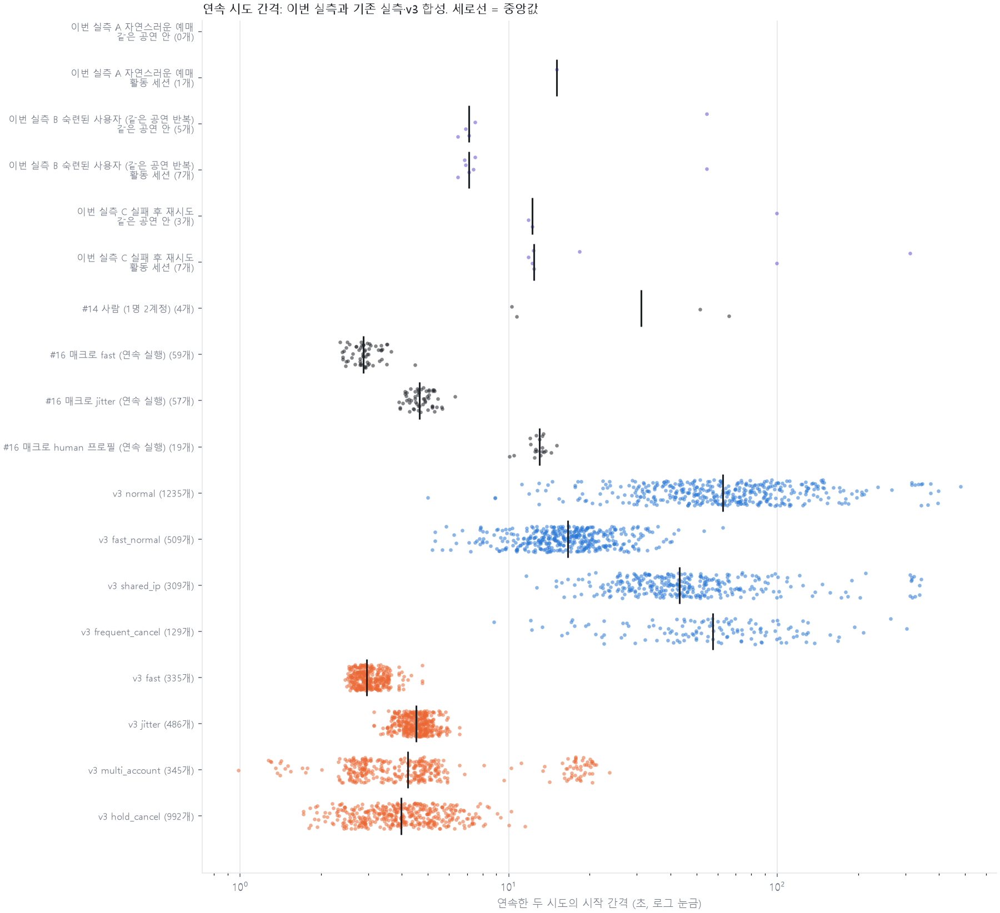

# 정상 사용자 예매 실측 결과 (Issue #17)

작성일 2026-11-24. [`measurement/README.md`](measurement/README.md) 의 절차로 수집한 실측(참가자 1명, 실험 A·B·C)을 분석한 결과다.
[`REPORT_INTERVAL_VALIDATION.md`](REPORT_INTERVAL_VALIDATION.md) 에서 확인한 빈칸(사람의 같은 공연 안 연속 시도 간격이 0개)을 메우기 위한 수집이었다.

**이번 단계는 분석까지다.** v4 데이터를 만들지 않았고, 모델을 학습하지 않았고, v1~v3 데이터·생성기·서빙 코드를 수정하지 않았다.
수치는 `measurement/output/20261124-u01/` 의 CSV 에서 가져왔다. 시도·계정 단위의 표와 원본은 `measurement/data/` 에 있고 git 에 올리지 않는다.

## 요약

| 질문 | 답 |
|---|---|
| 데이터는 온전한가 | 누락·중복·시각 오류 없음. 시도 18건, 이벤트 125건 (참가자 계정). Demo DB 의 기록과 건수가 일치한다 |
| 무엇이 모였나 | 참가자 1명. 완료 17건, 선점 만료 1건. 연속 시도 간격 15개 (같은 공연 안 8개) |
| 계획과 달라진 것 | 실험 C 의 좌석 이탈·결제 이탈·선점 거절이 **0건**이다. 실패 뒤 재시도는 선점 만료 1건뿐이다. A 는 2건, B 와 C 는 여러 공연이 섞였다 |
| 사람의 예매 속도 | **매우 빠르다.** 예매 1건(시작 → 완료) 중앙값 4.4초, 좌석 선택 1.6초, 결제 2.3초. 같은 공연 반복 간격은 6.5~7.5초 (5개 중 4개) |
| 매크로와 겹치는가 | 실측한 매크로의 간격 범위와 직접 겹치는 구간은 좁다. 다만 실험 B 의 간격(최소 6.45초)은 jitter 매크로의 최대(6.32초)와 0.13초 차이이고, human 프로필 매크로(10.1~15.1초)보다 **짧다**. 실험 C 의 간격은 7개 중 4개가 human 프로필 매크로의 범위 안이다 |
| v3 합성과 맞는가 | 맞지 않는다. v3 정상 시도 중 이번 실측의 예매 1건 중앙값(3.9초)보다 빠른 것은 **0%** 이고, 실험 B 의 간격 중앙값(7.1초)보다 짧은 v3 정상 간격은 0.7% 다. 이번 실측의 간격 15개 중 6개가 "정상 8초 이상" 밖이다 |

- **이 결과는 "사람이 이만큼 빠를 수 있다" 는 사실이지 "정상 사용자가 이렇다" 는 분포가 아니다.** 참가자는 사이트와 실험 목적을 아는 1명이고, 전체 수집이 9분 안에 끝났다.
- 그래도 v3 의 정상 간격 하한(8초)과 단계 시간(좌석 선택 20초)이 사람이 실제로 낼 수 있는 속도의 범위를 덮지 못한다는 점은 분명하다.

---

## 1. 수집과 데이터 품질

### 1.1 수집 조건

| 항목 | 값 |
|---|---|
| 환경 | 격리 E2E 환경 (`demo-ticketing/e2e`). 대기열 정원 100, CAPTCHA 꺼짐, 선점 시간 5분(기본값), 좌석 경쟁 없음 |
| 수집 시각 | 2026-11-23 15:34:16 ~ 15:43:10 UTC (한국 시각 11-24 00:34 ~ 00:43). 약 9분 |
| 참가자 | 1명 (`u01`) |
| 계정 | `u01-a-01` (A), `u01-b-01` (B), `u01-c-01` (C) |
| 내보내기 | `measurement/scripts/collect.py export --run-id 20261124-u01` → `measurement/data/20261124-u01/` (git 제외). #14 (`issue14-real-validation/data/`), #16 (`issue16-booking-interval/runs/`) 과 다른 폴더 |
| 그 밖의 계정 | `smoke-check-01`: 환경 검증용으로 넣은 매크로 예매 1건. 참가자 계정 규칙에 맞지 않아 분석에서 빠진다 (카드·IP 공유 수에는 들어간다) |

내보낸 뒤 DB 를 다시 확인했을 때 이벤트 수(132건)와 마지막 이벤트 시각이 그대로였다. 내보낸 파일이 원본 전체다.

### 1.2 품질 점검

| 점검 | 결과 |
|---|---|
| BTS `behavior_event` 건수 = Demo DB 의 기록 | 시도 이벤트 114 = 114, 예매 18 = 18 (시험 계정 포함) |
| Demo 의 전송 대기열 | 132건 모두 전송 완료. 실패·대기 0건 |
| `event_id`, `external_event_id` 중복 | 없음 |
| 같은 시도 안의 전이(`transitionId`), 순번(`sequence`) 중복 | 없음 |
| 순번이 1 부터 빠짐없이 이어짐 | 전 시도 |
| 순번 순서대로 시각이 뒤로 가지 않음 | 전 시도 |
| 모든 시도의 첫 이벤트가 `STARTED` | 18 / 18 |
| 완료된 시도 수 = `BOOKING` 이벤트 수 | 17 = 17 |
| `occurredAt` 과 서버 기록 시각(`recordedAt`)의 차이 | 1ms 이내 |
| `STARTED` 의 `occurredAt` 과 클릭 시각(`clientOccurredAt`)의 차이 | 중앙값 0.021초, 최대 0.035초 |
| 시각이 UTC 이고 밀리초까지 남음 | 전 이벤트 |
| 계정 사이에 시도가 겹침 | 없음 (계정의 활동 구간은 겹치지만 시도 단위로는 겹치지 않는다) |

**누락, 중복, 타임스탬프 오류는 없다.**

### 1.3 계획과 달라진 점 (해석에 영향)

| | 계획 | 실제 | 영향 |
|---|---|---|---|
| A | 처음 보는 상태로 c1, c2, c3 각 1건 | c1, c2 2건. 예매 1건에 4.2초, 5.0초 | 간격 1개. "화면이 익숙하지 않은 상태" 로 보기 어려운 속도다 |
| B | c1 을 6번 | c2 7건 사이에 c1 1건 (c2 c2 c1 c2 c2 c2 c2 c2) | 같은 공연 안의 간격이 7개가 아니라 5개 |
| C | c2 에서 좌석 이탈 2, 결제 이탈 2, 선점 거절 2, 선점 만료 1 | c1·c2·c3 을 오가며 완료 7건, 선점 만료 1건. **이탈·거절 이벤트 0건** | 실패 뒤 재시도는 만료 1건으로만 볼 수 있다. 같은 공연 안의 간격은 3개 |
| 참가자 | 여러 명 | 1명 | 사람 사이의 차이를 볼 수 없다 |
| 순서 | A → B → C | B 의 활동 구간(15:34:50~15:36:32) 안에 C 의 첫 시도(15:35:06)가 있다 | 두 창을 번갈아 쓴 것으로 보인다. B 의 54.5초 간격과 C 의 99.7초 간격에 다른 창에서의 작업 시간이 들어 있을 수 있다 |

- C 에서 이탈 이벤트가 없는 이유는 이벤트만으로는 알 수 없다. 좌석 화면의 "예매 시도 취소" 나 결제 화면의 "이전으로" 를 누르지 않았으면 이벤트가 남지 않는다. 종료 이벤트가 없는 시도도 0건이라, 탭을 닫거나 뒤로 가서 버려진 시도는 없었다.
- `manifest.csv` 는 양식 그대로다. 위 내용은 이벤트에서 읽은 것이다.

---

## 2. 실측 결과

### 2.1 시도 횟수와 결과

출처: `attempt_counts.csv`

| 실험 | 계정 | 시도 | 공연 수 | 완료 | 좌석 이탈 | 결제 이탈 | 선점 만료 | 종료 이벤트 없음 | 선점 거절 | 취소 | 간격: 같은 공연 안 | 간격: 활동 세션 |
|---|---|---|---|---|---|---|---|---|---|---|---|---|
| A | u01-a-01 | 2 | 2 | 2 | 0 | 0 | 0 | 0 | 0 | 0 | 0 | 1 |
| B | u01-b-01 | 8 | 2 | 8 | 0 | 0 | 0 | 0 | 0 | 0 | 5 | 7 |
| C | u01-c-01 | 8 | 3 | 7 | 0 | 0 | 1 | 0 | 0 | 0 | 3 | 7 |
| 합계 | | 18 | | 17 | 0 | 0 | 1 | 0 | 0 | 0 | 8 | 15 |

모든 예매가 좌석 1석이고 같은 결제 식별자를 썼다.

### 2.2 단계별 소요 시간 (초)

출처: `stage_times_by_experiment.csv`. 대기열 통과(0.07~0.19초)와 결제 화면 진입(0.04~0.06초)은 화면 전환 시간이라 표에서 뺐다.

| 실험 | 단계 | 건수 | 평균 | 중앙값 | 표준편차 | 최소 | 5% | 25% | 75% | 95% | 최대 |
|---|---|---|---|---|---|---|---|---|---|---|---|
| A | 좌석 선택 진입 → 선점 | 2 | 1.93 | 1.93 | 0.39 | 1.65 | 1.68 | 1.79 | 2.07 | 2.18 | 2.21 |
| A | 결제 화면 진입 → 예매 완료 | 2 | 2.39 | 2.39 | 0.12 | 2.31 | 2.32 | 2.35 | 2.43 | 2.47 | 2.47 |
| A | 시작 → 예매 완료 | 2 | 4.60 | 4.60 | 0.59 | 4.18 | 4.22 | 4.39 | 4.80 | 4.97 | 5.01 |
| B | 좌석 선택 진입 → 선점 | 8 | 1.67 | 1.51 | 0.45 | 1.36 | 1.39 | 1.47 | 1.63 | 2.38 | 2.76 |
| B | 결제 화면 진입 → 예매 완료 | 8 | 2.19 | 2.06 | 0.29 | 1.97 | 1.99 | 2.03 | 2.23 | 2.68 | 2.82 |
| B | 시작 → 예매 완료 | 8 | 4.06 | 3.94 | 0.44 | 3.67 | 3.67 | 3.76 | 4.22 | 4.75 | 4.97 |
| C | 좌석 선택 진입 → 선점 | 8 | 3.45 | 3.44 | 1.92 | 1.38 | 1.42 | 1.59 | 5.25 | 5.57 | 5.70 |
| C | 결제 화면 진입 → 예매 완료 | 7 | 3.42 | 2.35 | 1.98 | 2.14 | 2.17 | 2.28 | 3.97 | 6.54 | 6.98 |
| C | 시작 → 예매 완료 | 7 | 6.92 | 7.64 | 1.67 | 4.30 | 4.48 | 5.98 | 7.94 | 8.51 | 8.66 |

완료된 17건 전체: 시작 → 예매 완료 중앙값 4.36초 (3.67~8.66), 좌석 선택 1.62초 (1.36~5.70), 결제 2.30초 (1.97~6.98).

- 결제 단계에는 데모의 시연용 지연 1.2초가 들어 있다. 사람이 쓴 시간은 약 0.8~1.6초다 (저장된 카드를 고르고 버튼을 누르는 시간).
- 건수가 2~8건이라 5%·95% 는 최소·최대와 거의 같다. 분위수로서의 의미는 약하다.
- 참가자별 표(`stage_times_by_participant.csv`)는 참가자가 1명이라 위 표와 같다.

### 2.3 연속 시도 간격 (초)

간격 = 연속한 두 시도의 **시작** 시각 차이. 출처: `gap_summary.csv`

| 세션 정의 | 실험 | 간격 수 | 평균 | 중앙값 | 표준편차 | 최소 | 5% | 25% | 75% | 95% | 최대 |
|---|---|---|---|---|---|---|---|---|---|---|---|
| **같은 공연 안** (공연+30분) | A | 0 | — | — | — | — | — | — | — | — | — |
| | B | 5 | 16.49 | 7.12 | 21.26 | 6.45 | 6.54 | 6.90 | 7.48 | 45.11 | 54.51 |
| | C | 3 | 41.24 | 12.21 | 50.60 | 11.83 | 11.87 | 12.02 | 55.94 | 90.92 | 99.66 |
| **활동 세션** (30분만, 공연 무관) | A | 1 | 15.08 | 15.08 | — | 15.08 | | | | | 15.08 |
| | B | 7 | 13.81 | 7.12 | 17.95 | 6.45 | 6.57 | 6.87 | 7.43 | 40.40 | 54.51 |
| | C | 7 | 68.42 | 12.39 | 112.17 | 11.83 | 11.95 | 12.29 | 59.02 | 248.36 | 312.08 |

간격 15개를 순서대로 적으면 다음과 같다 (괄호는 앞 시도와 공연이 달랐던 간격).

| 실험 | 간격 (초) |
|---|---|
| A | (15.08) |
| B | 54.51, (6.83), (7.37), 6.45, 7.12, 7.48, 6.90 |
| C | 99.66, 11.83, (18.38), 12.21, (12.37), (12.39), (312.08) |

- **실험 B 에서 한 번 흐름을 탄 뒤의 간격은 6.45~7.48초에 모여 있다** (6개). 54.5초는 첫 예매 직후의 간격이고, 그 사이에 C 계정의 첫 시도가 있었다.
- 실험 C 의 간격은 11.8~18.4초에 5개가 있고, 99.7초(다른 창 작업으로 보임)와 312.1초(선점 만료를 기다린 시간)가 있다.
- **평균과 중앙값이 크게 다르다.** B 는 평균 16.5초·중앙값 7.1초, C 는 평균 68.4초·중앙값 12.4초다. 긴 간격 하나가 평균과 분산을 정한다.

### 2.4 앞 시도의 결과별 재시도 간격 (초)

출처: `retry_gap_by_previous_outcome.csv`. "종료 → 시작" 은 앞 시도의 종료 이벤트(완료·만료)부터 다음 시도 시작까지다.

| 실험 | 앞 시도의 결과 | 건수 | 시작 → 시작: 중앙값 (범위) | 종료 → 시작: 중앙값 (범위) |
|---|---|---|---|---|
| A | 예매 완료 | 1 | 15.08 | 10.04 |
| B | 예매 완료 | 7 | 7.12 (6.45~54.51) | 3.11 (2.65~50.71) |
| C | 예매 완료 | 6 | 12.38 (11.83~99.66) | 5.01 (3.54~95.35) |
| C | **선점 만료** | 1 | 312.08 | 6.76 |
| — | 좌석 선택에서 이탈 | 0 | 측정 없음 | 측정 없음 |
| — | 결제 화면에서 이탈 | 0 | 측정 없음 | 측정 없음 |
| — | 선점 거절 뒤 같은 시도에서 재선택 | 0 | 측정 없음 | 측정 없음 |

- 예매를 마치고 다음 "예매하기" 를 누르기까지: B 에서 2.65~3.69초 (7개 중 6개), C 에서 3.54~10.67초 (6개 중 5개).
- **선점 만료 뒤의 "시작 → 시작" 간격은 선점 시간이 정한다.** 312초 = 좌석 선택 4.6초 + 선점 시간 300초 + 만료 처리 약 1초 + 다시 들어오기까지 6.8초. 사람이 다시 들어오는 데 쓴 시간은 6.8초다.
- 실패 유형별 비교는 할 수 없다. 만료 1건이 전부다.

### 2.5 기존 6개 Feature

BTS 계산식(#14 추출기, 수정 없음)으로 계산했다. 기준 시각은 마지막 이벤트 + 1초. 출처: `measurement/data/_analysis/20261124-u01/features.csv`, `feature_summary.csv`

| Feature | u01-a-01 (A) | u01-b-01 (B) | u01-c-01 (C) | 비고 |
|---|---|---|---|---|
| `booking_count` | 2 | 8 | 8 | |
| `avg_booking_interval` (초) | 15.08 | 13.81 | 68.42 | 30일 전체 = 이 수집에서는 활동 세션 기준과 같다 |
| `booking_interval_variance` (초²) | 0 | 276.2 | 10,784.8 | A 는 간격이 1개라 식으로 0 이다 (측정값이 아니다) |
| `cancel_rate` | 0 | 0 | 0 | 취소를 하지 않았다 |
| `card_reuse_count` | 4 | 4 | 4 | **왜곡.** 모든 계정이 같은 결제 식별자 |
| `ip_booking_density` | 4 | 4 | 4 | **왜곡.** 모든 계정이 같은 IP (`::1`) |
| (세션) 평균 간격: 같은 공연 안 | 결측 | 16.49 | 41.24 | A 는 두 시도의 공연이 달라 간격이 없다 |
| (세션) 분산: 같은 공연 안 | 결측 | 361.5 | 1,707.0 | |
| 세션 수: 같은 공연 안 / 활동 세션 | 2 / 1 | 3 / 1 | 5 / 1 | 공연이 바뀔 때마다 세션이 나뉜다 |

추출기의 값이 시도 표에서 직접 계산한 값과 같은지 확인했다: 시도 수 일치, 평균 간격 일치, "시도 2건 미만이면 결측" 일치 (`analysis_summary.json`).

**계산할 수 없거나 해석할 수 없는 값**

| 값 | 상태 | 이유 |
|---|---|---|
| 6개 Feature (BTS 정의) | 세 계정 모두 계산됨 | 결측 없음 |
| A 의 분산 | 0 으로 계산되지만 의미 없음 | 시도 2건이면 간격이 1개라 모분산이 항상 0 |
| A 의 세션 간격·분산 (같은 공연 안) | 결측 | 같은 공연의 연속 시도가 없다 |
| `card_reuse_count`, `ip_booking_density` | 계산되지만 해석 불가 | 데모의 결제 식별자가 3개뿐이고 프록시 때문에 IP 가 하나다. 값 4 는 이 DB 의 계정 수다 (시험 계정 포함) |
| `cancel_rate` | 0 | 취소 행동을 수집하지 않았다 |
| 결제 실패, 좌석 클릭 시각, 세션 식별자 | 측정 불가 | 이벤트가 없다 (`measurement/README.md` 1.3절) |

---

## 3. 기존 데이터와의 비교

출처: `comparison_with_existing.csv`, `gap_overlap_with_existing.csv`, `figures/gaps.png`. #16 매크로는 연속 실행 조건이다.

### 3.1 시도 1건의 소요 시간 (초, 중앙값과 범위)

| 자료 | 건수 | 시작 → 예매 완료 | 좌석 선택 → 선점 |
|---|---|---|---|
| **이번 실측 A** | 2 | 4.60 (4.18~5.01) | 1.93 (1.65~2.21) |
| **이번 실측 B** | 8 | 3.94 (3.67~4.97) | 1.51 (1.36~2.76) |
| **이번 실측 C** | 7 | 7.64 (4.30~8.66) | 2.31 (1.38~5.70) |
| #14 사람 (1명 2계정) | 6 | 8.85 (5.87~30.56) | 1.86 (1.20~7.38) |
| #16 매크로 fast | 63 | 2.23 (1.78~3.27) | 0.52 (0.30~1.10) |
| #16 매크로 jitter | 60 | 3.06 (2.57~3.74) | 1.08 (0.68~1.44) |
| #16 매크로 human 프로필 | 20 | 7.02 (5.36~7.69) | 3.49 (2.44~4.43) |
| v3 normal | 1,562 | 41.37 [15.3~104] | 20.38 [6.1~64.4] |
| v3 fast_normal | 653 | 10.57 [6.3~19.7] | 1.96 [1.1~3.6] |
| v3 fast / jitter | 407 / 549 | 2.26 / 2.93 | 0.53 / 1.04 |

v3 는 `[5%~95%]`, 나머지는 `(최소~최대)`.

- **실험 B 의 사람은 human 프로필 매크로보다 빠르다** (3.94초 대 7.02초). jitter 매크로(3.06초)와 0.9초 차이이고, 범위가 일부 겹친다 (사람 최소 3.67초, jitter 최대 3.74초).
- 좌석 선택 시간은 사람 1.36~2.76초, jitter 0.68~1.44초로 1.36~1.44초 구간이 겹친다. human 프로필 매크로(2.44~4.43초)는 사람보다 느리다.
- #14 의 사람(8.85초)보다 두 배 빠르다. 결제 단계의 차이가 크다 (#14 는 카드 번호를 직접 입력했다).
- **v3 정상 시도 가운데 3.94초보다 빨리 끝난 것은 0% 다.** v3 `fast_normal` 의 좌석 선택(1.96초)은 실측과 비슷하지만 결제(중앙값 7초)와 대기(6초)가 길다.

### 3.2 연속 시도 간격 (초)

| 자료 | 간격 수 | 중앙값 | 최소 | 5% | 25% | 75% | 95% | 최대 |
|---|---|---|---|---|---|---|---|---|
| **이번 실측 B: 같은 공연 안** | 5 | 7.12 | 6.45 | 6.54 | 6.90 | 7.48 | 45.11 | 54.51 |
| **이번 실측 B: 활동 세션** | 7 | 7.12 | 6.45 | 6.57 | 6.87 | 7.43 | 40.40 | 54.51 |
| **이번 실측 C: 같은 공연 안** | 3 | 12.21 | 11.83 | 11.87 | 12.02 | 55.94 | 90.92 | 99.66 |
| **이번 실측 C: 활동 세션** | 7 | 12.39 | 11.83 | 11.95 | 12.29 | 59.02 | 248.36 | 312.08 |
| **이번 실측 A: 활동 세션** | 1 | 15.08 | 15.08 | | | | | 15.08 |
| #14 사람: 같은 공연 안 | 0 | — | | | | | | |
| #14 사람: 활동 세션 | 4 | 31.12 | 10.26 | 10.33 | 10.58 | 55.20 | 63.99 | 66.19 |
| #16 매크로 fast | 59 | 2.88 | 2.35 | 2.41 | 2.71 | 3.04 | 3.52 | 4.47 |
| #16 매크로 jitter | 57 | 4.66 | 3.91 | 4.02 | 4.41 | 5.04 | 5.49 | 6.32 |
| #16 매크로 human 프로필 | 19 | 13.02 | 10.06 | 10.40 | 12.51 | 13.41 | 14.48 | 15.07 |
| v3 normal | 1,235 | 62.79 | 5.00 | 23.28 | 41.74 | 92.85 | 198.19 | 560.04 |
| v3 fast_normal | 509 | 16.26 | 5.19 | 8.09 | 13.07 | 20.45 | 30.61 | 62.56 |
| v3 fast | 335 | 2.96 | 2.46 | 2.58 | 2.78 | 3.28 | 3.64 | 4.77 |
| v3 jitter | 486 | 4.52 | 3.15 | 3.68 | 4.15 | 4.86 | 5.55 | 6.56 |
| v3 multi_account | 345 | 4.21 | 0.98 | 2.32 | 2.85 | 5.30 | 19.03 | 23.70 |
| v3 hold_cancel | 992 | 3.96 | 1.60 | 2.30 | 3.05 | 5.12 | 7.28 | 11.52 |



### 3.3 정상 사용자의 간격이 매크로와 얼마나 겹치는가

이번 실측의 간격 가운데 각 매크로 자료의 범위(최소~최대) 안에 드는 비율이다. 출처: `gap_overlap_with_existing.csv`

| 이번 실측 | 간격 수 | #16 fast (2.35~4.47) | #16 jitter (3.91~6.32) | #16 human 프로필 (10.06~15.07) | v3 jitter (3.15~6.56) | v3 multi_account (0.98~23.70) | v3 hold_cancel (1.60~11.52) |
|---|---|---|---|---|---|---|---|
| B: 같은 공연 안 | 5 | 0% | 0% | 0% | 20% | 80% | 80% |
| B: 활동 세션 | 7 | 0% | 0% | 0% | 14% | 86% | 86% |
| C: 활동 세션 | 7 | 0% | 0% | **57%** | 0% | 71% | 0% |
| A: 활동 세션 | 1 | 0% | 0% | 0% | 0% | 100% | 0% |

- **실측한 매크로(#16)의 간격 범위와 실험 B 의 간격은 겹치지 않는다. 그러나 붙어 있다.** jitter 의 최대 6.32초와 B 의 최소 6.45초 사이가 0.13초다. B 의 간격은 jitter(3.9~6.3초)와 human 프로필(10.1~15.1초) **사이의 빈 구간**에 있다.
- **실험 C 의 간격은 7개 중 4개가 human 프로필 매크로의 범위 안이다** (11.83, 12.21, 12.37, 12.39초).
- v3 합성 매크로와는 더 많이 겹친다. v3 는 계정마다 속도를 조정해 범위가 넓고(jitter 최대 6.56초), `multi_account` 에는 human 프로필 링이 있어 23.7초까지 간다. B 의 간격 5개 중 4개가 v3 `multi_account` 와 `hold_cancel` 의 범위 안이다.
- 반대로 v3 **정상** 과는 겹치지 않는 쪽에 가깝다.

| 이번 실측의 값 | v3 정상 간격 중 이보다 짧은 비율 | v3 fast_normal 중 | v3 이상 간격 중 이보다 긴 비율 |
|---|---|---|---|
| B 의 중앙값 7.12초 | 0.7% | 2.6% | 5.3% |
| C 의 중앙값 12.39초 | 5.4% | 20.6% | 2.4% |
| A 의 15.08초 | 10.6% | 40.3% | 2.3% |

- v3 에서 7.12초는 정상의 맨 아래 0.7%, 이상의 위쪽 5% 에 해당한다. **v3 의 기준으로 보면 실험 B 의 사람은 매크로 쪽에 있다.**
- "정상 8초 이상": 이번 실측의 간격 15개 중 6개(6.45~7.48초)가 8초 미만이다.
- 계정 평균으로 보면 B 는 16.5초(같은 공연 안) 또는 13.8초(활동 세션)다. `REPORT_V3_SESSION.md` 5.3절의 "세션 평균 간격이 임계값보다 짧으면 이상" 규칙의 임계값이 14.8~16.8초였다. B 계정은 그 경계에 있고, 54.5초 간격 하나가 없었다면 평균 7.0초로 이상 판정이다.

### 3.4 #14 정상 사용자 실측과의 비교

| | #14 사람 | 이번 실측 |
|---|---|---|
| 참가자 | 1명, 2계정 | 1명, 3계정 |
| 시도 | 6 (모두 다른 공연) | 18 |
| 같은 공연 안의 간격 | 0 | 8 |
| 시작 → 예매 완료 | 8.85초 (5.87~30.56) | 4.36초 (3.67~8.66) |
| 완료 → 다음 시작 | 2.5초 / 36~41초 | 3.1초 (B), 5.0초 (C) |
| 다른 공연 사이의 간격 | 10.3~66.2초 | 6.83~18.38초 (만료 뒤의 312초 제외) |

- 두 측정 모두 "빠른 쪽의 한 사람" 이다. #14 의 빠른 계정(10.5초 간격)과 이번 실측의 C(12초대)가 비슷하고, B 는 더 빠르다.
- 두 측정이 같은 사람인지는 기록이 없다. 독립 표본으로 합칠 수 없다.

---

## 4. v4 생성 규칙에 대한 검토

실측으로 말할 수 있는 것과 가정이 필요한 것을 나눴다.

### 4.1 정상 사용자의 단계 시간

| | 실측이 말해 주는 것 | 말해 주지 않는 것 |
|---|---|---|
| 좌석 선택 | 사람이 1.4~5.7초에 할 수 있다 (17건). 두 번의 측정(#14, 이번)에서 중앙값이 1.6~1.9초다 | 처음 보는 사람, 좌석을 실제로 고민하는 사람의 시간. 좌석 경쟁이 있을 때의 시간 |
| 결제 | 저장된 카드로 2.0~2.8초 (지연 1.2초 포함), 길면 7.0초. 카드 번호를 직접 입력하면 4.5~21.6초 (#14) | 실제 결제 수단(인증, 간편결제)의 시간. 이 데모의 결제는 실제보다 훨씬 짧다 |
| 시도 1건 | 3.7~8.7초 | 위와 같음 |

- **범위의 아래쪽 끝이 내려간다.** `REPORT_INTERVAL_VALIDATION.md` 3.2절은 정상 단계 시간의 배율을 0.25~1배(v3 normal 기준)로 뒀다. 실측한 좌석 선택 1.6초는 v3 normal 의 20초의 **0.08배**다. 아래쪽 끝을 0.08배로 넓혀야 실측한 사람이 범위 안에 든다.
- 위쪽 끝(v3 의 20초)에는 여전히 근거가 없다. 이번 실측으로 확인된 것도 반박된 것도 아니다.
- **그 사이의 분포는 가정이다.** 두 측정 모두 빠른 한 사람이고, 평균적인 사용자가 어디에 있는지는 모른다. "정상 사용자의 대부분이 이렇게 빠르다" 고 두면 안 된다.

### 4.2 같은 공연 반복 예매의 간격

| | 실측 | 가정이 필요한 것 |
|---|---|---|
| 요청을 받고 같은 공연을 반복할 때의 간격 | 6.45~7.48초 (6개, 1명) | |
| 완료 → 다음 "예매하기" | 2.65~3.69초 (B), 3.54~10.67초 (C) | |
| 정상 사용자가 같은 공연을 다시 예매하는 **빈도** | 측정하지 않았다 (B 는 그렇게 하도록 요청한 실험이다) | 전부 가정. v3 는 정상 간격의 80% 를 여기서 만든다 |
| 요청 없이 다시 예매할 때의 대기 | 없음 | 가정 |

- v3 `fast_normal` 의 대기 중앙값 6초, `normal` 의 20초는 실측(약 3초)보다 길다. 다만 실측은 "곧바로 다시 하라" 는 상황이다.

### 4.3 실패 후 재시도 간격

| 실패 유형 | 실측 | 판단 |
|---|---|---|
| 선점 만료 | 1건. 만료 → 다음 시작 6.8초. 시작 → 시작 312초 | "시작 → 시작" 간격은 선점 시간(5분)이 정한다. 사람의 재진입 시간은 따로 봐야 한다 |
| 좌석 선택에서 이탈 | 0건 | **자료 없음.** 가정으로 남는다 |
| 결제 화면에서 이탈 | 0건 | **자료 없음** |
| 선점 거절 뒤 재선택 | 0건 | **자료 없음** |
| 결제 실패 | 측정 불가 | 이벤트가 없다 |

- 만료 1건으로 "실패 뒤 재진입은 약 7초" 라고 일반화할 수 없다. 참가자가 만료를 기다리고 있던 상황이다.
- **이 항목은 이번 수집으로 채워지지 않았다.** v4 에서 실패 뒤 재시도를 넣으려면 보충 수집이 필요하거나, 넓은 범위(`REPORT_INTERVAL_VALIDATION.md` 의 2.5~40초)를 그대로 가정으로 둬야 한다.
- 새로 확인된 구조: 선점 만료는 시작 → 시작 간격을 "선점 시간 + α" 로 만든다. v3 도 이렇게 만들지만(중앙값 340초), 선점 시간이 서비스 설정값이라는 점을 v4 설정에 드러내야 한다.

### 4.4 세션 경계

| 세션 정의 | A | B | C | 잡힌 간격 |
|---|---|---|---|---|
| 같은 공연 + 30분 | 세션 2, 간격 0 | 세션 3, 간격 5 | 세션 5, 간격 3 | 15개 중 8개 |
| 30분만 (활동 세션) | 세션 1, 간격 1 | 세션 1, 간격 7 | 세션 1, 간격 7 | 15개 중 15개 |

- **#14 에 이어 이번에도 사람은 공연을 바꿔 가며 연달아 예매했다.** "같은 공연 + 30분" 은 9분짜리 한 번의 활동을 10개 세션으로 쪼갠다. 간격의 절반 가까이(7개)가 버려지고, A 계정은 Feature 가 결측이 된다.
- 공연을 바꾼 간격(6.83, 7.37, 12.37, 12.39, 18.38초)은 같은 공연 안의 간격(6.45~7.48, 11.83~12.21초)과 같은 크기다. 이 사람에게 공연을 바꾸는 것은 간격에 영향이 없었다. 공연으로 세션을 나눌 행동상의 이유가 이 데이터에는 없다.
- 30분 기준은 이번에도 검증되지 않는다. 간격의 최댓값이 312초라 10분이든 60분이든 결과가 같다.
- **판단**: 이번 자료는 "활동 세션(시간만)" 쪽을 지지한다. 다만 두 번 모두 진행자가 여러 공연을 예매하도록 유도한 실험이라, 실제 사용자가 공연을 얼마나 오가는지의 근거는 아니다.

### 4.5 `avg_booking_interval`, `booking_interval_variance` 의 계산 방식

- **평균은 긴 간격 하나에 좌우된다.** B 계정: 간격 7개 중 6개가 6.5~7.5초인데 평균은 13.8초다. C 계정: 5개가 11.8~18.4초인데 평균은 68.4초다.
- **분산은 더 심하다.** B 276초², C 10,785초². 긴 간격 하나(54.5초, 312초)가 값의 거의 전부다. "간격이 일정한가" 를 나타내지 못한다.
- 긴 간격의 원인이 행동이 아닌 경우가 있다: 312초는 선점 만료 대기(서비스 설정), 54.5초와 99.7초는 다른 창에서의 작업으로 보인다.
- 검토할 방향 (정의를 바꾸는 일이므로 여기서는 제안만 한다)
  - 평균 대신 중앙값, 분산 대신 사분위 범위 같은 값. B 의 중앙값 7.1초는 그 계정의 실제 속도를 나타낸다.
  - 간격을 "시작 → 시작" 이 아니라 "앞 시도 종료 → 다음 시작" 으로 재는 방법. 선점 만료 대기가 빠진다. 다만 종료 이벤트가 없는 시도(탭 닫기)에서는 계산할 수 없다.
- 이 변경이 매크로 탐지에 유리한지는 모른다. 빠른 사람(중앙값 7.1초)이 jitter 매크로(4.7초)에 더 가까워지기 때문이다.

### 4.6 v3 생성 규칙 중 실측과 맞지 않는 부분

| v3 의 규칙 | 실측 | 판단 |
|---|---|---|
| 정상 간격의 최솟값 5.0초, 7.5초 미만은 정상 간격의 0.7% | 간격 15개 중 6개가 8초 미만 | **맞지 않음.** 사람이 낼 수 있는 속도의 아래쪽이 빠져 있다 |
| normal 의 좌석 선택 20초, 결제 15초 | 1.6초, 2.3초 (빠른 1명) | 실측한 사람은 범위 밖. 다수의 사용자에 대해서는 근거 없음 |
| fast_normal 의 좌석 선택 2초 | 1.6초 | 맞음 |
| fast_normal 의 결제 7초, 대기 6초 | 2.3초, 3.1초 | 실측이 더 빠르다 |
| fast_normal 이 정상의 15% | 측정 불가 | 가정 |
| 한 오픈에 한 공연 | 두 측정 모두 공연을 오갔다 | **맞지 않음** (유도된 행동이라는 한계) |
| 정상 사용자가 같은 공연을 여러 번 완료 | B 는 요청에 의한 것 | 판단 불가 |
| 이탈 뒤의 재진입 대기 = 완료 뒤와 같은 분포 | 자료 없음 | 가정으로 남음 |
| 선점 만료 뒤의 간격 ≈ 선점 시간 + 대기 | 312초 | 맞음 |
| human 프로필 매크로 평균 17.3초 | #16 실측 12.8초 | 맞지 않음 (이전 보고서에서 확인) |
| fast·jitter 매크로 | #16 실측과 일치 | 수정 불필요 |

### 4.7 탐지에 대한 함의

- 이번 실측에서 **빠른 사람과 느린 매크로의 순서가 뒤집혔다.** 사람(B)의 간격 7.1초 < human 프로필 매크로 13.0초. 간격만으로는 "빠르면 매크로" 가 성립하지 않는다.
- 사람과 매크로를 가르던 "다음 시도까지의 대기" 도 가깝다: 사람 2.65~3.69초, jitter 매크로 1.0~2.6초, human 프로필 매크로 4.7~7.9초.
- 이 데모는 결제가 2초에 끝나고 대기열이 없다. 실제 서비스에서는 사람의 결제 시간이 길어 차이가 더 날 수 있다. 반대로 대기열이 길면 차이가 가려진다. 어느 쪽인지는 이 환경으로 알 수 없다.

---

## 5. 데이터 품질 문제와 한계

| 문제 | 내용 |
|---|---|
| 참가자 1명 | 사람 사이의 차이를 추정할 수 없다. 모든 수치는 한 사람의 값이다 |
| 참가자의 성격 | 사이트와 실험 목적을 아는 사람이다. 9분 동안 18건을 예매했다. 일반 사용자의 표본이 아니라 "빠른 쪽의 예" 다 |
| A 가 "자연스러운 예매" 가 아님 | 예매 1건에 4.2~5.0초다. 화면을 처음 본 사람의 값으로 쓸 수 없다. 익숙하지 않은 상태의 단계 시간은 여전히 자료가 없다 |
| C 의 실패 유형 누락 | 좌석 이탈, 결제 이탈, 선점 거절이 0건. 실패 뒤 재시도는 만료 1건 |
| 공연이 섞임 | B, C 가 여러 공연에 걸쳐 있다. 같은 공연 안의 간격이 8개로 줄었다 |
| 두 창을 번갈아 쓴 흔적 | B 의 54.5초, C 의 99.7초 간격에 다른 계정에서의 작업 시간이 섞였을 수 있다 |
| 기록 미작성 | `manifest.csv` 가 비어 있다. 위 해석은 이벤트에서 추정한 것이다 |
| 환경 | 대기열 없음, 좌석 경쟁 없음, 결제가 클릭 한 번. 실제 티켓 오픈의 시간과 다르다 |
| 카드·IP | 모든 계정이 같은 값이라 두 Feature 는 해석할 수 없다 |
| 표본 크기 | 간격 15개, 시도 18건. 분위수와 표준편차는 참고용이다 |

---

## 6. v4 생성 전에 결정할 사항

1. **보충 수집을 할 것인가.** 지금 자료로 채워지지 않은 것은 세 가지다.
   - 다른 사람들의 값 (참가자 수). 정상 쪽 분포를 좁히려면 가장 필요하다.
   - 실패 뒤 재시도 (좌석 이탈, 결제 이탈, 선점 거절). 현재 0건이다.
   - 익숙하지 않은 상태의 단계 시간. 현재 0건이다.

   하지 않는다면 v4 에서 이 세 항목은 범위를 넓게 둔 가정으로 진행한다.
2. **정상 사용자 단계 시간의 범위.** 아래쪽 끝을 실측(좌석 선택 약 1.5초, 시도 1건 약 4초)까지 내릴 것인가. 내린다면 그 속도의 사용자가 차지하는 비중은 가정으로 정해야 한다 (예: 범위로 두고 민감도 분석).
3. **세션 경계.** "같은 공연 + 30분" 과 "활동 세션(시간만)" 중 무엇을 기준으로 할 것인가. 두 번의 실측은 시간만 쓰는 쪽을 지지하지만 둘 다 유도된 행동이다.
4. **간격의 대표값.** 평균·분산을 유지할 것인가, 중앙값 같은 값을 같이 검토할 것인가. Feature 정의의 변경이라 BTS 쪽 결정이 필요하다.
5. **같은 공연 반복 예매의 빈도.** v3 는 정상 간격의 80% 를 여기서 만든다. 실측으로는 정할 수 없으므로, 0% 부터 v3 수준까지를 범위로 둘지 정한다.
6. **v4 의 목표를 어디에 둘 것인가.** 이번 실측은 "간격과 속도만으로는 빠른 사람과 느린 매크로를 가를 수 없다" 는 쪽을 가리킨다. v4 가 그 겹침을 반영하면 간격 Feature 의 구분력은 크게 내려갈 것이다. 그 결과를 받아들이고 다른 Feature(시도 수, 카드·IP, 취소율)와 함께 평가할지 정한다.

`REPORT_INTERVAL_VALIDATION.md` 5.5절의 순서(참조 파일 보강 → v4 설계 → 분포 민감도 분석 → 모델 평가)는 그대로 유효하다. 이번 실측으로 바뀌는 것은 3.2절의 범위(정상 단계 시간의 아래쪽 끝, 완료 뒤 대기의 아래쪽 끝)다.

---

## 부록: 파일과 재현

| 내용 | 위치 | git |
|---|---|---|
| 원본 이벤트, 계정, 환경 기록 | `measurement/data/20261124-u01/` | 제외 |
| 시도 1행, 간격 1행, 계정별 Feature | `measurement/data/_analysis/20261124-u01/` | 제외 |
| 집계표 9개, 그래프 2장, 계산 조건(`analysis_summary.json`) | `measurement/output/20261124-u01/` | 내용을 본 뒤 결정 |
| 수집·분석 스크립트 | `measurement/scripts/collect.py`, `analyze.py` | |

```powershell
cd ai\experiments\issue17-event-based-dummy
$py = "..\issue14-real-validation\.venv\Scripts\python"
& $py measurement\scripts\analyze.py --run-id 20261124-u01      # 내보낸 파일만 읽는다. DB 가 꺼져 있어도 된다
```

분석 중에 `analyze.py` 의 버그 하나를 고쳤다: 선점 거절이나 이탈이 한 건도 없는 수집에서 멈추던 문제 (점검용 가짜 이벤트에는 항상 들어 있어서 드러나지 않았다). 그리고 간격의 겹침 표(`gap_overlap_with_existing.csv`)를 추가했다. 그 밖의 기존 코드와 데이터는 수정하지 않았다.
