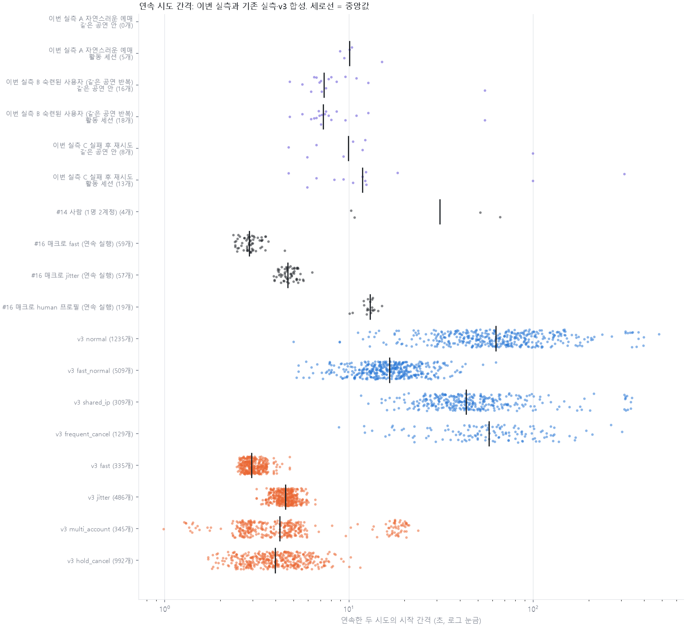

# 정상 사용자 추가 실측 분석과 v4 생성 규칙 설계 (Issue #17)

작성일 2026-11-24. [`REPORT_MEASUREMENT.md`](REPORT_MEASUREMENT.md) (첫 수집) 이후에 추가로 수집한 실측을 합쳐 분석하고, 그 결과로 v4 생성 규칙을 설계한 문서다.

> **정정 (2026-11-24).** 계정 ID 의 `u01`, `u02`, `u03` 은 서로 다른 참가자가 아니다. **같은 사람 1명이 계정을 바꿔 가며 수행했다** (수집한 사람의 확인).
> 이 문서의 초판은 "참가자 번호 3개, 서로 다른 사람인지 미확인" 으로 적었다. 이 판에서는 모든 실측을 **1명, 8계정, 시도 44건**으로 다시 정리했다.
> 계정 사이의 차이는 사용자 사이의 차이가 아니라 **같은 사람의 반복 측정 사이의 차이**다. 수치는 바뀌지 않았고 해석과 v4 설계의 근거 구분이 바뀌었다.
> 분석 스크립트는 참가자를 계정 ID 가 아니라 수집 기록(`manifest.csv` 의 `person` 열)에서 읽도록 고쳤다.

**이번 단계는 분석과 설계까지다.** v4 데이터를 만들지 않았고, 모델을 학습하지 않았고, v1~v3 데이터·생성기·서빙 코드·실측 원본 이벤트를 수정하지 않았다.
수치는 `measurement/output/20261124-all/` 의 CSV 에서 가져왔다. 원본과 시도·계정 단위의 표는 `measurement/data/` 에 있고 git 에 올리지 않는다.

## 요약

| 질문 | 답 |
|---|---|
| 실측의 규모 | **사람 1명**, 계정 8개, 시도 44건, 완료 40건, 연속 시도 간격 36개. 추가 수집분은 계정 5개, 시도 26건이다 |
| 데이터는 온전한가 | 누락·중복·시각 오류 없음. 이전 수집의 132건은 새 파일에 그대로 들어 있다 |
| 이 실측이 무엇인가 | **사이트에 익숙한 정상 사용자 1명이 빠르게 예매한 사례.** 정상 사용자 전체의 속도 분포를 대표하지 않는다 |
| 없는 것 | 다른 사람의 측정, 화면을 처음 보는 사람의 예매, 선점 거절(0건), 취소(0건) |
| 같은 사람의 반복 사이의 차이 | 작다. 같은 공연 반복 간격의 계정 중앙값이 7.1 / 7.4 / 8.0초, 예매 1건이 3.9 / 4.9 / 5.9초다. **사용자 사이의 차이는 이 자료로 추정할 수 없다** |
| 새 계정의 첫 몇 건과 반복 | 반복(B)이 처음 3건(A)보다 14~23% 빠르다. 같은 사람이므로 "익숙하지 않은 사용자와 숙련된 사용자" 의 비교가 아니다 |
| 매크로와 겹치는가 | **겹친다.** 활동 세션 간격 36개 중 5개가 jitter 매크로의 범위(3.9~6.3초) 안, 8개가 human 프로필 매크로의 범위(10.1~15.1초) 안이다. 절반(18개)은 그 사이에 있다. fast 매크로와는 겹치지 않는다 |
| v3 와 맞는가 | 이 사람은 v3 의 정상 범위에 거의 들지 않는다. 실측 간격의 중앙값(8.75초)보다 짧은 v3 정상 간격은 1.7% 다 |
| 간격 Feature 의 한계 | 평균은 빠른 사람과 느린 매크로의 순서를 가르지 못하고, 긴 간격 하나에 좌우된다. 분산은 간격이 5개 이상이면 이 사람(4~5초²)과 매크로(0.06~1.4초²)가 나뉘지만, 간격이 2개면 사람도 0.02~0.06초² 가 나온다 |

- 이 실측이 보여 주는 것은 **"사람 한 명이 이만큼 빠를 수 있다"** 는 사실 하나다. 정상 사용자가 대체로 이렇다는 근거가 아니다.
- v4 에서 이 값은 정상 사용자 속도의 **빠른 쪽 끝점**으로만 쓴다. 사용자 사이의 속도 차이는 실측으로 추정하지 않고, 명시적인 가정과 민감도 분석으로 다룬다 (5절, 6절).
- 실측 계정 8개는 독립된 사용자 8명이 아니다. 이 계정들로 신뢰구간을 계산하거나, 학습·평가 데이터에 나눠 넣지 않는다 (6.4절).

---

## 1. 추가 실측의 수집 범위와 품질

### 1.1 추출

| 항목 | 값 |
|---|---|
| 내보내기 | `collect.py export --run-id 20261124-add` → `measurement/data/20261124-add/` (git 제외 확인) |
| 이전 원본 | `measurement/data/20261124-u01/raw_events.csv` 는 수정하지 않았다 (내보내기 전후 해시 동일) |
| 파일의 관계 | 같은 DB 에서 다시 내보냈으므로 새 파일(309건)이 이전 파일(132건)을 그대로 포함한다. **통합 분석은 새 파일 하나만 읽는다** (두 파일을 합치면 이전 계정이 두 번 세어진다) |
| 수집 시각 (UTC) | 이전 15:34:16~15:43:10, 추가 15:54:02~15:58:32 (한국 시각 11-24 00:54~00:58) |
| 환경 | 이전과 같은 스택 (격리 E2E, 대기열 정원 100, 선점 5분, 좌석 경쟁 없음). 사이에 재시작 없음 |
| 서버 | 내보내기와 파일 확인 뒤에도 종료하지 않았다 |

### 1.2 무결성

| 점검 | 결과 |
|---|---|
| BTS 이벤트 수 = Demo DB 기록 | 시도 이벤트 268 = 268, 예매 41 = 41 (시험 계정 포함) |
| Demo 전송 대기열 | 309건 모두 전송 완료 |
| 이전 파일의 132건이 새 파일에 같은 값으로 있음 | 전부 일치 |
| `event_id`, `external_event_id`, 시도 안의 전이·순번 중복 | 없음 |
| 순번이 1 부터 빠짐없이 이어지고 시각이 뒤로 가지 않음 | 44개 시도 전부 |
| 모든 시도의 첫 이벤트가 `STARTED` | 44 / 44 |
| 완료된 시도 수 = `BOOKING` 수 | 40 = 40 |
| `occurredAt` − `recordedAt` | 1ms 이내 |
| `STARTED` 의 `occurredAt` − 클릭 시각 | 중앙값 0.022초, 최대 0.118초 |
| 계정 사이에 겹치는 시도 | 없음 |
| Demo DB 의 시도 상태와 선점 상태 | 이벤트와 일치 (`u01-c-02`: 완료 4, 좌석 이탈 1, 결제 이탈 2, 해제된 선점 2) |

### 1.3 계정별 이벤트와 실제로 수행된 시나리오

출처: `attempt_counts.csv`, `account_summary.csv`

| 수집 | 계정 | 이벤트 (시도 / 예매) | 시도 | 완료 | 좌석 이탈 | 결제 이탈 | 선점 만료 | 선점 거절 | 예매한 공연 |
|---|---|---|---|---|---|---|---|---|---|
| 이전 | u01-a-01 | 12 / 2 | 2 | 2 | 0 | 0 | 0 | 0 | c1 c2 |
| 이전 | u01-b-01 | 48 / 8 | 8 | 8 | 0 | 0 | 0 | 0 | c2 c2 c1 c2 c2 c2 c2 c2 |
| 이전 | u01-c-01 | 48 / 7 | 8 | 7 | 0 | 0 | 1 | 0 | c3 c3 c3 c1 c1 c2 c1 c3 |
| **추가** | u02-a-01 | 18 / 3 | 3 | 3 | 0 | 0 | 0 | 0 | c1 c2 c3 |
| **추가** | u02-b-01 | 42 / 7 | 7 | 7 | 0 | 0 | 0 | 0 | c2 × 7 |
| **추가** | u03-a-01 | 18 / 3 | 3 | 3 | 0 | 0 | 0 | 0 | c1 c2 c3 |
| **추가** | u03-b-01 | 36 / 6 | 6 | 6 | 0 | 0 | 0 | 0 | c1 × 6 |
| **추가** | u01-c-02 | 40 / 4 | 7 | 4 | 1 | 2 | 0 | 0 | c3 × 6, c1 |
| 합계 | 8계정 | 262 / 40 | 44 | 40 | 1 | 2 | 1 | 0 | |

**계획 대비 실제** (수행하지 않은 것은 수행한 것으로 보지 않는다)

| 시나리오 | 계획 | 실제로 기록된 것 | 판단 |
|---|---|---|---|
| A 자연스러운 예매 | 화면을 처음 보는 사람이 c1, c2, c3 | 3계정 8건 (u01 은 2건). 모두 4~11초에 완료 | 절차는 수행됨. **"익숙하지 않은 상태" 라는 조건은 충족되지 않은 것으로 본다** (1.4절) |
| B 같은 공연 반복 | 같은 공연 6회 | 3계정 21건. 추가 수집의 두 계정은 한 공연만 예매 | 수행됨 |
| C1 좌석 선택에서 이탈 → 재시도 | 2회 | **1회** | 일부 수행 |
| C2 결제 화면에서 이탈 → 재시도 | 2회 | **2회** | 수행됨 |
| C3 좌석 선점 거절 | 2회 | **0회** (`SEAT_HOLD/REJECTED` 이벤트 없음, 보조 계정 `helper-*` 도 없음) | **수행되지 않음** |
| C4 선점 만료 | 1회 | 1회 (이전 수집) | 수행됨 |
| 결제 실패 | 대상 아님 | 이벤트로 남지 않는다 | 측정 불가 |
| 예매 취소 | 계획에 없음 | 0회 | 없음. `cancel_rate` 는 모든 계정에서 0 |

### 1.4 참가자

**모든 실측은 같은 사람 1명이 수행했다.** 계정 ID 의 `u01`, `u02`, `u03` 은 계정을 구분하는 번호일 뿐이다.

| 계정 (시작 순서) | 시작 (UTC) | 끝 | 앞 계정이 끝난 뒤 |
|---|---|---|---|
| u02-a-01 | 15:54:02 | 15:54:32 | — |
| u02-b-01 | 15:54:47 | 15:55:45 | 15.3초 |
| u03-a-01 | 15:55:55 | 15:56:23 | 10.1초 |
| u03-b-01 | 15:56:36 | 15:57:20 | 13.5초 |
| u01-c-02 | 15:57:40 | 15:58:32 | 19.8초 |

- 이벤트의 모습도 이와 맞는다: 추가 수집의 다섯 계정은 4분 30초 동안 10~20초 간격으로 이어서 진행됐고, 계정 사이의 속도가 매우 비슷하다 (2.2절).
- 이 사람은 사이트의 화면과 실험의 목적을 안다. A 계정의 첫 예매가 5.0 / 6.4 / 6.7초에 끝났다. **"화면을 처음 보는 사용자" 의 측정은 한 건도 없다.**
- 수집 기록(`measurement/data/20261124-add/manifest.csv`)에 여덟 계정이 모두 같은 사람(`p01`)이라고 적었다. 기록의 근거는 수집한 사람의 확인이다. 시각과 브라우저는 기록이 없어 비워 뒀다.

**#14 실측의 사람 계정과의 관계**

- #14 의 README 에는 "사람 참가자가 1명" 이라고만 적혀 있다. 누구인지는 README, 수집 기록(`manifest.csv` 는 머리글만 있음), 보고서 어디에도 없다.
- #14 를 커밋한 계정이 이번 수집을 진행한 계정과 같다는 것은 확인되지만, 그것으로 예매를 한 사람이 같다고 할 수는 없다.
- **이 문서는 #14 의 사람과 이번 실측의 사람을 독립된 두 표본으로 세지 않는다.** 같은 사람이라면 독립된 정상 사용자 표본은 모두 합쳐 1명이고, 다른 사람이라고 확인되더라도 2명이다. 어느 쪽이든 사용자 사이의 분포를 추정할 수 없다는 결론은 같다.
- 두 측정을 한 표에 나란히 둘 때는 "같은 사람일 수 있음" 을 표시한다 (3.1절). 두 측정을 합쳐 평균을 내거나 표본 수를 더하지 않는다.

---

## 2. 통합 분석 (계정 8개, 시도 44건)

44건 전부가 한 사람의 반복 측정이다. 시도도 계정도 독립 표본이 아니다. 아래의 평균·표준편차·분위수는 **이 사람의 값이 어느 범위에 있었는지**를 적은 것이고, 정상 사용자 집단에 대한 추정치가 아니다. 신뢰구간은 계산하지 않았다.

### 2.1 시나리오별 (시도 단위, 초)

출처: `stage_times_by_experiment.csv`, `gap_summary.csv`. 결측 = 그 단계의 이벤트가 없는 시도 (이탈·만료된 시도).

| 실험 | 값 | 건수 | 결측 | 평균 | 중앙값 | 표준편차 | 최소 | 5% | 25% | 75% | 95% | 최대 |
|---|---|---|---|---|---|---|---|---|---|---|---|---|
| A (8건) | 좌석 선택 → 선점 | 8 | 0 | 2.65 | 2.22 | 1.06 | 1.65 | 1.72 | 1.90 | 3.16 | 4.35 | 4.69 |
| | 결제 화면 → 예매 완료 | 8 | 0 | 3.68 | 2.89 | 2.21 | 2.09 | 2.16 | 2.43 | 3.59 | 7.40 | 8.64 |
| | 시작 → 예매 완료 | 8 | 0 | 6.59 | 6.56 | 1.99 | 4.18 | 4.47 | 5.33 | 7.02 | 9.54 | 10.79 |
| B (21건) | 좌석 선택 → 선점 | 21 | 0 | 2.02 | 1.67 | 0.74 | 1.30 | 1.36 | 1.49 | 2.55 | 3.50 | 3.67 |
| | 결제 화면 → 예매 완료 | 21 | 0 | 2.71 | 2.16 | 1.48 | 1.62 | 1.65 | 2.02 | 2.72 | 6.80 | 7.19 |
| | 시작 → 예매 완료 | 21 | 0 | 4.92 | 4.36 | 1.57 | 3.09 | 3.66 | 3.88 | 5.26 | 8.63 | 9.09 |
| C (15건) | 좌석 선택 → 선점 | 14 | 1 | 3.26 | 2.50 | 1.65 | 1.38 | 1.45 | 1.82 | 5.06 | 5.45 | 5.70 |
| | 결제 화면 → 예매 완료 | 11 | 4 | 3.08 | 2.35 | 1.63 | 1.94 | 2.04 | 2.23 | 2.87 | 6.25 | 6.98 |
| | 시작 → 예매 완료 | 11 | 4 | 6.65 | 7.13 | 1.52 | 4.30 | 4.52 | 5.18 | 7.66 | 8.42 | 8.66 |

완료된 40건 전체: 시작 → 예매 완료 중앙값 5.20초 (3.09~10.79), 좌석 선택 2.06초 (1.29~5.70), 결제 2.42초 (1.61~8.64, 시연용 지연 1.2초 포함).

| 세션 정의 | 실험 | 간격 수 | 평균 | 중앙값 | 표준편차 | 최소 | 5% | 25% | 75% | 95% | 최대 |
|---|---|---|---|---|---|---|---|---|---|---|---|
| 같은 공연 안 (공연+30분) | A | 0 | — | — | — | — | — | — | — | — | — |
| | B | 16 | 10.64 | 7.30 | 11.87 | 4.76 | 5.37 | 6.60 | 8.79 | 23.18 | 54.51 |
| | C | 8 | 20.10 | 9.92 | 32.27 | 4.70 | 5.13 | 6.46 | 11.93 | 69.05 | 99.66 |
| 활동 세션 (30분만) | A | 5 | 10.77 | 10.06 | 2.47 | 8.95 | 9.05 | 9.43 | 10.34 | 14.13 | 15.08 |
| | B | 18 | 10.25 | 7.25 | 11.21 | 4.76 | 5.45 | 6.69 | 8.41 | 19.00 | 54.51 |
| | C | 13 | 40.33 | 11.83 | 85.38 | 4.70 | 5.44 | 8.31 | 12.39 | 184.63 | 312.08 |

활동 세션 간격 36개 전체: 중앙값 8.75초. 8초 미만이 15개(42%)다.

### 2.2 계정별 (같은 사람의 반복 측정)

출처: `account_summary.csv`, `stage_times_by_account.csv`

| 계정 | 시도 / 완료 | 예매 1건: 중앙값 (범위) | 좌석 선택 중앙값 | 결제 중앙값 | 간격: 같은 공연 안 (수, 중앙값) | 간격: 활동 세션 (수, 중앙값, 범위) | 완료 → 다음 시작 중앙값 |
|---|---|---|---|---|---|---|---|
| u01-a-01 | 2 / 2 | 4.60 (4.18~5.01) | 1.93 | 2.39 | 0 | 1, 15.08 | 10.04 |
| u02-a-01 | 3 / 3 | 6.42 (5.44~10.79) | 2.24 | 3.09 | 0 | 2, 9.19 (8.95~9.43) | 3.23 |
| u03-a-01 | 3 / 3 | 6.96 (6.70~7.23) | 3.70 | 2.82 | 0 | 2, 10.20 (10.06~10.34) | 3.20 |
| u01-b-01 | 8 / 8 | 3.94 (3.67~4.97) | 1.51 | 2.06 | 5, 7.12 | 7, 7.12 (6.45~54.51) | 3.11 |
| u02-b-01 | 7 / 7 | 4.92 (3.92~8.63) | 1.73 | 2.61 | 6, 7.39 | 6, 7.39 (6.22~12.73) | 2.37 |
| u03-b-01 | 6 / 6 | 5.93 (3.09~9.09) | 2.44 | 2.22 | 5, 8.02 | 5, 8.02 (4.76~10.97) | 1.87 |
| u01-c-01 | 8 / 7 | 7.64 (4.30~8.66) | 2.31 | 2.35 | 3, 12.21 | 7, 12.39 (11.83~312.08) | 5.01 |
| u01-c-02 | 7 / 4 | 6.30 (4.74~7.35) | 3.27 | 2.45 | 5, 6.64 | 6, 7.48 (4.70~10.52) | 3.56 |

**계정 중앙값 사이의 차이.** 같은 사람이 계정을 바꿔 반복했을 때 값이 얼마나 달라졌는지다. 사용자 사이의 차이가 아니다. 출처: `between_account_summary.csv`

| 실험 | 값 | 계정 수 | 최소 | 중앙값 | 최대 | 최대 / 최소 |
|---|---|---|---|---|---|---|
| A | 예매 1건 | 3 | 4.60 | 6.42 | 6.96 | 1.51 |
| A | 활동 세션 간격 | 3 | 9.19 | 10.20 | 15.08 | 1.64 |
| B | 예매 1건 | 3 | 3.94 | 4.92 | 5.93 | 1.51 |
| B | 좌석 선택 | 3 | 1.51 | 1.73 | 2.44 | 1.62 |
| B | 결제 | 3 | 2.06 | 2.22 | 2.61 | 1.27 |
| B | 같은 공연 안 간격 | 3 | 7.12 | 7.39 | 8.02 | **1.13** |
| B | 완료 → 다음 시작 | 3 | 1.87 | 2.37 | 3.11 | 1.66 |
| C | 예매 1건 | 2 | 6.30 | 6.97 | 7.64 | 1.21 |

### 2.3 실패 유형별 재시도 간격

출처: `retry_gap_by_previous_outcome.csv`. 실패 뒤의 재시도는 C 계정 두 개에서 나온 4건이 전부다.

| 앞 시도의 결과 | 건수 | 앞 시도 시작 → 이번 시작 | 앞 시도 종료 이벤트 → 이번 시작 | 비고 |
|---|---|---|---|---|
| 예매 완료 (A) | 5 | 중앙값 10.06 (8.95~15.08) | 3.48 (2.80~10.04) | 다른 공연으로 이동 |
| 예매 완료 (B) | 18 | 7.25 (4.76~54.51) | 2.56 (1.66~50.71) | 같은 공연 |
| 예매 완료 (C) | 9 | 12.21 (8.31~99.66) | 3.84 (3.37~95.35) | |
| **좌석 선택에서 이탈** | 1 | 6.64 | 1.71 | 이탈까지 4.9초 |
| **결제 화면에서 이탈** | 2 | 4.70, 5.93 | 1.08, 0.88 | 이탈까지 3.6초, 5.1초 |
| **선점 만료** | 1 | 312.08 | 6.76 | 선점 시간 300초 포함 |
| 선점 거절 뒤 재선택 | 0 | 측정 없음 | 측정 없음 | |

- **이탈 뒤에는 완료 뒤보다 빨리 다시 시작했다** (0.9~1.7초 대 2.6~3.8초). 다만 3건이고, 실패를 일부러 만들고 곧바로 다시 하는 상황이다.
- **이탈 뒤 재시도의 "시작 → 시작" 간격(4.70, 5.93, 6.64초)은 jitter 매크로의 범위(3.91~6.32초)에 2건이 들어간다.** 시도가 중간에 끝나면 시작 간격이 짧아지기 때문이다.

### 2.4 기존 6개 Feature

BTS 계산식(#14 추출기 그대로). 기준 시각은 마지막 이벤트 + 1초. 출처: `measurement/data/_analysis/20261124-all/features.csv`

| 계정 | `booking_count` | `avg_booking_interval` | `booking_interval_variance` | `cancel_rate` | `card_reuse_count` | `ip_booking_density` | (세션) 평균: 같은 공연 안 | (세션) 분산: 같은 공연 안 |
|---|---|---|---|---|---|---|---|---|
| u01-a-01 | 2 | 15.08 | 0 (간격 1개) | 0 | 8 | 9 | 결측 | 결측 |
| u02-a-01 | 3 | 9.19 | 0.057 | 0 | 5 | 9 | 결측 | 결측 |
| u03-a-01 | 3 | 10.20 | 0.020 | 0 | 8 | 9 | 결측 | 결측 |
| u01-b-01 | 8 | 13.81 | 276.2 | 0 | 8 | 9 | 16.49 | 361.5 |
| u02-b-01 | 7 | 8.32 | 5.02 | 0 | 8 | 9 | 8.32 | 5.02 |
| u03-b-01 | 6 | 7.57 | 4.92 | 0 | 8 | 9 | 7.57 | 4.92 |
| u01-c-01 | 8 | 68.42 | 10,784.8 | 0 | 8 | 9 | 41.24 | 1,707.0 |
| u01-c-02 | 7 | 7.57 | 4.02 | 0 | 8 | 9 | 7.42 | 4.69 |

- 8계정 모두 BTS 정의의 6개 Feature 가 계산된다 (결측 0). 추출기의 시도 수·평균 간격이 시도 표에서 직접 계산한 값과 일치한다 (`analysis_summary.json`).
- **결측**: 세션을 "같은 공연 안" 으로 정의하면 A 계정 3개가 모두 결측이다 (공연마다 1건씩 예매). 활동 세션 정의에서는 결측이 없고 BTS 의 30일 값과 같다 (모든 시도가 한 번의 활동이다).
- **의미 없는 값**: `u01-a-01` 의 분산 0 은 간격이 1개라 식으로 나온 값이다.
- **왜곡**: 카드 8(또는 5), IP 9 는 이 DB 의 계정 수다 (결제 식별자 3개, IP 하나). 해석하지 않는다.
- `cancel_rate` 는 취소를 하지 않아 모두 0 이다.

---

## 3. 기존 실측·v3 합성과의 비교

출처: `comparison_with_existing.csv`, `gap_overlap_with_existing.csv`, `figures/gaps.png`. #16 매크로는 연속 실행 조건.

### 3.1 다섯 자료

| 자료 | 계정 | 시도 | 예매 1건: 중앙값 (범위) | 좌석 선택 중앙값 | 연속 시도 간격: 중앙값 (범위) |
|---|---|---|---|---|---|
| ① #14 사람 (1명. 이번 실측과 같은 사람일 수 있음) | 2 | 6 | 8.85 (5.87~30.56) | 1.86 | 31.1 (10.3~66.2), 다른 공연 사이 4개 |
| ② #16 매크로 fast | 4 | 63 | 2.23 (1.78~3.27) | 0.52 | 2.88 (2.35~4.47) |
| ② #16 매크로 jitter | 3 | 60 | 3.06 (2.57~3.74) | 1.08 | 4.66 (3.91~6.32) |
| ② #16 매크로 human 프로필 | 1 | 20 | 7.02 (5.36~7.69) | 3.49 | 13.02 (10.06~15.07) |
| ③ 이전 실측 (같은 사람) | 3 | 18 | 4.36 (3.67~8.66) | 1.62 | 12.21 (6.45~312.08), 15개 |
| ④ 추가 실측 (같은 사람) | 5 | 26 | 5.59 (3.09~10.79) | 2.38 | 8.31 (4.70~12.73), 21개 |
| ③+④ 전체 (**1명**) | 8 | 44 | 5.20 (3.09~10.79) | 2.06 | 8.75 (4.70~312.08), 36개 |
| ⑤ v3 normal | 527 | | 41.37 [15.3~104] | 20.38 | 62.79 [23.3~198] |
| ⑤ v3 fast_normal | 122 | | 10.57 [6.3~19.7] | 1.96 | 16.26 [8.1~30.6] |
| ⑤ v3 fast / jitter | 44 / 43 | | 2.26 / 2.93 | 0.53 / 1.04 | 2.96 [2.6~3.6] / 4.52 [3.7~5.6] |
| ⑤ v3 multi_account / hold_cancel | 56 / 56 | | 2.89 / 3.05 | 0.97 / 0.73 | 4.21 [2.3~19.0] / 3.96 [2.3~7.3] |

v3 는 `[5%~95%]`, 실측은 `(최소~최대)`. ③④ 의 간격은 활동 세션 기준.



### 3.2 정상 사용자의 예매 속도는 참가자마다 얼마나 다른가

**이 자료로는 답할 수 없다.** 참가자가 1명이다.

- 계정 사이의 차이는 같은 사람이 계정을 바꿔 반복했을 때의 차이다. 같은 공연 반복 간격의 계정 중앙값이 7.12 / 7.39 / 8.02초(최대와 최소의 비 1.13), 예매 1건이 3.94 / 4.92 / 5.93초(1.51), 좌석 선택이 1.51 / 1.73 / 2.44초(1.62)다.
- 이 값이 말해 주는 것: **한 사람의 속도는 계정을 바꿔도, 20분 뒤에 다시 해도 비슷하게 재현된다.** 반복 사이의 흔들림은 1.1~1.6배다.
- 참고로 #14 의 한 사람은 두 계정의 평균 간격이 5.6배 달랐다 (10.5초와 58.9초). 한 사람 안에서도 상황에 따라 그만큼 달라질 수 있다.
- v3 는 계정 사이의 속도 차이를 로그 표준편차 0.5 로 뒀다. 이 값을 확인하거나 반박할 실측은 없다. **v4 에서 사용자 사이의 속도 차이는 전부 가정이다** (5.2절 R1).

### 3.3 익숙하지 않은 사용자와 숙련된 사용자의 차이

**이 비교도 할 수 없다.** 익숙하지 않은 사용자의 측정이 없다. 실험 A 와 B 는 같은 숙련된 사람이 한 것이다.

| 계정 번호 | A (새 계정의 처음 2~3건, 공연을 바꿔 가며): 예매 1건 중앙값 (건수) | B (같은 공연 반복): 중앙값 (건수) | B 가 빠른 정도 | A 의 첫 예매 |
|---|---|---|---|---|
| u01 | 4.60 (2) | 3.94 (8) | 14% | 5.01 |
| u02 | 6.42 (3) | 4.92 (7) | 23% | 6.42 |
| u03 | 6.96 (3) | 5.93 (6) | 15% | 6.70 |

- 세 번 모두 B 가 A 보다 0.7~1.5초 빠르다 (14~23%). 같은 사람의 세 번의 반복에서 같은 방향이 나왔다는 뜻이다.
- 이 차이는 "숙련도" 가 아니라 **조건의 차이**다: A 는 공연을 바꿔 가며 예매했고 B 는 같은 공연을 반복했다. 이미 익숙한 사람이 같은 동작을 연달아 할 때 조금 더 빨라지는 정도로 읽는다. A 는 계정당 2~3건이라 긴 결제 한 건(8.6초)이 값을 바꾼다.
- B 계정 안에서 뒤로 갈수록 빨라지는 경향은 보이지 않는다 (예: `u02-b-01` 4.92, 3.92, 4.52, 4.30, 5.26, 5.13, 8.63초).
- 화면을 처음 보는 사람이 얼마나 느린지는 자료가 없다. v4 에서 숙련도의 효과는 가정이다 (5.2절 R2).

### 3.4 정상 사용자의 세션 내 간격은 매크로와 어느 정도 겹치는가

활동 세션 간격 36개가 실측한 매크로의 범위 어디에 있는지다.

| 구간 | 간격 수 | 비율 | 해당 계정 |
|---|---|---|---|
| fast 매크로 (2.35~4.47초) 안 | 0 | 0% | |
| jitter 매크로 (3.91~6.32초) 안 | 5 | 14% | u03-b-01 2, u01-c-02 2, u02-b-01 1 |
| jitter 최대와 human 프로필 최소 사이 (6.32~10.06초) | 18 | 50% | 대부분의 B 간격 |
| human 프로필 매크로 (10.06~15.07초) 안 | 8 | 22% | u01-c-01 4, u01-c-02 · u02-b-01 · u03-a-01 · u03-b-01 각 1 |
| 15.07초 초과 | 5 | 14% | 긴 간격 (만료 대기, 다른 창) |

| 실험 | 간격 수 | #16 jitter 범위 안 | #16 human 프로필 범위 안 | v3 jitter 범위 안 | v3 multi_account 범위 안 | v3 hold_cancel 범위 안 | v3 normal 의 5~95% 안 |
|---|---|---|---|---|---|---|---|
| A | 5 | 0% | 20% | 0% | 100% | 80% | |
| B | 18 | 17% | 11% | 22% | 94% | 89% | |
| C | 13 | 15% | 38% | 15% | 85% | 46% | |
| 전체 | 36 | 14% | 22% | | | | 22% (8개) |

- **첫 수집에서는 jitter 매크로와 0.13초 차이로 겹치지 않았지만, 추가 수집에서 겹쳤다.** 가장 빠른 사람 간격은 4.70초(결제 이탈 뒤), 4.76초(같은 공연 반복)다.
- **사람의 간격은 fast 와는 겹치지 않고, jitter 와 human 프로필의 범위 양쪽에 걸친다.** 절반은 두 매크로 프로필 사이의 구간(6.3~10.1초)에 있는데, 그 구간이 비어 있는 것은 매크로 도구의 프로필이 세 점뿐이어서다. 지연 설정을 jitter 와 human 사이로 두면 그 구간에 온다.
- 예매 1건의 소요 시간도 겹친다: 완료 40건 중 4건이 jitter 의 범위(2.57~3.74초), 13건이 human 프로필의 범위(5.36~7.69초) 안이다. 가장 빠른 사람 시도는 3.09초다.
- **순서가 뒤집힌다.** B 의 사람(계정 중앙값 7.1~8.0초)은 human 프로필 매크로(13.0초)보다 빠르다.
- 이 겹침은 **빠른 사람 한 명**과 느린 쪽의 매크로 사이의 것이다. 정상 사용자 가운데 이만큼 빠른 사람이 얼마나 되는지, 평균적인 사용자가 얼마나 겹치는지는 이 자료로 알 수 없다. "정상 사용자의 14% 가 jitter 매크로와 겹친다" 는 식으로 읽으면 안 된다. 14% 는 이 한 사람의 간격 36개 가운데의 비율이다.

### 3.5 v3 의 정상 사용자 생성 규칙 중 실측과 맞지 않는 부분

| v3 의 규칙·결과 | 실측 (계정 8개) | 판단 |
|---|---|---|
| 정상 간격의 최솟값 5.0초 | 최소 4.70초 | 실측이 범위 밖 |
| 실측 간격의 중앙값 8.75초보다 짧은 정상 간격: **1.7%** (fast_normal 6.3%) | 36개 중 18개가 그보다 짧다 | **맞지 않음** |
| 정상 간격의 5~95% 구간 12.2~166초 | 36개 중 8개만 그 안 | 맞지 않음 |
| 실측 예매 1건의 중앙값 5.20초보다 빠른 정상 시도: **0.4%** | 40건 중 20건 | **맞지 않음** |
| 실측 예매 1건의 최댓값 10.79초보다 빠른 정상 시도: 13.5% | 40건 전부 | 맞지 않음 |
| 정상 계정의 평균 간격 (세션 기준) 5% 지점 9.5~25초 | 계정 8개 중 7개가 v3 정상 계정의 하위 10% 안, 그중 2개(7.57초)는 v3 정상 계정 전부보다 짧다 | 맞지 않음 |
| normal 의 좌석 선택 20초, 결제 15초, 대기 20초 | 2.1초, 2.4초, 3.2초 | 실측은 범위의 아래쪽 밖 |
| fast_normal 의 좌석 선택 2초 | 2.06초 | **맞음** |
| fast_normal 의 결제 7초, 대기 6초 | 2.4초, 3.2초 | 실측이 더 빠르다 |
| 이탈 뒤의 재진입 대기 = 완료 뒤와 같은 분포 (중앙값 6~20초) | 이탈 뒤 0.9~1.7초, 완료 뒤 2.6~3.8초 | 맞지 않음 (3건) |
| 한 오픈에 한 공연 | A 와 C 에서 공연을 오갔다 | 맞지 않음 (유도된 행동) |
| 시도 안의 변동 (로그 표준편차 0.35~0.5) | 같은 공연 반복 간격의 변동계수 약 0.3 (계정 3개) | fast_normal 의 0.35 와 비슷 |
| 선점 만료 뒤의 간격 ≈ 선점 시간 + 대기 | 312초 | 맞음 |
| human 프로필 매크로 평균 17.3초 | #16 실측 12.8초 | 맞지 않음 (`REPORT_INTERVAL_VALIDATION.md`) |
| fast·jitter 매크로 | #16 과 일치 | 수정 불필요 |

- 요약하면 **v3 의 정상 사용자는 이번에 실측한 한 사람보다 한 자릿수 가까이 느리다.** v3 의 "정상" 범위에 이 사람이 거의 들지 않는다. v3 가 틀렸다는 것이 아니라, 이런 사용자가 v3 에 없다는 것이다.
- 다만 v3 의 느린 쪽(좌석 선택 20초)이 틀렸다는 근거도 없다. 실측에 없을 뿐이다.

### 3.6 `avg_booking_interval`, `booking_interval_variance` 의 한계

**평균 간격**

| | 값 (초) |
|---|---|
| 사람: 긴 간격이 없는 계정 (5개) | 7.57, 7.57, 8.32, 9.19, 10.20 |
| 사람: 긴 간격이 있는 계정 (3개) | 13.81 (54.5초 1개), 15.08 (간격 1개), 68.42 (312초, 99.7초) |
| #16 매크로 fast / jitter / human 프로필 (계정 평균) | 2.64~3.12 / 4.34~5.10 / 12.83 |

1. **순서가 맞지 않는다.** 사람 5계정(7.6~10.2초)이 human 프로필 매크로(12.8초)보다 짧다. "짧으면 이상" 이라는 방향으로는 느린 매크로를 놓치고 빠른 사람을 잡는다.
2. **긴 간격 하나가 값을 정한다.** `u01-b-01` 은 간격 7개 중 6개가 6.5~7.5초인데 평균이 13.8초다. `u01-c-01` 은 선점 만료 대기 312초 때문에 68.4초다. 같은 사람의 같은 속도가 7.6초로도 68초로도 나온다.
3. **긴 간격의 원인이 행동이 아닐 수 있다.** 312초는 서비스의 선점 시간이고, 54.5초와 99.7초는 다른 계정에서의 작업으로 보인다.
4. **공연별 세션으로 계산하면 결측이 된다.** A 계정 3개가 모두 결측이다.
5. **사이트 상태가 들어간다.** 간격 = 앞 시도의 전체 소요 시간 + 대기다. 대기열이 길어지면 사람과 매크로의 값이 같이 커진다 (이 환경에서는 0).

**간격 분산**

| | 값 (초²) |
|---|---|
| 사람: 간격 5개 이상, 긴 간격 없음 (3계정) | 4.02, 4.92, 5.02 |
| 사람: 간격 2개 (A 계정 2개) | 0.020, 0.057 |
| 사람: 긴 간격 포함 (2계정) | 276, 10,785 |
| #16 매크로 fast / jitter (계정별) | 0.063~0.159 / 0.057~0.217 |
| #16 매크로 human 프로필 (1계정) | 1.39 |
| v3 이상 계정 (세션 기준): 중앙값 [5%~95%] | 0.22 [0~2.68] |

1. **간격이 충분하면 분산은 평균보다 잘 나눈다.** 간격 5개 이상인 사람 계정은 4.0~5.0초², 매크로는 0.06~1.4초² 다. 사람의 반복에는 2초 정도의 흔들림이 있고 매크로에는 없다. Credit 규칙의 "분산 1.0초² 미만" 기준과도 맞는다 (사람 3계정은 위, fast·jitter 는 아래, human 프로필은 조금 위).
2. **간격이 적으면 사람도 작게 나온다.** 간격이 2개인 A 계정은 0.02, 0.06초² 로 매크로보다 작다. Credit 규칙이 "시도 5건 이상" 을 붙인 이유와 같다.
3. **긴 간격 하나가 값을 정한다.** 276, 10,785초² 는 간격 하나에서 나온 값이고 "간격이 일정한가" 와 무관하다.
4. 한 사람의 계정 3개에서 나온 결과다. 다른 사람이나 다른 상황에서도 사람의 분산이 매크로보다 큰지는 확인되지 않았다.

---

## 4. Feature 정의 검토

Feature 종류(6개)는 유지한다. 아래는 간격 2개의 계산 방식에 대한 검토이며, 서빙 코드는 수정하지 않았다.

### 4.1 세션 기준의 정의

| | 공연별 세션 (같은 공연 + 30분) | 활동 세션 (30분 비활동으로만 나눔) |
|---|---|---|
| 실측 44건의 세션 수 | 20 | 8 (계정당 1) |
| 잡히는 간격 | 36개 중 24개 | 36개 중 36개 |
| 간격 Feature 가 결측인 계정 | 8개 중 3개 (A 전부) | 0 |
| 공연을 바꿔 가며 예매하는 계정 | 간격이 없다 | 간격이 잡힌다 |
| 구현 | `concertId` 를 읽어야 한다 | 시각만 쓴다. 지금 루프에서 임계값보다 긴 간격만 건너뛰면 된다 |
| 약점 | 여러 공연·회차를 도는 매크로가 결측이 된다 | 서로 관계없는 공연의 시도가 한 세션으로 묶인다. 임계값(30분)의 근거가 약하다 |

- #14 와 이번 실측 모두에서 사람은 공연을 바꿔 가며 연달아 예매했고, 공연을 바꾼 간격(6.8~18.4초)은 같은 공연 안의 간격과 같은 크기였다. **실측은 활동 세션 쪽을 지지한다.**
- 다만 두 번 모두 여러 공연을 예매하도록 유도된 실험이다. 실제 사용자가 공연을 얼마나 오가는지의 근거는 아니다.
- 30분이라는 값은 여전히 검증되지 않는다. 실측 간격의 최댓값이 312초라 5분 20초보다 긴 임계값이면 결과가 모두 같다.

### 4.2 `avg_booking_interval`, `booking_interval_variance` 의 세션 기준 정의

| 선택지 | 내용 | 실측에서의 효과 | 문제 |
|---|---|---|---|
| (a) 세션 안 간격의 평균·모분산 | `REPORT_V3_SESSION.md` 의 "모든 간격" | 30일 값과 같다 (세션이 하나) | 긴 간격 하나가 값을 정한다 (3.6절) |
| (b) 세션 안 간격의 중앙값 | 평균 대신 중앙값 | `u01-b-01` 13.8 → 7.1초, `u01-c-01` 68.4 → 12.4초. 계정 8개가 7.1~15.1초에 모인다 | 빠른 사람이 jitter 매크로에 더 가까워진다. Feature 의 의미가 바뀐다 |
| (c) 분산 대신 흔들림의 강건한 척도 (사분위 범위 등) | | 276 → 약 0.5초 수준 | 간격이 적으면 불안정하다. Feature 의 의미가 바뀐다 |
| (d) 간격을 "앞 시도 종료 → 다음 시작" 으로 | 선점 만료 대기가 빠진다 | 312초 → 6.8초 | 종료 이벤트가 없는 시도(탭 닫기)에서는 계산할 수 없다. 다른 창 작업은 그대로 남는다 |
| (e) 임계값을 넘는 간격을 세션 경계로 | 지금 정의. 임계값을 낮춘다 | 임계값 5분이면 312초가 빠지고 54.5초·99.7초는 남는다 | 임계값을 선점 시간에 맞추는 꼴이 된다 |

- (a) 는 정의 변경이 가장 작다. (b)(c) 는 실측한 왜곡을 가장 잘 없애지만 Feature 이름과 뜻이 달라진다.
- 어느 쪽이 탐지에 유리한지는 실측만으로 정할 수 없다. v4 에서 같은 이벤트에 (a)~(d) 를 계산해 비교한다 (6절).

### 4.3 세션 안의 시도가 1건뿐일 때

| 경우 | 처리 |
|---|---|
| 시도가 1건인 세션 | 간격이 없다. 그 세션은 계산에서 뺀다. 0 이나 다른 값으로 채우지 않는다 |
| 간격이 있는 세션이 하나도 없는 계정 | 두 Feature 가 결측. 모델에 넣기 전에 학습 데이터의 중앙값으로 대체 (지금의 기준 전처리) |
| 간격이 1개뿐인 계정 | 평균은 그 값, 분산은 식으로 0. **분산 0 을 측정값처럼 쓰지 않도록** 결측으로 둘지 정해야 한다 |
| 간격이 2~4개인 계정 | 분산이 사람에게서도 작게 나온다 (0.02~0.06초²). 분산을 쓰려면 "간격 n 개 이상" 조건이 필요하다 |

- 실측에서 공연별 세션은 계정의 38%(3 / 8)를 결측으로 만들었다. 활동 세션은 0% 다.
- 분산의 최소 간격 수는 Credit 규칙의 "시도 5건 이상" 을 출발점으로 삼을 수 있다. 값은 v4 에서 확인한다.

### 4.4 긴 대기와 선점 만료

| 긴 간격 | 크기 | 원인 | 평균에 주는 영향 |
|---|---|---|---|
| 선점 만료 대기 | 312초 | 선점 시간(서비스 설정 5분) | `u01-c-01` 평균 68.4초 (만료 간격을 빼면 27.8초) |
| 다른 창·다른 계정에서의 작업 | 54.5초, 99.7초 | 실험 진행 방식 | `u01-b-01` 평균 13.8초 (빼면 7.0초) |

- 선점 만료는 "시작 → 시작" 간격을 항상 선점 시간 이상으로 만든다. 실제 서비스에서도 생긴다.
- 대책은 4.2절의 (b)(d)(e) 다. 실측으로는 어느 것이 맞는지 정할 수 없다.

### 4.5 변경이 필요할 때의 수정 범위 (서빙 코드는 변경하지 않았다)

`REPORT_V3_SESSION.md` 8.2절의 목록이 기준이다. 선택지에 따라 달라지는 부분만 적는다.

| 선택 | BTS 백엔드 (`ticket-fds-admin/backend`) | AI 서버 (`ai`) |
|---|---|---|
| 활동 세션 + (a) 평균·분산 | `FeatureAggregationService.calculate`: 간격 루프에서 임계값(상수 추가)을 넘는 간격을 제외. `concertId` 는 읽지 않아도 된다. 남은 간격이 없으면 null. `UserCalculatedFeatures` 주석, 테스트(`FeatureAggregationServiceTest`: 임계값을 넘는 간격, 모든 간격이 제외되는 계정), 관리자 화면 문구 | `preprocessing.py` 의 `FEATURE_SPECS` 주석, `app/schemas.py` 설명, `docs/predict_feature_spec.md`, 예시·테스트. **모델 재학습과 번들 재생성** (결측 대체 포함) |
| 공연별 세션 | 위에 더해 `metadata.concertId` 를 시도의 시작 시각과 함께 저장 | 같음 |
| (b) 중앙값, (c) 강건한 분산 | 계산식 변경 (정렬 후 중앙값·분위수). 필드 이름을 유지할지 바꿀지 결정 필요 | 같음. 필드 이름을 바꾸면 스키마·검증·문서·테스트 전부 |
| (d) 종료 → 시작 간격 | 시도마다 종료 시각(`COMPLETED`, `ABANDONED`, `EXPIRED` 이벤트)을 함께 모아야 한다. 종료 이벤트가 없는 시도의 처리 규칙 필요 | 같음 |
| 분산의 최소 간격 수 | 간격이 n 개 미만이면 분산을 null 로 | null 허용은 이미 돼 있다 |

- 어떤 선택이든 **BTS 와 AI 서버가 같은 시점에 바뀌어야 하고 모델을 다시 학습해야 한다.**
- 실험 쪽에서는 #14 의 추출기(`extract_features.py`)와 일치 테스트, `extract_session_features.py` 를 같은 정의로 맞춘다.
- 같은 클래스의 이전 사본이 별도 저장소 `backend/` 에 있다. 어느 쪽이 배포되는지 확인이 필요하다.

---

## 5. v4 생성 규칙 설계

원칙

- 실측과 합성이 겹치도록 값을 맞추지 않는다. 실측은 **범위의 끝점**과 **구조**를 정하는 데만 쓴다.
- 모델 성능을 보고 파라미터를 고치지 않는다. 범위는 생성 전에 고정한다.
- 근거가 없는 값은 하나로 정하지 않고 범위로 두어 민감도 분석의 축으로 삼는다.

### 5.1 근거의 수준에 따른 파라미터 구분

**(가) 실측·코드를 직접 반영할 수 있는 것**

| 파라미터 | 값 | 근거 |
|---|---|---|
| fast·jitter 매크로의 시도 1건과 다음 시도까지의 간격 | 실측 시도를 통째로 복원추출 (v2·v3 와 같음) | #16 연속 실행 6계정 120건 |
| 매크로의 계정 간 속도 차이 | 로그 표준편차 0.085 | #16 계정 평균 6개 |
| human 프로필 매크로 | #16 연속 실행의 시도를 통째로 복원추출 (v3 의 #14 값 + 추정 대기를 교체) | #16 1계정 20건. 간격 10.1~15.1초 |
| 단계 시간의 하한 | 좌석 0.298초, 결제 1.297초 등 | #16 실측 120건의 최솟값 |
| 이벤트의 구조 | 선점 거절은 같은 attemptId, 결제 실패는 이벤트 없음, 완료·이탈 뒤에는 새 attemptId, 이탈·만료의 사유 코드 | 코드 + 이번 실측에서 확인 (이탈 3건, 만료 1건) |
| 선점 만료 뒤의 간격 = 선점까지의 시간 + 선점 시간 + 재진입 | 선점 시간 300초 | 코드 + 실측 1건 (312초) |
| 시각의 정의 | 서버 기록 시각, 클릭 시각과 0.02초 차이 | 실측 44건 |

**(나) 실측은 있지만 일반화할 수 없는 것** — 한 사람의 값이다. 정상 사용자 속도의 **빠른 쪽 끝점**으로만 쓴다

| 파라미터 | 실측 값 (1명) | 표본 | 쓰는 방법 |
|---|---|---|---|
| 좌석 선택 시간 | 중앙값 2.06초 (1.29~5.70) | 40건 | 정상 범위의 빠른 끝점. 분포의 중심으로 쓰지 않는다 |
| 결제 시간 | 2.42초 (1.61~8.64), 지연 1.2초 포함 | 40건 | 빠른 끝점. 저장된 카드 클릭이라 실제 결제보다 짧다 |
| 예매 1건 | 5.20초 (3.09~10.79) | 40건 | 빠른 끝점 |
| 완료 → 다음 시도 시작 | 중앙값 3.24초 (25~75%: 2.42~4.07) | 32개 | 빠른 끝점. "이어서 하라" 는 상황이었다 |
| 이탈 → 다음 시도 시작 | 좌석 이탈 1.71초 (1건), 결제 이탈 0.88, 1.08초 (2건) | 3건 | 빠른 끝점. 실패를 일부러 만든 상황이었다 |
| 만료 → 다음 시도 시작 | 6.76초 | 1건 | 빠른 끝점 |
| 한 사람 안의 간격 흔들림 | 표준편차 2.2~2.5초 (변동계수 약 0.3), 분산 4~5초² | 계정 3개 | 시도 안의 변동(로그 표준편차)의 아래쪽 값 0.3 |
| 같은 사람의 반복 사이의 차이 | 계정 중앙값의 최대 / 최소 1.1~1.6 | 계정 3~8개 | **사용자 사이의 차이로 쓰지 않는다.** 한 사람의 세션 사이 변동의 참고값일 뿐이다 |
| 조건에 따른 속도 변화 | 같은 공연 반복이 14~23% 빠름 | 세 번 반복 | 참고. 숙련도의 효과로 쓰지 않는다 |
| 공연을 오가는 행동 | A·C 계정에서 관찰 | | 그런 행동이 가능하다는 것만. 빈도는 유도된 것이다 |

**(다) 가정이 필요한 것** — 실측으로 추정하지 않는다. 값을 명시하고 민감도 분석의 축으로 둔다

| 파라미터 | 왜 가정인가 |
|---|---|
| **정상 사용자 사이의 속도 차이** (분포의 모양, 폭, 중심) | 실측한 사람이 1명이다. #14 를 더해도 최대 2명이다 |
| 정상 사용자 속도의 **느린 끝** | 처음 보는 사람, 좌석을 고민하는 사람의 실측이 없다 |
| 실측한 사람만큼 빠른 사용자의 비중 | 이 사람이 전체에서 어디에 있는지 모른다 |
| 숙련도의 효과 (처음 보는 사용자가 얼마나 느린가) | 익숙하지 않은 사용자의 실측이 없다 |
| 같은 공연을 다시 예매하는 빈도, 한 세션의 목표 예매 수 | B 는 요청에 의한 반복이다 |
| 실패의 빈도 (이탈, 만료, 선점 거절), 선점 거절 뒤의 재선택 시간 | 거절은 실측 0건, 빈도는 측정 대상이 아니었다 |
| 오픈 참여 횟수, 30일 시도 수 | 운영 자료가 필요하다 (`REPORT_V3.md` 7절) |
| 매크로의 지연 설정 분포, 매크로의 시도 수·참여 횟수 | 도구의 세 프로필만 실측했다 |
| 대기열 대기 시간 | 실측 환경에서는 0 이다 |
| 실제 결제 수단의 소요 시간, 사이트 응답 시간 | 데모의 값이다 |
| 취소 행동, 카드·IP 공유 | 실측 없음 (v3 그대로) |

### 5.2 규칙별 설계

**R1. 정상 사용자의 속도: 계정마다 연속적인 속도 수준 (사용자 사이의 차이는 전부 가정)**

- v3 의 네 유형마다 고정된 단계 중앙값을 두는 대신, 계정마다 속도 수준 `s` 를 하나 뽑아 좌석 선택·결제·대기 시간에 곱한다.
- **끝점**: 빠른 끝 = 실측한 한 사람 (좌석 2.1초, 결제 조작 1.2초 + 고정 지연, 대기 3.2초). 느린 끝 = v3 normal (좌석 20초, 결제 15초, 대기 20초). 좌석 선택 기준으로 0.1배 ~ 1배다.
  - 빠른 끝은 "사람이 낼 수 있다고 확인된 가장 빠른 속도" 로 실측이 정한다.
  - 느린 끝은 실측이 없는 물려받은 값이다.
- **끝점 사이의 분포는 실측으로 정하지 않는다.** 실측한 계정 8개의 값을 표본으로 삼아 분포를 맞추지 않는다 (한 사람이다). 아래 세 가지를 **명시적인 가정**으로 두고 각각 생성해 비교한다.

| 가정 | 속도 수준의 분포 | 뜻 |
|---|---|---|
| D1 느린 쪽 중심 | v3 와 같은 중심(1배 근처), 빠른 끝까지 꼬리가 닿음 | 실측한 사람은 드문 예외다 |
| D2 로그 균등 | 0.1배 ~ 1배에 고르게 | 어느 속도가 흔한지 모른다 |
| D3 빠른 쪽 중심 | 0.1~0.3배에 몰림 | 실측한 사람이 흔한 유형이다 |

- 세 가정 가운데 어느 것이 맞는지 판단할 근거가 없다. **v4 의 결과는 세 가정 각각에 대해 따로 보고한다.** 하나를 대표로 고르지 않는다.
- 사용자 사이의 폭(로그 표준편차로 환산하면 D1 약 0.5, D2 약 0.66, D3 약 0.3)도 실측이 아니라 이 가정에서 나온 값이다.
- 시나리오 레이블(normal, fast_normal, shared_ip, frequent_cancel)과 계정 수는 그대로 둔다. `fast_normal` 은 속도 수준의 범위를 빠른 쪽 절반으로 제한하는 식으로 유지한다.
- 한 계정 안의 흔들림: 로그 표준편차 0.3 (실측한 한 사람의 변동계수 0.3) 과 0.5 (v3) 를 범위로 둔다.

**R2. 숙련도 (가정)**

- 익숙하지 않은 사용자의 실측이 없다. 실측에서 본 것은 "익숙한 사람이 같은 공연을 반복할 때 14~23% 빨라진다" 는 것뿐이고, 이것은 숙련도의 효과가 아니다.
- v4 의 기본 규칙에는 넣지 않는다. 민감도 분석에서만 "계정의 처음 k 건이 느리다" 는 가정(배율 1.2~3배, k = 1~3)을 켜서 영향이 있는지 본다.
- R1 의 느린 끝(v3 normal)이 사실상 "익숙하지 않거나 신중한 사용자" 를 대신한다.

**R3. 세션의 구조: 목표 예매 수와 재시도**

- 세션마다 "완료하려는 예매 수" 를 먼저 정한다. 시도가 실패하면(이탈, 만료, 거절로 포기) 목표를 채울 때까지 다시 시도한다. v3 의 "시도 수를 먼저 뽑고 80% 를 완료" 를 바꾼다.
- 목표 예매 수의 분포가 가정이다. 범위: 대부분 1건(한 공연 한 번) ~ v3 수준(한 세션 여러 건).
- 다음 시도까지의 대기를 앞 시도의 결과에 따라 나눈다.

| 앞 시도 | 대기의 빠른 끝 (실측) | 느린 끝 (가정) |
|---|---|---|
| 완료 | 3.2초 | v3 의 6~20초 |
| 이탈 (좌석·결제) | 0.9~1.7초 | 완료 뒤와 같은 값 |
| 선점 만료 | 6.8초 | 40초 |

- 공연을 오가는 행동: 한 활동 안에서 다음 시도의 공연을 바꿀 확률을 둔다 (가정, 0 ~ 0.5). 공연별 세션과 활동 세션의 차이는 이 값이 0 보다 커야 드러난다.

**R4. 실패**

- 좌석 이탈·결제 이탈·선점 만료의 이벤트 구조는 실측대로 만든다. 빈도는 v3 의 값(가정)을 범위로 둔다.
- 선점 거절은 v3 의 위험률 방식을 유지한다. 실측이 0건이라 거절 뒤의 재선택 시간은 가정이다.
- 결제 실패는 이벤트를 만들지 않는다 (코드). 넣더라도 결제 단계의 시간만 늘린다.

**R5. 매크로**

- fast·jitter: v3 그대로.
- human 프로필: #16 연속 실행 실측으로 교체 (오류 수정).
- 지연 설정의 연속 범위: 도구의 pause 를 fast(0.01초)와 human(2.6초) 사이에서 계정마다 뽑는다. 세 점(fast, jitter, human)의 실측 시도 사이를 pause 값으로 보간한다. 분포는 가정 (세 점만 / 로그 균등 / 느린 쪽 편중).
- 시도 수와 오픈 참여: v3 의 S1·S2 (가정) 를 범위로 유지한다.

**R6. 대기열 대기**

- 시도마다 `STARTED → QUEUE 통과` 에 대기 `W` 를 더한다. 사람과 매크로에 같은 분포를 쓴다 (매크로가 대기열을 건너뛴다는 근거가 없다).
- `W` 는 공연(오픈)마다 다르게 둔다: 0 (실측 환경) / 10초 / 60초 / 300초. 한 오픈 안에서의 변동은 가정.
- 대기가 길면 선점 시간·대기열 입장 유효 시간(5분)과의 관계도 생긴다. 구조만 반영하고 값은 범위로 둔다.

**R7. 그대로 두는 것**: 계정 목록·시나리오 비율·레이블, 공유 관계(IP·카드), `hold_cancel` 의 정의, 취소 성향, 이벤트 형식, 추출 파이프라인.

### 5.3 v4 에서 하지 않는 것

- 실측 간격의 분포에 합성 분포를 맞추는 보정 (실측은 빠른 한쪽 끝이다).
- 겹침의 목표값 설정.
- 평가 결과를 본 뒤의 파라미터 변경.

---

## 6. v4 에서 수행할 계획

### 6.1 민감도 분석

**먼저 보는 값** (모델 없이)

- 세션 평균 간격·세션 분산·시도 수 각각의 단일 Feature AUC
- 정상 5~95% 구간 안에 드는 이상 계정의 비율, 그 반대
- 간격 Feature 가 결측인 계정의 비율 (정상 / 이상)
- 실측한 한 사람의 계정 8개와 #16 매크로 계정이 합성 분포의 범위 안에 드는지 (드는지만 본다. 맞추지 않는다)

**축과 범위** (생성 전에 설정 파일에 고정한다. 결과를 본 뒤 바꾸지 않는다)

| 축 | 값 | 근거 |
|---|---|---|
| **S-A 정상 사용자 사이의 속도 분포** | D1 느린 쪽 중심 / D2 로그 균등 / D3 빠른 쪽 중심 (범위 0.1~1배) | **전부 가정.** 빠른 끝점만 실측(1명) |
| S-B 계정 안의 흔들림 | 0.3 / 0.5 | 실측한 한 사람 0.3, v3 0.5 |
| S-C 목표 예매 수 | 대부분 1건 / v3 수준 | 가정 |
| S-D 재시도 대기 | 실측 끝(완료 뒤 3.2초, 이탈 뒤 1초대) / 느린 끝(v3) | 한 사람의 4건 + 가정 |
| S-E 공연을 바꿀 확률 | 0 / 0.25 / 0.5 | 가정 |
| S-F 매크로 지연 설정 | 세 점만 / 로그 균등 / 느린 쪽 편중 | 세 점 실측 |
| S-G 대기열 대기 | 0 / 10 / 60 / 300초 | 가정 |
| S-H 오픈 참여, 매크로 시도 수 | v3 의 S1·S2 켬 / 끔 | 가정 (`REPORT_V3.md`) |
| S-I 숙련도 | 끔 / 켬 (처음 1~3건 1.2~3배) | 가정 |

**방법**

1. **S-A 는 기준 조건을 하나로 두지 않는다.** D1, D2, D3 각각을 기준으로 삼아 세 벌의 결과를 낸다. 사용자 사이의 분포가 결과를 가장 크게 좌우할 것으로 보이는데 근거가 전혀 없기 때문이다.
2. 나머지 축은 가운데 값을 기준으로 두고, 한 번에 한 축만 양 끝으로 바꾼다.
3. 변화가 큰 축 두세 개만 S-A 의 세 가정과 조합한다.
4. 각 조건을 생성 seed 10개로 만들어 seed 흔들림과 축의 효과를 구분한다.
5. 결과는 "가정에 따른 폭" 으로 보고한다. 한 조건의 값을 대표로 쓰지 않는다. 특히 "정상 사용자와 매크로가 X% 겹친다" 는 문장은 어느 가정(D1~D3)에서의 값인지를 항상 같이 적는다.

### 6.2 Feature 정의 비교

같은 v4 이벤트에서 아래를 모두 계산해 저장한다 (추출 결과만 다르고 이벤트는 같다).

- 세션 경계: 30일 전체(현재 BTS) / 공연별 세션 / 활동 세션
- 간격의 대표값: 평균·모분산 / 중앙값·강건한 흔들림 / 종료 → 시작 간격
- 분산의 최소 간격 수: 없음 / 5개

단일 Feature AUC, 결측 비율, 긴 간격에 대한 민감도를 비교한다.

### 6.3 Isolation Forest 평가

- 6.1절의 S-A 세 가정(D1, D2, D3) 각각에서 평가한다. 한 가정에서만 평가하고 그것을 v4 의 성능이라고 하지 않는다.

- 6.1절에서 고른 대표 조건(가정의 양 끝과 가운데, 3~5개)에서만 평가한다.
- 절차는 이전과 같다: train / validation / test 분리, 전처리는 train 에만 fit, validation 정상 계정의 오탐률 5% 이하로 임계값 결정, test 는 최종 평가에만 사용.
- 기준 모델: 혼합 학습 + 결측 중앙값 대체 + log1p, 기본 트리 설정. **추가 튜닝은 하지 않는다.**
- 비교: Feature 정의(6.2절) × 학습 데이터 구성(혼합 / Credit 규칙 통과 계정 / 정상만 = 상한).
- 지표: Precision, Recall, F1, 오탐률, ROC-AUC, 시나리오별 오탐률과 Recall, 여러 오픈에 참여한 매크로의 Recall.
- 안정성: 모델 seed, 분할 seed, 생성 seed.
- 결과는 조건별 범위로 보고하고, 어느 가정에서 결론이 바뀌는지를 적는다.
- Feature 는 6개 그대로다. Ablation 은 하지 않는다.

---

### 6.4 실측 데이터를 쓰는 방법과 쓰지 않는 방법

실측은 한 사람의 8계정이다. v4 의 생성과 평가에서 다음과 같이 다룬다.

| 한다 | 하지 않는다 |
|---|---|
| 정상 사용자 속도의 **빠른 끝점**을 정하는 데 쓴다 | 실측 계정 8개를 표본으로 분포를 추정하거나 합성 분포를 맞춘다 |
| 이벤트 구조(이탈·만료·재시도의 순서와 사유 코드)를 확인하는 데 쓴다 | 계정 8개를 독립 사용자 8명으로 보고 평균의 신뢰구간이나 검정을 계산한다 |
| 합성 분포의 범위 안에 이 사람이 드는지 확인하는 **참고점 하나**로 쓴다 (8계정을 한 묶음으로) | 실측 계정을 학습 데이터와 평가 데이터에 나눠 넣는다 (같은 사람이 양쪽에 들어간다) |
| 모델 평가 뒤에 "이 사람의 계정들이 어떻게 판정되는가" 를 사례로 본다 (전체를 한 건의 사례로) | 실측 계정의 판정 결과로 오탐률 같은 비율을 계산한다 (8계정 중 몇 개라는 값은 한 사람의 반복이다) |
| #14 의 사람과 나란히 놓고 본다 | #14 와 합쳐 표본 수를 늘리거나, 두 측정을 독립된 두 사용자로 센다 (같은 사람일 수 있다) |
| | 실측에 없는 사용자를 만들어 실측처럼 쓴다. 표본이 충분하다고 가정한다 |

v4 의 학습·평가 데이터는 전부 합성이다. 실측은 그 바깥에서 참고로만 쓴다.

---

## 7. 한계

- **실측한 사람은 1명이다.** 계정 8개, 시도 44건은 모두 그 사람의 반복이다. 사용자 사이의 차이, 정상 사용자 집단의 분포에 대해서는 이 자료로 말할 수 있는 것이 없다.
- 이 사람은 사이트를 알고 빠르게 예매했다. 처음 보는 사용자, 좌석을 고민하는 사용자의 자료가 없다.
- #14 의 사람이 같은 사람인지 기록이 없다. 같다면 프로젝트 전체에서 실측한 정상 사용자는 1명이다.
- 실패 뒤 재시도는 4건(이탈 3, 만료 1)이다. 선점 거절은 0건이다.
- 대기열·좌석 경쟁이 없고 결제가 클릭 한 번인 환경이다.
- 분위수와 표준편차는 한 사람의 값의 범위를 적은 것이다. 추정치로서의 의미는 없다.
- 카드·IP Feature 는 환경 때문에 해석할 수 없고, 취소는 수집되지 않았다.
- 추가 실측은 현재 범위에서 마무리한다. 위의 빈칸은 v4 에서 가정으로 남는다.

---

## 8. v4 생성 규칙 확정안

정정을 반영해 확정할 내용을 한곳에 모았다. "제안" 은 이대로 진행해도 되는지 확인이 필요한 값이다.

### 8.1 규칙

| | 규칙 | 근거 | 제안 |
|---|---|---|---|
| R0 | 계정 목록·시나리오 비율·레이블, 공유 관계, `hold_cancel` 의 정의, 취소, 이벤트 형식, 추출 파이프라인 | v2·v3 | 그대로 |
| R1 | 정상 사용자의 속도 수준: 빠른 끝 0.1배(실측 1명) ~ 느린 끝 1배(v3 normal). 사용자 사이의 분포는 D1 / D2 / D3 세 가정 | 끝점 하나만 실측, 분포는 가정 | **세 가정을 모두 생성하고 따로 보고한다.** 대표를 고르지 않는다 |
| R1b | 한 계정 안의 흔들림 0.3 / 0.5 | 실측 1명 0.3, v3 0.5 | 기준 0.3, 민감도로 0.5 |
| R2 | 숙련도 | 실측 없음 | 기본 규칙에서 제외, 민감도에서만 |
| R3 | 세션 = 목표 예매 수 + 실패 시 재시도. 대기는 앞 시도의 결과별 | 구조는 코드, 대기의 빠른 끝은 실측 1명(4건), 나머지 가정 | 구조 채택. 목표 예매 수와 대기는 범위 |
| R3b | 공연을 바꿀 확률 | 가능하다는 것만 실측 | 0 / 0.25 / 0.5 |
| R4 | 실패: 이탈·만료의 이벤트 구조는 실측대로, 빈도는 v3 값. 선점 거절은 v3 의 위험률 방식 | 구조는 코드와 실측, 빈도는 가정 | 그대로 |
| R5 | 매크로: fast·jitter 는 v3 그대로, human 프로필은 #16 연속 실행 실측으로 교체, 지연 설정은 세 점 / 연속 범위 | #16 실측 | human 프로필 교체는 확정, 연속 범위는 민감도 |
| R6 | 대기열 대기 W: 사람과 매크로에 같은 분포, 0 / 10 / 60 / 300초 | 가정 | 기준 0 (실측 환경), 민감도로 나머지 |
| R7 | 오픈 참여 횟수, 매크로 시도 수 | 가정 (v3 의 S1·S2) | 켬 / 끔 둘 다 |

### 8.2 실측의 사용

- 실측은 한 사람이다. 6.4절의 표대로 다룬다.
- 학습·평가 데이터는 전부 합성이고, 실측은 참고점으로만 쓴다.
- #14 의 사람은 독립 표본으로 세지 않는다.

### 8.3 보고 방식

- 모든 결과는 사용자 사이의 분포 가정(D1, D2, D3)별로 따로 적는다.
- "겹친다 / 구분된다" 는 결론에는 그 결론이 어느 가정에서 성립하는지를 붙인다.
- 실측한 한 사람이 각 가정의 합성 분포에서 어디에 놓이는지를 참고로 같이 적는다.

### 8.4 생성 전에 결정할 사항

1. **사용자 사이의 속도 분포를 세 가정(D1, D2, D3)으로 두는 데 동의하는가.** 가정을 줄이거나(예: D1 과 D3 만) 다른 가정을 추가할 수 있다. 실측으로 고를 수는 없다.
2. **빠른 끝점을 실측한 한 사람의 값(좌석 2.1초, 대기 3.2초, v3 normal 의 0.1배)으로 두는 데 동의하는가.** 이 사람보다 빠른 사람이 있을 수 있으므로 끝점을 더 내릴지도 정할 수 있다 (하한은 매크로 실측의 단계 최솟값이다).
3. **세션의 구조를 "목표 예매 수 + 실패 시 재시도" 로 바꿀 것인가 (R3).** 바꾸면 정상 계정의 시도 수와 간격이 v3 와 크게 달라진다.
4. **세션 경계.** 공연별 / 활동 세션. v4 에서는 둘 다 계산해 비교할 수 있다 (6.2절). 기준으로 삼을 쪽만 정하면 된다.
5. **간격의 대표값.** 평균·분산을 유지할지, 중앙값·강건한 척도·종료 → 시작 간격을 후보로 같이 볼지. BTS 의 Feature 정의에 닿는 결정이다.
6. **대기열 대기 (R6)와 민감도 축의 범위 (6.1절).** 9개 축의 값을 이대로 고정할 것인가.
7. **#14 의 사람이 이번 실측과 같은 사람인가.** 이 문서는 독립 표본으로 세지 않는 쪽으로 정리했으므로 진행에는 영향이 없다. 확인되면 기록에 적어 둔다.
8. **결과를 받아들이는 방식.** 세 가정에 따라 간격 Feature 의 구분력이 크게 달라질 것이다 (D1 에서는 높고 D3 에서는 낮을 것으로 예상하지만, 생성해 보기 전에는 모른다). 하나의 수치가 아니라 가정별 폭으로 보고하는 데 동의하는가.

---

## 부록: 파일과 재현

| 내용 | 위치 | git |
|---|---|---|
| 추가 수집 원본 (이전 수집 포함 309건) | `measurement/data/20261124-add/` | 제외 |
| 이전 수집 원본 (132건, 변경 없음) | `measurement/data/20261124-u01/` | 제외 |
| 시도 1행, 간격 1행, 계정별 Feature, 완료 순서별 시간 | `measurement/data/_analysis/20261124-all/` | 제외 |
| 집계표 13개, 그래프 2장 | `measurement/output/20261124-all/` | 내용을 본 뒤 결정 |
| 이전 수집만의 분석 결과 (변경 없음) | `measurement/output/20261124-u01/` | |

```powershell
cd ai\experiments\issue17-event-based-dummy
$py = "..\issue14-real-validation\.venv\Scripts\python"
& $py measurement\scripts\analyze.py --run-id 20261124-add --earlier-run-id 20261124-u01 --name 20261124-all
```

수집 기록 `measurement/data/20261124-add/manifest.csv` 에 여덟 계정이 모두 같은 사람(`person = p01`)이라고 적었다 (수집한 사람의 확인에 따른 기록이며, 원본 이벤트 파일은 건드리지 않았다). `analyze.py` 는 참가자를 이 `person` 열에서 읽는다. 열이 없으면 계정 ID 의 번호를 쓰고, 그 값이 확인되지 않은 것임을 `analysis_summary.json` 에 남긴다.

`analyze.py` 에 추가한 것: `--earlier-run-id` (이전 수집의 계정을 구분), 계정별 요약(`account_summary.csv`), 계정 중앙값 사이의 비교(`between_account_summary.csv`), 계정별·수집 차수별 단계 시간. 기존 출력은 그대로다.
