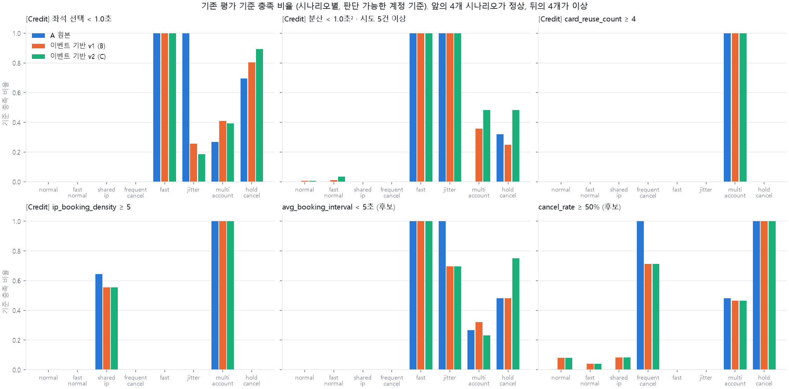
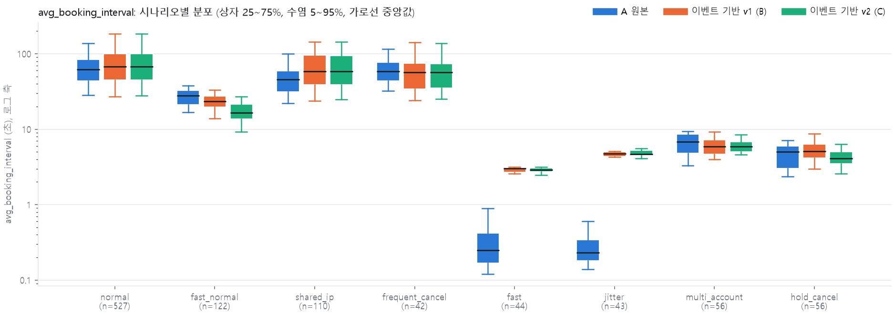
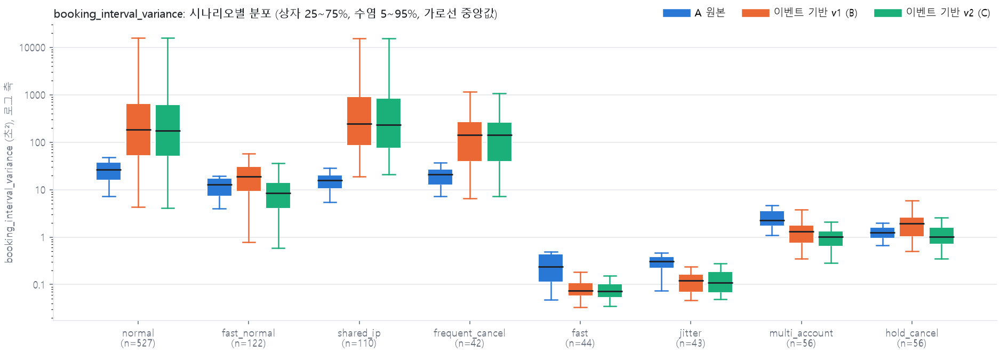
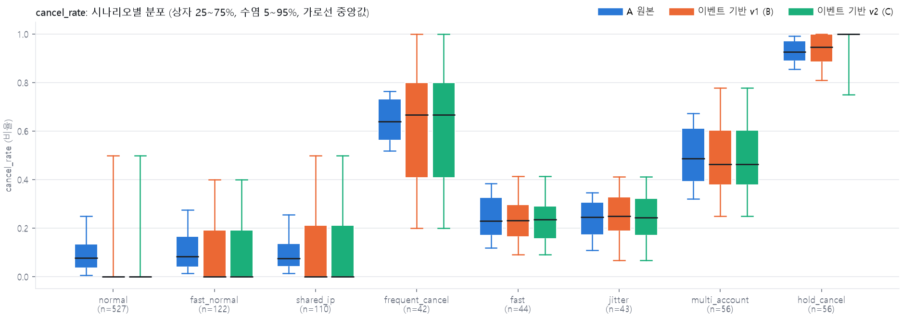
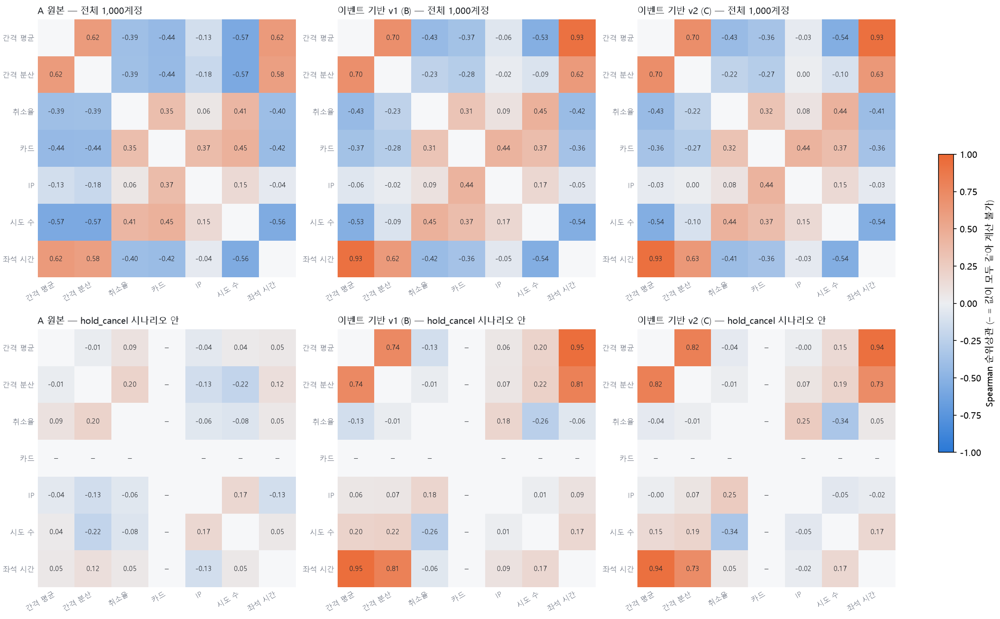
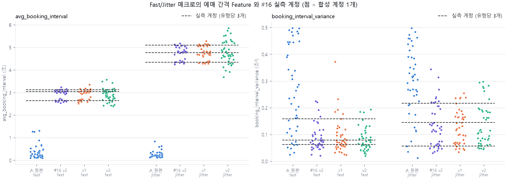
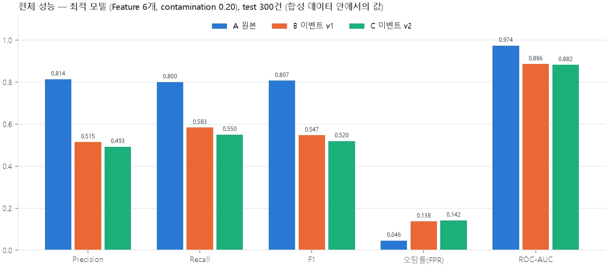
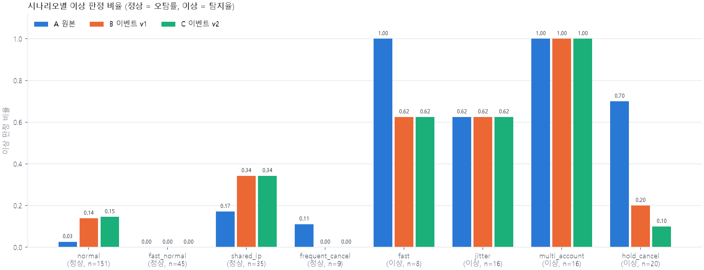
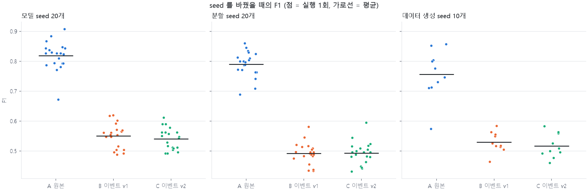
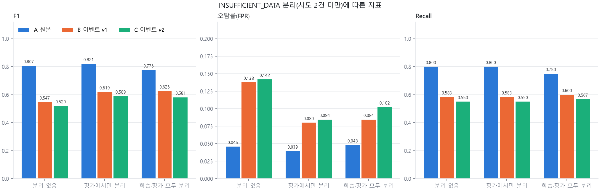

# 이벤트 기반 더미데이터 보정 v2 (Issue #17 추가 보고서)

작성일 2026-11-23. v1 의 결과는 [`REPORT.md`](REPORT.md) 에 그대로 있다. 이 문서는 v1 을 보존한 채 이벤트 생성 규칙을 고쳐 만든 v2 를 다룬다.
모든 수치는 `output/v2/` 의 CSV 에서 가져왔고 각 절에 출처를 적었다.

비교 대상

| | 데이터셋 | 경로 | sha256 |
|---|---|---|---|
| A | 기존 Feature 직접 샘플링 | `ml_experiment/data/fairticket_synthetic_features.csv` | `2e1e27c1…` |
| B | 이벤트 기반 v1 | `data/single_session/fairticket_event_based_features.csv` | `f430317a…` |
| C | 이벤트 기반 v2 | `data/v2/fairticket_event_based_features.csv` | `b39aa533…` |

세 데이터셋은 같은 1,000계정, 같은 행 순서, 같은 레이블(이상 19.9%), 같은 시나리오별 계정 수다. A·B 와 #14·#16 의 파일은 바뀌지 않았다 (테스트가 해시로 확인).

## 요약

| 질문 | 답 |
|---|---|
| 구조적 타당성이 개선됐는가 | **일부 개선.** v1 의 일관성(수학적 제약 위반 0건, 공유 관계 일치)은 그대로 유지된다. 추가로 가장 빠른 실측 매크로보다 빠른 단계 시간이 없어졌고, `hold_cancel` 의 이벤트가 시나리오 정의(미결제 선점)와 맞게 됐다 |
| 실측과의 유사성이 개선됐는가 | **기준에 따라 다르다.** 실측 계정 하나를 숨기고 만들었을 때 그 계정의 평균이 합성 범위 안에 드는 경우가 6개 중 3개 → 5개로 늘었다. 반면 생성에 쓴 실측 3계정과의 Wasserstein 거리는 커졌다 (Fast 0.050 → 0.124초, Jitter 0.057 → 0.201초). v1 은 실측 값 주변에 몰려 있어 가깝게 나온 것이고, v2 는 그 사이와 바깥을 채웠다 |
| Isolation Forest 성능은 어떻게 변했는가 | **v1 과 사실상 같다.** F1 A 0.807 / B 0.547 / C 0.520. B 와 C 의 차이는 seed 흔들림(표준편차 0.03~0.04) 안이다. `hold_cancel` 탐지는 14 → 4 → 2 (20계정 중) |

- v2 의 생성 규칙 4가지는 모델 평가를 돌리기 전에 정했고, 평가 결과를 본 뒤에 바꾸지 않았다.
- 실측 근거가 없는 Feature 는 기존 평가 기준에 가까워졌는지와 상관없이 현실성이 개선됐다고 볼 수 없다. 이 문서에서 "개선"이라고 쓴 것은 실측과 비교했거나 정의·수학적 관계로 확인할 수 있는 것뿐이다.
- 합성 데이터 안의 지표는 실제 사용자에 대한 탐지 성능이 아니다.

---

## 1. 기존 평가 기준과 v1 분포

### 1.1 평가 기준이 있는 곳

| 출처 | 내용 | 성격 |
|---|---|---|
| `demo-ticketing/frontend/src/risk/features.ts` `FEATURE_SPECS` | Feature 8종의 "기준 후보" | 실험으로 고르기 위한 후보. 방향(미만/이상)은 적혀 있지 않다 |
| `demo-ticketing/frontend/src/risk/credit.ts` `CREDIT_PARAMS` | Credit 규칙 감점의 확정 초기값 4개 | 주석에 "초기 정책값이며 실험 결과에 따라 변경" |
| `ai/docs/predict_feature_spec.md`, `ai/preprocessing.py` | 허용 범위, null 허용 여부, 최소 데이터 기준 | 정상/이상 판정 기준은 없다. 문서는 이전 7개 Feature 스펙이다 |
| `ai/ml_experiment/generate_dummy_data.py` 주석 | "5초 이하 초단기", "분산 1.0 미만", "1초 미만 비인간적 속도", "동일 카드 4건 이상", "동일 IP 5건 이상" | 생성 의도. 기준 문서가 아니다 |

AI 레포와 BTS 백엔드에는 Feature 별 정상/이상 판정 기준이 없다. 아래 표의 기준은 모두 데모 프론트의 값이다.

**확인이 필요한 점**

- 프론트의 Feature 정의가 BTS 계산식과 다르다. 프론트의 `avg_booking_interval` 은 최근 10분의 예매 요청(좌석 선택·예매하기·결제) 간격이고, BTS 는 30일 동안의 시도 시작 간격이다. 프론트의 `ip_booking_density` 는 "동일 IP 의 최근 10분 예매 시도 횟수"이고, BTS 는 "같은 IP 로 예매한 고유 계정 수(30일)"다. **기준 후보를 BTS Feature 에 그대로 적용해도 되는지는 확인이 필요하다.**
- `booking_count` 의 기준은 코드와 문서에서 찾지 못했다.
- 기준 후보의 방향은 적혀 있지 않다. 이 분석에서는 Credit 규칙의 방향을 따라 간격·분산·좌석 시간은 "미만", 취소율·카드·IP·시도 수는 "이상"으로 계산했다 (이 해석은 이 분석의 것이다).
- `step_stay_time`, `recent_booking_count` 는 브라우저 전용 Feature 다. BTS 의 6개에도, 데이터셋 컬럼에도 없다. 이벤트에서 비슷한 값을 계산해 검증에만 썼다 (1.3절).

### 1.2 Feature 별 정리

분포는 `중앙값 [최소~최대]`. 출처: `output/v2/distribution_comparison/feature_stats.csv`

| Feature | 정의·계산식 (BTS) | A 정상 / 이상 | B (v1) 정상 / 이상 | 실측 근거 | 기존 평가 기준 | 보정이 필요한 이유와 방향 |
|---|---|---|---|---|---|---|
| `avg_booking_interval` | 연속한 시도 시작 시각 차이의 평균 (초). 시도 2건 미만이면 null | 52.4 [10.6~218] / 2.93 [0.10~9.96] | 54.6 [10.4~367] / 4.69 [2.52~13.3] (정상 35계정 null) | **있음**: Fast 2.64~3.12초, Jitter 4.34~5.10초 (#16, 유형당 3계정). 약함: 사람 10.5초, 58.9초 (#14, 1명) | 후보 3 / 5 / 10초. 확정값 없음 | v1 의 매크로는 실측 3계정 값 주변에만 모인다 → 계정 간 변동을 연속적으로 반영 (C1). 실측된 빠른 사람(10.5초)이 `fast_normal` 범위의 끝에 있다 → 범위 안쪽으로 (C4) |
| `booking_interval_variance` | 같은 간격의 모분산 (초²). 시도 2건이면 0 | 20.1 [3.28~49.9] / 0.87 [0.012~4.93] | 90.5 [0~28,994] / 0.50 [0.024~9.30] | **있음**: Fast 0.063~0.159, Jitter 0.057~0.217초² | 후보 0.5 / 1.0 / 2.0초². Credit: 1.0초² 미만이고 요청 5회 이상 | 평균과 함께 움직여야 한다 → 간격을 조정할 때 같은 시도들을 같은 비율로 조정해 평균·분산이 같이 변하게 함 (C1). 정상 사용자의 넓은 분산은 근거가 없어 바꾸지 않음 |
| `cancel_rate` | 취소된 완료 예매 / 완료 예매. 완료 예매 0건이면 null | 0.084 [0~0.795] / 0.388 [0.10~1.0] | 0 [0~1] / 0.414 [0.03~1] (정상 15계정 null) | 없음 (실측 계정은 취소하지 않았다) | 후보 30 / 50 / 70%. 확정값 없음 | `hold_cancel` 의 미결제 선점은 이 값에 잡히지 않는데 v1 은 결제 비율을 높게 둬서 취소율을 유지했다 → 결제 비율을 정의에 맞게 낮춤 (C3). 그 밖의 취소 확률은 바꿀 근거가 없다 |
| `card_reuse_count` | 내가 쓴 결제 식별자로 예매한 고유 계정 수의 최댓값. 최소 1 | 1 [1~1] / 1 [1~7] | 1 [1~1] / 1 [1~7] | 없음 (실측 환경은 모든 계정이 같은 카드) | Credit: 4계정 이상 (2계정 이상은 약한 감점) | 바꾸지 않음. v1 에서 공유 관계는 이미 서로 맞는다 |
| `ip_booking_density` | 내가 쓴 IP 로 예매한 고유 계정 수의 최댓값. 최소 1 | 1 [1~6] / 2 [1~11] | 1 [1~6] / 2 [1~11] | 없음 (실측 환경은 모든 계정이 같은 IP) | Credit: 5회 이상 (프론트 정의는 10분 시도 횟수 — 확인 필요) | 바꾸지 않음 |
| `booking_count` | 고유 `attemptId` 수 | 4 [1~13] / 22 [10~49] | 4 [1~14] / 22 [10~49] | 없음 (실측은 횟수를 정해 놓고 돌림) | **확인되지 않음** | 바꾸지 않음. 시도 1건 계정의 결측은 평가 단계에서 다룬다 (3.1절) |
| `seat_selection_latency` (BTS 미산출, 정의는 실험 가정) | 시도별 (선점 성공 − 좌석 선택 진입), 계정 평균 | 17.4 [1.03~224] / 0.67 [0.10~1.97] | 17.4 [1.19~145] / 0.85 [0.40~2.29] | **있음**: Fast 0.49~0.60초, Jitter 0.99~1.17초. 약함: 사람 1.6초, 3.7초 | 후보 0.5 / 1 / 3초. Credit: 1초 미만 | v1 의 `hold_cancel` 에는 가장 빠른 실측 매크로(0.298초)보다 빠른 시도가 있다 (최소 0.153초) → 실측 최솟값을 하한으로 (C2) |
| `step_stay_time` (프론트 전용) | 단계별 화면 체류 시간 | 계산 불가 (이벤트 없음) | 좌석: 정상 16.4 / 이상 0.82초, 결제: 정상 12.3 / 이상 1.61초 | 있음: 매크로의 결제 단계 1.32~1.63초 | 후보: 정상 분포 하위 5% / 10% | 결제 단계가 결제 화면 지연(1.2초)보다 짧아질 수 있었다 → 하한 (C2) |
| `recent_booking_count` (프론트 전용) | 최근 1분 / 10분의 예매 시도 횟수 | 계산 불가 | 1분 최대 구간: 정상 2 / 이상 13회 | 없음 | 후보: 1분간 5 / 10 / 20회 | 직접 바꾸지 않음. 간격에서 따라 나오는 값이다 |

### 1.3 기존 평가 기준 충족 비율

판단할 수 있는 계정(값이 있는 계정) 중 기준을 충족한 비율이다. 출처: `criteria_rates.csv`

| 기준 | A 정상 | A 이상 | B 정상 | B 이상 | C 정상 | C 이상 | 실측 Fast (3) | 실측 Jitter (3) | 실측 사람 (2) |
|---|---|---|---|---|---|---|---|---|---|
| 간격 < 3초 (후보) | 0% | 50.8% | 0% | 12.1% | 0% | 17.1% | 1/3 | 0/3 | 0/2 |
| 간격 < 5초 (후보) | 0% | 64.8% | 0% | 59.8% | 0% | 64.8% | 3/3 | 2/3 | 0/2 |
| 간격 < 10초 (후보) | 0% | 100% | 0% | 98.0% | 1.6% | 99.5% | 3/3 | 3/3 | 0/2 |
| 분산 < 1.0초² (후보) | 0% | 52.8% | 13.2% | 60.8% | 13.6% | 70.9% | 3/3 | 3/3 | 1/2 |
| [Credit] 분산 < 1.0초², 시도 5건 이상 | 0% | 52.8% | 0.6% | 60.8% | 1.1% | 70.9% | 3/3 | 3/3 | 판단 불가 |
| 좌석 선택 < 0.5초 (후보) | 0% | 30.7% | 0% | 7.5% | 0% | 5.5% | 1/3 | 0/3 | 0/2 |
| [Credit] 좌석 선택 < 1.0초 | 0% | 70.9% | 0% | 61.8% | 0% | 62.3% | 3/3 | 1/3 | 0/2 |
| 좌석 선택 < 3.0초 (후보) | 21.0% | 100% | 13.9% | 100% | 13.0% | 100% | 3/3 | 3/3 | 1/2 |
| 취소율 ≥ 30% (후보) | 8.2% | 70.9% | 18.7% | 66.8% | 18.7% | 66.3% | — | — | — |
| 취소율 ≥ 50% (후보) | 5.4% | 41.7% | 10.8% | 41.2% | 10.8% | 39.4% | — | — | — |
| 취소율 ≥ 70% (후보) | 1.7% | 28.1% | 3.3% | 31.2% | 3.3% | 28.0% | — | — | — |
| [Credit] 카드 ≥ 4 | 0% | 28.1% | 0% | 28.1% | 0% | 28.1% | — | — | — |
| [Credit] IP ≥ 5 | 8.9% | 28.1% | 7.6% | 28.1% | 7.6% | 28.1% | — | — | — |
| 1분 시도 ≥ 5회 (후보) | 계산 불가 | 계산 불가 | 0.9% | 100% | 3.0% | 100% | — | — | — |
| 1분 시도 ≥ 10회 (후보) | 계산 불가 | 계산 불가 | 0% | 82.4% | 0% | 84.9% | — | — | — |



이 표에서 읽을 수 있는 것:

- **지연을 쓰는 매크로는 Credit 규칙 일부를 피한다.** 실측 Jitter 3계정 중 좌석 선택이 1초 미만인 것은 1개뿐이다 (0.99, 1.13, 1.17초). 이벤트 기반 데이터의 `jitter` 도 19~26% 만 충족한다. A 는 100% 다 (기존 더미는 매크로의 좌석 선택을 0.1~0.8초로 뒀다).
- **분산 기준은 시도 2건인 정상 계정을 잡는다.** 시도 2건이면 분산이 식으로 0 이라, "분산 1.0초² 미만"만 보면 정상의 13% 가 충족한다. Credit 규칙처럼 "5회 이상"을 붙이면 0.6~1.1% 로 줄어든다.
- **취소율 기준은 예매 건수가 적은 정상 계정을 잡는다.** 예매 3건 중 1건만 취소해도 33% 다. 이벤트 기반에서 정상의 18.7% 가 30% 기준을, 10.8% 가 50% 기준을 넘는다 (A 는 8.2%, 5.4%).
- **빠른 정상 사용자와 겹친다.** 실측 사람 계정 하나는 좌석 선택 평균이 1.6초라 3초 후보에 걸린다. v2 의 `fast_normal` 은 83% 가 3초 미만이고 10% 가 평균 간격 10초 미만이다.
- 이 비율이 A 에서 더 "깔끔한"(정상 0%, 이상 100%) 것은 A 가 기준에 맞춰 값을 직접 뽑았기 때문이다. 깔끔함이 현실성의 근거는 아니다.

---

## 2. v1 에서 발견된 문제와 v2 의 변경

### 2.1 보정 계획과 변경한 규칙

Feature 값은 고치지 않았다. 이벤트 생성 설정만 바꾸고 (`config/scenarios_v2.json` 의 `changes_from_v1`), 같은 추출 로직으로 Feature 를 다시 계산했다.

| | 대상 | v1 | v2 | 근거 |
|---|---|---|---|---|
| C1 | `fast`, `jitter` | 실측 계정 하나를 배정하고 그 계정의 시도를 그대로 복원추출 | 계정의 평균 간격 수준을 실측 계정 평균의 분포(로그정규, 계정 간 로그 표준편차 0.085)에서 뽑고, 배정된 실측 계정의 시도 전체(단계 시간과 간격)를 그 수준에 맞게 같은 비율로 조정 | **실측** (계정 평균 6개). 표준편차는 유형당 3계정으로는 불안정해 두 유형을 합쳐 추정했다. 시간 전체를 같은 비율로 조정하는 것은 가정 |
| C2 | 가정 시나리오 6개 | 단계 시간 = 중앙값 × 변동 (하한 없음) | 단계 시간 = 하한 + (중앙값 − 하한) × 변동. 하한은 실측 매크로 120건의 단계별 최솟값 (좌석 선택 0.298초, 결제 1.297초 등) | **실측** + 코드 (`PaymentPage.tsx` 의 결제 화면 지연 1.2초) |
| C3 | `hold_cancel` | 선점의 40~90% 를 결제 후 대부분 취소 | 선점의 5~30% 만 결제, 나머지는 결제 없이 두고 이동 (5분 뒤 만료) | 정의의 근거: 기존 생성 코드 주석 "미입금 취소 반복", Credit 문서의 "선점 후 미입금 자동 취소". 비율 자체는 **가정** |
| C4 | `fast_normal` | 다음 시도까지 대기 중앙값 12초, 계정 간 편차 0.25 | 대기 6초, 편차 0.35 | **약한 실측** (#14 사람 1명 2계정: 평균 간격 10.5초와 58.9초, 대기 2.6초와 36~41초) |

바꾸지 않은 것과 이유:

- 정상 사용자의 취소 확률, 시도 수, 좌석 선택 시간(약 20초), 선점 만료까지 기다리는 시도의 비율(3%): 바꿀 실측 근거가 없다. 특히 마지막 항목은 v1 에서 오탐의 주된 원인이었는데, 그래서 더욱 모델 결과를 보고 고치지 않았다.
- 매크로의 시도 수·취소 성향, 공유 관계: 실측이 없다.
- 결측 계정: 생성 규칙의 문제가 아니다 (3.1절).

### 2.2 생성 결과

| | v1 | v2 |
|---|---|---|
| 이벤트 | 56,910 | 55,424 |
| 시도 | 8,322 | 8,322 (같은 계정, 같은 시도 수) |
| 완료 예매 / 취소 | 7,185 / 2,068 | 6,678 / 1,596 |
| 선점만 두고 이동 | 404 | 911 |
| 모델 입력에 결측이 있는 계정 | 40 (정상 40) | 46 (정상 40, `hold_cancel` 6) |

v2 의 `hold_cancel` 56계정은 완료 예매가 중앙값 3건(v1 11.5건)이고, 6계정은 완료 예매가 없어 `cancel_rate` 가 null 이다.
추출 검증은 v1 과 같은 항목을 모두 통과했다 (독립 재계산 일치, 생성 기록 일치, BTS 일치 테스트 10개). 출처: `output/feature_extraction/v2/validation.json`

---

## 3. 기존 문제점 확인

### 3.1 결측 Feature

| 원인 | 계정 (v1) | 왜 생기는가 | 다룰 곳 |
|---|---|---|---|
| 시도가 1건 | 35 (normal 30, shared_ip 5) | 간격은 시도 2건 이상에서만 정의된다 (BTS 는 null). 시도 수 분포(1 + Poisson)에서 약 5% 가 1건이다 | **평가 단계.** 한 번만 예매하는 사용자는 정상적인 행동이다. 생성에서 없애면 데이터를 모델에 맞추는 것이 된다 |
| 시도는 있지만 완료 예매가 0건 | 15 (normal 13, shared_ip 2). 그중 10계정은 위와 겹침 | 취소율의 분모가 0 이다 | **평가 단계** (그리고 서빙 정책). 예매에 실패한 사용자도 있을 수 있다 |
| v2 에서 추가: `hold_cancel` 의 완료 예매 0건 | 6 | 결제하지 않는 선점 반복 계정 | **Feature 설계.** 이 행동을 나타내는 Feature 가 6개 안에 없다 (3.2절) |

실제 서빙 정책과의 비교:

| 위치 | 최소 데이터 기준 | 결측 처리 |
|---|---|---|
| `docs/predict_feature_spec.md` | `bookingCount < 2` 이면 `INSUFFICIENT_DATA` | null 은 학습 데이터의 중앙값으로 대체 (이전 7개 Feature 스펙 문서) |
| `train_model.py` | `MIN_BOOKING_COUNT = 2` | 전처리 파이프라인에 대체 단계 있음 (이전 모델) |
| `pack_bundle.py` (현재 6개 Feature 번들) | `min_booking_count=1` | `preprocess={}` — 대체 단계 없음. 결측이 모델에 그대로 들어간다 |
| `ml_experiment/train_and_evaluate_if.py` (평가) | 없음 | 없음 |
| BTS (`ticket-fds-admin`) | AI 응답을 처리하는 코드를 찾지 못함 | **확인 필요** |

문서의 기준(2건 미만)과 현재 번들의 설정(1건)이 다르다. 현재 번들대로면 시도 1건인 계정은 `INSUFFICIENT_DATA` 가 아니라 결측을 가진 채 점수가 매겨진다.
이 실험에서는 결측을 어떤 숫자로도 채우지 않았다. 문서 기준으로 분리했을 때의 지표는 6.4절에 있다.

### 3.2 hold_cancel: 14/20 → 4/20 의 원인

**확인한 것**

1. **A 에서도 경계선 위의 탐지였다.** A 의 `hold_cancel` test 20계정의 `decision_function` 중앙값은 −0.008 이다 (0 미만이면 이상). 탐지된 14계정의 점수는 −0.005 ~ −0.044 로, 조금만 밀려도 정상 쪽으로 넘어간다. B 의 중앙값은 +0.024, C 는 +0.033 이다.
2. **이 계정들의 Feature 값 자체는 A 와 B 에서 크게 다르지 않다.** 같은 20계정을 나란히 보면 간격 2.4~8.0초 대 2.7~8.8초, 취소율 0.87~1.0 대 0.64~1.0, 카드 1, IP 1~2 다 (`hold_cancel_test_accounts.csv`).
3. **달라진 것은 주변이다.** 이벤트 기반에서는 정상 계정이 넓게 퍼진다: 결측이 있는 정상 계정 16개가 모두 이상으로 판정되고, 분산이 큰 정상 계정이 먼저 고립된다. contamination 이 고정이라 그만큼 경계가 옮겨 간다.
   또 취소율 70% 이상인 정상 계정이 1.7% 에서 3.3% 로, 50% 이상이 5.4% 에서 10.8% 로 늘어 `hold_cancel` 만의 구간이 아니게 됐다.
4. v1 보고서의 Feature 교체 실험에서, A 에 이벤트 기반의 간격 2개만 넣어도 6/20, 취소율만 넣어도 7/20 으로 줄었다.

**선점 만료와 예매 취소의 차이**

| 행동 | 생기는 이벤트 | `cancel_rate` 에 반영 | Credit 문서의 개념 |
|---|---|---|---|
| 결제 후 취소 | `BOOKING` → `CANCEL` | 반영됨 | 일반 취소 (감점 없음) |
| 선점 후 미결제 → 만료 | `BOOKING_ATTEMPT` 의 `SEAT_HOLD EXPIRED` 뿐 | **반영되지 않음** | 미입금 자동 취소 (`Cauto`, 가중치 1.5) |

- `cancel_rate` 의 정의(취소된 완료 예매 / 완료 예매)와 v1·v2 의 이벤트 생성은 일치한다 (추출 검증 통과).
- **일치하지 않는 것은 시나리오 정의와 Feature 다.** 기존 더미는 "미입금 취소 반복" 계정에 취소율 0.85~1.0 을 직접 줬지만, 현재 계산식에서 미결제 선점은 취소율을 올리지 않는다.
- BTS 의 `BookingHistory` 에 `AUTO_CANCELLED` 상태가 정의돼 있지만 이 상태를 기록하는 코드는 찾지 못했다 (확인 필요).
- v2 는 정의에 맞게 대부분 미결제로 바꿨다. 그 결과 `hold_cancel` 의 취소율은 소수의 완료 예매(중앙값 3건)에서 계산되고, 6계정은 null 이다. 탐지는 2/20 이다.
  이것은 탐지율을 맞추려고 Feature 를 조작하지 않았을 때의 결과다. **이 행동을 잡으려면 만료된 선점의 수나 비율 같은 새 Feature 가 필요하다** (이번 범위 밖, 기존 Feature 정의는 바꾸지 않았다).

### 3.3 Feature 간 관계는 v2 에서도 유지되는가

| 검사 | A | B (v1) | C (v2) |
|---|---|---|---|
| 시도 1건 이하인데 간격 값이 있음 | 34 / 34 | 0 / 35 | 0 / 35 |
| 시도 2건인데 분산이 0 이 아님 | 85 / 85 | 0 / 82 | 0 / 82 |
| 분산이 수학적 상한(m²·(n−1))을 넘음 | 91 / 966 | 0 / 965 | 0 / 965 |
| 취소율이 정수 비로 나올 수 없는 값 | 996 / 1,000 | 0 / 985 | 0 / 979 |
| 좌석 선택 시간 > 평균 예매 간격 | 172 / 1,000 | 0 / 964 | 0 / 964 |
| 카드·IP 공유 수의 상대 계정이 실제로 있음 | 확인 불가 | 전 계정 일치 | 전 계정 일치 |

| 시나리오 안의 Spearman 순위상관 | A (범위) | B (범위) | C (범위) |
|---|---|---|---|
| 간격 평균 – 간격 분산 | −0.16 ~ 0.09 | 0.41 ~ 0.81 | 0.33 ~ 0.82 |
| 간격 평균 – 좌석 선택 시간 | −0.05 ~ 0.10 | 0.76 ~ 0.97 | 0.76 ~ 0.96 |
| 취소율 – 시도 수 (`hold_cancel`) | −0.08 | −0.26 | −0.34 |
| 카드 공유 – IP 공유 (`fast`, `jitter`) | 0.05, −0.01 | 0.24, 0.39 | 0.24, 0.39 |

- v2 의 구조 검사(단계 순서, 예매 뒤 취소, 한 번에 한 시도, 공유 관계)는 v1 의 테스트 함수를 그대로 적용해 통과했다. 공유 묶음은 v1 과 같다 (같은 seed).
- `jitter` 의 평균–분산 상관은 0.77 에서 0.33 으로 낮아졌다. v1 에서는 실측 3계정의 평균과 분산이 우연히 같은 순서라 상관이 높았고, v2 는 계정 수준을 따로 뽑아서 그 효과가 줄었다.
- v2 에서 새로 지켜지는 것: 가정 시나리오의 좌석 선택 시간 최솟값이 0.153초 → 0.386초 (실측 매크로 최솟값 0.298초 이상), 결제 화면 진입부터 예매까지가 1.297초 이상.

출처: `consistency_checks.csv`, `within_scenario_correlation.csv`, `tests/test_v2_dataset.py`

---

## 4. Feature 분포 비교 (A / B / C)

### 4.1 정상 / 이상

| Feature | 집단 | 데이터 | 결측 | 평균 | 중앙값 | 표준편차 | 최소 | 최대 |
|---|---|---|---|---|---|---|---|---|
| `avg_booking_interval` | 정상 | A | 0 | 59.20 | 52.40 | 33.87 | 10.60 | 218.3 |
| | | B | 35 | 69.32 | 54.63 | 49.54 | 10.41 | 367.1 |
| | | C | 35 | 67.90 | 54.37 | 49.57 | 5.99 | 367.0 |
| | 이상 | A | 0 | 3.33 | 2.93 | 3.11 | 0.10 | 9.96 |
| | | B | 0 | 4.93 | 4.69 | 1.86 | 2.52 | 13.25 |
| | | C | 0 | 4.62 | 4.59 | 1.58 | 2.38 | 11.43 |
| `booking_interval_variance` | 정상 | A | 0 | 23.05 | 20.14 | 12.65 | 3.28 | 49.94 |
| | | B | 35 | 1,634 | 90.51 | 4,457 | 0 | 28,994 |
| | | C | 35 | 1,620 | 82.35 | 4,456 | 0 | 28,987 |
| | 이상 | A | 0 | 1.21 | 0.868 | 1.17 | 0.012 | 4.93 |
| | | B | 0 | 1.09 | 0.500 | 1.42 | 0.024 | 9.30 |
| | | C | 0 | 0.724 | 0.401 | 0.848 | 0.020 | 6.89 |
| `cancel_rate` | 정상 | A | 0 | 0.128 | 0.084 | 0.147 | 0 | 0.795 |
| | | B | 15 | 0.126 | 0 | 0.230 | 0 | 1.00 |
| | | C | 15 | 0.126 | 0 | 0.230 | 0 | 1.00 |
| | 이상 | A | 0 | 0.508 | 0.388 | 0.297 | 0.101 | 0.998 |
| | | B | 0 | 0.508 | 0.414 | 0.311 | 0.029 | 1.00 |
| | | C | 6 | 0.497 | 0.391 | 0.314 | 0.029 | 1.00 |
| `seat_selection_latency` (실험 가정) | 정상 | A | 0 | 26.29 | 17.37 | 29.21 | 1.03 | 224.2 |
| | | B | 9 | 21.09 | 17.43 | 17.47 | 1.19 | 145.2 |
| | | C | 9 | 21.02 | 17.45 | 17.24 | 1.10 | 143.3 |
| | 이상 | A | 0 | 0.754 | 0.670 | 0.429 | 0.10 | 1.97 |
| | | B | 0 | 0.889 | 0.850 | 0.330 | 0.40 | 2.29 |
| | | C | 0 | 0.881 | 0.860 | 0.291 | 0.45 | 1.97 |

`card_reuse_count`, `ip_booking_density`, `booking_count` 는 B 와 C 가 사실상 같다 (공유 묶음과 시도 수가 같다. `ip_booking_density` 의 이상 평균만 3.63 → 3.59: 완료 예매가 없는 `hold_cancel` 계정이 기본값 1 이 됨).
시나리오별 통계량과 보조 지표는 `feature_stats.csv` 에 있다.

### 4.2 v1 → v2 에서 달라진 시나리오

KS 통계량 0.15 이상인 것만. 출처: `change_b_to_c.csv`

| 시나리오 | Feature | v1 중앙값 | v2 중앙값 | v1 표준편차 | v2 표준편차 | KS | 변경 |
|---|---|---|---|---|---|---|---|
| fast_normal | `avg_booking_interval` | 23.47 | 16.60 | 6.80 | 6.15 | 0.43 | C4 |
| fast_normal | `booking_interval_variance` | 18.49 | 8.21 | 25.17 | 14.83 | 0.40 | C4 |
| fast | `avg_booking_interval` | 3.03 | 2.90 | 0.221 | 0.270 | 0.23 | C1 |
| jitter | `avg_booking_interval` | 4.72 | 4.67 | 0.326 | 0.506 | 0.28 | C1 |
| jitter | `seat_selection_latency` | 1.11 | 1.08 | 0.090 | 0.118 | 0.19 | C1 |
| multi_account | `booking_interval_variance` | 1.30 | 1.02 | 1.38 | 1.01 | 0.23 | C2 |
| hold_cancel | `avg_booking_interval` | 5.09 | 4.10 | 1.76 | 1.21 | 0.38 | C2, C3 |
| hold_cancel | `booking_interval_variance` | 1.93 | 1.03 | 1.58 | 0.70 | 0.36 | C2, C3 |
| hold_cancel | `cancel_rate` | 0.946 | 1.000 | 0.079 | 0.124 | 0.30 | C3 |

`normal`, `shared_ip`, `frequent_cancel` 은 v1 과 거의 같다 (하한이 중앙값에 비해 매우 작다).
`hold_cancel` 의 간격이 짧아진 것은 결제를 건너뛰는 시도가 늘었기 때문이다 (결제 약 1.6초가 빠진다).









나머지 Feature 와 보조 지표의 그래프는 `output/v2/distribution_comparison/figures/` 에 있다.

---

## 5. 실측 데이터와의 유사성 (Fast/Jitter)

실측 계정은 유형당 3개, 계정당 간격 19개다 (#16).

### 5.1 생성에 쓴 실측 계정과의 거리

| 유형 | Feature | 데이터 | 평균 | 표준편차 | 범위 | 표준편차 비 (합성 / 실측) | Wasserstein 거리 |
|---|---|---|---|---|---|---|---|
| Fast | 간격 평균 (초) | 실측 계정 | 2.936 | 0.256 | 2.644~3.123 | — | — |
| | | A | 0.364 | 0.309 | 0.100~1.310 | 1.21 | 2.572 |
| | | #16 v2 | 2.917 | 0.212 | 2.540~3.240 | 0.83 | 0.039 |
| | | B (v1) | 2.931 | 0.221 | 2.520~3.360 | 0.86 | 0.050 |
| | | **C (v2)** | 2.899 | 0.270 | 2.400~3.570 | 1.05 | 0.124 |
| | 간격 분산 (초²) | 실측 계정 | 0.101 | 0.051 | 0.063~0.159 | — | — |
| | | B (v1) | 0.093 | 0.063 | 0.024~0.372 | 1.23 | 0.026 |
| | | **C (v2)** | 0.082 | 0.043 | 0.020~0.194 | 0.84 | 0.024 |
| Jitter | 간격 평균 (초) | 실측 계정 | 4.737 | 0.382 | 4.339~5.102 | — | — |
| | | A | 0.276 | 0.153 | 0.120~0.840 | 0.40 | 4.461 |
| | | #16 v2 | 4.732 | 0.311 | 4.250~5.180 | 0.81 | 0.050 |
| | | B (v1) | 4.710 | 0.326 | 4.270~5.290 | 0.85 | 0.057 |
| | | **C (v2)** | 4.784 | 0.506 | 3.690~5.860 | 1.32 | 0.201 |
| | 간격 분산 (초²) | 실측 계정 | 0.140 | 0.080 | 0.057~0.217 | — | — |
| | | B (v1) | 0.126 | 0.065 | 0.035~0.255 | 0.81 | 0.024 |
| | | **C (v2)** | 0.136 | 0.079 | 0.045~0.298 | 0.98 | 0.030 |



- 평균 수준은 v1 과 v2 가 모두 실측에 가깝다 (평균 차이 0.05초 이내).
- **생성에 쓴 3계정과의 Wasserstein 거리는 v2 가 더 크다** (Fast 0.050 → 0.124초, Jitter 0.057 → 0.201초). v1 은 합성 계정이 실측 3계정의 값 주변에 덩어리로 모여 있어서 그 3개 값과의 거리가 작게 나온다. v2 는 그 사이와 바깥을 채웠다.
- 계정 평균의 표준편차는 v2 가 실측에 더 가깝거나(Fast 0.86 → 1.05배) 더 넓다(Jitter 0.85 → 1.32배). Jitter 가 넓어진 것은 계정 간 편차를 두 유형을 합쳐 추정하고 로그 척도로 적용했기 때문이다. 실측 3계정으로는 어느 쪽이 맞는지 알 수 없다.
- 이 비교는 v1·v2 모두 독립 검증이 아니다 (비교에 쓴 실측으로 만들었다).

### 5.2 Leave-One-Account-Out

실측 계정 하나를 숨기고 나머지 계정만으로 같은 방식·같은 seed 로 그 유형의 합성 계정(44개 / 43개)을 만든 뒤, 숨긴 계정이 합성 계정의 범위 안에 드는지 봤다.

| 유형 | 숨긴 계정 | 평균 | v1 방식의 합성 범위 | 안 | v2 방식의 합성 범위 | 안 |
|---|---|---|---|---|---|---|
| Fast | macro-fast-02 | 2.644 | 2.95~3.22 | 아니오 (0.306초 밖) | 2.61~3.76 | 예 |
| Fast | macro-fast-11 | 3.123 | 2.56~3.15 | 예 | 2.28~3.58 | 예 |
| Fast | macro-fast-12 | 3.040 | 2.56~3.29 | 예 | 2.24~3.69 | 예 |
| Jitter | macro-jitter-01 | 4.339 | 4.68~5.26 | 아니오 (0.341초 밖) | 4.35~5.96 | 아니오 (0.011초 밖) |
| Jitter | macro-jitter-11 | 4.770 | 4.25~5.26 | 예 | 4.00~5.97 | 예 |
| Jitter | macro-jitter-12 | 5.102 | 4.25~4.92 | 아니오 (0.182초 밖) | 3.97~5.41 | 예 |

| 숨긴 계정이 합성 분포 안에 든 수 (6개 중) | v1 방식 | v2 방식 |
|---|---|---|
| 평균: 범위(최소~최대) 안 | 3 | 5 |
| 평균: 가운데 90% 안 | 2 | 3 |
| 분산: 범위 안 | 3 | 4 |
| 분산: 가운데 90% 안 | 3 | 3 |

- v2 방식은 본 적 없는 계정을 더 자주 포함한다. 다만 범위가 넓어진 만큼 포함되기 쉬워진 것이기도 하다. 가운데 90% 로 보면 3/6 으로 절반이다.
- 계정이 6개뿐이라 이 차이(3 → 5)를 일반화 성능의 추정치로 쓸 수는 없다. 방향을 보는 정도다.
- 다른 실행에서 수집한 계정(`macro-fast-02`, `macro-jitter-01`)이 가장 벗어난다. #16 이 지적한 "실행 사이의 차이"가 계정 간 차이보다 크다는 점은 그대로다.

출처: `macro_interval_vs_measured.csv`, `leave_one_account_out.csv`

### 5.3 실측 근거가 약하거나 없는 부분

- `fast_normal` (C4): 평균 간격의 범위가 10.4~52.8초에서 6.0~44.4초가 됐다. 실측 사람 계정의 10.5초가 범위의 끝에서 안쪽으로 들어왔다. 근거는 한 사람의 2계정이다.
- 그 밖의 정상 사용자, `multi_account`, `hold_cancel`, 매크로의 시도 수·취소·공유: 실측이 없다. **현실성이 개선됐다고 볼 근거가 없다.**

---

## 6. Isolation Forest 성능 비교

조건은 v1 보고서와 같다: Feature 6개, contamination 0.20, 전처리 없음, 7:3 분할(seed 42, stratify), `IsolationForest(n_estimators=100, random_state=42)`, 세 데이터셋에 같은 행 번호.
기존 학습 조건을 옮겨 둔 #16 의 함수와 상수를 그대로 썼다. 모델 파일은 저장하지 않았다.

### 6.1 전체 성능과 혼동행렬 (test 300건, 이상 60)

| 데이터셋 | Precision | Recall | F1 | 오탐률 | ROC-AUC | TP | FP | TN | FN |
|---|---|---|---|---|---|---|---|---|---|
| A 원본 | 0.814 | 0.800 | 0.807 | 0.046 | 0.974 | 48 | 11 | 229 | 12 |
| B 이벤트 v1 | 0.515 | 0.583 | 0.547 | 0.138 | 0.886 | 35 | 33 | 207 | 25 |
| C 이벤트 v2 | 0.493 | 0.550 | 0.520 | 0.142 | 0.882 | 33 | 34 | 206 | 27 |



기존 스크립트의 다른 구성은 `metrics_all_configs.csv` 에 있다. 예매 간격 2개를 뺀 구성에서는 A 0.835 / B 0.800 / C 0.717 이다.
이 구성은 취소율·카드·IP·시도 수만 쓰므로 `hold_cancel` 의 결제 비율을 낮춘 영향(C3)이 가장 크게 나타난다.

### 6.2 시나리오별 이상 판정 (test)

| 시나리오 | 실제 | test 수 | A | B | C |
|---|---|---|---|---|---|
| normal | 정상 | 151 | 4 | 21 | 22 |
| fast_normal | 정상 | 45 | 0 | 0 | 0 |
| shared_ip | 정상 | 35 | 6 | 12 | 12 |
| frequent_cancel | 정상 | 9 | 1 | 0 | 0 |
| fast | 이상 | 8 | 8 | 5 | 5 |
| jitter | 이상 | 16 | 10 | 10 | 10 |
| multi_account | 이상 | 16 | 16 | 16 | 16 |
| hold_cancel | 이상 | 20 | 14 | 4 | 2 |



`fast_normal` 은 간격이 짧아졌지만(C4) 오탐이 늘지 않았다. v2 에서 달라진 것은 `hold_cancel` 2건뿐이다.

### 6.3 여러 seed 에서의 변동

| 바꾼 것 | A F1 (평균 ± 표준편차, 범위) | B F1 | C F1 |
|---|---|---|---|
| 모델 seed 20개 | 0.818 ± 0.049 (0.672~0.908) | 0.550 ± 0.040 (0.488~0.619) | 0.541 ± 0.036 (0.492~0.612) |
| 분할 seed 20개 | 0.790 ± 0.043 (0.689~0.860) | 0.492 ± 0.036 (0.433~0.581) | 0.493 ± 0.038 (0.431~0.595) |
| 데이터 생성 seed 10개 | 0.756 ± 0.083 (0.574~0.857) | 0.529 ± 0.034 (0.464~0.583) | 0.516 ± 0.040 (0.460~0.583) |

| 시나리오별 이상 판정 비율 (분할 seed 20개 평균) | A | B | C |
|---|---|---|---|
| normal (오탐) | 0.04 | 0.13 | 0.13 |
| shared_ip (오탐) | 0.11 | 0.27 | 0.26 |
| fast | 0.76 | 0.37 | 0.37 |
| jitter | 0.73 | 0.49 | 0.49 |
| multi_account | 1.00 | 1.00 | 1.00 |
| hold_cancel | 0.74 | 0.05 | 0.05 |



- **B 와 C 의 차이는 어느 seed 축에서도 흔들림 안이다.** v2 의 보정은 모델 평가 결과를 의미 있게 바꾸지 않았다.
- A 와 이벤트 기반(B, C)의 차이는 흔들림보다 크다 (v1 보고서와 같은 결론).
- 분할 seed 를 바꾸면 이벤트 기반에서 `hold_cancel` 의 탐지율이 0.05 다. seed 42 분할의 4/20, 2/20 은 그 분할에서의 값이다.
- A·B 의 생성 seed 결과는 v1 실험(`output/model_comparison/generation_seed_runs.csv`)의 값을 그대로 읽었다.

### 6.4 INSUFFICIENT_DATA 로 분리했을 때

문서 기준(시도 2건 미만)으로 계정을 점수 대상에서 뺐다. 결측값은 채우지 않았다.
현재 번들의 설정(`min_booking_count=1`)에서는 분리되는 계정이 없어 "분리 없음"과 같다.

| 데이터셋 | 정책 | 분리된 test 계정 | Precision | Recall | F1 | 오탐률 | ROC-AUC | 남은 결측 계정 (이상 판정 수) |
|---|---|---|---|---|---|---|---|---|
| A | 분리 없음 | 0 | 0.814 | 0.800 | 0.807 | 0.046 | 0.974 | 0 |
| | 평가에서만 분리 | 11 (모두 정상) | 0.842 | 0.800 | 0.821 | 0.039 | 0.976 | 0 |
| | 학습·평가 모두 분리 | 11 | 0.804 | 0.750 | 0.776 | 0.048 | 0.965 | 0 |
| B | 분리 없음 | 0 | 0.515 | 0.583 | 0.547 | 0.138 | 0.886 | 16 (16) |
| | 평가에서만 분리 | 15 (모두 정상) | 0.660 | 0.583 | 0.619 | 0.080 | 0.913 | 1 (1) |
| | 학습·평가 모두 분리 | 15 | 0.655 | 0.600 | 0.626 | 0.084 | 0.917 | 1 (1) |
| C | 분리 없음 | 0 | 0.493 | 0.550 | 0.520 | 0.142 | 0.882 | 19 (16) |
| | 평가에서만 분리 | 15 (모두 정상) | 0.635 | 0.550 | 0.589 | 0.084 | 0.911 | 4 (1) |
| | 학습·평가 모두 분리 | 15 | 0.596 | 0.567 | 0.581 | 0.102 | 0.908 | 4 (1) |



- 이벤트 기반에서 시도 1건 계정을 분리하면 오탐률이 0.14 에서 0.08 로 내려가고 F1 이 0.06~0.08 오른다. Recall 은 그대로다. **v1 에서 본 오탐 증가의 절반은 모델의 탐지력이 아니라 결측 계정을 점수 대상에 넣느냐의 문제였다.**
- 분리한 뒤에도 A 와의 차이는 남는다 (F1 0.82 대 0.59~0.63).
- A 에도 시도 1건 계정이 있지만(test 11개) A 는 그 계정에 간격 값을 넣어 뒀기 때문에 결측이 없다. 이 값들은 BTS 계산식에서는 나올 수 없는 값이다.
- 분리 후에도 남는 결측은 "시도 2건 이상인데 완료 예매 0건"인 계정이다. C 에서는 그중 3개가 `hold_cancel` 이고 3개 모두 이상으로 판정되지 않았다. 간격이 결측인 계정은 16개 모두 이상으로 판정된 것과 다르다 (결측이 어느 Feature 에 있느냐에 따라 모델의 반응이 다르다).
- 문서의 기준(2건)과 번들의 설정(1건) 중 어느 쪽이 맞는지는 팀의 확인이 필요하다.

### 6.5 교차 평가

| 학습 → 평가 | Precision | Recall | F1 | 오탐률 |
|---|---|---|---|---|
| A → A | 0.814 | 0.800 | 0.807 | 0.046 |
| A → B | 0.388 | 0.833 | 0.529 | 0.329 |
| A → C | 0.371 | 0.767 | 0.500 | 0.325 |
| B → C | 0.507 | 0.567 | 0.535 | 0.138 |
| C → B | 0.500 | 0.583 | 0.538 | 0.146 |
| C → C | 0.493 | 0.550 | 0.520 | 0.142 |

B 와 C 는 서로 바꿔 학습·평가해도 결과가 같다. 모델이 보기에 두 데이터셋은 거의 같은 분포다.

출처: `output/v2/model_comparison/` 의 `metrics.csv`, `confusion_matrix.csv`, `scenario_detection.csv`, `seed_summary.csv`, `generation_seed_summary.csv`, `insufficient_data_policy.csv`, `cross_evaluation.csv`, `hold_cancel_test_accounts.csv`

---

## 7. 결론

### 구조적 타당성은 개선됐는가

**v1 의 일관성은 유지되고, 두 가지가 더해졌다.**

- 유지: 수학적 제약 위반 0건, 시도 수·예매·취소·공유 관계가 생성 기록과 전 계정 일치, 시나리오 안에서 같은 행동에서 나온 Feature 끼리 맞물림.
- 추가 1: 화면을 거치는 흐름에서 가장 빠른 실측 매크로보다 빠른 단계 시간이 없다 (좌석 선택 최소 0.153초 → 0.386초).
- 추가 2: `hold_cancel` 의 이벤트가 시나리오 정의(선점 후 미결제)와 맞다. v1 은 취소율을 유지하려고 결제 비율을 높게 둔 상태였다.
- 그 대가로 `hold_cancel` 은 현재 6개 Feature 로는 거의 드러나지 않는다는 점이 분명해졌다. 이것은 데이터의 결함이 아니라 Feature 정의와 시나리오 정의 사이의 간격이다.

### 실측 데이터와의 유사성은 개선됐는가

**무엇을 유사성으로 보느냐에 따라 답이 다르다.**

- 본 적 없는 실측 계정을 포함하는 정도: 개선 (평균 3/6 → 5/6, 분산 3/6 → 4/6). 계정 간 변동이 실측 값 3개의 덩어리가 아니라 연속적으로 반영됐다.
- 생성에 쓴 실측 계정과의 분포 거리: 나빠짐 (Fast 0.050 → 0.124초, Jitter 0.057 → 0.201초). Jitter 의 계정 간 표준편차는 실측의 1.32배로 넓다.
- 둘 다 실측 6계정 안에서의 이야기다. 독립인 실측 계정으로 검증한 것이 아니다.
- 실측이 없는 Feature 는 기존 평가 기준에 얼마나 맞는지와 상관없이 현실성이 개선됐다고 말할 수 없다. 오히려 1.3절은 기존 기준 후보가 실측 Jitter 매크로와 예매 건수가 적은 정상 계정에서 잘 나뉘지 않는다는 것을 보여 준다.

### Isolation Forest 성능은 어떻게 변했는가

**v1 과 사실상 같고, A 보다는 여전히 낮다.**

- F1: A 0.807, B 0.547, C 0.520. B 와 C 의 차이는 모델·분할·생성 seed 의 흔들림 안이다.
- `hold_cancel` 탐지는 14 → 4 → 2 (seed 42 분할). 분할 seed 20개 평균으로는 A 0.74, B 0.05, C 0.05 다.
- 시도 2건 미만 계정을 `INSUFFICIENT_DATA` 로 분리하면 이벤트 기반의 오탐률이 0.14 → 0.08, F1 이 0.59~0.63 이 된다.
- v2 는 F1 이나 Recall 을 올리도록 조정하지 않았고, 실제로 오르지 않았다. 보정의 목적(분포와 행동의 타당성)과 모델 지표는 별개였다.
- 이 수치는 합성 데이터 안의 값이며 실제 사용자에 대한 탐지 성능이 아니다.

---

## 8. 보정 후에도 남아 있는 한계

- **실측의 범위**: 실측 근거는 여전히 Fast/Jitter 6계정의 시간뿐이다. C1 의 계정 간 편차는 계정 평균 6개에서 추정했고, 실행 사이의 차이와 계정 사이의 차이가 섞여 있다.
- **시간 전체를 같은 비율로 조정 (C1)**: 서버 쪽 시간(결제 지연 등)까지 같은 비율로 늘이거나 줄인다. 그래서 `fast` 의 좌석 선택 최솟값이 0.274초로 실측 최솟값(0.298초)보다 조금 짧은 시도가 생긴다.
- **`hold_cancel` 의 결제 비율 (C3)**: 5~30% 는 가정이다. 선점만 반복하는 실제 행동이 얼마나 빠른지(v1·v2 는 기존 더미의 2~8초를 따른다. 만료 5분마다 다시 선점하는 방식일 수도 있다)도 알 수 없다.
- **정상 사용자**: 단계별 시간, 이탈 확률, 선점 만료까지 기다리는 비율은 v1 의 가정 그대로다. 정상 사용자의 넓은 분산이 현실적인지는 여전히 모른다. 정상 사용자가 한 세션에 여러 건을 완료한다는 기존 더미의 전제도 그대로다.
- **평가 기준의 정의 차이**: 기준 후보는 프론트의 Feature 정의(10분 창)에 맞춘 값이다. BTS Feature(30일)에 적용한 1.3절의 충족 비율은 참고용이다.
- **보조 지표**: `step_stay_time`, `recent_booking_count` 를 계정 1행으로 요약한 방식(중앙값, 가장 몰린 구간)은 이 실험의 가정이다. 정상 분포 하위 5% / 10% 기준은 같은 합성 데이터의 정상 계정으로 정했으므로 정상의 충족 비율이 5% / 10% 가 되는 것은 당연한 결과다.
- **결측 정책**: 문서(2건 미만)와 번들(1건)이 다르고, BTS 쪽 처리는 확인하지 못했다.
- **v1 의 한계 중 그대로인 것**: 단일 세션 전제, 좌석 경쟁 없음, 시나리오 안에서만 만든 공유 관계, 전처리 없는 조건에서의 모델 비교.

### 확인이 필요한 항목 (팀)

1. Feature 별 정상/이상 평가 기준의 확정 문서가 따로 있는지. 이 분석은 데모 프론트의 기준 후보와 Credit 규칙만 찾았다.
2. 기준 후보를 BTS 계산식(30일 창, 고유 계정 수)에 그대로 적용할지.
3. `INSUFFICIENT_DATA` 의 기준이 시도 1건인지 2건인지, 결측 Feature 를 서빙에서 어떻게 처리할지.
4. 미결제 선점(만료)을 `cancel_rate` 와 별개의 Feature 로 둘지, `AUTO_CANCELLED` 를 BTS 가 어디서 기록하는지.

---

## 부록: 결과 파일과 재현

| 내용 | 위치 |
|---|---|
| v2 생성 설정 (변경 목록 포함) | `config/scenarios_v2.json` |
| v2 이벤트 원본, 계정, 시도 | `data/v2/events.csv`, `accounts.csv`, `attempts.csv`, `generation.json` |
| v2 Feature 데이터셋 | `data/v2/fairticket_event_based_features.csv` (반올림 전 값은 `features_full.csv`) |
| v2 추출 검증 | `output/feature_extraction/v2/` |
| A/B/C 분포 비교, 기준 충족 비율, 실측 비교, Leave-One-Account-Out | `output/v2/distribution_comparison/` (CSV 11개, 그래프 14장) |
| A/B/C 모델 비교 | `output/v2/model_comparison/` (CSV 12개, 그래프 4장) |
| 테스트 | `tests/test_v2_dataset.py` (8개), `tests/test_event_dataset.py` (v1, 12개) |

```powershell
cd ai\experiments\issue17-event-based-dummy
$py = "..\issue14-real-validation\.venv\Scripts\python"

& $py scripts\generate_events.py --config config\scenarios_v2.json --out data\v2 --force
& $py scripts\extract_dataset.py --profile v2 --config config\scenarios_v2.json
& $py scripts\compare_v2.py          # 분포·기준·실측 비교, Leave-One-Account-Out
& $py scripts\compare_if_v2.py       # 모델 비교 (v1 의 scripts\compare_if.py 결과가 있어야 A·B 의 생성 seed 값을 읽는다)
& $py tests\test_v2_dataset.py
```

v1 은 기본 설정(`config/scenarios.json`)으로 그대로 재현된다. 생성기에 추가한 기능(계정 수준 효과, 단계 하한)은 v2 설정에 해당 항목이 있을 때만 동작한다.
