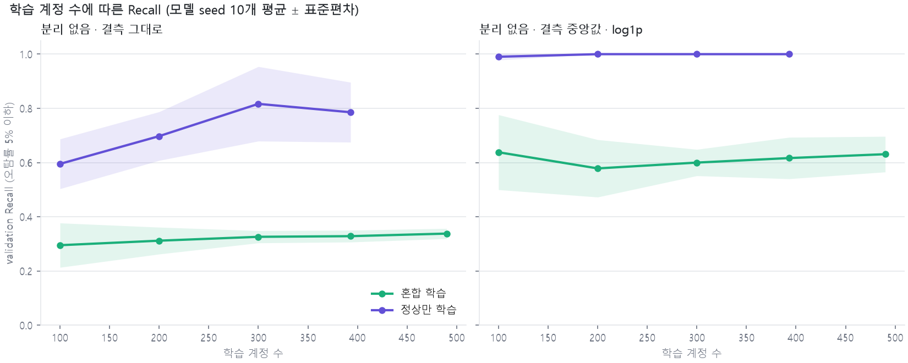
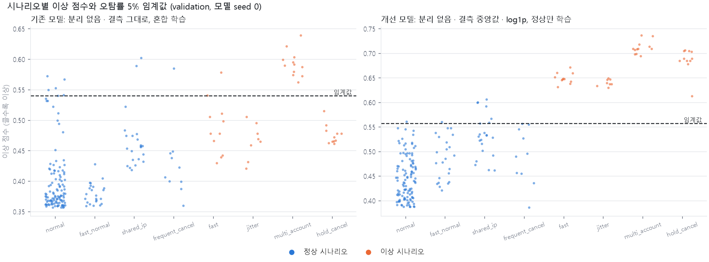
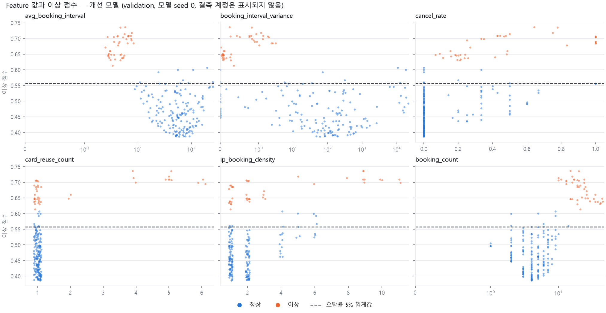
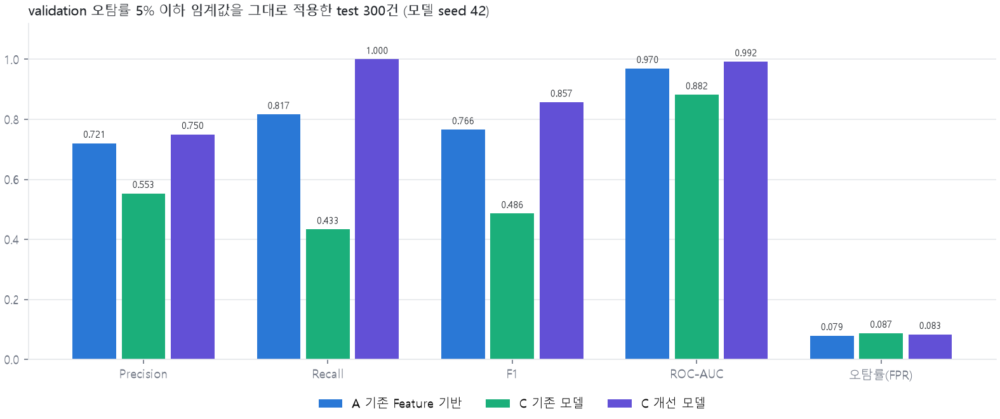
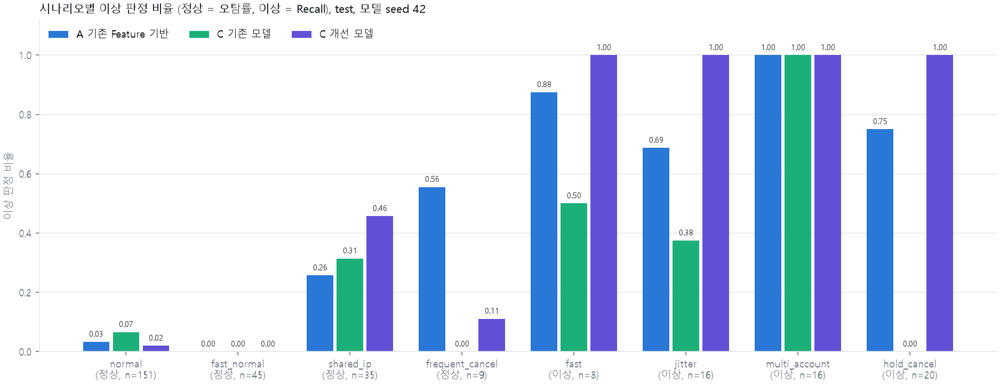
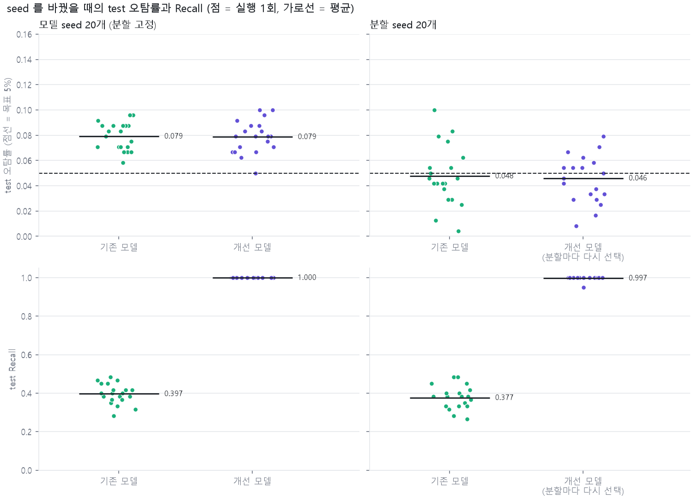

# 이벤트 기반 v2: 오탐률 5% 조건에서의 Isolation Forest 설정 (Issue #17 추가 보고서)

작성일 2026-11-23. [`REPORT_V2_TUNING.md`](REPORT_V2_TUNING.md) 는 F1 만 최대화했고 오탐률이 0.212 까지 올랐다. 이 문서는 **정상 사용자 오탐률(FPR) 5% 이하**를 조건으로 두고 그 안에서 Recall 과 F1 을 높이는 설정을 찾는다.
모든 수치는 `output/v2/model_fpr/` 의 CSV 에서 가져왔다. 스크립트는 `scripts/tune_if_v2_fpr.py` 다. 기존 스크립트와 결과 파일은 수정하지 않았다.

FPR 5% 목표가 적힌 Feature 설계 문서는 이 레포에서 찾지 못했다. 요청에 적힌 값을 그대로 기준으로 썼다.

## 요약

validation 에서 오탐률 5% 이하가 되도록 임계값을 정하고, 그 임계값을 바꾸지 않고 test 에 적용한 결과다.

| | Precision | Recall | F1 | ROC-AUC | test 오탐률 |
|---|---|---|---|---|---|
| **분할 seed 20개 평균** | | | | | |
| C 기존 모델 (결측 그대로, 혼합 학습) | 0.683 | 0.377 | 0.479 | 0.877 | 0.048 |
| C 개선 모델 (중앙값 대체 + log1p, 정상 계정만 학습) | 0.845 | 0.997 | 0.914 | 0.997 | 0.047 |
| A 기존 Feature 기반 (같은 방식의 임계값) | 0.792 | 0.764 | 0.771 | 0.965 | 0.053 |
| **기존 실험과 같은 test 300건, 모델 seed 42** | | | | | |
| C 기존 모델 | 0.553 | 0.433 | 0.486 | 0.882 | 0.088 |
| C 개선 모델 | 0.750 | 1.000 | 0.857 | 0.992 | 0.083 |
| A 기존 Feature 기반 | 0.721 | 0.817 | 0.766 | 0.970 | 0.079 |

- **오탐률 5% 조건에서 Recall 이 0.38 → 1.00, F1 이 0.48 → 0.91 로 올랐다** (분할 20개 평균). 같은 조건의 A(0.77)보다 높다.
- **효과가 가장 큰 것은 정상 계정만으로 학습하는 것이다.** 학습 건수의 차이로는 설명되지 않는다 (정상 100건 학습이 혼합 490건 학습보다 높다).
- **validation 에서 정한 임계값이 test 오탐률 5% 를 보장하지는 않는다.** 분할 20개의 test 오탐률은 평균 0.047, 표준편차 0.021 이고 5% 이하인 분할은 55% 다. 기존 실험과 같은 test 300건에서는 세 모델 모두 5% 를 넘었다 (0.08~0.09). validation 정상 계정이 168개라 허용 오탐이 8건뿐이기 때문이다.
- 남은 오탐은 `shared_ip` 에 몰려 있다 (오탐 20건 중 16건, IP 공유 수가 큰 계정).
- 정상 계정만으로 학습하려면 이상 계정을 걸러 낼 기준이 필요하다. 학습 데이터에 이상 계정이 5% 까지 섞여도 결과는 유지됐고, 10% 에서 Recall 0.95, 20% 에서 0.69 로 내려갔다.
- 합성 데이터 안의 값이다. Recall 1.00 은 이 데이터에서 매크로의 간격과 시도 수가 정상과 전혀 겹치지 않기 때문이며, 실제 사용자에 대한 탐지 성능이 아니다.

---

## 1. 실험 조건

**바꾸지 않은 것**: Feature 6개, v2 데이터셋과 이벤트 생성 규칙, 트리 수 100, `max_samples` 기본값. Ablation 은 하지 않았고 새 Feature 도 만들지 않았다.

**분할** (`REPORT_V2_TUNING.md` 와 같은 계정)

| | 건수 | 정상 / 이상 | 용도 |
|---|---|---|---|
| train | 490 | 393 / 97 | 모델 학습, 결측 대체값(중앙값) 계산 |
| validation | 210 | 168 / 42 | 임계값 결정, 설정 선택 |
| test | 300 | 240 / 60 | 최종 평가 (기존 실험과 같은 계정) |

**절차**

1. 모델과 결측 대체는 train 에만 fit 한다.
2. 임계값은 그 모델의 validation 점수에서, 정상 계정의 오탐률이 5% 이하가 되는 가장 낮은 점수로 정한다. 조건 안에서 Recall 이 가장 높은 임계값이다. validation 정상 168계정 중 8계정까지 허용된다 (4.8%).
3. 설정은 validation Recall(모델 seed 10개 평균, 동률이면 F1)이 가장 높은 것으로 고른다.
4. test 는 같은 모델과 같은 임계값으로 한 번 평가한다. 임계값이 모델의 점수에 묶여 있으므로 train+validation 재학습은 하지 않는다.

**비교한 설정** (전처리 4가지 × 학습 데이터 3가지)

| 전처리 | 내용 |
|---|---|
| 결측 그대로 | 기존 설정 |
| 결측 중앙값 | |
| 결측 중앙값 + log1p | `REPORT_V2_TUNING.md` 에서 고른 전처리 |
| 시도 2건 미만 분리 + 결측 중앙값 + log1p | 분리된 계정은 "이상 아님"으로 센다 |

| 학습 데이터 | 건수 | 내용 |
|---|---|---|
| 혼합 | 490 | train 전체 (정상 + 이상, 레이블 미사용). 기존 방식 |
| 정상만 | 393 | train 중 `normal`, `fast_normal`, `shared_ip`, `frequent_cancel` |
| 혼합 (크기 맞춤) | 393 | 혼합 train 에서 시나리오 비율을 유지한 채 정상만과 같은 건수만 뽑음 |

---

## 2. 실험 1: 오탐률 제약으로 정한 임계값

혼합 학습(기존 방식)에서 임계값만 바꾼 결과다. 모델 seed 20개 평균, test 300건.

| 전처리 | 임계값 | Precision | Recall | F1 | test 오탐률 |
|---|---|---|---|---|---|
| 결측 그대로 (기존) | contamination 0.20 (기존) | 0.519 | 0.533 | 0.525 | 0.124 |
| | **validation 오탐률 5% 이하** | 0.556 | 0.397 | 0.462 | 0.079 |
| 결측 중앙값 + log1p | contamination 0.20 | 0.664 | 0.728 | 0.695 | 0.092 |
| | **validation 오탐률 5% 이하** | 0.672 | 0.718 | 0.693 | 0.088 |

참고로 `REPORT_V2_TUNING.md` 의 설정(중앙값 + log1p, contamination 0.35, 700건 학습)은 F1 0.673, 오탐률 0.212 였다.

- **기존 모델은 오탐률을 낮추면 Recall 이 같이 내려간다** (0.53 → 0.40). 점수 상위에 정상 계정이 섞여 있어서, 임계값을 올리면 매크로가 먼저 빠진다.
- 중앙값 + log1p 를 쓰면 같은 조건에서 Recall 이 0.72 다. 그래도 `fast` 0.59, `jitter` 0.45 로 매크로의 절반 가까이를 놓친다.
- 혼합 학습에서는 임계값만으로 오탐률 5% 와 높은 Recall 을 같이 얻을 수 없었다.

validation 기준 값 (seed 10개 평균, 선택에 쓴 표). 출처: `validation_selection.csv`

| 전처리 | 혼합 Recall / F1 | 혼합 (크기 맞춤) | 정상만 |
|---|---|---|---|
| 결측 그대로 | 0.338 / 0.442 | 0.317 / 0.420 | 0.786 / 0.792 |
| 결측 중앙값 | 0.345 / 0.449 | 0.331 / 0.434 | 0.771 / 0.780 |
| 결측 중앙값 + log1p | 0.631 / 0.691 | 0.555 / 0.634 | **1.000 / 0.913** |
| 2건 미만 분리 + 중앙값 + log1p | 0.555 / 0.632 | 0.529 / 0.611 | **1.000 / 0.913** |

validation 오탐률은 모두 0.048 이다 (임계값을 그렇게 정했다).

- **선택: 결측 중앙값 + log1p, 정상만 학습.** 2건 미만을 분리하는 설정과 validation 값이 완전히 같았고, 미리 정한 순서(분리하지 않는 쪽)대로 골랐다.

---

## 3. 실험 2: 학습 데이터 구성

### 3.1 혼합 학습과 정상만 학습 (test, 모델 seed 20개 평균 ± 표준편차)

| 전처리 | 학습 데이터 | 건수 | Precision | Recall | F1 | ROC-AUC | test 오탐률 |
|---|---|---|---|---|---|---|---|
| 결측 그대로 | 혼합 | 490 | 0.556 | 0.397 ± 0.052 | 0.462 ± 0.045 | 0.879 | 0.079 |
| | 혼합 (크기 맞춤) | 393 | 0.542 | 0.361 ± 0.054 | 0.432 ± 0.052 | 0.873 | 0.076 |
| | 정상만 | 393 | 0.684 | 0.807 ± 0.090 | 0.738 ± 0.045 | 0.949 | 0.093 |
| 결측 중앙값 + log1p | 혼합 | 490 | 0.672 | 0.718 ± 0.061 | 0.693 ± 0.036 | 0.932 | 0.088 |
| | 혼합 (크기 맞춤) | 393 | 0.667 | 0.663 ± 0.090 | 0.663 ± 0.057 | 0.929 | 0.082 |
| | **정상만** | 393 | 0.762 | **1.000 ± 0.000** | **0.864 ± 0.020** | 0.996 | 0.079 |
| 2건 미만 분리 + 중앙값 + log1p | 혼합 | 490 | 0.717 | 0.684 ± 0.073 | 0.699 ± 0.048 | 0.939 | 0.067 |
| | 정상만 | 393 | 0.805 | 1.000 ± 0.000 | 0.892 ± 0.017 | 0.997 | 0.061 |

출처: `model_seed_summary.csv`. 결측 중앙값(변환 없음) 행은 CSV 에 있다.

- **정상만으로 학습하면 모든 전처리에서 Recall 이 크게 오른다.** 기존 전처리에서 0.40 → 0.81, 중앙값 + log1p 에서 0.72 → 1.00.
- 혼합 학습에서는 이상 계정(학습 데이터의 20%)이 서로 가까이 모여 있어 모델이 그 구간을 "흔한 값"으로 배운다. 정상만으로 학습하면 그 구간이 학습 범위 밖이 되어 바로 고립된다.
- 두 전처리의 효과는 따로 더해진다. log1p 없이 정상만 학습하면 `fast` 0.66, `jitter` 0.58 에 머문다.

### 3.2 학습 건수의 영향

정상만 학습은 건수가 97건 적다. 건수를 맞추거나 바꿔 가며 확인했다 (validation Recall, 모델 seed 10개 평균 ± 표준편차). 출처: `training_size.csv`

| 학습 건수 | 기존 전처리: 혼합 | 기존 전처리: 정상만 | 중앙값 + log1p: 혼합 | 중앙값 + log1p: 정상만 |
|---|---|---|---|---|
| 100 | 0.295 ± 0.082 | 0.595 ± 0.092 | 0.638 ± 0.138 | 0.990 ± 0.012 |
| 200 | 0.312 ± 0.049 | 0.698 ± 0.090 | 0.579 ± 0.106 | 1.000 |
| 300 | 0.326 ± 0.023 | 0.817 ± 0.137 | 0.600 ± 0.049 | 1.000 |
| 393 | 0.329 ± 0.022 | 0.786 ± 0.111 | 0.617 ± 0.076 | 1.000 |
| 490 | 0.338 ± 0.019 | — | 0.631 ± 0.066 | — |



- **건수의 영향은 작고, 구성의 영향이 크다.** 같은 393건에서 혼합 0.62 대 정상만 1.00 이다. 정상 100건으로 학습한 모델이 혼합 490건으로 학습한 모델보다 높다.
- 혼합 학습은 100건에서 490건으로 늘려도 Recall 이 거의 변하지 않는다. Isolation Forest 는 트리마다 최대 256건만 뽑아 쓰므로 그 이상에서는 건수의 효과가 작다.
- 기존 전처리에서 정상만 학습은 건수가 줄면 Recall 이 내려간다 (0.79 → 0.60). 고른 설정은 100건에서도 0.99 다.

### 3.3 정상 학습 데이터에 이상 계정이 섞여 있을 때

실제로는 이상 계정을 완전히 걸러 낼 수 없다. 정상 393건에 train 의 이상 계정을 일부 섞어 학습했다 (중앙값 + log1p, 모델 seed 10개 평균). 출처: `training_purity.csv`

| 학습 데이터 중 이상 계정 | 섞인 계정 수 | validation Recall | test Recall | test F1 | test 오탐률 | test ROC-AUC |
|---|---|---|---|---|---|---|
| 0% (정상만) | 0 | 1.000 | 1.000 | 0.861 | 0.081 | 0.995 |
| 1% | 4 | 1.000 | 1.000 | 0.861 | 0.081 | 0.999 |
| 2% | 8 | 1.000 | 1.000 | 0.858 | 0.083 | 0.999 |
| 5% | 21 | 1.000 | 0.998 | 0.851 | 0.087 | 0.994 |
| 10% | 44 | 0.950 | 0.950 | 0.827 | 0.087 | 0.979 |
| 20% (= 혼합) | 97 | 0.576 | 0.693 | 0.685 | 0.082 | 0.930 |

- **이상 계정이 5% 까지 섞여도 결과는 유지된다.** 10% 에서 내려가기 시작하고 20% 에서는 혼합 학습과 같아진다.
- 완벽한 정상 레이블이 없어도, 의심 계정을 대부분 걸러 낸 데이터면 된다는 뜻이다.

---

## 4. 실험 3: 오탐 원인

validation 210건, 오탐률 5% 임계값. 이상 판정 비율은 모델 seed 10개 평균, 원인 집계는 seed 0 이다 (두 모델 모두 오탐 8건).

### 4.1 시나리오별 오탐률과 Recall (validation)

| 시나리오 | validation 수 | 기존 모델 | 개선 모델 |
|---|---|---|---|
| normal (오탐률) | 113 | 0.042 | 0.006 |
| fast_normal (오탐률) | 23 | 0.000 | 0.026 |
| shared_ip (오탐률) | 22 | 0.100 | **0.236** |
| frequent_cancel (오탐률) | 10 | 0.100 | 0.150 |
| fast (Recall) | 11 | 0.191 | 1.000 |
| jitter (Recall) | 8 | 0.000 | 1.000 |
| multi_account (Recall) | 12 | 1.000 | 1.000 |
| hold_cancel (Recall) | 11 | 0.009 | 1.000 |

test 의 값은 5절에 있다. 출처: `error_analysis_validation.csv`



- 기존 모델에서는 `fast`, `jitter`, `hold_cancel` 의 점수가 정상 계정의 점수 범위 안에 있다. 임계값을 어디에 두어도 나뉘지 않는다.
- 개선 모델에서는 이상 계정 전체가 임계값 위에 있고(가장 낮은 이상 계정도 임계값보다 0.05 이상 높다), 임계값 근처에는 `shared_ip` 정상 계정만 남는다.

### 4.2 기존 문서의 Feature 기준 후보와 오탐

기준 후보는 `REPORT_V2.md` 1.1~1.3절의 것이다 (데모 프론트의 기준 후보와 Credit 규칙. `booking_count` 의 기준은 문서에 없다).
"충족한 정상 계정"은 validation 정상 168계정 중 그 기준에 해당하는 계정이다. 출처: `false_positive_criteria_validation.csv`

| 기준 | 충족한 정상 계정 | 기존 모델: 그중 오탐 | 개선 모델: 그중 오탐 | 충족한 이상 계정 비율 |
|---|---|---|---|---|
| 간격 < 10초 (후보) | 2 (1.2%) | 0 | 0 | 100% |
| 간격 < 5초 (후보) | 0 | — | — | 62% |
| 분산 < 1.0초² (후보) | 29 (17.3%) | 1 | 2 | 79% |
| 분산 < 1.0초², 시도 5건 이상 (Credit) | 0 | — | — | 79% |
| 취소율 ≥ 30% (후보) | 29 (17.3%) | 3 | 1 | 57% |
| 취소율 ≥ 50% (후보) | 15 (8.9%) | 0 | 0 | 33% |
| 카드 ≥ 4 (Credit) | 0 | — | — | 29% |
| IP ≥ 5 (Credit) | 10 (6.0%) | 1 | **4 (40%)** | 29% |
| (참고) 결측 Feature 있음 | 6 (3.6%) | 2 | 1 | 2% |
| (참고) 분산이 학습 데이터 상위 10% 이상 | 15 (8.9%) | **6 (40%)** | 3 | 0% |
| (참고) 시도 2건 (분산 0) | 23 (13.7%) | 1 | 2 | 0% |

오탐 8건 중 기준 후보를 하나 이상 충족하는 계정은 두 모델 모두 5건이다.

- **기존 모델의 오탐은 기준 후보와 관계가 없다.** 8건 중 6건이 "분산이 큰" 정상 계정이다. 기준 후보는 분산이 작은 쪽을 이상으로 보는데, 모델은 반대쪽 끝을 잡고 있다. 결측 계정도 2건 잡힌다.
- **개선 모델의 오탐은 IP 공유 수에 몰린다.** 8건 중 6건이 `shared_ip` 이고, 그 6건 모두에서 점수를 가장 많이 올린 Feature 가 `ip_booking_density` 다. IP 5 이상인 정상 계정의 40% 가 오탐이다. 이것은 Credit 규칙의 "IP ≥ 5" 가 정상 `shared_ip` 계정을 잡는 것과 같은 현상이다 (`REPORT_V2.md` 1.3절: 정상의 7.6% 가 충족).
- 간격 기준(10초 미만)은 정상 1.2%, 이상 100% 로 가장 깔끔하게 나뉜다. 이 정보가 기존 모델의 점수에는 거의 반영되지 않았다.
- "분산 < 1.0" 과 "취소율 ≥ 30%" 는 정상의 17% 가 충족하지만 그 계정들의 오탐률은 3~10% 로 전체(4.8%)와 크게 다르지 않다. 모델은 이 기준 하나만으로 계정을 이상으로 보지 않는다.

### 4.3 Feature 값과 이상 점수

정상 계정 안에서 Feature 값과 점수의 Spearman 순위상관 (validation). 출처: `feature_score_correlation_validation.csv`

| Feature | 기존 모델 | 개선 모델 | 해석 |
|---|---|---|---|
| `avg_booking_interval` | +0.40 | −0.11 | 기존 모델은 간격이 **긴** 정상 계정에 높은 점수를 준다 |
| `booking_interval_variance` | +0.40 | −0.16 | 기존 모델은 분산이 **큰** 정상 계정에 높은 점수를 준다 |
| `cancel_rate` | +0.39 | +0.43 | 취소율이 높을수록 점수가 높다 |
| `ip_booking_density` | +0.26 | +0.17 | IP 공유 수가 클수록 점수가 높다 |
| `booking_count` | +0.19 | +0.08 | |



- 기존 모델에서 간격·분산과 점수의 관계는 매크로를 찾는 방향과 반대다. 개선 모델에서는 이 관계가 없어지고, 간격 10초 미만·시도 10건 이상인 구간에서 점수가 뚜렷이 높다.
- 개선 모델에서 임계값을 넘는 정상 계정은 IP 4~6, 취소율이 있는 계정, 시도 수 9~10건 근처에 있다. 정상 범위의 가장자리다.
- 기존 모델의 같은 그림은 `figures/feature_vs_score_baseline.png` 에 있다.

---

## 5. 최종 비교 (오탐률 5% 조건)

### 5.1 기존 실험과 같은 test 300건 (모델 seed 42)

| 모델 | Precision | Recall | F1 | ROC-AUC | test 오탐률 | TP | FP | TN | FN |
|---|---|---|---|---|---|---|---|---|---|
| C 기존 모델 (결측 그대로, 혼합) | 0.553 | 0.433 | 0.486 | 0.882 | 0.088 | 26 | 21 | 219 | 34 |
| C 전처리만 개선 (중앙값 + log1p, 혼합) | 0.649 | 0.833 | 0.730 | 0.940 | 0.112 | 50 | 27 | 213 | 10 |
| **C 개선 모델 (중앙값 + log1p, 정상만)** | **0.750** | **1.000** | **0.857** | **0.992** | **0.083** | 60 | 20 | 220 | 0 |
| A 기존 Feature 기반 (결측 없음, 혼합) | 0.721 | 0.817 | 0.766 | 0.970 | 0.079 | 49 | 19 | 221 | 11 |



| 시나리오 | test 수 | C 기존 모델 | C 개선 모델 | A |
|---|---|---|---|---|
| normal (오탐률) | 151 | 0.07 | 0.02 | 0.03 |
| fast_normal (오탐률) | 45 | 0.00 | 0.00 | 0.00 |
| shared_ip (오탐률) | 35 | 0.31 | **0.46** | 0.26 |
| frequent_cancel (오탐률) | 9 | 0.00 | 0.11 | 0.56 |
| fast (Recall) | 8 | 0.50 | 1.00 | 0.88 |
| jitter (Recall) | 16 | 0.38 | 1.00 | 0.69 |
| multi_account (Recall) | 16 | 1.00 | 1.00 | 1.00 |
| hold_cancel (Recall) | 20 | 0.00 | 1.00 | 0.75 |



- **이 test 300건에서는 세 모델 모두 오탐률 5% 를 넘었다 (0.08~0.09).** validation 에서 4.8% 로 맞춘 임계값이 test 에서는 8% 가 됐다. 이 분할의 test 에 `shared_ip` 정상 계정 가운데 점수가 높은 계정이 더 많이 들어 있다.
- 개선 모델의 오탐 20건은 `shared_ip` 16, `normal` 3, `frequent_cancel` 1 이다. `shared_ip` 를 빼면 정상 205계정 중 4건(2.0%)이다.
- 출처: `test_metrics_seed42.csv`, `reference_a_runs.csv`

### 5.2 seed 안정성

**모델 seed 20개 (분할 고정, test 300건)**

| 모델 | Precision | Recall | F1 | ROC-AUC | test 오탐률 |
|---|---|---|---|---|---|
| C 기존 모델 | 0.556 ± 0.039 | 0.397 ± 0.052 | 0.462 ± 0.045 | 0.879 ± 0.010 | 0.079 ± 0.011 |
| C 개선 모델 | 0.762 ± 0.030 | 1.000 ± 0.000 | 0.864 ± 0.020 | 0.996 ± 0.003 | 0.079 ± 0.013 |
| A 기존 Feature 기반 | 0.788 ± 0.036 | 0.862 ± 0.074 | 0.822 ± 0.045 | 0.975 ± 0.009 | 0.058 ± 0.011 |

**분할 seed 20개** — 분할마다 train/validation/test 를 새로 나누고, 그 분할의 validation 에서 임계값과 설정을 다시 정했다.

| 모델 | Precision | Recall | F1 | ROC-AUC | test 오탐률 | 오탐률 5% 이하인 분할 |
|---|---|---|---|---|---|---|
| C 기존 모델 | 0.683 ± 0.108 | 0.377 ± 0.060 | 0.479 ± 0.050 | 0.877 ± 0.014 | 0.048 ± 0.024 | 13 / 20 |
| C 전처리만 개선 (혼합) | 0.719 ± 0.062 | 0.505 ± 0.099 | 0.586 ± 0.071 | 0.935 ± 0.014 | 0.051 ± 0.019 | 10 / 20 |
| C 개선 모델 (분할마다 다시 선택) | 0.848 ± 0.056 | 0.997 ± 0.011 | 0.915 ± 0.031 | 0.997 ± 0.003 | 0.046 ± 0.019 | 11 / 20 |
| C 개선 모델 (5.1절의 설정 그대로) | 0.845 ± 0.060 | 0.997 ± 0.015 | 0.914 ± 0.035 | 0.997 ± 0.003 | 0.047 ± 0.021 | 11 / 20 |
| A 기존 Feature 기반 | 0.792 ± 0.066 | 0.764 ± 0.102 | 0.771 ± 0.052 | 0.965 ± 0.009 | 0.053 ± 0.025 | 13 / 20 |

| 시나리오별 이상 판정 비율 (분할 20개 평균) | C 기존 모델 | C 개선 모델 | A |
|---|---|---|---|
| normal (오탐률) | 0.03 | 0.02 | 0.04 |
| fast_normal (오탐률) | 0.00 | 0.00 | 0.00 |
| shared_ip (오탐률) | 0.16 | 0.21 | 0.09 |
| frequent_cancel (오탐률) | 0.05 | 0.07 | 0.29 |
| fast (Recall) | 0.18 | 1.00 | 0.71 |
| jitter (Recall) | 0.21 | 1.00 | 0.68 |
| multi_account (Recall) | 1.00 | 1.00 | 1.00 |
| hold_cancel (Recall) | 0.00 | 0.99 | 0.61 |



- **Recall 과 F1 의 개선은 모든 seed 에서 같다.** 분할 20개 모두에서 "정상만 학습 + 중앙값 + log1p" 가 선택됐다 (2건 미만 분리 여부만 14 대 6 으로 갈렸다).
- **test 오탐률은 평균으로는 목표에 맞지만 분할마다 0.01~0.08 로 흔들린다.** 5% 이하인 분할은 절반 정도다. 이것은 모델과 무관하게 세 모델에 똑같이 나타난다. 정상 168계정으로 5% 분위수를 추정하는 것의 한계다.
- 5.1절의 분할(seed 42)은 세 모델 모두 test 오탐률이 높게 나온 분할이다.

출처: `model_seed_summary.csv`, `split_seed_summary.csv`, `split_seed_runs.csv`, `split_seed_selected.csv`

---

## 6. BTS 적용 추천

### 추천 설정

| 항목 | 추천 | 근거 |
|---|---|---|
| 결측 처리 | 학습 데이터의 중앙값으로 대체 | 결측을 그대로 넣으면 시도 1건인 정상 계정이 이상으로 판정된다. `preprocessing.build_preprocessor(imputation="median")` |
| 변환 | 간격 평균·분산, 시도 수에 log1p | `preprocessing.FEATURE_SPECS` 의 `log` 후보 그대로. 없으면 `fast`·`jitter` Recall 이 0.6 대 |
| 학습 데이터 | 이상으로 의심되는 계정을 뺀 계정 | 3절. 이상 계정이 5% 이하로 남아도 결과가 유지된다 |
| 임계값 | 정상으로 볼 수 있는 계정의 점수 상위 5% | 이상 계정의 레이블 없이 정할 수 있다 |
| 시도 1건 계정 | `INSUFFICIENT_DATA` 로 분리 (문서 기준 2건 미만) | validation 성능은 분리하지 않는 경우와 같았다. 문서(`predict_feature_spec.md`)의 기준과 맞추는 쪽이다 |

현재 번들(`pack_bundle.py`)은 `preprocess={}`, `min_booking_count=1` 이고 혼합 데이터로 학습한 모델을 쓴다. 위 설정을 쓰려면 같은 전처리로 모델을 다시 학습해 번들을 새로 만들어야 한다.

### 적용할 때 정해야 하는 것

1. **학습에서 뺄 계정의 기준.** 이 실험은 합성 데이터의 레이블로 뺐다. BTS 에는 레이블이 없으므로 대신 쓸 기준이 필요하다. 예를 들어 Credit 규칙에 걸린 계정이나 운영자가 확인한 매크로 계정을 빼는 방법이 있다. 어떤 기준이 실제로 이상 계정을 5% 이하로 남기는지는 이 실험으로 확인할 수 없다.
2. **오탐률 5% 를 얼마나 엄격하게 볼지.** 정상 168계정으로 정한 임계값은 새 데이터에서 평균 4.7%, 분할에 따라 1~8% 였다. "평균 5%" 가 목표면 지금 방식으로 충분하다. "항상 5% 이하" 가 목표면 임계값을 정하는 정상 계정 수를 늘리거나 더 낮은 목표(예: 3%)로 정해야 한다. 후자는 이 실험에서 확인하지 않았다.
3. **`shared_ip` 오탐.** 개선 모델에서도 `shared_ip` 정상 계정의 21~46% 가 이상으로 판정된다 (분할 20개 평균 0.21, 5.1절의 test 0.46). 6개 Feature 로는 회사·학교 같은 정상 공유와 다계정을 구분할 근거가 없다. 모델 점수만으로 자동 차단하지 말고, IP 공유 수가 주된 원인인 계정은 추가 확인 대상으로 두는 처리가 필요하다.

### 임계값을 validation 없이 정하는 방법 (참고)

정상만 학습한 모델은 학습 점수의 상위 5% 를 임계값으로 써도 (`contamination=0.05`) 결과가 비슷하다. 이상 계정이 들어 있는 validation 이 필요 없다. 모델 seed 평균, test 300건.

| 학습 데이터 중 이상 계정 | Precision | Recall | F1 | test 오탐률 |
|---|---|---|---|---|
| 0% (seed 20개) | 0.816 | 0.995 | 0.897 | 0.056 |
| 2% (seed 10개) | 0.882 | 0.988 | 0.932 | 0.033 |
| 5% (seed 10개) | 0.962 | 0.808 | 0.878 | 0.008 |
| 10% (seed 10개) | 0.921 | 0.460 | 0.613 | 0.010 |

이 방식은 학습 데이터에 이상 계정이 섞이면 임계값이 그 계정들 쪽으로 올라가 Recall 이 빨리 내려간다 (5% 에서 0.81, 10% 에서 0.46). 학습 데이터가 깨끗하다고 확신하기 어려우면 정상 계정을 따로 떼어 임계값을 정하는 쪽이 안전하다.

---

## 7. 한계

- **합성 데이터의 정상/이상 정의에 맞춘 결과다.** 이 데이터에서 매크로는 평균 간격과 시도 수만으로 정상과 완전히 나뉜다 (`REPORT_V2_TUNING.md` 2절). Recall 1.00 은 그 구조에서 나온 값이다. 실제 매크로가 정상 사용자의 범위 안에서 움직이면 같은 결과가 나오지 않는다.
- **정상만 학습은 레이블을 쓴다.** 순수한 비지도 설정이 아니다. 기존 모델(혼합 학습)과의 비교는 "레이블로 학습 데이터를 걸렀을 때 얼마나 나아지는가" 로 읽어야 한다.
- **정상 시나리오의 구성이 고정돼 있다.** 정상 학습 데이터에는 4개 유형이 모두 들어 있다. 학습에 없던 유형의 정상 사용자가 나타나면 오탐이 될 수 있다. 이 경우는 확인하지 않았다.
- **validation 이 작다.** 정상 168계정, 허용 오탐 8건이다. test 오탐률의 흔들림(표준편차 0.02)은 여기서 나온다.
- 설정 선택에서 두 설정이 validation 에서 동률이었다 (2건 미만 분리 여부). test 에서는 분리하는 쪽의 오탐률이 조금 낮았지만(0.061 대 0.079) 이 값으로 선택을 바꾸지 않았다.
- 트리 수, `max_samples` 는 조정하지 않았다. 데이터 생성 seed 는 바꾸지 않았다 (v2 데이터 고정).

---

## 부록: 결과 파일과 재현

| 내용 | 파일 (`output/v2/model_fpr/`) |
|---|---|
| 설정 선택 (validation) | `validation_selection.csv` |
| 전체 실행 (전처리 × 학습 데이터 × 모델 seed) | `runs.csv`, `model_seed_summary.csv`, `test_metrics_seed42.csv` |
| A 참고 | `reference_a_runs.csv` |
| 학습 건수, 이상 계정 혼입 | `training_size.csv`, `training_purity.csv` |
| 오탐 원인 | `error_analysis_validation.csv`, `error_detail_validation.csv`, `false_positive_criteria_validation.csv`, `feature_score_correlation_validation.csv` |
| 분할 seed | `split_seed_runs.csv`, `split_seed_summary.csv`, `split_seed_selected.csv` |
| 실험 설정 | `experiment_config.json` |
| 그래프 7장 | `figures/` |

```powershell
cd ai\experiments\issue17-event-based-dummy
& "..\issue14-real-validation\.venv\Scripts\python" scripts\tune_if_v2_fpr.py    # 약 12분
```

스크립트는 `scripts/tune_if_v2.py` 의 점수 계산과 분할을 import 해서 쓴다. 데이터셋은 읽기만 하고 실행 전후의 sha256 이 같은지 `experiment_config.json` 에 기록한다. 모델 파일은 저장하지 않는다.
