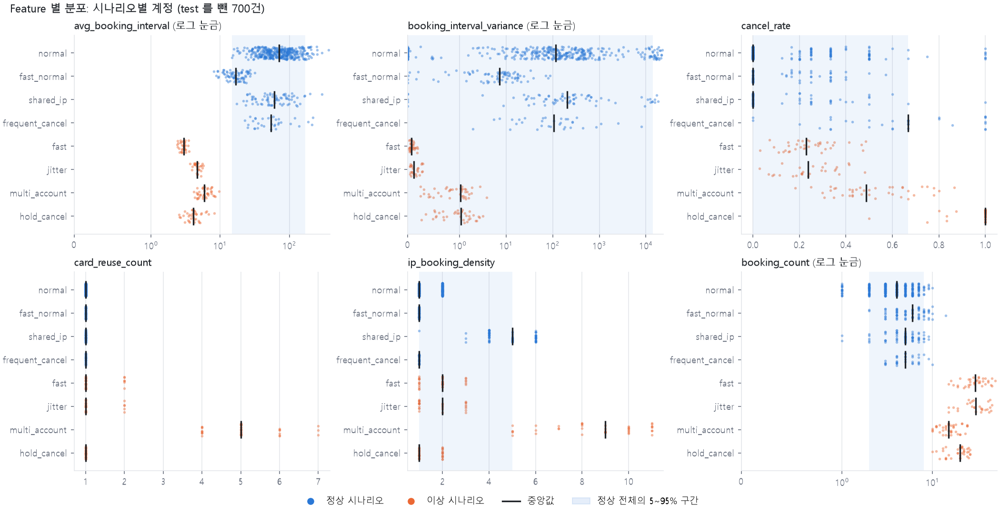
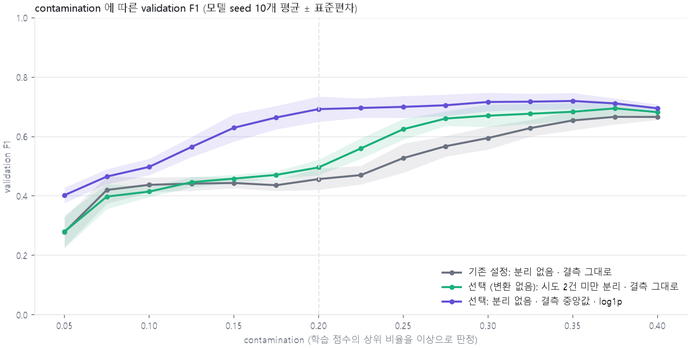
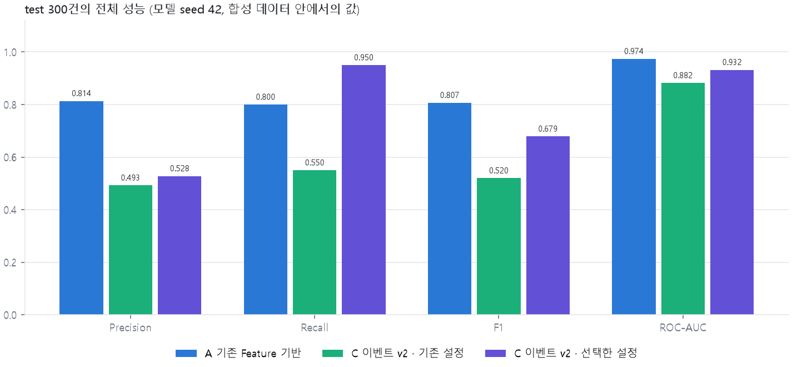
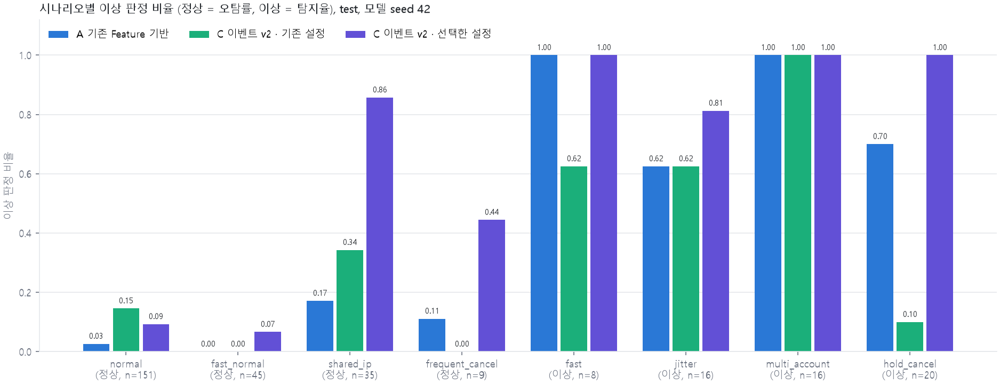
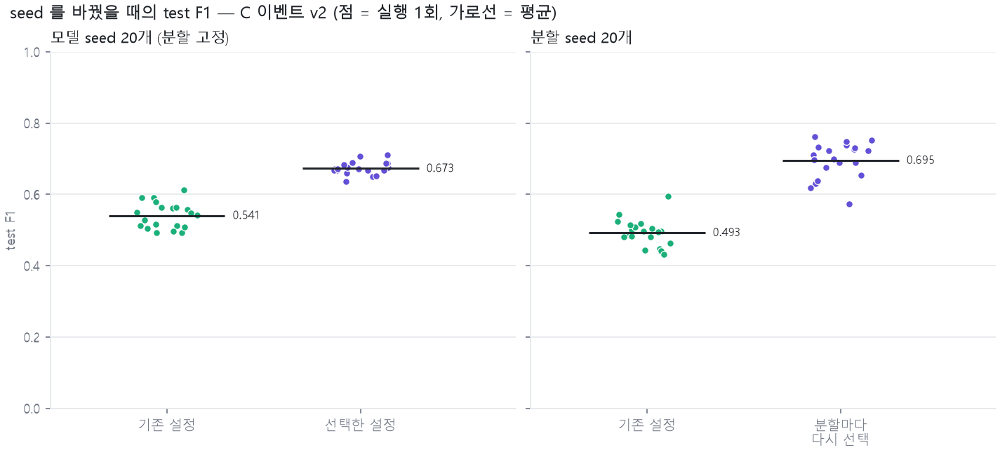

# 이벤트 기반 v2 의 Isolation Forest 설정 개선 (Issue #17 추가 보고서)

작성일 2026-11-23. 이벤트 기반 v2 데이터셋(C)과 Feature 6개는 [`REPORT_V2.md`](REPORT_V2.md) 의 것을 그대로 두고, 모델에 넣기 전의 처리와 판정 기준만 바꿔 본 결과다.
모든 수치는 `output/v2/model_tuning/` 의 CSV 에서 가져왔다. 스크립트는 `scripts/tune_if_v2.py` 다.

## 요약

test 300건(이상 60), 모델 seed 42, 기존 실험과 같은 test 계정이다.

| | Precision | Recall | F1 | ROC-AUC | 오탐률 |
|---|---|---|---|---|---|
| A 기존 Feature 기반 (기존 설정) | 0.814 | 0.800 | **0.807** | 0.974 | 0.046 |
| C 이벤트 v2, 기존 설정 | 0.493 | 0.550 | **0.520** | 0.882 | 0.142 |
| C 이벤트 v2, validation 에서 고른 설정 | 0.528 | 0.950 | **0.679** | 0.932 | 0.212 |

- **F1 은 0.520 → 0.679 로 올랐다.** 모델 seed 20개 평균으로는 0.541 → 0.673, 분할 seed 20개에서는 20번 모두 기존 설정보다 높았다 (평균 0.493 → 0.69).
- **오른 것은 Recall 이다 (0.55 → 0.95). Precision 은 거의 그대로다 (0.49 → 0.53).** 오탐률은 0.142 → 0.212 로 오히려 늘었고, `shared_ip` 정상 계정의 86% 가 이상으로 판정된다.
- A 의 0.807 에는 미치지 못한다.
- 고른 설정: 결측을 학습 데이터의 중앙값으로 대체, 간격 평균·분산과 시도 수에 log1p, contamination 0.35. 모두 `preprocessing.py` 에 이미 있는 선택지다.
- 이 수치는 합성 데이터 안의 값이고, contamination 은 레이블이 있는 validation 으로 골랐다. 실제 서비스에서는 이상 비율을 모르므로 같은 방식으로 고를 수 없다.

---

## 1. 실험 조건

**바꾸지 않은 것**: Feature 6개, v2 데이터셋과 이벤트 생성 규칙, 트리 수 100, `max_samples` 기본값. Feature 조합 실험은 하지 않았고 새 Feature 도 만들지 않았다.

**바꿔 본 것** (12가지 처리 × contamination 15개)

| 항목 | 값 | 출처 |
|---|---|---|
| INSUFFICIENT_DATA 기준 | 시도 1건 (분리 없음) / 2건 미만 분리 | `pack_bundle.py` / `docs/predict_feature_spec.md`, `train_model.py` |
| 결측 처리 | 그대로(NaN) / 중앙값 / 0 | `preprocessing.build_preprocessor` 의 `imputation` |
| log1p 변환 | 안 함 / 함 (간격 평균, 간격 분산, 시도 수) | `preprocessing.FEATURE_SPECS` 의 `log` 후보 |
| contamination | 0.05 ~ 0.40 (0.025 간격) | 기존 0.20 |

log1p 는 Feature 를 추가하거나 조합하는 것이 아니라 같은 Feature 의 눈금을 바꾸는 전처리다. 요청 범위(결측 처리, contamination·임계값) 밖이라고 볼 수도 있어서 **변환 없이 고른 결과도 모든 표에 따로 적었다.**

**분할**

| | 건수 | 용도 |
|---|---|---|
| test | 300 | 기존 실험과 같은 계정 (`random_state=42`, `stratify=is_anomaly`). 설정을 고른 뒤 한 번 평가 |
| train | 490 | 학습 |
| validation | 210 | 설정 선택. 나머지 700건을 `random_state=42`, `stratify=scenario` 로 나눔 |

- 설정은 train 으로 학습한 모델의 validation F1(모델 seed 10개 평균)이 가장 높은 것으로 골랐다. 2~4절의 분석도 test 를 뺀 700건 또는 validation 에서만 했다.
- 최종 평가는 고른 설정으로 train+validation 700건을 다시 학습해서 했다. 기존 결과(0.520)와 학습 계정이 같아진다. train 490건만으로 학습한 값도 같이 적었다.
- INSUFFICIENT_DATA 로 분리된 계정은 점수를 받지 않으므로 "이상 아님"으로 세고 300건 전체 기준으로 계산했다.
- 스크립트는 처음에 기존 함수(`fit_and_score`)로 A 0.807, C 0.520 을 재현하고, 자체 점수 계산이 그것과 같은 혼동행렬을 내는지 확인한다.

---

## 2. 정상/이상 Feature 분포 중첩

test 를 뺀 700건 (정상 561, 이상 139). 출처: `feature_overlap.csv`, `feature_overlap_joint.csv`

| Feature | 정상 중앙값 [5%~95%] | 이상 중앙값 | Feature 하나로 나눌 때의 AUC | 분포 중첩 계수 | 정상 5~95% 구간 안에 든 이상 계정 |
|---|---|---|---|---|---|
| `avg_booking_interval` | 57.9 [14.8~169] | 4.39 | 1.000 | 0.013 | 0% |
| `booking_count` | 4 [2~8] | 21 | 1.000 | 0.031 | 0% |
| `booking_interval_variance` | 82.1 [0~14,265] | 0.40 | 0.875 | 0.177 | 100% |
| `cancel_rate` | 0 [0~0.67] | 0.41 | 0.863 | 0.304 | 71% |
| `card_reuse_count` | 1 [1~1] | 1 | 0.683 | 0.633 | 63% |
| `ip_booking_density` | 1 [1~5] | 2 | 0.663 | 0.669 | 75% |



- **정상과 이상은 겹치지 않는다.** 평균 간격과 시도 수는 각각 하나만으로도 두 집단이 거의 완전히 나뉜다. 이상 계정 139개는 모두 6개 중 2개 이상의 Feature 에서 정상의 5~95% 구간 밖에 있다. 정상 계정은 시나리오에 따라 55~82% 가 6개 모두 구간 안이다.
- **그런데도 기존 설정의 ROC-AUC 는 0.88 이다.** 원인은 중첩이 아니라 Isolation Forest 가 값을 고립시키는 방식이다.
  - 분할 지점을 최솟값과 최댓값 사이에서 고르게 뽑는다. 분산은 0~29,000 초², 간격은 2~367초 범위인데 이상 계정은 분산 7 이하(중앙값 0.4), 간격 2~11초에 모여 있다. 원래 눈금에서는 이 구간이 전체 범위의 3% 이하라서 분할이 거의 그 안에 떨어지지 않는다.
  - 반대로 분산이 큰 정상 계정, IP 공유 수가 큰 `shared_ip` 는 범위의 바깥쪽에 드문드문 있어 먼저 고립된다.
  - 이상 계정은 전체의 20% 로 드물지 않고, 서로 가까이 모여 있다.
- 분산은 시도 2건이면 식으로 0 이 된다. 정상 계정의 약 10% 가 여기에 해당해 "분산이 작다"만으로는 정상과 매크로가 구분되지 않는다 (정상 5% 분위수가 0).
- `hold_cancel` 은 `cancel_rate`(중앙값 1.0, 정상 구간 안 3%), 간격, 시도 수에서 정상과 뚜렷이 다르다. 기존 설정에서 놓친 것은 값이 겹쳐서가 아니다.
- `fast`, `jitter`, `hold_cancel` 의 카드·IP 값은 정상과 같다. 이 두 Feature 로 구분되는 것은 `multi_account` 뿐이다.

---

## 3. 시나리오별 오탐·미탐 원인

validation 210건, train 으로 학습. 이상 판정 비율은 모델 seed 10개 평균, 원인 집계는 seed 0 이다.
"가장 크게 작용한 Feature"는 그 Feature 값만 학습 데이터의 중앙값으로 바꿨을 때 점수가 가장 많이 내려가는 Feature 다. 출처: `error_analysis_validation.csv`, `error_detail_validation.csv`

### 3.1 기존 설정 (결측 그대로, contamination 0.20)

| 시나리오 | validation 수 | 이상 판정 비율 | 오류 | 원인 |
|---|---|---|---|---|
| normal (정상) | 113 | 0.09 | 오탐 11 | 간격이 결측인 계정 4개, 취소율만 결측 1개. 나머지는 분산이 큰 계정 (학습 데이터 상위 10% 이상이 6개). 가장 크게 작용한 Feature 는 분산 9, 간격 2 |
| shared_ip (정상) | 22 | 0.13 | 오탐 3 | 3개 모두 분산이 상위 10% |
| fast_normal, frequent_cancel (정상) | 23, 10 | 0.00, 0.10 | 오탐 0, 1 | |
| fast (이상) | 11 | 0.31 | 미탐 8 | 점수가 임계값 바로 아래 (차이 중앙값 −0.035). 점수를 올린 것은 시도 수뿐이고, 간격과 분산은 점수를 거의 올리지 못한다 |
| jitter (이상) | 8 | 0.03 | 미탐 8 | 위와 같다 |
| hold_cancel (이상) | 11 | 0.08 | 미탐 10 | 9개가 취소율 0.5 이상인데도 임계값 아래 (−0.037). 취소율과 시도 수가 점수를 올리지만 부족하다 |
| multi_account (이상) | 12 | 1.00 | 0 | 카드·IP 공유 수가 범위의 바깥쪽이라 항상 고립된다 |

- **오탐**: contamination 0.20 의 자리 가운데 상당수를 결측 계정과 분산이 큰 정상 계정이 차지한다.
- **미탐**: 매크로 계정은 점수 순위에서 그 바로 아래에 있다. 2절의 눈금 문제 때문에 가장 잘 나뉘는 Feature(간격)가 점수에 거의 반영되지 않는다.

### 3.2 고른 설정 (중앙값 대체, log1p, contamination 0.35)

| 시나리오 | 이상 판정 비율 (기존 → 선택) | 남은 오류 | 원인 |
|---|---|---|---|
| normal (정상) | 0.09 → 0.09 | 오탐 11 | 결측 때문인 오탐은 없어졌다. 대신 시도 2건(분산 0) 계정 5개, 취소율이 높은 계정이 잡힌다. 가장 크게 작용한 Feature 는 간격 5, 취소율 5 |
| shared_ip (정상) | 0.13 → **0.64** | 오탐 14 | 13개에서 가장 크게 작용한 Feature 가 IP 공유 수 (9개가 5 이상) |
| frequent_cancel (정상) | 0.10 → 0.34 | 오탐 3 | 취소율 |
| fast_normal (정상) | 0.00 → 0.03 | 오탐 3 | 간격이 짧은 쪽 |
| fast (이상) | 0.31 → 0.90 | 미탐 1 | |
| jitter (이상) | 0.03 → 0.84 | 미탐 3 | 임계값 바로 아래 (−0.003) |
| hold_cancel (이상) | 0.08 → 1.00 | 0 | |
| multi_account (이상) | 1.00 → 1.00 | 0 | |

- log1p 로 간격·분산의 낮은 구간이 펴지면서 매크로 계정이 점수 순위 위쪽으로 올라온다.
- **`shared_ip` 오탐은 설정으로는 줄지 않았다.** IP 공유 수 5~6 은 `multi_account`(5~11)와 범위가 이어져 있고, Isolation Forest 는 "드문 값"만 보므로 정상적인 공유(회사·학교)와 다계정을 구분할 근거가 6개 Feature 안에 없다. contamination 을 올린 만큼 이 계정들이 같이 잡힌다.

---

## 4. 결측 Feature 와 INSUFFICIENT_DATA 처리

### 4.1 결측 현황 (1,000건)

| 시나리오 | 계정 | 시도 1건 (간격·분산 결측) | 취소율 결측 | 그중 시도 2건 이상 | 시도 2건 (분산 0) |
|---|---|---|---|---|---|
| normal | 527 | 30 | 13 | 5 | 71 |
| shared_ip | 110 | 5 | 2 | 0 | 7 |
| fast_normal | 122 | 0 | 0 | 0 | 4 |
| hold_cancel | 56 | 0 | 6 | 6 | 0 |
| 그 밖 | 185 | 0 | 0 | 0 | 0 |

결측 계정은 46개(4.6%)이고, 이상 계정은 `hold_cancel` 6개뿐이다 (완료 예매 0건). 출처: `missing_counts.csv`

### 4.2 처리 방식별 validation 지표 (contamination 0.20, 변환 없음, seed 10개 평균)

| 처리 | F1 | Precision | Recall | 오탐률 | ROC-AUC | 간격 결측 4계정 중 이상 판정 | `hold_cancel` 탐지율 |
|---|---|---|---|---|---|---|---|
| 분리 없음, 결측 그대로 (기존) | 0.457 | 0.546 | 0.393 | 0.082 | 0.899 | 3.1 | 0.08 |
| 분리 없음, 중앙값 | 0.525 | 0.621 | 0.455 | 0.069 | 0.916 | 0 | 0.26 |
| 분리 없음, 0 | 0.510 | 0.611 | 0.438 | 0.070 | 0.912 | 0 | 0.26 |
| 2건 미만 분리, 결측 그대로 | 0.496 | 0.609 | 0.419 | 0.067 | 0.915 | (분리됨) | 0.18 |
| 2건 미만 분리, 중앙값 | 0.522 | 0.632 | 0.445 | 0.065 | 0.919 | (분리됨) | 0.26 |
| 2건 미만 분리, 0 | 0.522 | 0.632 | 0.445 | 0.065 | 0.919 | (분리됨) | 0.26 |

출처: `missing_policy_validation.csv`

- **결측을 그대로 넣으면 시도 1건인 정상 계정이 대부분 이상으로 판정된다.** 분리하거나 값을 채우면 이 오탐이 없어지고 F1 이 0.04~0.07 오른다.
- 분리와 대체의 효과는 비슷하다. 차이는 시도 1건 계정을 "판정 보류"로 둘지 "정상에 가까운 점수"로 둘지이고, 이것은 성능보다 정책의 문제다. 시도 1건 계정은 이 데이터에서 모두 정상이다.
- 취소율만 결측인 계정(시도 2건 이상, 완료 예매 0건)은 분리 기준으로는 걸러지지 않는다. `hold_cancel` 6계정이 여기에 있어서, 2건 미만을 분리하더라도 대체를 같이 하는 편이 낫다.
- 결측 처리만으로는 F1 이 0.52 근처에서 멈춘다. 결측은 오탐의 일부만 설명한다.

---

## 5. contamination 과 판정 임계값

Isolation Forest 에서 contamination 은 트리에 영향을 주지 않는다. 학습 계정 점수의 상위 몇 % 를 이상으로 볼지 정하는 임계값일 뿐이다. 따라서 contamination 을 바꾸는 것과 임계값을 바꾸는 것은 같은 축이다.

### 5.1 처리별 validation F1 (seed 10개 평균)

| 처리 | contamination 0.20 일 때 | 가장 높은 contamination | 그때의 F1 | Precision | Recall |
|---|---|---|---|---|---|
| 분리 없음, 중앙값, log1p (**선택**) | 0.692 | 0.35 | **0.720** | 0.583 | 0.943 |
| 2건 미만 분리, 중앙값, log1p | 0.658 | 0.325 | 0.716 | 0.608 | 0.871 |
| 2건 미만 분리, 결측 그대로, log1p | 0.650 | 0.325 | 0.707 | 0.596 | 0.871 |
| 2건 미만 분리, 결측 그대로 (**변환 없이 선택**) | 0.496 | 0.375 | 0.695 | 0.582 | 0.862 |
| 분리 없음, 중앙값 | 0.525 | 0.35 | 0.686 | 0.581 | 0.838 |
| 분리 없음, 결측 그대로 (기존) | 0.457 | 0.375 | 0.667 | 0.550 | 0.845 |

12가지 전체는 `validation_best_per_policy.csv`, 격자 전체는 `validation_grid.csv` 에 있다.



- **모든 처리에서 F1 이 가장 높은 contamination 은 0.325~0.40 이다.** 실제 이상 비율(19.9%)보다 훨씬 높다. 점수 상위에 정상 계정(IP 공유, 큰 분산, 높은 취소율)이 섞여 있어서, 매크로를 다 잡으려면 그만큼 넓게 잡아야 한다는 뜻이다.
- 변환이 없으면 contamination 0.20 에서 0.46~0.52 에 머물다가 0.25 이상에서 오른다. log1p 를 쓰면 0.20 에서 이미 0.69 이고 그 뒤로는 평평하다 (0.20~0.375 에서 0.69~0.72).
- 상위 설정들 사이의 차이(0.72 대 0.716 대 0.707)는 seed 표준편차(0.02~0.04)보다 작다. "중앙값 + log1p"라는 방향은 분명하지만 그 안에서의 순위는 의미가 없다.

### 5.2 임계값 방식 비교 (train 490건으로 학습, seed 10개 평균)

| 처리 | 임계값 방식 | 학습 계정 중 이상 판정 | validation F1 | test F1 | test Precision | test Recall | test 오탐률 |
|---|---|---|---|---|---|---|---|
| 기존 | contamination 0.20 | 20% | 0.457 | 0.515 | 0.514 | 0.517 | 0.123 |
| | contamination 0.375 | 38% | 0.667 | 0.619 | 0.483 | 0.860 | 0.230 |
| | sklearn `auto` (고정 점수 −0.5) | 23% | 0.477 | 0.549 | 0.518 | 0.585 | 0.136 |
| | validation F1 이 최고인 점수 | 39% | 0.687 | 0.622 | 0.480 | 0.885 | 0.241 |
| 선택 (중앙값, log1p) | contamination 0.20 | 20% | 0.692 | 0.700 | 0.672 | 0.732 | 0.090 |
| | **contamination 0.35 (선택)** | 35% | 0.720 | 0.685 | 0.538 | 0.943 | 0.202 |
| | sklearn `auto` | 28% | 0.711 | 0.693 | 0.586 | 0.850 | 0.150 |
| | validation F1 이 최고인 점수 | 29% | 0.740 | 0.689 | 0.586 | 0.848 | 0.155 |

변환 없이 고른 처리의 값은 `threshold_comparison.csv` 에 있다.

- **기존 처리에서는 임계값만 낮춰도 F1 이 0.52 → 0.62 가 된다.** 다만 오탐률이 0.12 → 0.23 으로 두 배가 된다.
- **고른 처리에서는 임계값 방식에 따른 test F1 차이가 거의 없다 (0.685~0.700).** 임계값은 F1 을 바꾸지 않고 Precision 과 Recall 의 비중만 옮긴다: contamination 0.20 이면 0.67 / 0.73, 0.35 면 0.54 / 0.94.
- validation 에서는 0.35 가 가장 높았지만 test 에서는 0.20 이 조금 더 높다 (0.700 대 0.685). seed 흔들림 안의 차이다. 이 보고서는 정한 절차대로 validation 에서 고른 0.35 를 최종 설정으로 유지한다.
- 점수 임계값을 validation 레이블로 직접 맞추는 방식은 validation 에서만 더 좋고(0.740) test 에서는 같다 (0.689).

---

## 6. 최종 결과 (test 300건)

### 6.1 전체 성능 (모델 seed 42)

| 데이터 · 설정 | 학습 | Precision | Recall | F1 | 오탐률 | ROC-AUC | TP | FP | TN | FN |
|---|---|---|---|---|---|---|---|---|---|---|
| A 기존 Feature 기반, 기존 설정 | 700 | 0.814 | 0.800 | 0.807 | 0.046 | 0.974 | 48 | 11 | 229 | 12 |
| C 기존 설정 (결측 그대로, c=0.20) | 700 | 0.493 | 0.550 | 0.520 | 0.142 | 0.882 | 33 | 34 | 206 | 27 |
| C 기존 설정 | 490 | 0.500 | 0.517 | 0.508 | 0.129 | 0.882 | 31 | 31 | 209 | 29 |
| **C 선택 (중앙값, log1p, c=0.35)** | **700** | **0.528** | **0.950** | **0.679** | **0.212** | **0.932** | 57 | 51 | 189 | 3 |
| C 선택 | 490 | 0.560 | 0.933 | 0.700 | 0.183 | 0.940 | 56 | 44 | 196 | 4 |
| C 변환 없이 선택 (2건 미만 분리, 결측 그대로, c=0.375) | 700 | 0.567 | 0.917 | 0.701 | 0.175 | 0.914 | 55 | 42 | 198 | 5 |
| C 변환 없이 선택 | 490 | 0.558 | 0.883 | 0.684 | 0.175 | 0.911 | 53 | 42 | 198 | 7 |

- "변환 없이 선택"에서 분리된 test 계정은 15개(모두 정상)다. ROC-AUC 는 분리된 계정에 가장 낮은 점수를 준 값이고, 점수를 받은 285건만으로는 0.908 이다.
- 출처: `test_metrics_seed42.csv`. A 와 C 기존 설정(700)은 기존 함수로 다시 계산한 값이며 `REPORT_V2.md` 6.1절과 같다.



### 6.2 시나리오별 이상 판정 비율 (모델 seed 42, 700건 학습)

| 시나리오 | 실제 | test 수 | A 기존 | C 기존 설정 | C 선택 | C 변환 없이 선택 |
|---|---|---|---|---|---|---|
| normal | 정상 | 151 | 0.03 | 0.15 | 0.09 | 0.11 |
| fast_normal | 정상 | 45 | 0.00 | 0.00 | 0.07 | 0.00 |
| shared_ip | 정상 | 35 | 0.17 | 0.34 | **0.86** | 0.69 |
| frequent_cancel | 정상 | 9 | 0.11 | 0.00 | 0.44 | 0.22 |
| fast | 이상 | 8 | 1.00 | 0.63 | 1.00 | 0.88 |
| jitter | 이상 | 16 | 0.63 | 0.63 | 0.81 | 0.75 |
| multi_account | 이상 | 16 | 1.00 | 1.00 | 1.00 | 1.00 |
| hold_cancel | 이상 | 20 | 0.70 | 0.10 | **1.00** | 1.00 |

정상 시나리오의 값은 오탐률, 이상 시나리오의 값은 탐지율이다.



- 이상 4개 시나리오의 탐지율은 모두 A 이상이 됐다. `hold_cancel` 은 2/20 → 20/20 이다.
- 오탐 51건 중 30건이 `shared_ip` 다. A 와의 F1 차이는 대부분 여기서 나온다.

---

## 7. seed 안정성

### 7.1 모델 seed 20개 (분할 고정, 700건 학습)

| 설정 | F1 | Precision | Recall | 오탐률 | ROC-AUC |
|---|---|---|---|---|---|
| C 기존 설정 | 0.541 ± 0.036 | 0.522 ± 0.039 | 0.561 ± 0.037 | 0.129 ± 0.014 | 0.877 ± 0.011 |
| C 선택 | 0.673 ± 0.018 | 0.525 ± 0.015 | 0.938 ± 0.025 | 0.212 ± 0.009 | 0.926 ± 0.010 |
| C 변환 없이 선택 | 0.679 ± 0.012 | 0.542 ± 0.013 | 0.910 ± 0.016 | 0.193 ± 0.009 | 0.913 ± 0.009 |

고른 설정은 seed 에 따른 F1 흔들림이 기존의 절반이다. 출처: `model_seed_summary.csv`

### 7.2 분할 seed 20개

분할마다 test 30% 를 새로 뽑고, 나머지를 train/validation 으로 나눠 **그 분할의 validation 에서 설정을 다시 골랐다** (모델 seed 5개 평균). A 는 같은 분할에서 기존 설정으로 평가했다.

| 설정 | F1 (평균 ± 표준편차, 범위) | Precision | Recall | 오탐률 | ROC-AUC |
|---|---|---|---|---|---|
| A 기존 Feature 기반 | 0.790 ± 0.043 (0.689~0.860) | 0.764 | 0.820 | 0.064 | 0.964 |
| C 기존 설정 | 0.493 ± 0.038 (0.431~0.595) | 0.497 | 0.491 | 0.126 | 0.872 |
| C 분할마다 다시 선택 | 0.695 ± 0.050 (0.573~0.761) | 0.601 | 0.842 | 0.146 | 0.930 |
| C 6절의 설정을 그대로 적용 | 0.693 ± 0.031 (0.636~0.741) | 0.541 | 0.966 | 0.207 | 0.934 |

| 시나리오별 이상 판정 비율 (20개 평균) | A 기존 | C 기존 설정 | C 분할마다 다시 선택 | C 6절의 설정 |
|---|---|---|---|---|
| normal (오탐) | 0.04 | 0.13 | 0.07 | 0.11 |
| fast_normal (오탐) | 0.00 | 0.00 | 0.01 | 0.03 |
| shared_ip (오탐) | 0.11 | 0.26 | 0.55 | 0.75 |
| frequent_cancel (오탐) | 0.36 | 0.09 | 0.34 | 0.47 |
| fast | 0.76 | 0.37 | 0.73 | 0.95 |
| jitter | 0.73 | 0.49 | 0.68 | 0.88 |
| multi_account | 1.00 | 1.00 | 1.00 | 1.00 |
| hold_cancel | 0.74 | 0.05 | 0.88 | 1.00 |



- **20개 분할 모두에서 고른 설정의 F1 이 기존 설정보다 높았다.** 개선 폭(약 0.20)은 분할에 따른 표준편차(0.04~0.05)의 4배 이상이다.
- **고른 설정 자체는 분할마다 다르다.** log1p 는 20번 중 18번, 중앙값 대체는 15번 선택됐지만 contamination 은 0.20~0.375 로 흩어졌고 분리 여부도 13 대 7 로 갈렸다. validation 210건으로는 contamination 을 좁게 정할 수 없다.
- 그래서 분할마다 다시 고른 결과는 F1 평균이 같아도 Precision·Recall 의 폭이 크다 (Recall 0.68~1.0).
- A 와의 차이(0.79 대 0.69~0.70)는 모든 축에서 남는다.

출처: `split_seed_summary.csv`, `split_seed_runs.csv`, `split_seed_selected.csv`

---

## 8. 결론과 한계

**무엇이 성능을 낮췄는가**

- 정상과 이상의 분포가 겹쳐서가 아니다. 간격과 시도 수는 각각 하나로도 두 집단을 나눈다.
- 원래 눈금에서 Isolation Forest 가 간격·분산의 낮은 구간(매크로가 있는 곳)을 거의 분할하지 못하고, 결측 계정과 분산이 큰 정상 계정을 먼저 고립시켰기 때문이다.

**무엇이 효과가 있었는가** (validation F1, contamination 0.20 기준)

| 변경 | F1 |
|---|---|
| 기존 설정 | 0.457 |
| + 결측 대체 또는 시도 2건 미만 분리 | 0.50~0.53 |
| + log1p | 0.60~0.69 |
| + contamination 0.325~0.35 | 0.71~0.72 |

**남은 문제**

- Precision 은 0.5 대에 머문다. 이상으로 판정된 계정의 절반 가까이가 정상이고, 그 대부분이 `shared_ip` 다. 6개 Feature 와 Isolation Forest 로는 정상적인 IP 공유와 다계정을 구분하지 못했다.
- A 의 0.807 과는 0.11~0.13 차이가 남는다. 다만 A 의 Feature 값에는 BTS 계산식으로 나올 수 없는 값이 섞여 있다 (`REPORT_V2.md` 3.3절).

**한계**

- contamination 0.35 는 레이블이 있는 합성 validation 으로 고른 값이다. 실제 이상 비율은 알 수 없고, 합성 데이터의 이상 비율(19.9%)과 정상 시나리오 구성이 달라지면 최적값도 달라진다. 실제 서비스의 임계값으로 그대로 쓸 근거는 없다.
- 설정 선택에 쓴 지표가 F1 하나다. 오탐 비용이 큰 서비스라면 같은 처리에서 contamination 0.20 (test Precision 0.67, Recall 0.73, 오탐률 0.09, 5.2절)이 더 맞을 수 있다. 어느 쪽을 쓸지는 운영 기준의 문제다.
- log1p 는 요청에 명시된 항목이 아니다. 제외하면 "2건 미만 분리, contamination 0.375"가 선택되고 test F1 은 0.701 (seed 20개 평균 0.679)로 비슷하다. 다만 이 경우 개선은 거의 전부 contamination 을 올린 데서 나온다.
- 트리 수, `max_samples` 는 조정하지 않았다. 데이터 생성 seed 를 바꾼 확인은 하지 않았다 (v2 데이터 고정).
- 합성 데이터 안의 지표는 실제 사용자에 대한 탐지 성능이 아니다.

**확인이 필요한 항목 (팀)**

1. 서빙 번들(`pack_bundle.py` 의 `preprocess={}`)에 중앙값 대체와 log1p 를 넣을지. 넣는다면 모델을 같은 전처리로 다시 학습해야 한다.
2. 시도 1건 계정을 `INSUFFICIENT_DATA` 로 분리할지, 대체값으로 점수를 줄지 (성능 차이는 거의 없다).
3. 판정 기준을 Recall 과 Precision 중 어느 쪽에 맞출지.

---

## 부록: 결과 파일과 재현

| 내용 | 파일 (`output/v2/model_tuning/`) |
|---|---|
| 분포 중첩 | `feature_overlap.csv`, `feature_overlap_joint.csv` |
| 오탐·미탐 원인 | `error_analysis_validation.csv`, `error_detail_validation.csv` |
| 결측 | `missing_counts.csv`, `missing_policy_validation.csv` |
| contamination·임계값 | `validation_grid.csv`, `validation_best_per_policy.csv`, `threshold_comparison.csv` |
| 최종 test | `test_metrics_seed42.csv`, `test_predictions.csv`, `test_runs.csv` |
| seed 안정성 | `model_seed_summary.csv`, `split_seed_runs.csv`, `split_seed_summary.csv`, `split_seed_selected.csv` |
| 실험 설정 | `experiment_config.json` |
| 그래프 5장 | `figures/` |

```powershell
cd ai\experiments\issue17-event-based-dummy
& "..\issue14-real-validation\.venv\Scripts\python" scripts\tune_if_v2.py    # 약 13분
```

스크립트는 데이터셋을 읽기만 하고, 실행 전후의 sha256 이 같은지 `experiment_config.json` 에 기록한다. 모델 파일은 저장하지 않는다.
