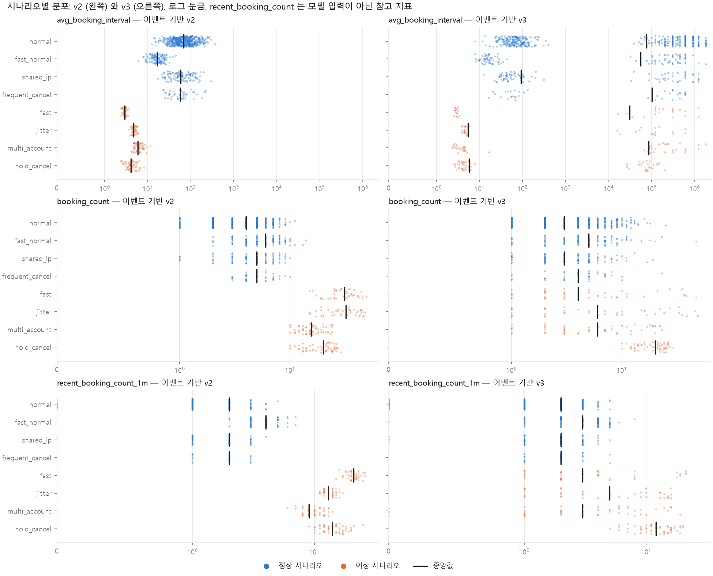
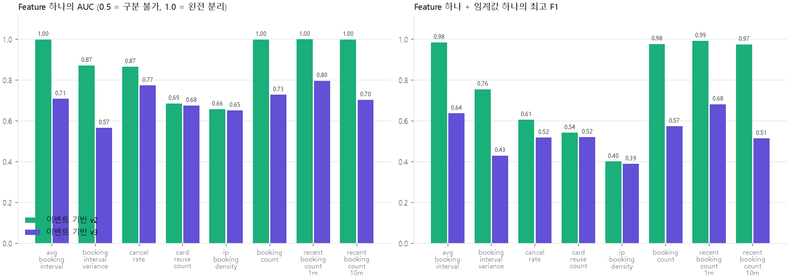
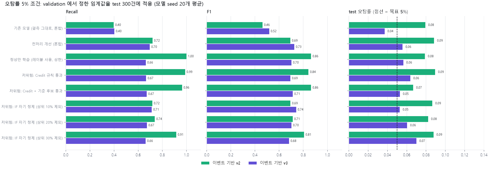
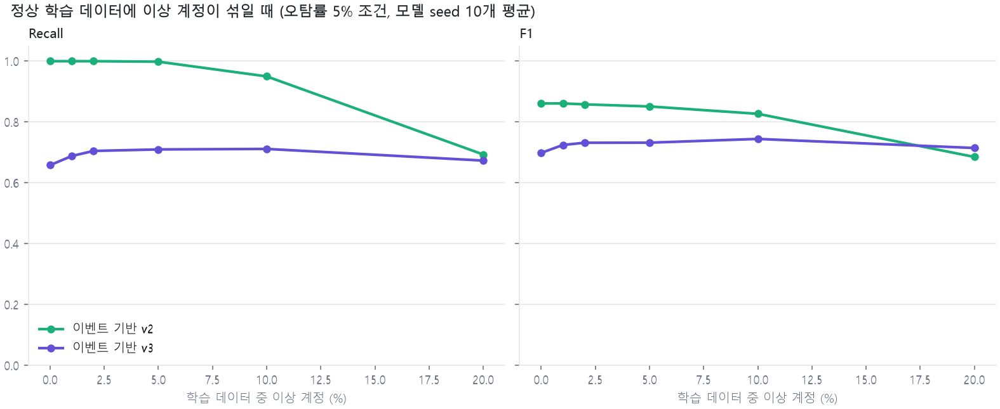
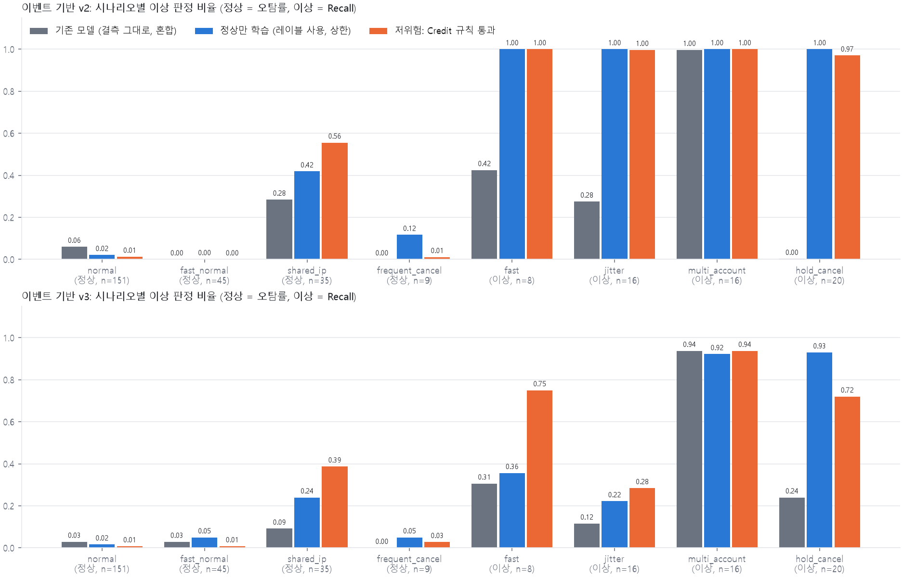
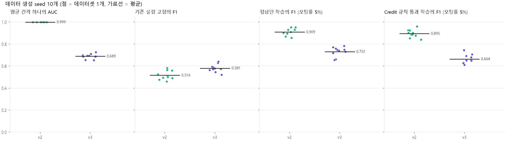
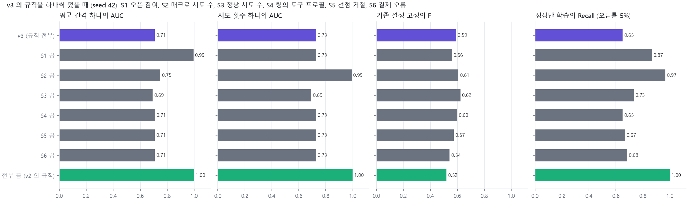

# 이벤트 기반 더미데이터 v3 (Issue #17 추가 보고서)

작성일 2026-11-23. v2 의 데이터·설정·보고서([`REPORT_V2.md`](REPORT_V2.md), [`REPORT_V2_TUNING.md`](REPORT_V2_TUNING.md), [`REPORT_V2_FPR.md`](REPORT_V2_FPR.md))는 그대로 두고, 이벤트 생성 규칙을 바꾼 v3 를 따로 만들었다.
모든 수치는 `output/v3/` 의 CSV 에서 가져왔다.

| | 경로 | sha256 |
|---|---|---|
| v2 | `data/v2/fairticket_event_based_features.csv` | `b39aa533…` (변경 없음) |
| v3 | `data/v3/fairticket_event_based_features.csv` | `fd28f6dc…` |

두 데이터셋은 같은 1,000계정, 같은 행 순서, 같은 시나리오, 같은 레이블(이상 19.9%)이다. Feature 6개의 정의와 추출 코드는 바꾸지 않았다.

## 요약

| 질문 | 답 |
|---|---|
| v2 에서 정상과 매크로가 왜 완전히 나뉘었나 | 생성 규칙 두 가지 때문이다. (1) 모든 계정이 티켓 오픈 1회에만 참여한다. (2) 매크로는 항상 10건 이상, 정상은 14건 이하로 시도한다. 그래서 평균 간격 하나(AUC 1.000), 시도 횟수 하나(0.999)로 두 집단이 나뉜다 |
| v3 에서 분포는 어떻게 됐나 | 겹침의 목표값 없이 행동 규칙만 바꿨고, 평균 간격 하나의 AUC 는 0.708, 시도 횟수는 0.728 이 됐다 (생성 seed 10개 평균 0.689, 0.743) |
| 탐지 성능은 | 오탐률 5% 조건에서 가장 좋았던 "정상만 학습"의 Recall 이 **1.00 → 0.66**, F1 이 **0.86 → 0.70** 이다. v2 의 결과는 분리된 분포 덕분이었다 |
| 정상 중심 학습은 여전히 유효한가 | **v3 에서는 이점이 없다.** 정상만 학습(Recall 0.66)과 혼합 학습(0.70)이 같은 수준이고, 학습 데이터의 이상 계정 비율을 0~20% 로 바꿔도 Recall 이 0.66~0.71 에서 움직이지 않는다 |
| 무엇이 성능을 낮췄나 | 오픈 참여 횟수(S1)와 매크로의 시도 수(S2)다. 둘 다 실측 근거가 없는 가정이다. 선점 거절·결제 오류·링의 도구 프로필은 결과를 거의 바꾸지 않았다 |

- v3 의 규칙 6개와 그 값은 모델 평가를 돌리기 전에 정했고, 분포의 겹침이나 평가 결과를 본 뒤에 바꾸지 않았다.
- v3 가 v2 보다 현실에 가깝다고 말할 근거는 없다. 달라진 것은 **"v2 의 깨끗한 분리가 가정 두 개에 달려 있었다"는 점이 드러났다**는 것이다. 어느 쪽이 실제에 가까운지는 7절의 데이터를 모아야 알 수 있다.
- 합성 데이터 안의 지표는 실제 사용자에 대한 탐지 성능이 아니다.

---

## 1. v2 분석: 왜 두 집단이 나뉘는가

### 1.1 단일 Feature 로 구분되는가

"최고 F1"은 그 Feature 하나에 임계값 하나를 둔 규칙의 값이다 (결측 계정은 이상 아님으로 셈, 전체 1,000계정). 출처: `distribution_comparison/separability.csv`

| Feature | 정상 [5%~95%] | 이상 [5%~95%] | AUC | 최고 F1 (임계값) | 오탐률 5% 이하에서의 Recall |
|---|---|---|---|---|---|
| `avg_booking_interval` | 54.4 [14.3~166] 초 | 4.59 [2.60~7.52] 초 | **1.000** | 0.985 (8.5초 미만) | 1.000 |
| `booking_count` | 4 [2~8] | 22 [12~44] | **0.999** | 0.977 (11건 이상) | 1.000 |
| `booking_interval_variance` | 82.4 [0~13,835] | 0.40 [0.05~2.25] | 0.872 | 0.755 | 0.000 |
| `cancel_rate` | 0 [0~0.67] | 0.39 [0.10~1.0] | 0.866 | 0.606 | 0.276 |
| `card_reuse_count` | 1 [1~1] | 1 [1~6] | 0.686 | 0.542 | 0.372 |
| `ip_booking_density` | 1 [1~5] | 2 [1~11] | 0.658 | 0.401 | 0.256 |
| (참고) `recent_booking_count` 1분 | 2 [1~4] | 13 [8~23] | 1.000 | 0.992 (7회 이상) | 1.000 |
| (참고) `recent_booking_count` 10분 | 4 [1~7] | 21 [11~44] | 0.999 | 0.975 (10회 이상) | 1.000 |

- **평균 간격 하나, 또는 시도 횟수 하나로 정상과 이상이 거의 완전히 나뉜다.** "간격 8.5초 미만"이라는 규칙 한 줄이 F1 0.985 다.
- `recent_booking_count` 는 모델의 6개 Feature 가 아니라 프론트 전용 Feature 다. v2 보고서와 같은 방식으로 이벤트에서 계산했다 (좌석 선점 요청이 가장 몰린 1분 / 10분 구간의 횟수). 모델의 6개 중 시도 횟수에 해당하는 것은 `booking_count` 이고, 두 값의 분리 양상은 같다.
- 이상 계정의 평균 간격은 정상의 5~95% 구간에 하나도 들지 않는다. 정상 801계정 중 이상의 범위(2.4~11.4초) 안에 든 것은 2.2% 다.

### 1.2 어떤 생성 규칙이 두 집단을 나누는가

출처: `distribution_comparison/generation_facts.csv`, `config/scenarios_v2.json`

| 규칙 (v2) | 정상 시나리오 | 이상 시나리오 | 결과 |
|---|---|---|---|
| 티켓 오픈 참여 횟수 | 모든 계정 1회 | 모든 계정 1회 | 평균 간격 = 한 번의 연속 예매 안의 간격. 며칠짜리 간격이 없다 |
| 시도 수 | 1 + Poisson(3~5): 1~14건 | randint: 10~49건 | 10건 이상인 정상은 801계정 중 11개, 10건 미만인 이상은 0개 |
| 시도 1건의 소요 시간 | 단계 중앙값의 합 약 57초 (`fast_normal` 16초) | 실측 2.4~5.9초, 가정 4~11초 | 계정 평균의 범위가 겹치지 않는다 (정상 최소 5.99초, 이상 최대 11.43초) |
| 예매 실패·재시도 | 없음 (이탈과 선점 만료만) | 없음 | 시도가 길어지거나 다시 시작되는 경우가 없다 |

- 평균 간격의 분리는 "오픈 1회" 와 "빠른 시도" 가 겹쳐서 생긴다. 계정이 오픈에 두 번 참여하면 30일 평균 간격에 며칠짜리 간격이 들어가는데, v2 에는 그런 계정이 없다.
- 시도 횟수의 분리는 두 분포의 범위를 처음부터 다르게 둔 결과다. 매크로의 15~50건은 기존 더미에서 물려받은 값이고 실측 근거가 아니다 (실측은 20회로 정해 놓고 돌렸다).
- 분산은 "시도 2건이면 0" 인 정상 계정 때문에, 취소율·카드·IP 는 일부 시나리오만 다르기 때문에 단독으로는 구분력이 낮다.

---

## 2. v3 의 생성 규칙

Feature 값은 고치지 않았다. 이벤트 생성 규칙 6개만 바꾸고(`config/scenarios_v3.json` 의 `changes_from_v2`), 기존 추출 코드로 Feature 를 다시 계산했다.
생성기는 `scripts/generate_events_v3.py` 이며 v1·v2 의 생성기(`generate_events.py`)를 수정하지 않고 import 한다.
계정 목록, IP 묶음, 카드 묶음, Fast/Jitter 의 실측 계정 배정은 v2 와 같다 (같은 seed).

| | 대상 | v2 | v3 |
|---|---|---|---|
| S1 | 전체 | 티켓 오픈 4회 중 1회 참여 | 1 + Binomial(3, q), q ~ Beta(1, 3). 평균 1.75회, 절반은 1회 |
| S2 | `fast`, `jitter`, `multi_account` | 시도 15~50건 / 10~25건 (균등) | 1~50건 / 1~25건 (로그 균등) |
| S3 | 정상 시나리오 4개 | 시도 1 + Poisson(lam) | 1 + Poisson(lam × 계정별 lognormal, 평균 1, 로그 표준편차 0.8) |
| S4 | `multi_account` | 가정한 단계 시간 (간격 4~11초) | 링마다 매크로 도구의 프로필 fast / jitter / human 중 하나 |
| S5 | 전체 | 선점 거절 없음 | 공연별 위험률 × 좌석을 고른 시간에 따라 `SEAT_HOLD/REJECTED` |
| S6 | 정상 시나리오 4개 | 결제 실패 없음 | 결제의 3% 에서 입력 오류, 그중 80% 는 다시 입력 |

`hold_cancel` 의 시도 수(10~30건)와 시간은 바꾸지 않았다. 이 시나리오는 정의가 "반복"이다.

### 2.1 실측 데이터 또는 코드로 뒷받침되는 규칙

| 규칙 | 근거 | 강도 |
|---|---|---|
| Fast/Jitter 의 시도 1건의 단계 시간과 다음 시도까지의 간격 | #16 실측 6계정 120건을 통째로 복원추출 (v2 와 같음, 값을 바꾸지 않음) | 실측 |
| Fast/Jitter 의 계정 간 속도 차이 (로그 표준편차 0.085) | #16 실측 계정 평균 6개 (v2 의 C1 그대로) | 실측 (표본 6개) |
| 가정 시나리오의 단계 시간 하한 | #16 실측 120건의 단계별 최솟값 (v2 의 C2 그대로) | 실측 |
| 선점 거절은 **같은 attemptId** 의 `SEAT_HOLD/REJECTED`, `reasonCode=SEAT_ALREADY_TAKEN`, holdId 없음 | `ReservationService.java`, `AttemptService.java`: 거절은 종료 상태가 아니고 같은 시도에서 다른 좌석을 다시 고른다 | 코드 |
| 매크로는 선점을 5번까지 요청하고, 모두 실패하면 그 실행을 멈춘다 | `macro/macro.js` (재시도 5회, `--continue-on-fail` 없으면 중단) | 코드 |
| 결제 실패는 `BOOKING_ATTEMPT` 이벤트를 남기지 않는다. 무작위 결제 실패는 없다 | `ReservationService.confirm`, `PaymentPage.tsx` | 코드 |
| 예매 1건에 최대 4석 → 적은 시도로 목적을 이루는 매크로가 가능하다 | `MAX_SEATS = 4`, `macro.js --seats` | 코드 (시도 수의 하한 1 의 근거) |
| 매크로 도구에 지연이 다른 프로필이 세 개 있다 (fast / jitter / human) | `macro.js` 의 프로필 표 | 코드 |
| human 프로필의 시도 1건의 단계 시간 (좌석 선택 2.2~4.7초, 선점~예매 7.0~10.8초, 합 9.4~14.9초) | #14 실측 1계정 20건 (`reference/macro_human_attempt_cycles.csv`) | 약한 실측: 계정 1개, #16 의 사이트 수정 전 |
| 30일 창 안의 모든 시도가 간격 계산에 들어간다. 실패·이탈·거절만 있는 시도도 시도 수에 센다 | `FeatureAggregationService.java`: 단계·상태로 거르지 않는다 | 코드 |

### 2.2 가정에 기반한 규칙

아래 값은 실측 근거가 없다. 이유를 적었지만 다른 값도 똑같이 가능하다.

| 규칙 | 값 | 이렇게 둔 이유 |
|---|---|---|
| S1 오픈 참여 횟수의 분포 | 1 + Binomial(3, q), q ~ Beta(1, 3) | 참여 횟수의 자료가 없어 **정상과 이상에 같은 분포**를 썼다. 절반은 1회, 나머지는 2~4회 |
| S2 매크로 시도 수의 분포 | 로그 균등 1~50 (다계정 1~25) | 상한은 v2 의 값, 하한은 코드. 그 사이는 근거가 없어 규모에 대해 고르게 뒀다 |
| S3 정상 사용자 시도 수의 계정 간 편차 | 로그 표준편차 0.8 (평균은 v2 와 같음) | 한두 번만 시도하는 사용자와 여러 번 다시 들어오는 사용자(여러 회차·동행 예매, 취소표 확인)가 섞인다고 봤다 |
| S4 링이 고르는 프로필의 비중 | 세 프로필 같은 비중 | 어느 프로필이 많이 쓰이는지 모른다 |
| S4 human 프로필의 다음 시도까지의 대기 | 실측 Fast 대기 1건 + pause(0.9~2.6초) 3번 | #14 는 시도마다 프로세스를 새로 띄워 대기를 잴 수 없었다. #16 에서 Jitter 와 Fast 의 대기 차이가 pause 평균 차이의 약 3배였던 것을 옮겼다 |
| S5 공연별 선점 거절 위험률 | 초당 0.03 / 0.01 / 0.003 / 0.001 | 매진급부터 한산한 공연까지. 좌석을 20초 고르면 거절 확률 45% / 18% / 6% / 2%, 0.5초면 1.5% 이하 |
| S5 사람이 다시 고르는 시간과 한도 | 처음의 0.3~0.7배, 한 시도에 1 + Poisson(2) 번까지 | |
| S6 결제 입력 오류 | 3%, 80% 는 다시 입력 | 사람만 해당. 매크로는 실측에서 모두 결제에 성공했다 |
| v2 에서 그대로 온 가정 | 정상 사용자의 단계 시간·이탈 확률·취소 성향, `hold_cancel` 의 결제 비율, 공유 묶음의 크기 | `REPORT_V2.md` 8절 |

**하지 않은 것**

- 정상과 이상이 겹치는 비율을 목표로 두지 않았다. 겹침은 규칙을 적용한 결과로만 봤다.
- 규칙의 값을 평가 결과를 보고 고치지 않았다. 5.5절의 "규칙 끄기"는 어떤 가정이 결과를 좌우하는지 확인하는 용도이고, 그 결과로 v3 를 다시 만들지 않았다.
- 좌석 재고를 계정들이 실제로 나눠 갖는 경쟁은 만들지 않았다. 거절은 위험률로만 표현했다.

---

## 3. v3 생성 결과와 일관성 검증

| | v2 | v3 |
|---|---|---|
| 이벤트 | 55,424 | 38,817 |
| 시도 | 8,322 | 5,939 |
| 완료 예매 / 취소 | 6,678 / 1,596 | 4,235 / 936 |
| 오픈 1 / 2 / 3 / 4회 참여 계정 | 1,000 / 0 / 0 / 0 | 568 / 292 / 113 / 27 |
| 선점 거절 | 0 | 612건 (시도 479건). 그중 115건은 선점 없이 끝남 |
| 결제 입력 오류 | 0 | 71건 |
| 다계정 링의 프로필 | — | fast 3, jitter 3, human 1 (링 7개) |
| 모델 입력에 결측이 있는 계정 | 46 (이상 6) | 156 (이상 27) |

v3 에서 결측이 늘어난 것은 시도가 1건인 계정이 134개(정상 115, 이상 19)로 늘었기 때문이다.

**검증** (모두 통과)

| 항목 | 결과 | 출처 |
|---|---|---|
| 추출기와 다른 방식으로 6개 Feature 를 다시 계산해 대조 | 전 계정 일치 | `output/feature_extraction/v3/validation.json` |
| 시도 수·완료 예매·취소 건수가 생성 기록과 일치 | 전 계정 일치 | 위와 같음 |
| 카드·IP 공유 수가 생성한 공유 묶음과 일치 | 전 계정 일치 | 위와 같음 |
| BTS 계산식과 추출기의 일치 테스트 (#14) | 10개 통과 | 위와 같음 |
| 같은 seed 로 다시 만들면 파일이 바이트 단위로 같음 | 통과 | `tests/test_v3_dataset.py` |
| 단계 순서, 예매 뒤 취소, 한 번에 한 시도, 공유 관계 (v1 의 테스트 함수 그대로) | 통과 | 위와 같음 |
| 거절은 같은 시도 안에만 있고 시도 수를 늘리지 않음, 매크로는 5번 이하 | 통과 | 위와 같음 |
| Fast/Jitter 의 시간이 실측 시도를 같은 비율로 조정한 값임 | 통과 | 위와 같음 |
| v1·v2 의 설정·이벤트·데이터셋·참조 파일의 해시가 그대로임 | 통과 | 위와 같음 |
| 생성 설정과 생성기에 Feature 이름이 없음 | 통과 | 위와 같음 |

| 수학적 관계 검사 (`consistency_checks.csv`) | v2 | v3 |
|---|---|---|
| 시도 1건 이하인데 간격 값이 있음 | 0 / 35 | 0 / 134 |
| 시도 2건인데 분산이 0 이 아님 | 0 / 82 | 0 / 174 |
| 분산이 수학적 상한(m²·(n−1))을 넘음 | 0 / 965 | 0 / 866 |
| 취소율이 정수 비로 나올 수 없는 값 | 0 / 979 | 0 / 943 |
| 좌석 선택 시간(계정 평균) > 평균 예매 간격 | 0 / 964 | 2 / 857 |

마지막 항목의 2건은 위반이 아니다. 시도가 2건인 계정에서 첫 시도는 짧고 둘째 시도의 좌석 선택이 길었던 경우다 (둘째 시도에서 선점이 거절돼 다시 고르거나, 첫 시도를 바로 이탈).
좌석 선택 시간은 선점에 성공한 시도의 평균이고 간격은 시도 시작 사이의 평균이라, 계정 평균끼리는 뒤집힐 수 있다. 시도마다의 순서(다음 시도는 이전 시도를 떠난 뒤 시작)는 테스트로 확인했다.

v3 의 규칙을 모두 끄면 v2 로 돌아간다: 이벤트 수가 같고(55,424), Feature 는 Fast/Jitter 계정의 간격에서 반올림 차이(평균 0.01초 이하, 분산 0.0005 이하)만 난다.

---

## 4. v2 대비 데이터 특성

### 4.1 분포

`중앙값 [5%~95%]`. 출처: `distribution_comparison/feature_stats.csv`

| Feature | v2 정상 | v2 이상 | v3 정상 | v3 이상 |
|---|---|---|---|---|
| `avg_booking_interval` (초) | 54.4 [14.3~166] | 4.59 [2.60~7.52] | 37,814 [16.5~1,209,480] | 6.10 [2.70~604,798] |
| `booking_count` | 4 [2~8] | 22 [12~44] | 3 [1~11] | 10 [1~33] |
| `booking_interval_variance` | 82.4 [0~13,835] | 0.40 [0.05~2.25] | 412 [0~3.7×10¹¹] | 1.19 [0~2.1×10¹¹] |
| `cancel_rate` | 0 [0~0.67] | 0.39 [0.10~1.0] | 0 [0~0.75] | 0.40 [0~1.0] |
| `card_reuse_count` | 1 [1~1] | 1 [1~6] | 1 [1~1] | 1 [1~5] |
| `ip_booking_density` | 1 [1~5] | 2 [1~11] | 1 [1~5] | 2 [1~9] |



v3 의 평균 간격은 오픈 참여 횟수에 따라 두 덩어리로 갈린다. 출처: `v3_interval_by_open_participation.csv`

| | 계정 | 간격 결측 | 평균 간격 중앙값 [5%~95%] | 시도 수 중앙값 |
|---|---|---|---|---|
| 정상, 오픈 1회 | 455 | 115 | 52.8초 [13.1~160] | 3 |
| 이상, 오픈 1회 | 113 | 19 | 3.95초 [2.61~5.91] | 9 |
| 정상, 오픈 2회 이상 | 346 | 0 | 403,237초 [75,621~1,209,761] | 4 |
| 이상, 오픈 2회 이상 | 86 | 0 | 120,961초 [26,297~1,058,394] | 10.5 |

- **오픈에 한 번만 참여한 계정에서는 v2 와 마찬가지로 정상과 매크로의 간격이 나뉜다.** 두 번 이상 참여한 계정(전체의 43%)은 평균 간격이 며칠 단위가 되어 정상과 매크로가 같은 구간에 들어간다.
- 이것은 가정한 값의 문제가 아니라 **Feature 정의의 성질**이다. BTS 의 `avg_booking_interval` 은 30일 창의 모든 시도 간격을 평균하므로, 매크로가 3초 간격으로 20번 시도했어도 일주일 뒤에 한 번 더 들어오면 평균이 3만 초가 된다.

### 4.2 중첩 (단일 Feature)

| Feature | AUC v2 → v3 | 최고 F1 v2 → v3 | 오탐률 5% 이하 Recall v2 → v3 | 정상 5~95% 구간 안의 이상 계정 v2 → v3 |
|---|---|---|---|---|
| `avg_booking_interval` | 1.000 → **0.708** | 0.985 → 0.637 | 1.000 → 0.472 | 0% → 45% |
| `booking_count` | 0.999 → **0.728** | 0.977 → 0.574 | 1.000 → 0.452 | 0% → 55% |
| `booking_interval_variance` | 0.872 → 0.566 | 0.755 → 0.430 | 0.000 → 0.000 | 100% → 99% |
| `cancel_rate` | 0.866 → 0.774 | 0.606 → 0.518 | 0.276 → 0.296 | 72% → 69% |
| `card_reuse_count` | 0.686 → 0.676 | 0.542 → 0.520 | 0.372 → 0.352 | 63% → 65% |
| `ip_booking_density` | 0.658 → 0.651 | 0.401 → 0.389 | 0.256 → 0.211 | 74% → 79% |
| (참고) `recent_booking_count` 1분 | 1.000 → 0.797 | 0.992 → 0.682 | 1.000 → 0.563 | 0% → 42% |
| (참고) `recent_booking_count` 10분 | 0.999 → 0.703 | 0.975 → 0.514 | 1.000 → 0.372 | 0% → 61% |



| 이상 시나리오별 AUC | 평균 간격 v2 → v3 | 시도 횟수 v2 → v3 |
|---|---|---|
| fast | 1.000 → 0.640 | 1.000 → 0.578 |
| jitter | 1.000 → 0.754 | 1.000 → 0.641 |
| multi_account | 0.998 → 0.643 | 0.999 → 0.652 |
| hold_cancel | 1.000 → 0.783 | 0.999 → 0.989 |

- 단일 Feature 로 두 집단을 나누는 규칙은 v3 에서 없다. 가장 높은 것이 "간격 7.75초 미만"의 F1 0.637 이다 (Precision 1.00, Recall 0.47: 오픈 1회·2건 이상 시도한 매크로만 잡는다).
- `hold_cancel` 의 시도 횟수는 v3 에서도 거의 완전히 나뉜다 (AUC 0.989). 시도 수를 바꾸지 않았기 때문이다.
- 데이터 생성 seed 10개에서 v3 의 AUC 는 평균 간격 0.689 ± 0.022, 시도 횟수 0.743 ± 0.018 이다 (v2 는 둘 다 0.999).
- 출처: `separability.csv`, `model_evaluation/generation_seed_summary.csv`

### 4.3 실측과의 유사성

v3 는 계정이 여러 오픈에 참여하므로 30일 평균 간격을 실측(한 번의 연속 실행)과 직접 비교할 수 없다. **같은 오픈 안의 연속 시도 간격**으로 비교했다.
계정 평균은 오픈 안 간격이 5개 이상인 계정만 썼다 (실측은 계정당 19개). 출처: `macro_vs_measured.csv`, `leave_one_account_out.csv`

| 유형 | 값 | 데이터 | 계정(간격) 수 | 평균 | 표준편차 | 범위 | Wasserstein 거리 |
|---|---|---|---|---|---|---|---|
| Fast | 계정 평균 (초) | 실측 | 3 | 2.936 | 0.256 | 2.644~3.123 | — |
| | | v2 | 44 | 2.899 | 0.269 | 2.398~3.573 | 0.123 |
| | | v3 | 15 | 3.046 | 0.254 | 2.735~3.581 | 0.161 |
| | 개별 간격 (초) | 실측 | 57 | 2.936 | 0.383 | 2.354~4.470 | — |
| | | v2 | 1,305 | 2.904 | 0.392 | 2.163~4.857 | 0.053 |
| | | v3 | 335 | 3.056 | 0.389 | 2.461~4.774 | 0.125 |
| Jitter | 계정 평균 (초) | 실측 | 3 | 4.737 | 0.382 | 4.339~5.102 | — |
| | | v2 | 43 | 4.784 | 0.506 | 3.691~5.857 | 0.201 |
| | | v3 | 21 | 4.573 | 0.457 | 3.827~5.346 | 0.219 |
| | 개별 간격 (초) | 실측 | 57 | 4.737 | 0.491 | 3.909~6.321 | — |
| | | v2 | 1,326 | 4.778 | 0.640 | 3.239~6.930 | 0.126 |
| | | v3 | 486 | 4.537 | 0.558 | 3.150~6.558 | 0.210 |

| Leave-One-Account-Out: 숨긴 실측 계정의 평균이 합성 계정 안에 든 수 (6개 중) | v2 방식 | v3 방식 |
|---|---|---|
| 범위(최소~최대) 안 | 5 | 5 |
| 가운데 90% 안 | 3 | 4 |

- **오픈 안의 간격은 v3 에서도 실측 범위에 있다** (평균 차이 Fast +0.11초, Jitter −0.16초). 시도 1건의 시간은 v2 와 같은 실측 시도에서 오기 때문이다.
- **실측과의 거리는 v3 가 조금 더 크다** (Fast 0.123 → 0.161초, Jitter 0.201 → 0.219초). 규칙이 바뀌어서가 아니라 표본이 줄어서다: v3 에서 오픈 안 간격이 5개 이상인 매크로 계정은 87개 중 36개뿐이다. 계정 수준을 계정마다 뽑으므로 계정 수가 적으면 평균이 흔들린다.
- Leave-One-Account-Out 은 v2 와 같은 수준이다. 숨긴 계정 6개 중 5개가 범위 안이고, 벗어난 하나(`macro-fast-02`)는 0.055초 밖이다.
- **근거가 약한 실측** (`weak_measured_position.csv`): #14 의 사람 2계정의 평균 간격 58.9초와 10.5초는 v3 정상 계정의 오픈 안 평균 간격(7.9~560초)에서 각각 55%, 2% 위치다 (v2 와 같다). human 프로필 링 11계정의 오픈 안 평균 간격은 13.3~18.9초이고, 실측한 시도 1건의 소요 시간(대기 제외)은 중앙값 12.8초다.
- **실측으로 확인할 수 없는 것**: 오픈 참여 횟수, 시도 수, 선점 거절, 결제 오류. v3 의 겹침을 만든 규칙(S1, S2)은 모두 여기에 속한다. 4.2절의 겹침이 실제와 비슷한지는 이 데이터로는 판단할 수 없다.

---

## 5. 탐지 성능

조건은 기존 실험과 같다: Feature 6개, 트리 100개, 같은 test 300건(이상 60). 두 데이터셋은 계정과 레이블이 같아 같은 분할을 쓴다. 스크립트는 `scripts/evaluate_v3.py` 다.

### 5.1 기존 설정 고정 (결측 그대로, contamination 0.20, 700건 학습)

| | Precision | Recall | F1 | 오탐률 | ROC-AUC |
|---|---|---|---|---|---|
| v2, 모델 seed 42 | 0.493 | 0.550 | 0.520 | 0.142 | 0.882 |
| v3, 모델 seed 42 | 0.581 | 0.600 | 0.590 | 0.108 | 0.824 |
| v2, 분할 seed 20개 | 0.497 | 0.491 | 0.493 ± 0.038 | 0.126 | 0.872 |
| v3, 분할 seed 20개 | 0.521 | 0.532 | 0.525 ± 0.048 | 0.123 | 0.795 |
| v2, 생성 seed 10개 | 0.541 | 0.497 | 0.516 ± 0.040 | 0.106 | 0.889 ± 0.012 |
| v3, 생성 seed 10개 | 0.589 | 0.577 | 0.581 ± 0.036 | 0.101 | 0.852 ± 0.018 |

- **ROC-AUC 는 내려갔다 (0.88 → 0.82~0.85).** 점수가 두 집단을 나누는 정도는 v3 에서 더 낮다.
- **F1 은 조금 올랐다 (0.52 → 0.53~0.59).** 기존 설정은 v2 에서도 분리된 분포를 활용하지 못하고 있었기 때문에(`REPORT_V2_TUNING.md` 2절) 분포가 겹쳐도 잃을 것이 적다. contamination 0.20 한 점에서의 값이고, seed 흔들림(0.04~0.05)과 비슷한 크기의 차이다.
- 출처: `fixed_setting_summary.csv`, `split_seed_summary.csv`, `generation_seed_summary.csv`

### 5.2 오탐률 5% 조건

`REPORT_V2_FPR.md` 와 같은 절차다: train 490 / validation 210 / test 300, 임계값은 validation 정상 계정의 오탐률이 5% 이하가 되는 가장 낮은 점수, test 에는 그대로 적용.
모델 seed 20개 평균. 출처: `fpr5_summary.csv`

| 설정 | 데이터 | Precision | Recall | F1 | ROC-AUC | test 오탐률 |
|---|---|---|---|---|---|---|
| 기존 모델 (결측 그대로, 혼합 학습) | v2 | 0.556 | 0.397 | 0.462 | 0.879 | 0.079 |
| | v3 | 0.732 | 0.402 | 0.517 | 0.835 | 0.037 |
| 전처리 개선 (중앙값 + log1p, 혼합 학습) | v2 | 0.672 | 0.718 | 0.693 | 0.932 | 0.088 |
| | v3 | 0.759 | 0.696 | 0.725 | 0.898 | 0.056 |
| **정상만 학습 (레이블 사용, 성능 상한)** | v2 | 0.762 | **1.000** | **0.864** | 0.996 | 0.079 |
| | v3 | 0.747 | **0.662** | **0.702** | 0.894 | 0.056 |



- **v2 에서 Recall 1.00 이던 정상만 학습이 v3 에서는 0.66 이다.** v2 의 결과는 "정상의 범위를 벗어나면 이상"이 성립하는 분포에서 나온 것이었다. v3 에서는 이상 계정의 절반 가까이가 정상의 범위 안에 있다.
- **v3 에서는 정상만 학습(0.66)이 혼합 학습(0.70)보다 낫지 않다.** 차이는 seed 표준편차(0.02) 수준이다.
- 전처리(중앙값 + log1p)의 효과는 v3 에서도 남는다 (Recall 0.40 → 0.70).
- test 오탐률은 v3 에서 0.04~0.06 이다. 5% 를 넘는 경우가 있다는 점은 v2 와 같다 (5.4절).

### 5.3 정상 중심 학습

**정상 레이블을 알고 학습하는 방식은 성능 상한이다.** 실제 BTS 에는 레이블이 없으므로, 레이블 없이 저위험 계정을 고르는 방법을 같이 비교했다.

| 학습 데이터를 고르는 방법 | 레이블 | 내용 |
|---|---|---|
| 정상만 | 사용 | 정상 시나리오 4개의 계정만. 상한 |
| Credit 규칙 통과 | 미사용 | 기존 Credit 규칙 중 6개 Feature 로 계산되는 3개에 걸리지 않은 계정: 분산 1.0초² 미만이면서 시도 5건 이상 / 카드 공유 4계정 이상 / IP 공유 5계정 이상 |
| Credit + 기준 후보 통과 | 미사용 | 위에 더해 평균 간격 10초 미만, 취소율 50% 이상인 계정도 제외 |
| IF 자기 정제 | 미사용 | 혼합 데이터로 한 번 학습해 점수 상위 10 / 20 / 30% 를 빼고 다시 학습 |

모델 seed 20개 평균, 전처리는 모두 중앙값 + log1p. "남은 이상"은 학습 데이터 중 이상 계정의 비율, "걸러낸 이상"은 train 의 이상 97계정 중 제외된 비율, "남긴 정상"은 train 의 정상 393계정 중 남은 비율이다.

| 방법 | 데이터 | 학습 건수 | 남은 이상 | 걸러낸 이상 | 남긴 정상 | Precision | Recall | F1 | ROC-AUC | test 오탐률 |
|---|---|---|---|---|---|---|---|---|---|---|
| 혼합 (선별 없음) | v2 | 490 | 19.8% | 0% | 100% | 0.672 | 0.718 | 0.693 | 0.932 | 0.088 |
| | v3 | 490 | 19.8% | 0% | 100% | 0.759 | 0.696 | 0.725 | 0.898 | 0.056 |
| 정상만 (상한) | v2 | 393 | 0% | 100% | 100% | 0.762 | 1.000 | 0.864 | 0.996 | 0.079 |
| | v3 | 393 | 0% | 100% | 100% | 0.747 | 0.662 | 0.702 | 0.894 | 0.056 |
| Credit 규칙 통과 | v2 | 371 | 3.8% | 86% | 91% | 0.735 | 0.989 | 0.843 | 0.990 | 0.089 |
| | v3 | 422 | 13.0% | 43% | 93% | 0.724 | 0.666 | 0.693 | 0.900 | 0.064 |
| Credit + 기준 후보 통과 | v2 | 313 | 0.0% | 100% | 80% | 0.784 | 0.963 | 0.864 | 0.989 | 0.067 |
| | v3 | 343 | 7.9% | 72% | 80% | 0.761 | 0.671 | 0.713 | 0.888 | 0.053 |
| IF 자기 정제 10% | v2 | 441 | 14.3% | 35% | 96% | 0.675 | 0.717 | 0.694 | 0.939 | 0.086 |
| | v3 | 441 | 12.1% | 45% | 99% | 0.773 | 0.712 | 0.741 | 0.904 | 0.053 |
| IF 자기 정제 20% | v2 | 392 | 9.3% | 63% | 91% | 0.692 | 0.738 | 0.712 | 0.950 | 0.082 |
| | v3 | 393 | 7.6% | 69% | 92% | 0.737 | 0.672 | 0.702 | 0.891 | 0.060 |
| IF 자기 정제 30% | v2 | 343 | 4.7% | 84% | 83% | 0.722 | 0.915 | 0.806 | 0.971 | 0.088 |
| | v3 | 343 | 5.8% | 80% | 82% | 0.705 | 0.662 | 0.682 | 0.880 | 0.070 |

**학습 데이터에 이상 계정이 섞이는 비율** (정상 393건에 train 의 이상 계정을 섞음, 모델 seed 10개 평균). 출처: `training_purity.csv`

| 학습 데이터 중 이상 계정 | v2 Recall | v2 F1 | v3 Recall | v3 F1 | v3 ROC-AUC |
|---|---|---|---|---|---|
| 0% | 1.000 | 0.861 | 0.658 | 0.699 | 0.894 |
| 1% | 1.000 | 0.861 | 0.688 | 0.725 | 0.907 |
| 2% | 1.000 | 0.858 | 0.705 | 0.732 | 0.910 |
| 5% | 0.998 | 0.851 | 0.710 | 0.732 | 0.914 |
| 10% | 0.950 | 0.827 | 0.712 | 0.745 | 0.910 |
| 20% (= 혼합) | 0.693 | 0.685 | 0.673 | 0.715 | 0.896 |



- **v2: 저위험 선별이 잘 된다.** Credit 규칙 3개만으로 이상 계정의 86% 가 걸러지고(남은 이상 3.8%), 그 데이터로 학습한 모델은 상한에 가깝다 (Recall 0.99). v2 에서는 이상 계정이 5% 이하로 남으면 결과가 유지된다.
- **v3: 선별의 효과가 없다.** 어떤 방법으로 골라도 Recall 0.66~0.71, F1 0.68~0.74 로 선별하지 않은 혼합 학습과 같다. 이상 계정의 비율을 0% 에서 20% 로 바꿔도 결과가 움직이지 않는다.
- 이유는 두 가지다.
  - v3 의 Credit 규칙은 이상 계정의 43% 만 거른다. "분산이 작고 시도 5건 이상" 은 오픈 1회에 여러 번 시도한 매크로만 잡는다. 오픈에 두 번 이상 참여한 매크로는 분산이 매우 크고, 시도가 적은 매크로는 5건 조건에 걸리지 않는다.
  - 걸러내더라도 소용이 없다. 놓치는 이상 계정은 정상과 같은 Feature 값을 가진 계정이라, 학습 데이터에서 그런 계정을 빼도 모델이 보는 "정상의 범위"는 달라지지 않는다. 상한(정상만 학습)이 이미 0.66 이다.
- **BTS 에서 쓸 수 있는 저위험 계정 선별 방식에 대한 판단**
  - Credit 규칙 통과 계정으로 학습하는 방법은 구현하기 쉽고(레이블 불필요, 이미 있는 규칙), v2 같은 분포라면 효과가 크다. 다만 그 효과는 "Credit 규칙이 이상 계정의 대부분을 잡는다"는 전제에 달려 있고, v3 에서는 그 전제가 성립하지 않는다.
  - IF 자기 정제는 규칙이 필요 없지만 v2 에서도 30% 를 빼야 효과가 났다. 얼마나 뺄지 정할 근거가 없다.
  - 이 실험이 보여 주는 것은 "어느 선별 방법이 좋은가" 보다 **"선별이 의미가 있으려면 이상 계정이 6개 Feature 에서 정상과 달라야 한다"** 는 점이다. 그 여부는 실제 데이터로 확인해야 한다 (7절).

### 5.4 시나리오별 오탐·미탐

오탐률 5% 조건, test 300건, 모델 seed 20개 평균. 정상 시나리오는 오탐률, 이상 시나리오는 Recall. 출처: `fpr5_summary.csv`

| 시나리오 (test 수) | v2 기존 모델 | v2 정상만 | v3 기존 모델 | v3 전처리 개선 (혼합) | v3 정상만 | v3 Credit 통과 |
|---|---|---|---|---|---|---|
| normal (151) | 0.06 | 0.02 | 0.03 | 0.02 | 0.02 | 0.01 |
| fast_normal (45) | 0.00 | 0.00 | 0.03 | 0.04 | 0.05 | 0.01 |
| shared_ip (35) | 0.28 | 0.42 | 0.09 | 0.21 | 0.24 | 0.39 |
| frequent_cancel (9) | 0.00 | 0.12 | 0.00 | 0.16 | 0.05 | 0.03 |
| fast (8) | 0.42 | 1.00 | 0.31 | 0.64 | **0.36** | 0.75 |
| jitter (16) | 0.28 | 1.00 | 0.12 | 0.24 | **0.22** | 0.28 |
| multi_account (16) | 1.00 | 1.00 | 0.94 | 0.94 | 0.92 | 0.94 |
| hold_cancel (20) | 0.00 | 1.00 | 0.24 | 0.89 | 0.93 | 0.72 |



v3 의 test 계정을 시나리오가 아닌 특성으로 나눈 값 (모델 seed 10개 평균). 출처: `v3_error_by_trait.csv`

| 이상 계정 (Recall) | test 수 | 기존 모델 | 전처리 개선 (혼합) | 정상만 |
|---|---|---|---|---|
| 시도 1건 | 6 | 0.50 | 0.50 | 0.50 |
| 시도 2~4건 | 12 | 0.54 | 0.53 | 0.50 |
| 시도 5~9건 | 10 | 0.41 | 0.76 | 0.40 |
| 시도 10건 이상 | 32 | 0.34 | 0.78 | 0.83 |
| 오픈 1회 참여 | 33 | 0.30 | 0.64 | 0.65 |
| 오픈 2회 이상 참여 | 27 | 0.54 | 0.77 | 0.66 |
| 도구 프로필 fast | 17 | 0.62 | 0.78 | 0.62 |
| 도구 프로필 jitter | 20 | 0.30 | 0.39 | 0.38 |
| 도구 프로필 human | 3 | 1.00 | 1.00 | 1.00 |
| 도구 아님 (`hold_cancel`) | 20 | 0.26 | 0.89 | 0.92 |

| 정상 계정 (오탐률) | test 수 | 기존 모델 | 전처리 개선 (혼합) | 정상만 |
|---|---|---|---|---|
| 시도 1건 | 32 | 0.01 | 0.04 | 0.04 |
| 시도 2~4건 | 117 | 0.06 | 0.06 | 0.05 |
| 시도 5~9건 | 71 | 0.03 | 0.02 | 0.03 |
| 시도 10건 이상 | 20 | 0.00 | 0.17 | 0.26 |
| 오픈 1회 참여 | 141 | 0.00 | 0.06 | 0.04 |
| 오픈 2회 이상 참여 | 99 | 0.09 | 0.06 | 0.07 |

- **미탐: `fast` 와 `jitter`.** v2 에서 가장 잘 잡히던 두 시나리오가 v3 에서 가장 안 잡힌다 (정상만 학습 0.36, 0.22). 시도가 적은 매크로(9건 이하의 Recall 0.4~0.5)는 정상 사용자와 시도 수가 같고, 오픈에 여러 번 참여한 매크로는 간격과 분산이 정상과 같다.
- **잡히는 것: `multi_account` 와 `hold_cancel`.** 다계정은 카드·IP 공유 수로(0.92~0.94), 선점 반복은 높은 취소율과 많은 시도 수로(0.89~0.93) 드러난다. 이 두 시나리오는 간격이나 시도 수가 겹쳐도 다른 Feature 가 남아 있다. human 프로필 링 3계정이 모두 잡히는 것도 느린 간격 때문이 아니라 링의 카드·IP 공유 때문이다.
- **오탐: 시도가 많은 정상 사용자.** 시도 10건 이상인 정상 계정의 오탐률이 0.17~0.26 이다 (v3 에서 새로 생긴 계정들). `shared_ip` 의 오탐(0.21~0.39)은 v2 와 같은 원인이다.
- 시도가 1건인 이상 계정 6개 중 절반이 잡히는 것은 간격이 아니라 IP·카드 공유 때문이다 (간격·분산·취소율이 결측이거나 정의되지 않는다).

### 5.5 seed 와 규칙별 영향

**분할 seed 20개** (분할마다 임계값을 다시 정함, 모델 seed 42). 출처: `split_seed_summary.csv`

| 설정 | 데이터 | Precision | Recall | F1 | ROC-AUC | test 오탐률 | 5% 이하인 분할 |
|---|---|---|---|---|---|---|---|
| 기존 모델 | v2 | 0.683 | 0.377 | 0.479 ± 0.050 | 0.877 | 0.048 ± 0.024 | 13 / 20 |
| | v3 | 0.649 | 0.414 | 0.501 ± 0.047 | 0.795 | 0.059 ± 0.023 | 10 / 20 |
| 전처리 개선 (혼합) | v2 | 0.719 | 0.505 | 0.586 ± 0.071 | 0.935 | 0.051 ± 0.019 | 10 / 20 |
| | v3 | 0.770 | 0.621 | 0.683 ± 0.063 | 0.884 | 0.049 ± 0.025 | 13 / 20 |
| 정상만 (상한) | v2 | 0.845 | 0.997 | 0.914 ± 0.035 | 0.997 | 0.047 ± 0.021 | 11 / 20 |
| | v3 | 0.755 | 0.634 | 0.687 ± 0.041 | 0.877 | 0.054 ± 0.022 | 11 / 20 |
| Credit 규칙 통과 | v2 | 0.830 | 0.978 | 0.897 ± 0.032 | 0.990 | 0.051 ± 0.017 | 10 / 20 |
| | v3 | 0.742 | 0.612 | 0.663 ± 0.057 | 0.887 | 0.058 ± 0.031 | 10 / 20 |
| IF 자기 정제 20% | v2 | 0.764 | 0.631 | 0.685 ± 0.042 | 0.955 | 0.052 ± 0.026 | 11 / 20 |
| | v3 | 0.761 | 0.618 | 0.680 ± 0.041 | 0.878 | 0.051 ± 0.022 | 11 / 20 |

**데이터 생성 seed 10개** (데이터셋마다 같은 절차, 모델 seed 42). 출처: `generation_seed_summary.csv`

| 설정 | 데이터 | Recall | F1 (평균 ± 표준편차, 범위) | ROC-AUC | test 오탐률 |
|---|---|---|---|---|---|
| 기존 모델 | v2 | 0.330 | 0.435 ± 0.066 (0.338~0.526) | 0.885 | 0.043 |
| | v3 | 0.428 | 0.533 ± 0.063 (0.437~0.661) | 0.854 | 0.042 |
| 전처리 개선 (혼합) | v2 | 0.523 | 0.599 ± 0.107 (0.415~0.768) | 0.939 | 0.050 |
| | v3 | 0.670 | 0.708 ± 0.056 (0.630~0.800) | 0.916 | 0.054 |
| 정상만 (상한) | v2 | 1.000 | 0.909 ± 0.032 (0.857~0.952) | 0.997 | 0.050 |
| | v3 | 0.702 | 0.732 ± 0.043 (0.655~0.784) | 0.912 | 0.053 |
| Credit 규칙 통과 | v2 | 0.975 | 0.895 ± 0.036 (0.840~0.960) | — | 0.051 |
| | v3 | 0.610 | 0.664 ± 0.041 (0.611~0.745) | 0.907 | 0.056 |
| IF 자기 정제 20% | v3 | 0.682 | 0.706 ± 0.049 (0.621~0.787) | 0.915 | 0.060 |



- **결론은 seed 에 따라 바뀌지 않는다.** 정상만 학습의 F1 은 v2 0.91, v3 0.69~0.73 이고 두 범위는 겹치지 않는다. v3 에서 정상만 학습·혼합 학습·저위험 선별의 차이는 어느 seed 축에서도 표준편차 안이다.
- 생성 seed 를 바꾸면 v3 의 데이터셋마다 F1 이 0.04~0.06 흔들린다. seed 42 의 값(5.2절)은 그 범위 안이다.
- test 오탐률은 평균 0.05 근처이고 분할의 절반에서 5% 를 넘는다 (`REPORT_V2_FPR.md` 와 같은 한계).

**v3 의 규칙을 하나씩 껐을 때** (seed 42, 끈 규칙만 v2 의 동작). 출처: `rule_switch_off.csv`

| | 평균 간격의 AUC | 시도 횟수의 AUC | 기존 설정의 F1 | 정상만 학습 Recall | 정상만 학습 F1 | 전처리 개선 (혼합) F1 |
|---|---|---|---|---|---|---|
| v3 (규칙 전부) | 0.708 | 0.728 | 0.590 | 0.650 | 0.709 | 0.741 |
| S1 (오픈 참여 횟수) 끔 | **0.994** | 0.728 | 0.559 | **0.867** | 0.832 | 0.759 |
| S2 (매크로 시도 수) 끔 | 0.749 | **0.991** | 0.608 | **0.967** | 0.899 | 0.661 |
| S3 (정상 시도 수의 편차) 끔 | 0.693 | 0.693 | 0.622 | 0.733 | 0.727 | 0.721 |
| S4 (링의 도구 프로필) 끔 | 0.709 | 0.728 | 0.598 | 0.650 | 0.709 | 0.723 |
| S5 (선점 거절) 끔 | 0.708 | 0.728 | 0.574 | 0.667 | 0.635 | 0.657 |
| S6 (결제 오류) 끔 | 0.708 | 0.728 | 0.543 | 0.683 | 0.695 | 0.644 |
| 전부 끔 (= v2) | 1.000 | 0.999 | 0.520 | 1.000 | 0.857 | 0.730 |



- **결과를 좌우하는 것은 S1 과 S2 다.** S1 을 끄면 평균 간격이 다시 완전히 나뉘고(0.994), S2 를 끄면 시도 횟수가 다시 나뉜다(0.991). 둘 중 하나만 꺼도 정상만 학습의 Recall 이 0.87~0.97 로 돌아간다.
- S3·S4·S5·S6 은 분포의 겹침을 바꾸지 않는다. F1 의 차이(0.64~0.74)는 한 seed 에서의 값이라 seed 흔들림과 구분되지 않는다.
- 선점 거절과 결제 오류가 영향이 없는 것은 코드의 동작 때문이다: 거절은 같은 attemptId 에 남고 결제 실패는 이벤트를 남기지 않으므로, 시도 수와 간격에 거의 영향을 주지 않는다.
- **S1 과 S2 는 둘 다 근거가 없는 가정이다.** v2 의 "오픈 1회, 매크로는 10건 이상" 도, v3 의 "절반은 여러 번, 매크로는 1건부터" 도 실측이 아니다. 탐지 성능의 차이(Recall 1.00 대 0.66)는 이 두 가정의 차이에서 나온다.

---

## 6. 한계

- **겹침의 정도는 가정이 정한다.** 목표 비율을 두지 않았지만, S1 과 S2 의 분포를 고른 순간 겹침이 정해진다. 다른 합리적인 값(예: 오픈 참여가 더 적거나, 매크로가 더 많이 시도)을 고르면 결과는 v2 와 v3 사이의 어딘가가 된다. v3 는 "이럴 수도 있다"는 한 지점이지 추정치가 아니다.
- **정상과 이상에 같은 오픈 참여 분포를 썼다.** 재판매 목적의 매크로가 더 많은 오픈에 참여할 수도, 특정 공연 하나만 노릴 수도 있다. 어느 쪽인지에 따라 결과의 방향이 다르다.
- **매크로가 여러 오픈에 참여하면 30일 평균 간격으로는 보이지 않는다는 결과는 Feature 정의에서 나온다.** 이것은 가정의 값과 무관하게 성립하지만, 실제 매크로 계정이 그렇게 움직이는지는 모른다.
- **실측의 범위는 그대로다.** Fast/Jitter 6계정의 시간, human 프로필 1계정(사이트 수정 전), 사람 1명 2계정. 시도 수·오픈 참여·실패에 대한 실측은 없다.
- **선점 거절은 위험률로만 표현했다.** 좌석 재고를 실제로 나눠 갖지 않으므로, 같은 좌석이 두 계정에 팔리지 않는다는 제약은 검증 대상이 아니다. 매진으로 예매를 포기하는 경우도 없다.
- **`hold_cancel` 은 바꾸지 않았다.** 실제 백엔드는 같은 공연에서 새 선점을 잡으면 이전 선점을 해제한다(`ReservationService.java`). v2·v3 의 "선점을 둔 채 다음 좌석으로 넘어가 5분 뒤 만료" 는 이 동작과 다르다.
- **human 프로필 링은 1개(11계정)뿐이다.** 링이 7개라 프로필 비중(3 / 3 / 1)은 우연에 좌우된다. 느린 매크로가 단독 계정일 때의 탐지 여부는 이 데이터로 볼 수 없다.
- v2 에서 그대로 온 한계: 정상 사용자의 단계 시간과 이탈 확률, 시나리오 안에서만 만든 공유 관계, 정상 사용자가 한 오픈에서 여러 건을 완료한다는 전제.
- 모델 쪽: 트리 수와 `max_samples` 는 조정하지 않았다. 임계값을 정하는 validation 정상 계정이 168개라 test 오탐률이 5% 를 넘는 분할이 절반이다.

---

## 7. 실제 BTS 적용을 위해 추가로 수집해야 할 데이터

v2 와 v3 의 차이를 만든 것이 무엇인지에 맞춰 우선순위를 뒀다.

| 우선순위 | 수집할 것 | 왜 필요한가 | 어떻게 |
|---|---|---|---|
| 1 | **계정별 30일 시도 수의 분포** (정상 사용자) | S3. v2 는 1~14건, v3 는 1~47건으로 뒀다. 시도 10건 이상인 정상 사용자가 얼마나 되는지가 오탐을 좌우한다 | BTS 의 `behavior_event` 에서 계정별 고유 attemptId 수. 레이블이 없어도 전체 분포를 볼 수 있다 |
| 1 | **계정별 티켓 오픈 참여 횟수와 오픈 사이의 간격** | S1. 평균 간격 Feature 가 "한 번의 예매 안의 속도" 를 나타내는지 "참여 횟수" 를 나타내는지가 여기서 갈린다 | 계정별로 시도가 있었던 공연(concertId) 수, 시도 시각의 날짜 분포 |
| 1 | **확인된 매크로 계정의 실제 시도 수와 참여 횟수** | S2. 매크로가 15~50건씩 시도하는지, 몇 건으로 끝내는지에 따라 Recall 이 1.00 과 0.66 사이에서 달라진다 | 운영에서 차단·신고된 계정의 이벤트 기록. 건수가 적어도 범위를 알 수 있다 |
| 2 | **같은 오픈 안의 간격을 따로 계산한 값** | 4.1절. 30일 평균은 오픈을 여러 번 참여한 매크로를 가린다. 오픈(세션) 단위의 간격이 얼마나 다른지 확인해야 Feature 정의를 바꿀지 판단할 수 있다 | #14 추출기의 세션 컬럼(`session_interval_mean` 등)이 이미 있다. 실제 이벤트에 적용 |
| 2 | **Credit 규칙에 걸린 계정과 걸리지 않은 계정의 비율, 그 계정들의 Feature 분포** | 5.3절. 저위험 선별이 의미가 있으려면 규칙이 이상 계정의 대부분을 걸러야 한다 (v2 86%, v3 43%) | 운영 중인 Credit 규칙의 판정 기록 |
| 2 | **선점 거절(`SEAT_HOLD/REJECTED`)의 빈도와 공연별 차이** | S5. 현재 6개 Feature 에는 거의 영향이 없지만, 사람과 매크로의 거절 비율 차이는 그 자체로 신호가 될 수 있다 | `behavior_event` 의 단계·상태 집계 |
| 3 | **연속 실행한 human 프로필 매크로의 측정** | S4. 단계 시간은 사이트 수정 전의 1계정이고 다음 시도까지의 대기는 추정이다 | #16 과 같은 방식(`--repeat`)으로 human 프로필을 2~3계정 측정 |
| 3 | **사람 사용자의 측정을 늘리기** | 정상 사용자의 단계 시간은 1명 2계정 6건이 전부다 | 여러 사람이 실제 오픈과 비슷한 조건에서 예매 |
| 3 | **결제 실패와 재시도의 기록** | S6. 현재 데모는 결제 실패 이벤트를 남기지 않아 수집 자체가 안 된다 | 결제 실패를 `BOOKING_ATTEMPT` 로 남길지 결정이 먼저 필요하다 |

**이 데이터가 모이기 전에 할 수 있는 판단**

- v2 의 결과(정상만 학습으로 Recall 1.00, Credit 규칙 통과 계정으로 0.99)를 BTS 의 기대 성능으로 쓰면 안 된다. 그 값은 "오픈 1회, 매크로는 10건 이상" 이라는 가정 위에서만 나온다.
- 전처리(결측 중앙값 대체 + log1p)는 v2 와 v3 모두에서 효과가 있었다. 이 부분의 추천은 유지된다.
- 정상 중심 학습과 저위험 선별은 v3 에서 이점이 없었다. 적용 여부는 1순위 데이터를 본 뒤에 정하는 것이 맞다.
- 다계정(카드·IP 공유)과 선점 반복(취소율·시도 수)은 두 버전 모두에서 잡혔다. 단독 계정으로 적게 시도하는 매크로는 현재 6개 Feature 로는 잡히지 않는다.

---

## 부록: 결과 파일과 재현

| 내용 | 위치 |
|---|---|
| v3 생성 설정 (변경 목록, 값마다 근거) | `config/scenarios_v3.json` |
| v3 생성기 | `scripts/generate_events_v3.py` (v1·v2 생성기를 import, 수정 없음) |
| human 프로필 참조 | `reference/macro_human_attempt_cycles.csv`, `reference_human_summary.json` (`scripts/build_reference_human.py`) |
| v3 이벤트·계정·시도 | `data/v3/events.csv`, `accounts.csv`, `attempts.csv`, `generation.json` |
| v3 Feature 데이터셋 | `data/v3/fairticket_event_based_features.csv` (반올림 전 값은 `features_full.csv`) |
| v3 추출 검증 | `output/feature_extraction/v3/` |
| v2 / v3 분포·중첩·실측 비교 | `output/v3/distribution_comparison/` (CSV 11개, 그래프 3장) — `scripts/compare_v3.py` |
| v2 / v3 모델 평가 | `output/v3/model_evaluation/` (CSV 12개, 그래프 5장) — `scripts/evaluate_v3.py` |
| 테스트 | `tests/test_v3_dataset.py` (11개) |

```powershell
cd ai\experiments\issue17-event-based-dummy
$py = "..\issue14-real-validation\.venv\Scripts\python"

& $py scripts\build_reference_human.py        # #14 실측 원본이 있는 PC 에서만. 없으면 저장된 참조 파일을 그대로 쓴다
& $py scripts\generate_events_v3.py --force
& $py scripts\extract_dataset.py --profile v3 --config config\scenarios_v3.json   # 기존 추출 스크립트 그대로
& $py scripts\compare_v3.py
& $py scripts\evaluate_v3.py                  # 약 17분
& $py tests\test_v3_dataset.py
```

기존 스크립트 중 수정한 것은 없다. v1·v2 의 데이터와 결과 폴더(`data/single_session`, `data/v2`, `output/v2` 등)에는 쓰지 않는다.
모델 파일은 저장하지 않았다.
