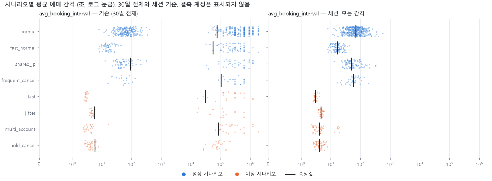
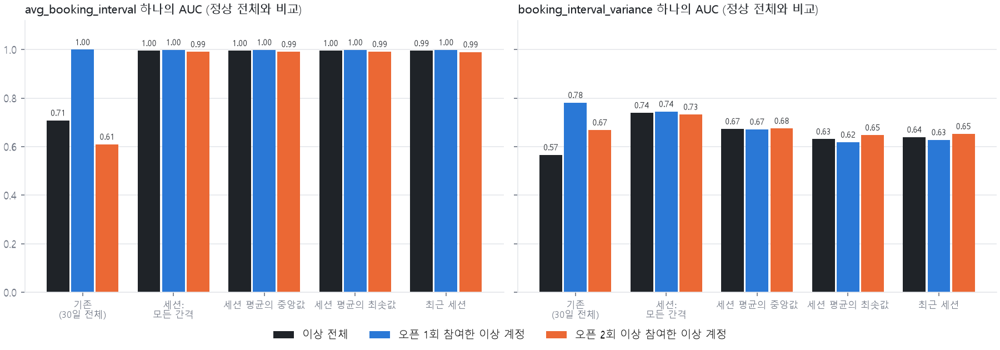
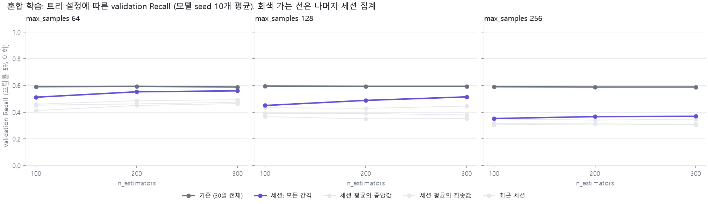
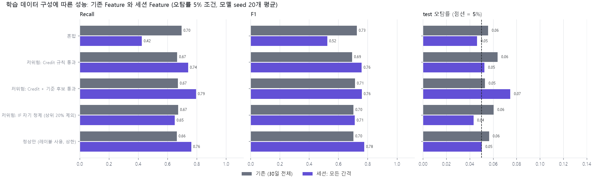
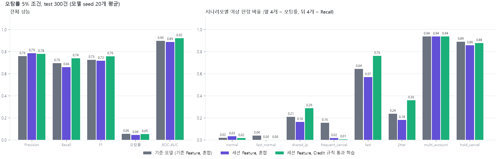
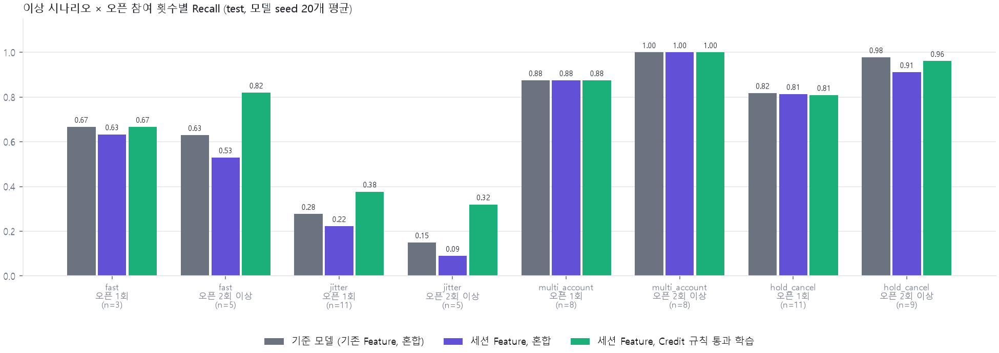
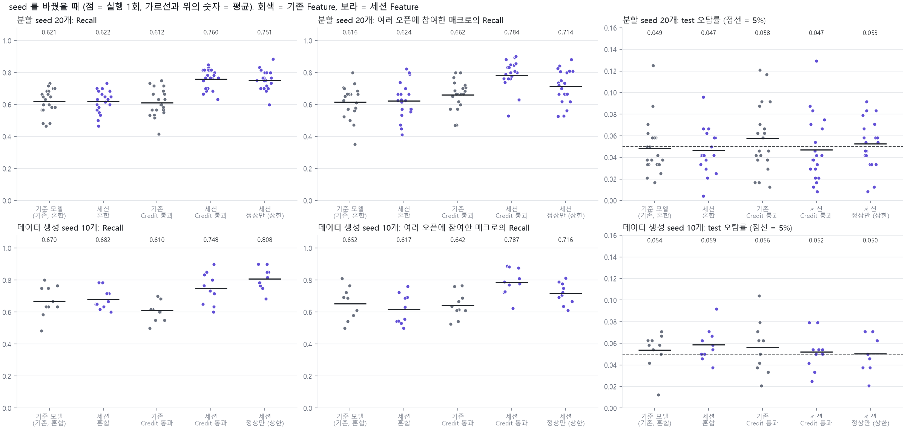

# 이벤트 기반 v3: 예매 간격 Feature 의 세션 기준 집계 (Issue #17 추가 보고서)

작성일 2026-11-23. [`REPORT_V3.md`](REPORT_V3.md) 는 30일 평균 간격이 서로 다른 공연 오픈 사이의 며칠짜리 공백까지 평균에 넣는다는 점을 확인했다.
이 문서는 v3 의 이벤트와 생성 규칙을 그대로 두고, 간격 Feature 2개(`avg_booking_interval`, `booking_interval_variance`)만 같은 세션 안의 간격으로 다시 계산했을 때의 결과다.
나머지 4개 Feature 는 바꾸지 않았다. Feature 는 6개 그대로이고 Ablation 은 하지 않았다.

모든 수치는 `output/v3_session/` 과 `data/v3_session/validation.json` 에서 가져왔다. v1·v2·v3 의 데이터와 보고서는 수정하지 않았다.

## 요약

오탐률 5% 조건(validation 에서 임계값 결정, test 300건에 그대로 적용), 모델 seed 20개 평균이다.

| 설정 | Precision | Recall | F1 | 오탐률 | ROC-AUC | 여러 오픈에 참여한 매크로의 Recall |
|---|---|---|---|---|---|---|
| 기준 모델: 기존 Feature, 혼합 학습 | 0.759 | 0.696 | 0.725 | 0.056 | 0.898 | 0.661 |
| 세션 Feature (간격·분산 모두), 혼합 학습, 기본 트리 설정 | 0.695 | **0.424** | 0.523 | 0.046 | 0.875 | 0.611 |
| 세션 Feature, 혼합 학습, 트리 300개 · max_samples 64 | 0.786 | 0.660 | 0.717 | 0.045 | 0.887 | 0.617 |
| 간격만 세션 기준 (분산은 기존), 혼합 학습 | 0.846 | 0.700 | **0.765** | **0.032** | 0.913 | 0.667 |
| 세션 Feature, Credit 규칙 통과 계정으로 학습 | 0.779 | **0.740** | 0.758 | 0.053 | 0.921 | **0.761** |

- **세션 기준 간격은 정상과 이상을 거의 완전히 나눈다.** 평균 간격 하나의 AUC 가 0.708 → 0.995 이고, 여러 오픈에 참여한 이상 계정만 보면 0.610 → 0.991 이다.
- **그런데 지정한 기준 모델(혼합 학습)에서는 성능이 오르지 않았다.** 간격과 분산을 모두 세션 기준으로 바꾸면 Recall 이 0.70 → 0.42 로 내려간다. validation 으로 고른 설정은 기존 Feature 였다. 트리 설정(n_estimators, max_samples)을 바꿔도 기존 Feature 를 넘지 못한다.
- **원인은 두 가지로 나뉜다.**
  - 분산을 세션 기준으로 바꾼 것이 혼합 학습에서 성능을 낮춘다. 간격만 바꾸면 F1 0.725 → 0.765, 오탐률 0.056 → 0.032 다.
  - 혼합 학습은 한데 모인 매크로 계정(학습 데이터의 20%)을 "흔한 값"으로 배운다. 학습 데이터에서 Credit 규칙에 걸린 계정을 빼면 세션 Feature 의 효과가 나타난다 (Recall 0.74, 분할 seed 20개에서는 0.62 → 0.76 으로 20번 모두 기준 모델보다 높음).
- **여러 공연에 참여한 매크로의 탐지율**은 혼합 학습에서는 그대로이고(0.66 → 0.61~0.67), Credit 규칙 통과 계정으로 학습하면 0.76~0.79 다.
- 집계 방식(모든 간격 / 세션 평균의 중앙값 / 최솟값 / 최근 세션)의 차이는 작다. 모든 조건에서 "모든 간격"이 같거나 가장 높았다.
- 참고로 세션 간격 하나에 임계값 하나를 둔 규칙이 Recall 0.82, F1 0.80 (분할 seed 20개 평균)으로 어떤 Isolation Forest 설정보다 높다. 모델이 이 Feature 를 충분히 활용하지 못하고 있다.
- 이 결과는 합성 데이터 안의 값이다. 세션 간격이 잘 나뉘는 것은 v3 에서도 "한 오픈 안에서 매크로는 2~7초, 사람은 8초 이상" 이라는 생성 가정이 그대로이기 때문이다.

---

## 1. 세션의 정의

### 1.1 demo-ticketing 의 이벤트 구조

| 확인한 것 | 출처 |
|---|---|
| `BOOKING_ATTEMPT` 이벤트의 필수 필드에 `concertId` 가 있다 | `demo-ticketing/docs/booking-attempts.md` ("필수 필드는 attemptId, transitionId, concertId, stage, status, sequence, source, recordedAt") |
| `attemptId` 는 사용자·공연·서비스에 고정된다. 다른 공연에 붙일 수 없다 | 같은 문서 |
| 세션 식별자는 이벤트에 없다 | 실측 이벤트(#16)의 metadata, 같은 문서 |
| 대기열에서 받은 순번은 최대 30분 유지된다. 그보다 오래 비우면 대기열에 다시 들어가야 한다 | `application.properties`: `demo.queue.wait-ttl=PT30M` |
| 예매를 마치거나 이탈하면 다음 예매는 새 `attemptId` 로 시작하고 대기열도 다시 거친다 | `AttemptConcertPage.tsx`, `PaymentPage.tsx` |

### 1.2 채택한 정의

1. **시도의 시작 시각** = 그 `attemptId` 의 가장 이른 `BOOKING_ATTEMPT` 이벤트 시각. BTS 와 같다.
2. **시도의 공연** = 그 이벤트들의 `metadata.concertId`.
3. 한 계정의 시도를 시작 시각 순으로 놓고, 바로 앞 시도와 **서비스와 공연이 같고 시작 간격이 30분 이하**이면 같은 세션이다.

공연이 바뀌면 간격이 짧아도 다른 세션이고, 같은 공연이라도 30분 넘게 비우면 다른 세션이다.

**v3 데이터에서는 경계를 어떻게 잡아도 결과가 같다.** 공연만으로 나누거나, 시간만으로(10분 / 30분 / 60분) 나눠도 세션 배정이 전 계정에서 같다 (`validation.json` 의 `boundary_variants`).
v3 는 오픈이 일주일씩 떨어져 있고 계정이 한 오픈에서 몇 분 안에 시도를 끝내기 때문이다. 30분이라는 값과 "공연이 같아야 한다"는 조건이 맞는지는 이 데이터로 검증되지 않는다.

### 1.3 세션 안의 값과 계정 수준 집계

- **간격** = 같은 세션에서 연속한 두 시도의 시작 시각 차이(초).
- **세션 평균** = 그 간격들의 평균. **세션 분산** = 모분산 (BTS 와 같은 식, 간격이 1개면 0).

| 집계 | `avg_booking_interval` | `booking_interval_variance` |
|---|---|---|
| 모든 간격 (pooled) | 모든 세션의 간격을 한데 모은 평균 | 같은 간격들의 모분산 |
| 세션 평균의 중앙값 (median) | 세션 평균들의 중앙값 | 세션 분산들의 중앙값 |
| 세션 평균의 최솟값 (min) | 세션 평균이 가장 작은 세션의 평균 | 그 세션의 분산 |
| 최근 세션 (latest) | 간격이 있는 세션 중 가장 최근 세션의 평균 | 그 세션의 분산 |

### 1.4 결측 처리

| 경우 | 처리 |
|---|---|
| 시도가 1건인 세션 | 간격이 없다. 집계에서 뺀다. 0 이나 다른 값으로 채우지 않는다 |
| 간격이 있는 세션이 하나도 없는 계정 (모든 세션이 시도 1건) | 두 Feature 가 결측 |
| 가장 최근 세션이 시도 1건인 계정 ("최근 세션" 집계) | 그 앞의, 간격이 있는 가장 최근 세션을 쓴다 (57계정) |
| 모델에 넣을 때 | 기준 모델의 전처리 그대로: 학습 데이터의 중앙값으로 대체한 뒤 log1p |

`booking_count`(30일 시도 수)는 바꾸지 않았으므로 시도 1건인 세션의 시도도 그대로 센다.

---

## 2. 추출 결과와 검증

스크립트는 `scripts/extract_session_features.py` 다. 기존 추출기(#14)와 `data/v3` 는 수정하지 않았고, 결과는 `data/v3_session/` 에 따로 저장했다.

| 파일 | 내용 |
|---|---|
| `data/v3/fairticket_event_based_features.csv` | 기존 추출 결과 (변경 없음, sha256 `fd28f6dc…`) |
| `data/v3_session/fairticket_event_based_features_<pooled, median, min, latest>.csv` | 세션 기준. 기존과 같은 컬럼·순서·레이블이고 간격 2개만 다르다 |
| `data/v3_session/session_features_all.csv` | 계정 1행, 네 집계의 값과 기존 값 |
| `data/v3_session/sessions.csv` | 세션 1행 (계정, 공연, 시도 수, 시작·끝, 세션 평균·분산) |

| | 값 |
|---|---|
| 시도 / 세션 | 5,939 / 1,599 |
| 시도가 1건인 세션 | 577 (36%) |
| 세션 1 / 2 / 3 / 4개인 계정 | 568 / 292 / 113 / 27 |
| 간격이 결측인 계정: 기존 → 세션 기준 | 정상 115 → 223, 이상 19 → 30 |
| 기존에는 값이 있었지만 세션 기준에서는 결측이 된 계정 | 119 |

**결측이 13.4% 에서 25.3% 로 늘었다.** 여러 오픈에 한 번씩만 시도한 계정은 30일 기준으로는 간격(며칠)이 있었지만, 세션 기준으로는 간격이 없다.

**검증** (모두 통과, `data/v3_session/validation.json`)

| 항목 | 결과 |
|---|---|
| 세션이 하나뿐인 계정(568)은 네 집계 모두 기존 추출 결과와 같은 값 (반올림 전) | 일치 |
| 생성기가 기록한 시도(공연, 시작 시각)에서 같은 규칙으로 다시 계산한 값 | 전 계정 일치 |
| 세션의 시도 수 합 = `booking_count` | 전 계정 일치 |
| 나머지 컬럼(4개 Feature, 레이블, 시나리오)이 기존 데이터셋과 같음 | 일치 |
| 간격이 있는 세션이 없으면 결측, 있으면 값이 있음 | 일치 |
| 세션 평균의 최솟값 ≤ 중앙값, 세션 분산은 0 이상이고 수학적 상한 이하 | 위반 0건 |
| v3 원본 파일의 해시가 실행 전후로 같음 | 일치 |

---

## 3. 정상·이상 Feature 분포

`중앙값 [5%~95%]`, 결측 계정 제외. 출처: `distribution.csv`

| Feature | 추출 방식 | 정상 (결측) | 이상 (결측) |
|---|---|---|---|
| `avg_booking_interval` (초) | 기존 (30일 전체) | 37,814 [16.5~1,209,480] (14%) | 6.10 [2.70~604,798] (10%) |
| | 세션: 모든 간격 | 53.4 [13.1~165] (28%) | 3.95 [2.58~6.69] (15%) |
| | 세션 평균의 중앙값 | 53.4 [13.2~164] | 4.01 [2.59~6.67] |
| | 세션 평균의 최솟값 | 49.2 [12.6~157] | 3.90 [2.52~6.59] |
| | 최근 세션 | 51.7 [12.8~174] | 3.95 [2.61~6.59] |
| `booking_interval_variance` (초²) | 기존 (30일 전체) | 412 [0~3.7×10¹¹] | 1.19 [0~2.1×10¹¹] |
| | 세션: 모든 간격 | 33.9 [0~11,802] | 0.218 [0~2.68] |
| | 세션 평균의 중앙값 | 15.0 [0~7,392] | 0.152 [0~2.42] |
| | 세션 평균의 최솟값 | 8.16 [0~3,602] | 0.148 [0~2.62] |
| | 최근 세션 | 9.43 [0~9,369] | 0.131 [0~2.46] |



**단일 Feature 의 AUC** (정상 전체와 비교). 출처: `separability.csv`

| Feature | 추출 방식 | 이상 전체 | 오픈 1회 참여한 이상 | 오픈 2회 이상 참여한 이상 | fast | jitter | multi_account | hold_cancel |
|---|---|---|---|---|---|---|---|---|
| 평균 간격 | 기존 | 0.708 | 0.999 | **0.610** | 0.640 | 0.754 | 0.643 | 0.783 |
| | 세션: 모든 간격 | **0.995** | 0.999 | **0.991** | 1.000 | 1.000 | 0.982 | 1.000 |
| | 세션 평균의 중앙값 | 0.995 | 0.999 | 0.991 | 1.000 | 1.000 | 0.983 | 1.000 |
| | 세션 평균의 최솟값 | 0.996 | 0.999 | 0.992 | 1.000 | 1.000 | 0.983 | 1.000 |
| | 최근 세션 | 0.995 | 0.999 | 0.990 | 1.000 | 1.000 | 0.981 | 1.000 |
| 간격 분산 | 기존 | 0.566 | 0.782 | 0.669 | 0.537 | 0.623 | 0.554 | 0.561 |
| | 세션: 모든 간격 | 0.740 | 0.745 | 0.733 | 0.773 | 0.768 | 0.723 | 0.714 |
| | 세션 평균의 중앙값 | 0.673 | 0.672 | 0.676 | 0.719 | 0.703 | 0.659 | 0.638 |
| | 세션 평균의 최솟값 | 0.631 | 0.618 | 0.648 | 0.693 | 0.658 | 0.624 | 0.582 |
| | 최근 세션 | 0.639 | 0.628 | 0.653 | 0.683 | 0.667 | 0.633 | 0.600 |



- **세션 기준 간격은 오픈 참여 횟수와 무관하게 정상과 이상을 나눈다.** 여러 오픈에 참여한 이상 계정의 AUC 가 0.610 → 0.991 이다. v3 에서 겹침을 만든 원인(오픈 사이의 공백)이 없어졌다.
- `multi_account` 가 0.98 인 것은 human 프로필 링(간격 13~19초)이 빠른 정상 사용자와 겹치기 때문이다.
- 집계 방식에 따른 간격의 차이는 없다 (0.995~0.996). 분산은 "모든 간격"이 가장 높고(0.740) 나머지는 0.63~0.67 이다. 세션 하나만 쓰는 집계는 시도 2건(분산 0)인 세션이 대표로 뽑히는 경우가 늘어 정상과 매크로가 0 근처에 같이 모인다.
- 분산은 세션 기준으로도 단독 구분력이 낮다 (0.74). 시도 2건이면 0 이 되는 식의 성질은 그대로다.
- 데이터 생성 seed 10개에서 평균 간격의 AUC 는 0.689 → 0.992, 결측 비율은 13.9% → 26.1% 다 (`generation_seed_summary.csv`).

---

## 4. 실험: 기준 모델의 조건

스크립트는 `scripts/evaluate_session.py` 다.

| 항목 | 내용 |
|---|---|
| 기준 모델 | 혼합 학습(레이블 미사용) + 결측 중앙값 대체 + log1p, `n_estimators` 100, `max_samples` 256 (기존 기본값 `auto` 와 같다) |
| 분할 | train 490 / validation 210 / test 300 (이전 실험과 같은 계정) |
| 임계값 | validation 정상 계정의 오탐률이 5% 이하가 되는 가장 낮은 점수. test 에는 같은 모델·같은 임계값 |
| 비교 | 추출 방식 5가지 × `n_estimators` 100 / 200 / 300 × `max_samples` 64 / 128 / 256 = 45가지 |
| 선택 | validation Recall (모델 seed 10개 평균, 동률이면 F1). test 는 선택에 쓰지 않았다 |
| 전처리 fit | 결측 대체값은 train 에서만 계산 |

### 4.1 validation Recall (모델 seed 10개 평균)

| 추출 방식 | n_estimators 100: max_samples 64 / 128 / 256 | 200: 64 / 128 / 256 | 300: 64 / 128 / 256 |
|---|---|---|---|
| 기존 (30일 전체) | 0.590 / **0.595** / 0.590 | 0.593 / 0.593 / 0.588 | 0.588 / 0.593 / 0.588 |
| 세션: 모든 간격 | 0.512 / 0.450 / 0.352 | 0.552 / 0.488 / 0.367 | 0.560 / 0.514 / 0.369 |
| 세션 평균의 중앙값 | 0.460 / 0.433 / 0.350 | 0.486 / 0.429 / 0.340 | 0.493 / 0.445 / 0.348 |
| 세션 평균의 최솟값 | 0.452 / 0.390 / 0.305 | 0.462 / 0.390 / 0.312 | 0.474 / 0.379 / 0.310 |
| 최근 세션 | 0.412 / 0.367 / 0.314 | 0.450 / 0.350 / 0.312 | 0.464 / 0.352 / 0.305 |



- **선택된 설정: 기존 Feature, `n_estimators` 100, `max_samples` 128.** 세션 Feature 는 45가지 중 어느 조합에서도 기존 Feature 를 넘지 못했다.
- 기존 Feature 에서는 트리 설정이 결과를 바꾸지 않는다 (0.588~0.595, seed 표준편차 0.01~0.02). 기본 설정과 선택된 설정의 차이는 흔들림 안이다.
- 세션 Feature 에서는 `max_samples` 가 작을수록 좋다 (256 → 64 에서 0.35 → 0.51~0.56). 트리마다 보는 표본이 적으면 모여 있는 매크로 계정이 덜 "흔하게" 보인다. 트리 수는 300 쪽이 조금 높다.
- 세션 집계 가운데서는 "모든 간격"이 모든 트리 설정에서 가장 높다.

### 4.2 test 결과 (모델 seed 20개 평균 ± 표준편차)

| 설정 | Precision | Recall | F1 | 오탐률 | ROC-AUC |
|---|---|---|---|---|---|
| **기준 모델: 기존 Feature, 100 / 256** | 0.759 | 0.696 ± 0.023 | 0.725 ± 0.018 | 0.056 | 0.898 |
| 기존 Feature, 100 / 128 (validation 선택) | 0.748 | 0.692 ± 0.023 | 0.719 ± 0.018 | 0.059 | 0.901 |
| 세션: 모든 간격, 100 / 256 | 0.695 | 0.424 ± 0.083 | 0.523 ± 0.065 | 0.046 | 0.875 |
| 세션 평균의 중앙값, 100 / 256 | 0.669 | 0.389 ± 0.078 | 0.488 ± 0.062 | 0.048 | 0.860 |
| 세션 평균의 최솟값, 100 / 256 | 0.643 | 0.356 ± 0.059 | 0.456 ± 0.052 | 0.049 | 0.855 |
| 최근 세션, 100 / 256 | 0.673 | 0.335 ± 0.066 | 0.444 ± 0.059 | 0.041 | 0.852 |
| 세션: 모든 간격, 300 / 64 (세션 Feature 중 validation 최고) | 0.786 | 0.660 ± 0.038 | 0.717 ± 0.026 | 0.045 | 0.887 |

- 기준 모델의 조건에서 세션 Feature 는 기존 Feature 보다 낮거나(기본 트리 설정, Recall 0.42) 같은 수준이다(트리 300 / 64, F1 0.717 대 0.725).
- **정한 절차대로라면 결론은 "기존 추출 방식을 유지" 다.** 다만 이것은 세션 Feature 에 정보가 없어서가 아니다 (3절). 5절에서 원인을 나눠 본다.

출처: `validation_grid.csv`, `test_summary.csv`

---

## 5. 어떤 변경이 성능에 기여했는가

### 5.1 간격과 분산을 따로 바꿨을 때 (혼합 학습, 기본 트리 설정)

Feature 를 빼는 것이 아니라, 두 변경 중 하나만 적용한 데이터셋이다 ("모든 간격" 집계).

| 간격 | 분산 | validation Recall | Precision | Recall | F1 | 오탐률 | ROC-AUC |
|---|---|---|---|---|---|---|---|
| 기존 | 기존 | 0.587 | 0.759 | 0.696 | 0.725 | 0.056 | 0.898 |
| **세션** | 기존 | **0.618** | **0.846** | 0.700 | **0.765** | **0.032** | **0.913** |
| 기존 | 세션 | 0.495 | 0.726 | 0.536 | 0.614 | 0.050 | 0.872 |
| 세션 | 세션 | 0.380 | 0.695 | 0.424 | 0.523 | 0.046 | 0.875 |

- **간격만 세션 기준으로 바꾸면 좋아진다.** Recall 은 같고 오탐률이 0.056 → 0.032 로 내려가 Precision 이 0.76 → 0.85 다. validation 에서도 기준 모델보다 높다 (0.618 대 0.587).
- **분산을 세션 기준으로 바꾸면 나빠진다.** 간격을 어느 쪽으로 두든 Recall 이 0.16~0.28 내려간다.
- 이 조합(간격만 변경)은 미리 정한 45가지에 없던 것이다. 분리 분석으로 본 값이므로, 채택하려면 같은 조합을 다른 데이터로 다시 확인해야 한다.
- 분산이 왜 방해가 되는지에 대한 해석: 기존 30일 분산은 여러 오픈에 참여한 계정에서 10¹⁰ 대의 큰 값이 되어 모델이 계정을 넓게 흩어 놓는 축이었다. 세션 분산은 매크로(0.2 근처)와 시도 2건인 정상 계정(0)을 좁은 구간에 같이 모은다. 혼합 학습에서는 그 구간이 "흔한 값" 이 된다. 이 해석은 위 표와 3절의 분포에서 추론한 것이고 따로 검증하지는 않았다.

### 5.2 학습 데이터 구성을 바꿨을 때 (보조 분석)

기준 모델은 혼합 학습으로 정해져 있다. 아래는 세션 Feature 가 혼합 학습에서 효과가 없는 이유를 나눠 보기 위한 것이며, 4절의 선택에는 쓰지 않았다.
학습 데이터를 고르는 방법은 `REPORT_V3.md` 5.3절과 같다. 기본 트리 설정, 모델 seed 20개 평균. 출처: `training_composition_summary.csv`

| 학습 데이터 | 레이블 | Feature | 학습 데이터 중 이상 | 걸러낸 이상 | Recall | F1 | 오탐률 | ROC-AUC |
|---|---|---|---|---|---|---|---|---|
| 혼합 | 미사용 | 기존 | 19.8% | 0% | 0.696 | 0.725 | 0.056 | 0.898 |
| | | 세션 | 19.8% | 0% | 0.424 | 0.523 | 0.046 | 0.875 |
| **Credit 규칙 통과** | 미사용 | 기존 | 13.0% | 43% | 0.666 | 0.693 | 0.064 | 0.900 |
| | | **세션** | **9.3%** | **62%** | **0.740** | **0.758** | 0.053 | 0.921 |
| Credit + 기준 후보 통과 | 미사용 | 기존 | 7.9% | 72% | 0.671 | 0.713 | 0.053 | 0.888 |
| | | 세션 | 2.5% | 92% | 0.794 | 0.759 | 0.075 | 0.920 |
| IF 자기 정제 (상위 20% 제외) | 미사용 | 기존 | 7.6% | 69% | 0.672 | 0.702 | 0.060 | 0.891 |
| | | 세션 | 8.5% | 66% | 0.649 | 0.711 | 0.043 | 0.895 |
| 정상만 (상한) | 사용 | 기존 | 0% | 100% | 0.662 | 0.702 | 0.056 | 0.894 |
| | | 세션 | 0% | 100% | 0.762 | 0.775 | 0.050 | 0.918 |

"세션" 은 "모든 간격" 집계다. 나머지 집계와 간격만 바꾼 데이터셋의 값은 CSV 에 있다.



- **기존 Feature 는 학습 데이터를 어떻게 골라도 Recall 0.66~0.70 이다** (`REPORT_V3.md` 의 결론 그대로). 상한이 0.66 이다.
- **세션 Feature 는 상한이 0.76 으로 올라간다.** 그리고 학습 데이터에서 매크로를 걸러 낼수록 그 상한에 가까워진다 (혼합 0.42 → Credit 통과 0.74 → 기준 후보까지 0.79).
- **세션 Feature 는 Credit 규칙 자체도 더 잘 듣게 만든다.** "분산 1.0초² 미만이고 시도 5건 이상" 규칙이 거르는 이상 계정이 43% → 62% 로 늘고, "평균 간격 10초 미만" 후보까지 쓰면 92% 다. 30일 분산은 여러 오픈에 참여한 매크로에서 매우 커서 이 규칙에 걸리지 않았다.
- 기준 후보까지 쓰면 Recall 은 가장 높지만 오탐률이 0.075 로 목표를 넘는다. 빠른 정상 사용자(`fast_normal`)의 오탐이 0.00 → 0.11 로 는다.
- IF 자기 정제는 세션 Feature 에서도 효과가 없다 (0.65).

### 5.3 참고: 평균 간격 하나에 임계값 하나

Isolation Forest 가 아니라 "세션 평균 간격이 임계값보다 짧으면 이상" 이라는 규칙이다. 같은 절차로 validation 에서 임계값을 정했다 (결측 계정은 판정하지 않음). 출처: `single_feature_rule_summary.csv`

| Feature | 분할 | 임계값 | Precision | Recall | F1 | 오탐률 | `fast_normal` 오탐률 |
|---|---|---|---|---|---|---|---|
| 기존 평균 간격 | seed 42 | 22.7초 | 0.562 | 0.450 | 0.500 | 0.088 | 0.44 |
| 세션 평균 간격 | seed 42 | 16.8초 | 0.710 | 0.817 | 0.760 | 0.083 | 0.42 |
| 기존 평균 간격 | 분할 seed 20개 평균 | 18.3초 | 0.700 | 0.468 | 0.558 | 0.053 | 0.27 |
| 세션 평균 간격 | 분할 seed 20개 평균 | 14.8초 | 0.789 | **0.821** | **0.802** | 0.057 | 0.31 |

- **규칙 한 줄이 5.2절의 어떤 Isolation Forest 설정보다 Recall 과 F1 이 높다** (분할 seed 평균 0.82 / 0.80 대 0.76 / 0.78). 6개 Feature 를 쓰는 모델이 간격 하나의 정보를 다 쓰지 못한다는 뜻이다.
- 이 규칙의 Recall 상한은 간격이 있는 이상 계정의 비율(85%)이다. 오탐은 `fast_normal` 에 몰린다 (27~44%). 임계값을 오탐률 5% 에 맞추면 15~17초가 되는데, 그 아래에 빠른 정상 사용자가 있다.
- 이 규칙을 추천하는 것은 아니다. 합성 데이터의 가정(매크로 2~7초, 빠른 정상 사용자 8초 이상)에 그대로 기대는 값이고, 카드·IP 공유나 취소율로만 드러나는 계정은 잡지 못한다.

---

## 6. 시나리오별 오탐·미탐, 여러 공연에 참여한 매크로

오탐률 5% 조건, test 300건, 모델 seed 20개 평균. 정상 시나리오는 오탐률, 이상 시나리오는 Recall. 출처: `test_summary.csv`, `training_composition_summary.csv`

| 시나리오 (test 수) | 기준 모델 | 세션, 혼합 (300 / 64) | 간격만 세션, 혼합 | 세션, Credit 통과 학습 | 세션, 정상만 (상한) |
|---|---|---|---|---|---|
| normal (151) | 0.02 | 0.03 | 0.01 | 0.02 | 0.02 |
| fast_normal (45) | 0.04 | 0.00 | 0.01 | 0.00 | 0.04 |
| shared_ip (35) | 0.21 | 0.16 | 0.16 | 0.29 | 0.20 |
| frequent_cancel (9) | 0.16 | 0.02 | 0.01 | 0.01 | 0.03 |
| fast (8) | 0.64 | 0.57 | 0.61 | **0.76** | 0.58 |
| jitter (16) | 0.24 | 0.18 | 0.26 | **0.36** | 0.53 |
| multi_account (16) | 0.94 | 0.94 | 0.94 | 0.94 | 0.83 |
| hold_cancel (20) | 0.89 | 0.86 | 0.90 | 0.88 | 0.96 |



**오픈 참여 횟수별 Recall** (`GROUPS` 컬럼, 같은 출처). "매크로" 는 `fast`, `jitter`, `multi_account` 다.

| 설정 | 이상: 오픈 1회 | 이상: 오픈 2회 이상 | 매크로: 오픈 1회 | **매크로: 오픈 2회 이상** | 정상 오탐률: 1회 / 2회 이상 |
|---|---|---|---|---|---|
| 기준 모델 (기존, 혼합) | 0.638 | 0.767 | 0.548 | **0.661** | 0.053 / 0.060 |
| 세션, 혼합, 100 / 256 | 0.361 | 0.502 | 0.439 | 0.611 | 0.049 / 0.042 |
| 세션, 혼합, 300 / 64 | 0.615 | 0.715 | 0.516 | 0.617 | 0.046 / 0.044 |
| 간격만 세션, 혼합 | 0.636 | 0.778 | 0.545 | 0.667 | 0.025 / 0.043 |
| 기존, Credit 통과 학습 | 0.668 | 0.663 | 0.570 | 0.722 | 0.050 / 0.083 |
| **세션, Credit 통과 학습** | 0.668 | **0.828** | 0.598 | **0.761** | 0.050 / 0.056 |
| 세션, Credit + 기준 후보 통과 학습 | 0.744 | 0.856 | 0.691 | 0.783 | 0.075 / 0.074 |
| 세션, 정상만 (상한) | 0.747 | 0.780 | 0.652 | 0.669 | 0.054 / 0.045 |

시나리오 × 오픈 참여 (test, 모델 seed 20개 평균). 출처: `error_by_trait.csv`

| 시나리오 / 오픈 참여 (test 수) | 기준 모델 | 세션, 혼합 (300 / 64) | 기존, Credit 통과 | 세션, Credit 통과 |
|---|---|---|---|---|
| fast / 1회 (3) | 0.67 | 0.63 | 0.67 | 0.67 |
| fast / 2회 이상 (5) | 0.63 | 0.53 | 0.80 | **0.82** |
| jitter / 1회 (11) | 0.28 | 0.22 | 0.32 | 0.38 |
| jitter / 2회 이상 (5) | 0.15 | 0.09 | 0.20 | **0.32** |
| multi_account / 1회 (8) | 0.88 | 0.88 | 0.88 | 0.88 |
| multi_account / 2회 이상 (8) | 1.00 | 1.00 | 1.00 | 1.00 |
| hold_cancel / 1회 (11) | 0.82 | 0.81 | 0.86 | 0.81 |
| hold_cancel / 2회 이상 (9) | 0.98 | 0.91 | 0.54 | **0.96** |
| shared_ip / 2회 이상 (13, 오탐률) | 0.28 | 0.13 | 0.56 | 0.29 |



- **여러 공연에 참여한 매크로의 Recall: 혼합 학습에서는 바뀌지 않는다 (0.66 → 0.61~0.67).** 세션 Feature 로 그 계정들의 간격이 3~5초로 드러났지만, 혼합 학습의 모델은 그 값을 이상으로 보지 않는다. Credit 규칙 통과 계정으로 학습하면 0.76 이다.
- 기존 Feature 로 Credit 통과 학습을 하면 여러 오픈에 참여한 `hold_cancel` 을 놓친다 (0.98 → 0.54). 30일 간격으로는 이 계정들이 정상의 범위 안에 있어서다. 세션 Feature 에서는 0.96 이다.
- **`jitter` 는 어느 설정에서도 낮다 (0.18~0.36, 상한 0.53).** 세션 간격만 보면 완전히 나뉘는데도(AUC 1.000) 모델은 잡지 못한다. log1p 를 거친 간격에서 Jitter(4.6초 → 1.7)와 가장 빠른 정상 사용자(8~13초 → 2.2~2.6)의 거리가 작고, 시도 수·취소율·카드·IP 가 정상과 같기 때문이다. 5.3절의 규칙이 모델보다 높은 것도 같은 이유다.
- `multi_account` 는 모든 설정에서 카드·IP 공유로 잡힌다. 정상만 학습에서 0.83 으로 내려가는 것은 오탐률 5% 임계값이 올라가서다.
- 오탐은 `shared_ip` 에 남는다 (0.16~0.29). 세션 Feature 로 `fast_normal` 과 `frequent_cancel` 의 오탐은 줄었다 (0.04 → 0.00, 0.16 → 0.01~0.02).
- 시도 수별로 보면 (`error_by_trait.csv`) 시도 10건 이상인 정상 계정의 오탐률이 0.17~0.27 로 가장 높고, 시도 1건인 이상 계정은 어느 설정에서도 0.50 이다 (간격이 정의되지 않는다).

---

## 7. seed 안정성

모델 seed 20개의 값은 4~6절의 표에 있다 (표준편차는 Recall 0.02~0.08).

**분할 seed 20개** (분할마다 임계값을 다시 정함, 모델 seed 42). 출처: `split_seed_summary.csv`

| 설정 | Precision | Recall | F1 | 오탐률 | ROC-AUC | 매크로 (오픈 2회 이상) Recall | 기준 모델보다 Recall 이 높은 분할 |
|---|---|---|---|---|---|---|---|
| 기준 모델 (기존, 혼합) | 0.770 | 0.621 ± 0.079 | 0.683 ± 0.063 | 0.049 | 0.884 | 0.616 | — |
| 세션, 혼합 (300 / 64) | 0.775 | 0.622 ± 0.072 | 0.687 ± 0.060 | 0.047 | 0.884 | 0.624 | 9 / 20 |
| 기존, Credit 통과 학습 | 0.742 | 0.612 ± 0.085 | 0.663 ± 0.057 | 0.058 | 0.887 | 0.662 | 8 / 20 |
| **세션, Credit 통과 학습** | 0.814 | **0.760 ± 0.062** | **0.781 ± 0.048** | 0.047 | 0.920 | **0.784** | **20 / 20** |
| 세션, 정상만 (상한) | 0.788 | 0.751 ± 0.063 | 0.766 ± 0.045 | 0.053 | 0.908 | 0.714 | 19 / 20 |

**데이터 생성 seed 10개** (데이터셋마다 이벤트 생성 → 두 방식으로 추출 → 같은 절차). 출처: `generation_seed_summary.csv`

| 설정 | Precision | Recall | F1 | 오탐률 | ROC-AUC | 매크로 (오픈 2회 이상) Recall | 기준 모델보다 Recall 이 높은 데이터셋 |
|---|---|---|---|---|---|---|---|
| 기준 모델 (기존, 혼합) | 0.763 | 0.670 ± 0.097 | 0.708 ± 0.056 | 0.054 | 0.916 | 0.652 | — |
| 세션, 혼합 (300 / 64) | 0.747 | 0.682 ± 0.065 | 0.710 ± 0.033 | 0.059 | 0.913 | 0.617 | 5 / 10 |
| 기존, Credit 통과 학습 | 0.741 | 0.610 ± 0.065 | 0.664 ± 0.041 | 0.056 | 0.907 | 0.642 | 3 / 10 |
| **세션, Credit 통과 학습** | 0.785 | 0.748 ± 0.100 | 0.763 ± 0.057 | 0.052 | 0.939 | 0.787 | 7 / 10 |
| 세션, 정상만 (상한) | 0.805 | 0.808 ± 0.069 | 0.804 ± 0.032 | 0.050 | 0.935 | 0.716 | 9 / 10 |



- **혼합 학습에서 세션 Feature 는 기준 모델과 같다.** 분할 seed 에서 0.621 대 0.622, 생성 seed 에서 0.670 대 0.682 이고 이긴 횟수가 절반이다. 결론은 seed 를 바꿔도 같다.
- **세션 Feature + Credit 통과 학습은 분할 20개 모두에서 기준 모델보다 Recall 이 높다** (평균 +0.14). 생성 seed 에서는 10개 중 7개에서 높고 평균 +0.08 이다. 데이터셋에 따른 흔들림(표준편차 0.10)이 커서 차이의 크기는 0.05~0.15 범위로 봐야 한다.
- test 오탐률은 모든 설정에서 평균 0.05 근처이고 분할의 35~55% 에서 5% 를 넘는다 (이전 보고서와 같은 한계).

---

## 8. BTS 적용 검토

실제 서빙 코드와 모델 번들은 변경하지 않았다. 아래는 같은 정의로 적용하려면 고쳐야 할 곳의 목록이다.

### 8.1 서빙 로직과 실험 코드의 비교

BTS 의 집계는 `ticket-fds-admin/backend/.../risk/service/FeatureAggregationService.java` 의 `calculate` 다.

| 항목 | BTS 서빙 (현재) | 실험 (세션 기준) | 같은가 |
|---|---|---|---|
| 분석 기간 | `calculatedAt` 이전 30일, 양 끝 포함 | 같음 | 같음 |
| 시도의 단위 | `serviceId:attemptId` (`attemptStarts` 맵) | 같음 | 같음 |
| 시도의 시작 시각 | 그 시도의 가장 이른 `BOOKING_ATTEMPT` 의 `occurredAt` (`putIfAbsent`) | 같음 | 같음 |
| 단계·상태 필터 | 없음 (모든 시도를 센다) | 같음 | 같음 |
| 간격 | 30일 안의 모든 시도를 시각 순으로 놓은 연속 차이. 음수는 0 | **같은 세션 안의 연속 차이만**. 음수는 0 | **다름** |
| 세션 | 개념 없음. `concertId` 를 읽지 않는다 | 서비스·`concertId` 가 같고 시작 간격 30분 이하 | **다름** |
| 평균·분산 | 평균, 모분산 | 같은 식 (세션 안의 간격에 적용) | 식은 같음 |
| 결측 | 시도 2건 미만이면 null | 간격이 있는 세션이 없으면 null (시도가 여러 건이어도 null 일 수 있다) | **다름** |
| 계정 수준 집계 | 해당 없음 | 모든 간격 / 세션 평균의 중앙값 / 최솟값 / 최근 세션 | 새로 정해야 함 |
| `booking_count`, `cancel_rate`, `card_reuse_count`, `ip_booking_density` | 현재 식 | 변경 없음 | 같음 |

- "모든 간격" 집계는 BTS 의 현재 루프에서 **세션 경계를 넘는 간격만 건너뛰면** 된다. 나머지 집계는 세션별 통계를 따로 모아야 한다. 성능 차이가 작으므로(3~5절) 구현이 가장 단순한 "모든 간격" 이 맞다.
- 서빙 쪽에서 `concertId` 를 읽으려면 시도의 시작 시각과 함께 공연을 저장해야 한다. `concertId` 는 `BOOKING_ATTEMPT` 의 필수 필드이므로 demo-ticketing 은 고칠 필요가 없다.
- **확인이 필요한 점**: 다른 연동 서비스도 `metadata.concertId` 를 보내는지, 공연 개념이 없는 서비스에서는 세션을 어떻게 나눌지 (시간 간격만으로 나누는 대안이 있다. v3 에서는 결과가 같았다).

### 8.2 수정해야 할 파일

**BTS 백엔드 (`ticket-fds-admin/backend`)**

| 파일 | 수정 내용 |
|---|---|
| `src/main/java/com/bts/fairticket/risk/service/FeatureAggregationService.java` | `attemptStarts` 에 공연(`metadata.concertId`)을 함께 저장. 세션 경계 상수(30분)와 `META_CONCERT_ID` 추가. 간격 루프에서 서비스·공연이 다르거나 30분을 넘는 간격을 제외. 남은 간격이 없으면 두 값을 null 로 |
| `src/main/java/com/bts/fairticket/risk/dto/UserCalculatedFeatures.java` | 필드 주석 ("시도 2건 미만 시 null" → "같은 세션 안의 간격이 없으면 null"). 필드 이름과 타입은 그대로 둘 수 있다 |
| `src/test/java/com/bts/fairticket/risk/service/FeatureAggregationServiceTest.java` | `calculate_attemptIntervalsWithMillis` 의 기대값 점검. 추가할 경우: 공연이 다른 시도, 같은 공연에서 30분을 넘긴 시도, 모든 세션이 시도 1건인 계정, `concertId` 가 없는 이벤트 |
| `src/main/java/com/bts/fairticket/admin/dto/UserFeaturesResponse.java`, `admin/service/AdminUserQueryService.java` | 구조 변경은 없다. 관리자 화면에 내려가는 값의 의미가 바뀐다 |
| `frontend/src/pages/UserDetail.tsx` | 표시 문구 "연속 시도 시작 간격 평균 / 분산" → 세션 안의 간격임을 표기 |
| `src/test/java/com/bts/fairticket/query/QueryControllerTests.java` | Feature 값을 검증하는 부분이 있으면 기대값 갱신 |

같은 클래스의 예전 사본이 별도 저장소 `backend/` 에도 있다 (`backend/src/main/java/com/bts/fairticket/risk/service/FeatureAggregationService.java`, DTO, 테스트. `calculate(events)` 서명이 다른 이전 버전).
어느 쪽이 실제로 배포되는지 확인하고, 둘 다 쓰인다면 함께 고쳐야 한다. Java 코드에서 AI 의 `/predict` 를 호출하는 부분은 두 저장소 모두에서 찾지 못했다 (현재 `aggregateFeatures` 를 부르는 곳은 관리자 조회뿐이다).

**AI 서버 (`ai`)**

| 파일 | 수정 내용 |
|---|---|
| `preprocessing.py` | `FEATURE_SPECS` 의 주석 ("예매 2건 미만이면 null 허용" → 세션 기준의 결측 조건). 검증 규칙(범위, null 허용)은 그대로 쓸 수 있다 |
| `app/schemas.py` | `avgBookingInterval`, `bookingIntervalVariance` 의 설명 문구 |
| `docs/predict_feature_spec.md` | Feature 정의. 이 문서는 아직 이전 7개 Feature 스펙이어서 6개 Feature 기준으로 다시 쓰는 일이 먼저다 |
| `docs/samples/*.json`, `README.md`, `docs/docker_and_integration.md` | 예시 값과 설명 |
| `tests/test_golden_features.py`, `tests/test_spring_payloads.py`, `tests/conftest.py`, `tests/test_api.py` | 예시 요청과 기대값 |
| `ml_experiment/generate_dummy_data.py`, `ml_experiment/train_and_evaluate_if.py`, `ml_experiment/export_bundle.py`, `pack_bundle.py` | **모델을 다시 학습해야 한다.** 현재 번들은 간격의 의미가 다른 데이터로 학습됐다. 번들의 `preprocess={}` 도 바꿔야 한다: 세션 기준에서는 결측이 13% → 25% 로 늘어 중앙값 대체가 필요하다 |
| `models/behavior_model.joblib` | 위 재학습의 결과물. `model_version` 을 올려 Feature 정의가 바뀐 것을 구분 |

**실험 코드 (참고)**

| 파일 | 내용 |
|---|---|
| `experiments/issue14-real-validation/scripts/extract_features.py` | BTS 를 재현하는 추출기. 세션 보조 컬럼이 이미 있지만 정의가 다르다 (시간 간격만으로 나누고 표본분산을 쓴다). BTS 를 바꾸면 이 추출기와 일치 테스트(`test_extract_features.py`)도 같이 바꿔야 한다 |
| `experiments/issue17-event-based-dummy/scripts/extract_session_features.py` | 이번 실험의 정의. BTS 구현의 기준 값으로 쓸 수 있다 (`sessions.csv` 에 세션별 값이 있다) |

**고치지 않아도 되는 곳**: demo-ticketing 백엔드·프론트 (`concertId` 를 이미 보낸다). 프론트의 `risk/features.ts` 는 자체 정의(최근 10분의 요청 간격)를 쓰므로 이 변경과 무관하다.

### 8.3 적용 순서에 대한 의견

1. **지금 상태(혼합 학습)에서 간격과 분산을 모두 세션 기준으로 바꾸면 성능이 내려간다.** Feature 정의만 먼저 바꾸는 것은 권하지 않는다.
2. 적용한다면 다음 둘 중 하나와 함께여야 한다.
   - **간격만 세션 기준으로 바꾸고 분산은 그대로 둔다.** 혼합 학습에서 F1 0.725 → 0.765, 오탐률 0.056 → 0.032 였다. 다만 미리 정한 비교에 없던 조합이라 재확인이 필요하고, 한 Feature 는 세션 기준이고 다른 하나는 30일 기준이 되는 불일치를 감수해야 한다.
   - **둘 다 세션 기준으로 바꾸고, 학습 데이터에서 Credit 규칙에 걸린 계정을 뺀다.** Recall 0.70 → 0.74 (분할 seed 평균 0.62 → 0.76). 레이블 없이 가능하다. 재학습 절차에 Credit 판정 결과를 연결해야 한다.
3. 어느 쪽이든 모델 번들을 다시 만들어야 하고, BTS 와 AI 서버가 같은 시점에 바뀌어야 한다 (간격의 의미가 다르면 모델 입력이 학습 때와 달라진다).

---

## 9. 한계

- **세션 간격이 잘 나뉘는 것은 생성 가정의 결과다.** v3 가 바꾼 것은 오픈 참여 횟수와 시도 수이고, 한 오픈 안의 속도(매크로 2~7초, 사람 8초 이상)는 v2 그대로다. 세션 기준으로 바꾸면 그 가정이 다시 드러나므로, 3절의 AUC 0.995 는 `REPORT_V3.md` 가 지적한 v2 의 분리와 같은 종류의 값이다. 실제 사용자의 세션 안 간격이 매크로와 얼마나 겹치는지는 알 수 없다.
- **세션 경계는 이 데이터로 검증되지 않았다.** 어떤 경계를 써도 결과가 같았다. 같은 공연에 여러 날 들어오는 사용자나, 짧은 시간에 여러 공연을 오가는 사용자가 있으면 경계의 선택이 결과를 바꾼다.
- **결측이 두 배가 된다 (13% → 25%).** 세션마다 한 번만 시도하는 계정은 간격 Feature 로 판단할 수 없다. 이런 매크로(오픈마다 1건)는 세션 기준에서 오히려 보이지 않게 된다.
- **간격만 바꾼 조합은 사후 분석이다.** 4절의 사전 비교에서는 기존 Feature 가 선택됐다.
- **학습 데이터 구성은 보조 분석이다.** 기준 모델은 혼합 학습으로 지정돼 있었고, Credit 통과 학습과의 조합은 원인을 나누기 위해 추가했다. Credit 규칙이 거르는 비율(62%)도 이 합성 데이터에서의 값이다.
- `jitter` 는 세션 간격으로 완전히 나뉘는데도 모델의 Recall 이 0.2~0.5 다. Isolation Forest 가 6개 Feature 를 같은 비중으로 쓰는 한, 한 Feature 에만 있는 차이는 약하게 반영된다.
- 트리 설정은 요청된 9가지만 비교했다. 임계값을 정하는 validation 정상 계정이 168개라 test 오탐률이 5% 를 넘는 경우가 절반 가까이 된다.
- 합성 데이터 안의 지표는 실제 사용자에 대한 탐지 성능이 아니다.

---

## 부록: 결과 파일과 재현

| 내용 | 위치 |
|---|---|
| 세션 기준 추출 | `scripts/extract_session_features.py` → `data/v3_session/` (데이터셋 4개, `sessions.csv`, `session_features_all.csv`, `validation.json`) |
| 분포 | `output/v3_session/distribution.csv`, `separability.csv` |
| 격자 (validation) | `validation_grid.csv`, `grid_runs.csv` |
| 혼합 학습의 test 결과 | `test_summary.csv`, `test_runs.csv`, `test_seed42.csv` |
| 학습 데이터 구성 (보조) | `training_composition_summary.csv`, `training_composition_runs.csv` |
| 간격 하나의 규칙 (참고) | `single_feature_rule_summary.csv`, `single_feature_rule_runs.csv` |
| 시나리오 × 오픈 참여, 시도 수별 | `error_by_trait.csv` |
| seed | `split_seed_summary.csv`, `split_seed_runs.csv`, `generation_seed_summary.csv`, `generation_seed_runs.csv` |
| 실험 설정 | `experiment_config.json` |
| 그래프 7장 | `output/v3_session/figures/` |

```powershell
cd ai\experiments\issue17-event-based-dummy
$py = "..\issue14-real-validation\.venv\Scripts\python"

& $py scripts\extract_session_features.py     # data\v3 를 읽어 data\v3_session 에 저장
& $py scripts\evaluate_session.py             # 약 15분
```

v3 의 이벤트(`data/v3/events.csv`)와 기존 추출 결과는 읽기만 한다. 실행 전후의 해시가 같은지 `validation.json` 과 `experiment_config.json` 에 기록한다.
서빙 코드, 모델 번들, 모델 파일은 변경하거나 저장하지 않았다.
