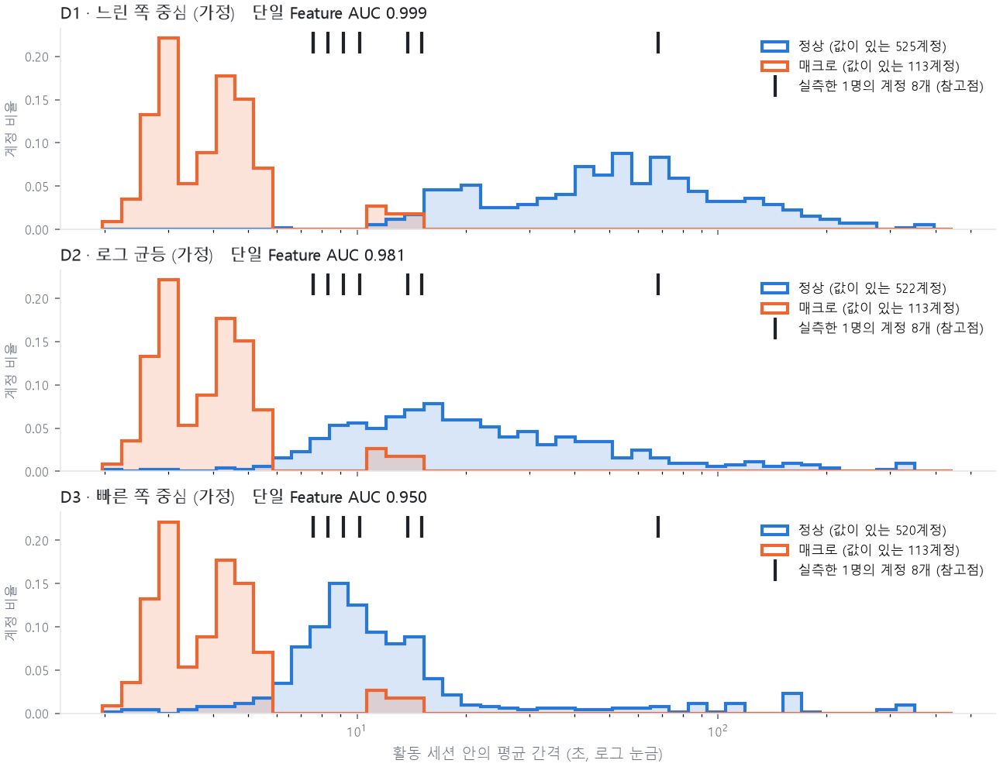
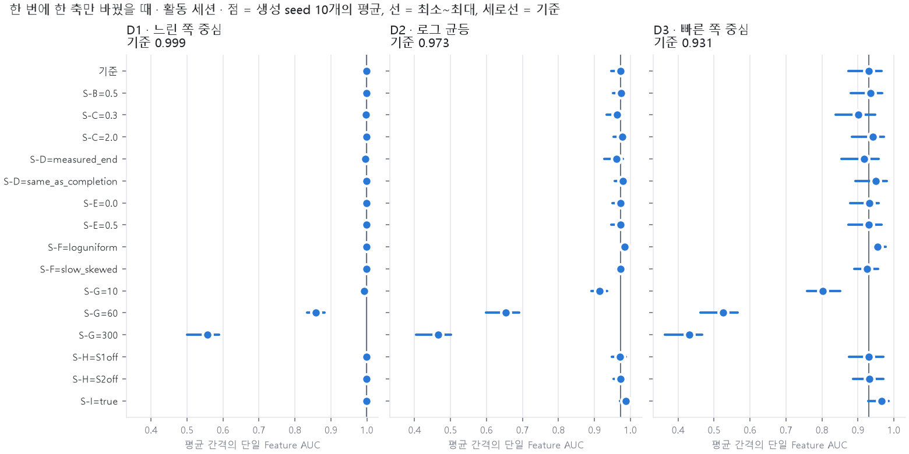

# 이벤트 기반 v4: 실측 일부를 반영한 합성 데이터에서의 강건성 평가 (Issue #17)

작성일 2026-11-24. 설계는 [`REPORT_MEASUREMENT_ADD.md`](REPORT_MEASUREMENT_ADD.md) 5절·6절·8절이다.

> **이 실험은 실제 사용자에 대한 탐지 성능 검증이 아니다.**
> 실측 일부(매크로 도구의 시도 시간, 정상 사용자 1명의 빠른 예매)를 반영한 **합성 데이터**에서, 생성 가정이 달라질 때 결과가 얼마나 달라지는지를 본 강건성 평가다.
> 이 문서의 Precision·Recall·F1·오탐률은 모두 합성 데이터 안의 값이고, 운영 환경의 성능 예측으로 쓸 수 없다.

- D1·D2·D3 는 "정상 사용자들 사이의 속도 분포" 에 대한 **세 가지 가정**이다. 어느 것도 실제 분포가 아니다. 결과는 가정별로 따로 적었고 평균으로 합치지 않았다.
- 실측한 정상 사용자는 1명(8계정)이다. 빠른 쪽 끝점과 참고점으로만 썼다. 학습·평가 데이터에 넣지 않았고, 그 계정들로 비율이나 신뢰구간을 계산하지 않았다.
- 생성 규칙(`config/scenarios_v4.json`)과 평가 조건은 결과를 보기 전에 고정했고, 결과를 본 뒤 생성 파라미터를 바꾸지 않았다.
- Feature 는 6개 그대로다. Ablation 은 하지 않았다. 간격 Feature 2개의 **계산 방식**만 후보 18개로 바꿔 봤다.
- v1~v3 의 데이터·결과, 실측 원본, BTS 서빙 코드는 수정하지 않았다.

수치의 출처는 `output/v4/` 의 CSV 다. 별도 표시가 없으면 오탐률 5% 조건(validation 에서 임계값 결정, test 300건에 적용), 혼합 학습, 생성 seed 10개 × 모델 seed 5개의 평균이다.

## 요약

| | D1 느린 쪽 중심 | D2 로그 균등 | D3 빠른 쪽 중심 |
|---|---|---|---|
| 실측한 1명만큼 빠른(2배 이내) 정상 계정의 비율 (가정) | 0.9% | 34% | 82% |
| 활동 세션 평균 간격의 단일 Feature AUC | 0.999 | 0.973 | 0.931 |
| 현재 BTS 정의(30일 평균 간격)의 단일 Feature AUC | 0.733 | 0.730 | 0.722 |
| **현재 BTS 정의**: F1 / Recall / 오탐률 | 0.717 / 0.671 / 0.049 | 0.702 / 0.652 / 0.050 | 0.709 / 0.655 / 0.048 |
| 30일 간격 + **분산은 간격 5개 이상일 때만** | 0.766 / 0.746 / 0.050 | 0.766 / 0.745 / 0.050 | 0.778 / 0.756 / 0.047 |
| 활동 세션 평균·분산 (혼합 학습) | 0.526 / 0.440 / 0.054 | 0.409 / 0.321 / 0.054 | 0.378 / 0.291 / 0.046 |
| 활동 세션 평균·분산 (Credit 규칙 통과 계정으로 학습) | 0.764 / 0.759 / 0.054 | 0.630 / 0.569 / 0.055 | 0.577 / 0.495 / 0.047 |

1. **현재 BTS 정의의 성능은 세 가정에서 거의 같다 (F1 0.70~0.72).** 정상 사용자의 속도를 10배 바꿔도 달라지지 않는다. 30일 평균 간격이 예매 속도가 아니라 "오픈과 오픈 사이의 며칠" 로 정해지기 때문이다. 속도 가정에 강건한 것이 아니라 속도를 보지 않는 것이다.
2. **세션 기준 간격은 Feature 하나로는 잘 나누지만(AUC 0.93~1.00), 기준 모델(혼합 학습)에서는 오히려 성능을 낮춘다 (F1 0.38~0.53).** 정상 사용자가 빠를수록 더 낮아진다. v3 에서 본 현상이 v4 에서도 같고, D3 로 갈수록 심하다.
3. **세 가정 모두에서 고르게 나온 정의는 "30일 간격 + 분산은 간격이 5개 이상일 때만 계산" 이다** (F1 0.766~0.778, 가정 사이의 차이 0.012). 민감도 조건 22개 × 가정 3개(66개)에서도 모두 현재 정의보다 높았다 (+0.02~+0.21, 사후 확인). **이 정의는 test 결과를 보고 고른 것이므로 위 수치는 독립적인 검증 성능이 아니다** (6.4절).
4. **모델 성능에 가장 큰 영향을 주는 생성 가정은 오픈 참여 횟수와 매크로의 시도 수, 그리고 대기열 대기다.** 모든 계정이 오픈 1회에만 참여하면 현재 정의의 F1 이 0.72 → 0.55, 대기 300초와 매크로 시도 수 가정을 같이 바꾸면 0.51 까지 내려간다. 정상 사용자의 속도 분포(D1~D3)는 현재 정의에서는 영향이 거의 없다.
5. **대기열 대기가 60초면 세션 간격의 구분력이 사라진다** (단일 Feature AUC 0.999 → 0.86 / 0.65 / 0.53, 300초면 0.43~0.56). 간격은 "대기 + 예매 시간" 이라, 대기가 길어지면 사람과 매크로가 같아진다. 실측 환경의 대기는 0 이었다.
6. v3 대비: 현재 BTS 정의·혼합 학습의 F1 은 0.708 → 0.70~0.72 로 사실상 같다. 세션 Feature 의 효과는 v3 보다 작아졌다 (Credit 통과 학습 0.763 → 0.764 / 0.630 / 0.577).

---

## 1. v3 → v4 생성 규칙의 변경

| | v3 | v4 | 근거 |
|---|---|---|---|
| R1 정상 사용자의 속도 | 시나리오마다 고정된 단계 중앙값 × 계정 속도(로그 표준편차 0.35~0.5) | 계정마다 속도 수준 `s`. 느린 끝 `s = 1` (v3 normal: 좌석 20초, 결제 15초), 빠른 끝 `s = 0.1` (실측한 1명: 좌석 2.06초, 결제 2.42초). 그 사이의 분포는 **D1 / D2 / D3 세 가정** | 빠른 끝만 실측(1명). 분포는 가정 |
| R1b 계정 안의 흔들림 | 0.35~0.5 | 0.3 | 실측한 1명의 변동계수 |
| R3 정상 세션 | 시도 수를 먼저 뽑고 결과를 따로 뽑음 | 세션마다 **목표 예매 수**를 정하고, 실패하면 80% 확률로 다시 시도 | 구조는 가정 |
| R3 다음 시도까지의 대기 | 결과와 무관하게 같은 분포 | 앞 시도의 결과별: 완료 뒤 3.2~20초, 이탈 뒤 1.1~20초, 만료 뒤 6.8~40초 (속도 수준으로 보간) | 빠른 끝은 실측한 1명 (완료 32건, 이탈 3건, 만료 1건) |
| R3b 공연 이동 | 한 오픈에 한 공연 | 다음 시도에서 25% 확률로 이미 열린 다른 공연으로 | 가정 |
| R5 human 프로필 매크로 | #14 값 + 추정 대기 (평균 17.3초) | **#16 연속 실행 실측 20건을 복원추출** (간격 10.1~15.1초, 평균 12.8초) | #16 실측 |
| R6 대기열 대기 | 없음 | `STARTED → QUEUE 통과` 사이의 별도 변수. 사람과 매크로에 같은 분포. 기준 0초 | 가정 (실측 환경은 0) |
| 이벤트 필드 | `recordedAt`, `transitionId`, `clientOccurredAt` 없음 | 실측 이벤트와 같게 추가 | 실측 이벤트 |
| 그대로 | 계정 1,000개·시나리오·레이블, IP·카드 공유, fast·jitter 매크로(실측 시도 복원추출), `hold_cancel`, 선점 거절, 결제 입력 오류, 취소, 오픈 참여 횟수(S1), 매크로 시도 수(S2) | | v3 |

**정상 사용자 사이의 속도 분포 (가정)**

| 가정 | 규칙 | 뜻 | 정상 계정의 `s` 중앙값 [5%~95%] | `s ≤ 0.2` 인 비율 |
|---|---|---|---|---|
| D1 느린 쪽 중심 | ln s ~ N(0, 0.5), 0.1 미만은 0.1 | v3 와 같은 중심과 폭. 실측한 사람은 드문 예외 | 0.91 [0.26~2.27] | 0.9% |
| D2 로그 균등 | log10 s ~ U(−1, 0) | 어느 속도가 흔한지 모른다 | 0.27 [0.11~0.88] | 34% |
| D3 빠른 쪽 중심 | ln s = ln 0.1 + \|N(0, 0.5)\|, 1 초과는 1 | 실측한 사람이 흔한 유형 | 0.14 [0.10~0.27] | 82% |

- `fast_normal` 은 같은 분포에서 `s ≤ 0.316` 인 값만 받는다.
- 실측한 1명보다 빠른 정상 계정은 만들지 않았다 (`s ≥ 0.1`).
- D1 은 v3 와 맞추기 위해 느린 끝(1배)을 중심으로 뒀으므로 1배보다 느린 계정이 절반가량 있다.
- 세 데이터셋은 정상 계정의 이벤트만 다르다. 매크로와 `hold_cancel` 의 이벤트는 같다 (테스트로 확인).

**설계 문서와 다르게 정한 것** (모두 평가 전에 설정 파일에 적었다)

- 목표 예매 수: 설계 문서는 두 끝(대부분 1건 / v3 수준)만 적었다. 기준값으로 그 사이의 값(`goal_lambda = 1.0`, 세션당 평균 약 2건)을 뒀다.
- 다른 공연으로의 이동은 "이미 열린 공연" 으로만 한다. 첫 오픈(c1)의 세션에서는 옮길 공연이 없다.
- 대기열 대기는 오픈 중인 공연의 시도에만 더한다. 이미 열린 공연으로 옮긴 시도에는 없다.
- 매크로는 공연을 옮기지 않는다 (v3 와 같다).

## 2. 실측 근거와 가정의 구분

| 수준 | 파라미터 |
|---|---|
| **실측 (#16 매크로)** | fast·jitter·human 프로필의 시도 1건(단계 시간 + 다음 시도까지의 간격), 계정 간 편차(로그 표준편차 0.085), 단계 시간의 하한 |
| **실측 (정상 사용자 1명)**: 빠른 끝점으로만 | 단계 중앙값(좌석 2.06초, 결제 2.42초), 결과별 재시작 대기(3.24 / 1.08 / 6.76초), 계정 안의 흔들림 0.3 |
| **코드·실측 이벤트** | 이벤트 종류·필드·단계 순서, 선점 5분, 선점 거절은 같은 attemptId, 결제 실패는 이벤트 없음 |
| **물려받은 값 (근거 없음)** | 느린 끝(v3 normal), 시도 결과 확률, 취소 성향, IP·카드 공유, 좌석 경쟁 |
| **가정** | **정상 사용자 사이의 속도 분포(D1~D3)**, 목표 예매 수, 재시도 확률 0.8, 공연 이동 확률, 대기열 대기, 오픈 참여 횟수, 매크로 시도 수, 매크로 지연 설정의 분포, 숙련도, 세션 30분·간격 5개라는 기준값 |

값마다의 근거는 `config/scenarios_v4.json` 의 `basis` 에 있다.

## 3. 데이터 검증

D1·D2·D3 (생성 seed 42) 각각 계정 1,000개, 이상 비율 19.9%. 출처: `output/v4/validation/<D>/validation.json`

| | D1 | D2 | D3 |
|---|---|---|---|
| 이벤트 / 시도 / 완료 예매 / 취소 | 36,397 / 5,596 / 3,917 / 884 | 35,791 / 5,500 / 3,947 / 888 | 35,483 / 5,462 / 3,935 / 879 |
| 선점 거절로 포기한 시도 | 110 | 25 | 10 |
| 다른 공연으로 옮긴 정상 시도 | 476 | 463 | 434 |

| 점검 | 결과 (세 데이터셋 모두) |
|---|---|
| 이벤트 순서와 시각: 30일 창 안, event_id 가 시간순, 시도 안의 순번이 1부터 연속, 시각이 뒤로 가지 않음, 첫 이벤트가 `STARTED` | 통과 |
| 모든 시도가 종료 이벤트(완료 / 이탈 / 만료 / 거절)로 끝나고 종료 이벤트는 하나 | 통과 |
| 한 계정의 시도가 겹치지 않음 (`hold_cancel` 의 5분 뒤 만료 이벤트만 예외) | 통과 |
| 완료된 시도 = `BOOKING`, 실패한 시도에는 `BOOKING` 없음, `BOOKING` 이 선점과 완료 사이 | 통과 |
| `CANCEL` 이 자기 예매를 가리키고 예매보다 뒤이며 예매당 1건 이하 | 통과 |
| 기존 BTS 추출기(#14, 수정 없음)로 6개 Feature 계산 | 1,000계정 모두 계산됨 |
| 추출값 = 다른 방식의 재계산 = 생성 기록(시도·예매·취소 수, 공유 관계) | 일치 |
| #14 의 BTS 일치 테스트 | 통과 |
| 간격 정의: 30일 평균·분산 = 추출기 값, 세션 평균·분산 = v3 세션 실험 코드의 값 | 일치 |
| 실측 이벤트(2026-11-24)에 나온 이벤트 종류 10가지가 같은 필드로 있음, 실측의 단계 순서 4가지가 모두 있음 | 일치 |

- 실측과 다른 점: `BOOKING` 의 `performanceStartsAt` / `performanceEndsAt` 은 만들지 않았다 (Feature 계산에 쓰이지 않는다). 합성에만 있는 것은 선점 거절, `CANCEL`, 결제 화면 이벤트가 없는 시도(해당 단계 이벤트가 없던 시기의 실측 매크로 시도)다.
- 테스트 13개 통과 (`tests/test_v4_dataset.py`): 저장 파일의 바이트 단위 재현, v2·v3 파일이 생성 기록과 같음, 가정이 정상 계정만 바꿈, 대기열 대기가 사람과 매크로에 같게 들어감 등.

**결측** (계정 수. 세 데이터셋이 거의 같아 D2 를 적는다. 출처: `null_report.csv`)

| 시나리오 | 계정 | 간격 결측 (시도 1건) | 분산이 식으로 0 (시도 2건) | 취소율 결측 (완료 예매 0건) |
|---|---|---|---|---|
| normal | 527 | 127 | 104 | 15 |
| fast_normal | 122 | 33 | 11 | 4 |
| shared_ip | 110 | 28 | 15 | 6 |
| frequent_cancel | 42 | 15 | 2 | 0 |
| fast / jitter | 44 / 43 | 6 / 7 | 8 / 6 | 0 / 0 |
| multi_account | 56 | 6 | 6 | 3 |
| hold_cancel | 56 | 0 | 0 | 6 |
| 전체 | 1,000 | 222 (정상의 25%, 이상의 10%) | 152 | 34 |

- 정상 계정의 25% 가 시도 1건이다. "목표 1건을 한 번에 완료하고 끝" 인 계정이 많아진 결과다 (v3 는 14%).
- 세션 기준으로 바꾸면 간격 결측이 정상의 35%(활동 세션), 39%(공연별 세션)로 늘어난다.

## 4. D1·D2·D3 의 Feature 분포

생성 seed 42 의 값. 출처: `output/v4/distribution/`

### 4.1 계정별·시나리오별 분포

| 값 (중앙값 [5%~95%]) | D1 | D2 | D3 | 매크로 (세 데이터셋 같음) |
|---|---|---|---|---|
| 정상: 활동 세션 평균 간격 (초) | 53.5 [16.1~171] | 18.3 [7.4~118] | 10.1 [5.7~94] | fast 2.9, jitter 4.6, multi_account 4.1 [2.4~13.3], hold_cancel 4.0 |
| 그중 normal | 61.4 | 22.0 | 10.0 | |
| 그중 fast_normal | 17.8 | 13.0 | 9.9 | |
| 정상: 활동 세션 분산 (초²) | 17.1 | 3.0 | 2.0 | 매크로 0.08 [0~0.96], hold_cancel 1.0 |
| 정상: 30일 평균 간격 (초, 현재 BTS) | 201,617 (2.3일) | 201,668 | 201,699 | 매크로 16,100 (값의 절반 이상이 수 시간 이상) |
| 시도 수 | 3 [1~10] | 3 [1~9] | 3 [1~9] | 매크로 5 [1~36], hold_cancel 20 |
| 취소율 | 0 [0~1.00] | 0 [0~0.76] | 0 [0~0.87] | 매크로 0.29, hold_cancel 1.0 |

- 속도 가정은 **세션 안의 간격만** 바꾼다. 30일 평균 간격, 시도 수, 취소율, 카드·IP 는 세 가정에서 거의 같다.
- 30일 평균 간격은 정상도 매크로도 며칠 단위다. 여러 오픈에 참여한 계정의 값은 오픈 사이의 공백으로 정해진다.



### 4.2 정상과 매크로의 겹침, 단일 Feature AUC

| | D1 | D2 | D3 |
|---|---|---|---|
| **활동 세션 평균 간격**: 단일 Feature AUC (생성 seed 10개 평균) | 0.999 | 0.973 | 0.931 |
| 같은 값, 생성 seed 42 (아래 겹침과 나머지 AUC 는 이 데이터셋의 값) | 0.999 | 0.981 | 0.950 |
| 매크로 계정 중 정상의 5~95% 구간 안 | 0% | 6% | 7% |
| 정상 계정 중 매크로의 5~95% 구간 안 | 0.4% | 21% | 57% |
| **30일 평균 간격 (현재 BTS)**: AUC (생성 seed 10개 평균) | 0.733 | 0.730 | 0.722 |
| 매크로 계정 중 정상의 5~95% 구간 안 | 47% | 48% | 48% |
| 30일 분산: AUC | 0.626 | 0.623 | 0.618 |
| 활동 세션 분산: AUC | 0.676 | 0.637 | 0.619 |
| 시도 수 / 취소율 / 카드 / IP: AUC | 0.755 / 0.782 / 0.678 / 0.648 | 거의 같음 | 거의 같음 |

- **가장 빠른 쪽 가정(D3)에서도 세션 간격의 AUC 는 0.93 이다.** 실측한 사람의 간격(7.6~10초)이 fast·jitter 매크로(2.9, 4.6초)보다 여전히 길기 때문이다. 겹치는 것은 human 프로필 매크로(10~15초)와 지연을 크게 준 매크로다.
- D3 에서 정상 계정의 57% 가 매크로의 범위 안에 든다. 매크로의 범위가 human 프로필 때문에 13초까지 넓어서다.
- 분산은 어느 정의에서도 AUC 0.58~0.68 이다. 시도가 2건이라 분산이 0 으로 나오는 계정이 정상에 많기 때문이다 (3절).

### 4.3 실측한 1명의 위치 (참고점)

한 사람의 8계정을 한 묶음으로 본 값이다. 독립 표본이 아니고 비율로 해석하지 않는다. 출처: `person_position.csv`

| 값 | 8계정의 범위 (중앙값) | 합성 정상 분포에서의 백분위: D1 | D2 | D3 | 합성 매크로 분포에서의 백분위 |
|---|---|---|---|---|---|
| 활동 세션 평균 간격 | 7.6~68.4초 (9.7) | 0.2 (0.2~64) | 15.8 (6~91) | 43.9 (18~93) | 93.8 (94~100) |
| 공연별 세션 평균 간격 (값이 있는 5계정) | 7.4~41.2초 (8.3) | 0.2 | 9.5 | 27.0 | 93.8 |
| 30일 평균 간격 (현재 BTS) | 같은 값 | 0.2 | 4.7 | 15.3 | 48.4 |
| 활동 세션 분산 | 0~10,785초² (4.5) | 38.9 | 52.4 | 61.6 | 99.1 |
| 시도 수 | 2~8 (6.5) | 85.6 | 87.3 | 87.5 | 59.4 |

- 이 사람은 D1 에서는 정상 분포의 맨 아래(0.2%), D2 에서는 아래쪽 16%, D3 에서는 가운데(44%)에 놓인다. 세 가정이 "이 사람이 얼마나 흔한가" 에 대해 다른 답을 주도록 만들어졌고, 그대로 만들어졌다.
- 합성 매크로와 비교하면 이 사람의 간격은 매크로의 94% 보다 길다. 합성 매크로의 대부분이 fast·jitter 프로필이기 때문이다.
- 이 사람의 30일 값이 세션 값과 같은 것은 측정이 한 번의 활동이었기 때문이다. 합성 정상 계정의 30일 값은 며칠 단위라 비교가 되지 않는다.

## 5. Feature 및 세션 정의 비교

### 5.1 후보 18개

| 축 | 값 |
|---|---|
| 세션 경계 | 30일 전체 (현재 BTS) / 공연별 세션 (같은 공연, 시작 간격 30분 이하) / 활동 세션 (시작 간격 30분 이하) |
| 대표값 | 평균·모분산 / 중앙값·강건한 흔들림 ((사분위 범위 ÷ 1.349)²) / 종료 → 시작 간격의 평균·모분산 |
| 분산의 최소 간격 수 | 없음 / 간격이 5개 미만이면 분산을 결측으로 |

- 후보는 설계 문서(6.2절)에 평가 전에 적어 둔 것이다.
- **30분, 사분위 범위, 5개라는 값은 실측으로 검증된 것이 아니다 (가정).** 실측은 한 번의 연속된 활동뿐이라 세션 경계를 검증할 수 없다.
- 종료 → 시작 간격은 앞 시도가 종료 이벤트로 끝나지 않았거나 그 이벤트가 다음 시작보다 늦으면 시작 → 시작 간격을 쓴다.

### 5.2 단일 Feature 로서의 구분력과 결측 (D2, 생성 seed 42)

| 평균 간격의 정의 | AUC: 전체 이상 | 매크로만 | hold_cancel 만 | 간격 결측: 정상 / 이상 |
|---|---|---|---|---|
| 30일 · 평균 (현재 BTS) | 0.774 | 0.736 | 0.859 | 25% / 10% |
| 30일 · 중앙값 | 0.900 | 0.856 | 0.997 | 25% / 10% |
| 30일 · 종료 → 시작 | 0.760 | 0.731 | 0.822 | 25% / 10% |
| 공연별 세션 · 평균 | 0.982 | 0.978 | 0.991 | 39% / 15% |
| 활동 세션 · 평균 | 0.981 | 0.977 | 0.990 | 35% / 15% |
| 활동 세션 · 중앙값 | 0.981 | 0.976 | 0.991 | 35% / 15% |
| 활동 세션 · 종료 → 시작 | 0.909 | 0.962 | 0.804 | 35% / 15% |

- 분산을 "간격 5개 이상" 으로 제한하면 분산의 결측이 정상 81%, 이상 37%(30일) / 정상 90%, 이상 41%(활동 세션)가 된다. 분산이 "시도가 많은 계정에만 있는 값" 이 된다.
- 공연별 세션과 활동 세션의 차이는 작다. 공연을 옮기는 것이 정상 계정뿐이고 25% 확률이라, 공연별 세션에서 정상의 결측이 4%p 늘어나는 정도다.
- 종료 → 시작 간격은 `hold_cancel` 을 못 나눈다 (0.80). 선점만 해 두고 넘어가는 시도는 종료 이벤트가 5분 뒤에 와서 시작 → 시작 간격으로 돌아가기 때문이다.

### 5.3 Isolation Forest 에서의 결과 (혼합 학습, 생성 seed 10개)

F1 평균 (생성 seed 사이의 표준편차). 출처: `generation_summary.csv`

| 정의 | D1 | D2 | D3 | 세 가정의 최저 seed |
|---|---|---|---|---|
| 30일 · 평균·모분산 (**현재 BTS**) | 0.717 (0.048) | 0.702 (0.050) | 0.709 (0.047) | 0.619 |
| 30일 · 평균·모분산 · **분산은 간격 5개 이상** | **0.766** (0.052) | **0.766** (0.053) | **0.778** (0.042) | 0.689 |
| 30일 · 종료 → 시작 | 0.712 | 0.718 | 0.723 | 0.635 |
| 30일 · 종료 → 시작 · 분산은 간격 5개 이상 | 0.766 | 0.770 | 0.774 | 0.683 |
| 30일 · 중앙값·강건한 흔들림 | 0.505 | 0.473 | 0.467 | 0.405 |
| 30일 · 중앙값 · 분산은 간격 5개 이상 | 0.510 | 0.464 | 0.458 | 0.399 |
| 공연별 세션 · 평균·모분산 | 0.523 (0.083) | 0.399 (0.077) | 0.401 (0.169) | 0.151 |
| 공연별 세션 · 평균·모분산 · 5개 이상 | 0.510 | 0.568 | 0.577 | 0.406 |
| 공연별 세션 · 중앙값 | 0.550 | 0.481 | 0.552 | 0.301 |
| 공연별 세션 · 중앙값 · 5개 이상 | 0.559 | 0.572 | 0.599 | 0.363 |
| 공연별 세션 · 종료 → 시작 | 0.542 | 0.515 | 0.610 | 0.423 |
| 공연별 세션 · 종료 → 시작 · 5개 이상 | 0.552 | 0.615 | 0.703 | 0.393 |
| 활동 세션 · 평균·모분산 | 0.526 (0.056) | 0.409 (0.081) | 0.378 (0.130) | 0.102 |
| 활동 세션 · 평균·모분산 · 5개 이상 | 0.565 | 0.531 | 0.561 | 0.382 |
| 활동 세션 · 중앙값 | 0.572 | 0.469 | 0.505 | 0.159 |
| 활동 세션 · 중앙값 · 5개 이상 | 0.600 | 0.565 | 0.625 | 0.403 |
| 활동 세션 · 종료 → 시작 | 0.565 | 0.519 | 0.600 | 0.426 |
| 활동 세션 · 종료 → 시작 · 5개 이상 | 0.565 | 0.596 | 0.701 | 0.399 |

오탐률은 모든 정의에서 0.044~0.062 다. ROC-AUC 는 30일 정의 0.83~0.93, 세션 정의 0.86~0.92 다.

**안정적인 정의와 그 근거**

"가장 높은 F1" 이 아니라 세 가정에서 고르게 나오는지, 생성 seed 사이의 흔들림이 작은지, 최악의 경우가 어떤지를 봤다.

| 묶음 | 세 가정의 F1 | 가정 사이의 차이 | seed 표준편차 | 최저 seed | 판단 |
|---|---|---|---|---|---|
| 30일 평균·모분산 + 분산 5개 이상 | 0.766 / 0.766 / 0.778 | 0.012 | 0.04~0.05 | 0.689 | **가장 고르다** |
| 30일 종료 → 시작 + 분산 5개 이상 | 0.766 / 0.770 / 0.774 | 0.008 | 0.05 | 0.683 | 위와 같은 수준. 추가 이득 없음 |
| 30일 평균·모분산 (현재 BTS) | 0.717 / 0.702 / 0.709 | 0.015 | 0.05 | 0.619 | 고르지만 0.05~0.07 낮다 |
| 30일 중앙값 | 0.505 / 0.473 / 0.467 | 0.04 | 0.05 | 0.405 | 고르게 낮다 |
| 세션 정의 12개 | 0.38~0.70 | 0.03~0.15 | **0.06~0.17** | 0.10~0.43 | 가정과 seed 에 따라 크게 흔들린다 |

- **30일 정의에 "분산은 간격 5개 이상" 을 붙인 것이 세 가정에서 가장 일관된다.** Recall 이 0.65~0.67 → 0.75 로 오르고 오탐률은 같다 (0.047~0.050). `fast` 0.36~0.40 → 0.54~0.56, `jitter` 0.39~0.42 → 0.51~0.52, `hold_cancel` 0.71~0.72 → 0.81~0.84 다.
- 해석(검증하지 않은 설명): 지금 정의에서는 시도가 2건인 계정의 분산이 식으로 0 이 나온다. 이런 계정이 정상에 많아서(152계정) "분산이 작다" 가 흔한 값이 된다. 간격이 5개 미만인 계정의 분산을 결측으로 두면 작은 분산이 반복 시도를 한 계정에만 남는다. Credit 규칙이 "분산 1.0 미만이고 시도 5건 이상" 을 쓰는 것과 같은 이유다.
- **세션 정의는 혼합 학습에서 불안정하다.** 같은 정의가 생성 seed 에 따라 F1 0.10 에서 0.64 까지 나온다 (활동 세션, D3).
- 30일 중앙값은 Feature 하나로는 AUC 가 가장 많이 오르지만(0.77 → 0.90) 모델에서는 가장 낮다. 5.4절과 같은 이유다.
- 세션 정의 안에서는 "종료 → 시작 + 5개 이상" 이 D3 에서 높다 (0.70). D1 에서는 0.55~0.57 이라 가정에 따라 다르다.

**민감도 조건에서의 확인 (사후)**

| | 현재 BTS 정의 | 30일 + 분산 5개 이상 |
|---|---|---|
| 한 축씩 바꾼 15개 조건 × 가정 3개: F1 의 범위 | 0.536~0.786 | 0.683~0.828 |
| 두 축 조합 6개 × 가정 3개 | 0.514~0.600 | 0.716~0.771 |
| 66개 조건·가정 중 현재 정의보다 높은 경우 | | **66개 전부** (+0.020~+0.210) |
| 오탐률 | 0.043~0.063 | 0.043~0.063 |

- 현재 정의가 크게 내려가는 조건(오픈 1회, 매크로 시도 수, 대기열)에서 차이가 가장 크다 (+0.12~+0.21).
- 이 확인은 5.3절의 결과를 본 뒤 추가한 것이다 (`scripts/evaluate_v4_posthoc.py`). 사전에 계획한 실험이 아니다.

### 5.4 세션 정의가 혼합 학습에서 낮은 이유

| 활동 세션 평균·분산 | D1 | D2 | D3 |
|---|---|---|---|
| 혼합 학습: F1 / Recall | 0.526 / 0.440 | 0.409 / 0.321 | 0.378 / 0.291 |
| Credit 규칙 통과 계정으로 학습 | 0.764 / 0.759 | 0.630 / 0.569 | 0.577 / 0.495 |
| 정상만 학습 (레이블 사용, 상한) | 0.780 / 0.774 | 0.710 / 0.672 | 0.634 / 0.563 |
| (비교) 현재 BTS 정의, 정상만 학습 | 0.743 / 0.712 | 0.733 / 0.695 | 0.733 / 0.691 |

- 혼합 학습 데이터의 20% 가 이상 계정이다. 세션 기준으로 바꾸면 이 계정들의 간격이 2~7초에 촘촘하게 모인다. Isolation Forest 는 드문 값을 찾는 모델이라 **촘촘한 묶음을 흔한 값으로 본다.** `hold_cancel` 의 탐지 비율이 0.71~0.72 → 0.25 / 0.06 / 0.07 (D1 / D2 / D3) 로 떨어진다.
- 학습 데이터에서 이상 계정을 덜어내면 D1 에서는 효과가 드러난다 (0.76~0.78). v3 와 같은 결과다.
- **D2·D3 에서는 정상만으로 학습해도 현재 정의보다 낮다** (0.71 대 0.73, 0.63 대 0.73). 정상 사용자가 빠르면 정상의 간격이 매크로 바로 옆(7~15초)에 모여, 매크로가 "정상 묶음의 가장자리" 가 된다. 이것은 학습 데이터의 문제가 아니라 겹침 자체의 문제다.
- 따라서 "세션 기준으로 바꾸면 좋아진다" 는 결론은 **정상 사용자가 대체로 느리다는 가정(D1)과 깨끗한 학습 데이터**가 함께 있을 때만 성립한다.

## 6. Isolation Forest 평가

### 6.1 고정한 조건

| | |
|---|---|
| Feature | 6개 (`avg_booking_interval`, `booking_interval_variance`, `cancel_rate`, `card_reuse_count`, `ip_booking_density`, `booking_count`) |
| 모델 | IsolationForest(n_estimators=100, contamination="auto"), 결측 중앙값 대체 + log1p. 추가 튜닝 없음 |
| 분할 | test 300 (is_anomaly 층화) / train 490 / validation 210 (scenario 층화). 전처리는 train 에만 fit |
| 임계값 | validation 정상 계정의 오탐률 ≤ 5% 인 가장 낮은 점수. test 에 그대로 적용 |
| 학습 데이터 | 혼합 (기본) / Credit 규칙 통과 계정 / 정상만 (레이블 사용, 상한) |
| 반복 | 생성 seed 10 × 모델 seed 5, 기준 데이터셋 × 모델 seed 20, 분할 seed 20 |
| 실행 수 | 사전 계획 10,980회 + 사후 확인 5,940회 |

### 6.2 D1·D2·D3 의 결과 (현재 BTS 정의, 혼합 학습)

| | Precision | Recall | F1 (표준편차, 최소~최대) | 오탐률 | ROC-AUC |
|---|---|---|---|---|---|
| D1 | 0.776 | 0.671 | 0.717 (0.048, 0.646~0.797) | 0.049 | 0.913 |
| D2 | 0.770 | 0.652 | 0.702 (0.050, 0.619~0.783) | 0.050 | 0.908 |
| D3 | 0.779 | 0.655 | 0.709 (0.047, 0.636~0.776) | 0.048 | 0.909 |

| 다른 반복 | D1 | D2 | D3 |
|---|---|---|---|
| 기준 데이터셋(생성 seed 42), 모델 seed 20개: F1 / 오탐률 | 0.690 / 0.058 | 0.676 / 0.045 | 0.687 / 0.045 |
| 분할 seed 20개: F1 (표준편차) / 오탐률 (표준편차) | 0.688 (0.045) / 0.068 (0.025) | 0.686 (0.039) / 0.062 (0.026) | 0.678 (0.051) / 0.058 (0.018) |

- **세 가정의 차이(0.015)는 생성 seed 사이의 흔들림(표준편차 0.05)보다 작다.** 현재 정의에서는 정상 사용자의 속도 분포가 결과를 바꾸지 않는다.
- 원인은 4.1절이다. 현재 정의의 간격 Feature 는 속도가 아니라 오픈 사이의 공백을 재고, 나머지 4개 Feature 는 속도와 무관하다.
- test 오탐률은 분할에 따라 0.02~0.11 로 움직인다. validation 210건(정상 약 168건)에서 정한 임계값의 한계다.
- **속도 가정이 결과를 바꾸는 것은 세션 정의에서다** (5.4절): F1 0.53 / 0.41 / 0.38 (혼합), 0.78 / 0.71 / 0.63 (정상만).

### 6.3 v3 대비

같은 절차(오탐률 5% 조건, 생성 seed 10개). v3 값의 출처: `REPORT_V3_SESSION.md`, `output/v3_session/generation_seed_summary.csv`

| 설정 | v3 | v4 D1 | v4 D2 | v4 D3 |
|---|---|---|---|---|
| 현재 BTS 정의, 혼합: F1 / Recall / AUC | 0.708 / 0.670 / 0.916 | 0.717 / 0.671 / 0.913 | 0.702 / 0.652 / 0.908 | 0.709 / 0.655 / 0.909 |
| 세션 Feature, Credit 통과 학습: F1 / Recall | 0.763 / 0.748 | 0.764 / 0.759 | 0.630 / 0.569 | 0.577 / 0.495 |
| 세션 Feature, 정상만 (상한): F1 / Recall | 0.804 / 0.808 | 0.780 / 0.774 | 0.710 / 0.672 | 0.634 / 0.563 |
| 세션 평균 간격의 단일 Feature AUC | 0.992 | 0.999 | 0.973 | 0.931 |
| 30일 평균 간격의 단일 Feature AUC | 0.689 | 0.733 | 0.730 | 0.722 |
| 정상 계정의 간격 결측 | 14% | 25% | 25% | 25% |

- **현재 정의의 성능은 v3 와 사실상 같다.** 정상 세션의 구조, 속도 분포, human 프로필 매크로를 바꿨지만 30일 Feature 에는 거의 영향이 없다.
- **v3 에서 세션 Feature 가 보였던 이득은 "정상 사용자가 느리다" 는 가정에 기대고 있었다.** D1 에서는 v3 와 같은 값이 나오고(0.764), D2·D3 에서는 사라진다.
- v3 의 세션 Feature 는 공연별 세션이고 v4 의 값은 활동 세션이다. v4 에서 두 경계의 차이는 0.01~0.02 다.

### 6.4 선택과 검증에 대한 주의

- 18개 정의의 비교(5.3절)는 **test 결과**로 했다. 정의마다 임계값은 validation 으로 정했지만, "어느 정의가 좋은가" 는 test 의 F1 을 보고 판단했다.
- 따라서 **"30일 + 분산 5개 이상" 의 F1 0.766~0.778 은 독립적인 최종 검증 성능이 아니다.** 18개 중에서 고른 값이므로 실제보다 좋게 보일 수 있다.
- 과대평가의 정도를 줄여 주는 사정은 있다: 이 정의는 가정 3개 × 생성 seed 10개(30개 데이터셋)에서 평균이 높았고, 사후에 본 66개 조건·가정에서도 모두 현재 정의보다 높았다. 하나의 test 세트에 맞춰진 결과는 아니다.
- 그래도 사후 확인 역시 같은 합성 생성기에서 나온 데이터다. **독립적인 확인이 되려면** 정의를 고정한 뒤 새 생성 seed 로 다시 평가하거나, 실제 운영 이벤트에서 확인해야 한다. 이번에는 하지 않았다 (새 실험을 추가하지 않기로 했다).

## 7. 민감도 분석

D1·D2·D3 각각을 기준으로 한 번에 한 축만 바꿨다. 조건마다 생성 seed 10개다. 출처: `output/v4/sensitivity/`, `condition_summary.csv`

### 7.1 분포에 미치는 영향 (모델 없음): 평균 간격의 단일 Feature AUC

| 조건 | 활동 세션: D1 | D2 | D3 | 30일 (현재 BTS): D1 | D2 | D3 |
|---|---|---|---|---|---|---|
| 기준 | 0.999 | 0.973 | 0.931 | 0.733 | 0.730 | 0.722 |
| S-B 계정 안 흔들림 0.5 | 0.998 | 0.974 | 0.934 | 0.733 | 0.730 | 0.723 |
| S-C 목표 예매 수 0.3 (대부분 1건) | 0.998 | 0.962 | 0.901 | 0.804 | 0.803 | 0.795 |
| S-C 목표 예매 수 2.0 (v3 수준) | 0.999 | 0.977 | 0.942 | 0.688 | 0.683 | 0.675 |
| S-D 재시도 대기: 모두 실측한 빠른 값 | 0.995 | 0.961 | 0.917 | 0.733 | 0.727 | 0.719 |
| S-D 재시도 대기: 결과 구분 없음 | 0.999 | 0.980 | 0.950 | 0.734 | 0.731 | 0.726 |
| S-E 공연 이동 0 / 0.5 | 0.999 / 0.999 | 0.973 / 0.973 | 0.931 / 0.931 | 0.734 | 0.730 | 0.722 |
| S-F 매크로 지연: 로그 균등 / 느린 쪽 | 0.999 / 0.999 | 0.984 / 0.972 | 0.954 / 0.925 | 0.734 | 0.731 | 0.724 |
| **S-G 대기열 10초** | 0.992 | 0.914 | 0.803 | 0.732 | 0.717 | 0.696 |
| **S-G 대기열 60초** | **0.857** | **0.654** | **0.525** | 0.704 | 0.669 | 0.648 |
| **S-G 대기열 300초** | **0.556** | **0.465** | **0.432** | 0.649 | 0.637 | 0.633 |
| **S-H 오픈 참여 1회 (S1 끔)** | 0.999 | 0.971 | 0.929 | **0.999** | **0.971** | **0.929** |
| S-H 매크로 시도 수 v2 (S2 끔) | 0.999 | 0.973 | 0.932 | 0.805 | 0.801 | 0.793 |
| S-I 숙련도 켬 | 1.000 | 0.987 | 0.965 | 0.730 | 0.732 | 0.730 |

조합할 축은 "간격 AUC 의 변화가 큰 순서" 로 골랐다 (모델 성능은 보지 않았다): S-G 0.51, S-H 0.27, S-C 0.07, S-I 0.04, S-F 0.02, S-D 0.02, S-B·S-E 0.004.



- **대기열 대기(S-G)가 세션 간격에 가장 큰 영향을 준다.** 대기 60초면 정상의 간격 중앙값이 54 → 118초(D1), 매크로가 3.9 → 71초가 되어 매크로의 84~98% 가 정상 범위에 들어온다.
- 대기 300초에서 AUC 가 0.5 아래(D2·D3)인 것은 방향이 뒤집혔다는 뜻이다. 이 생성기에서는 정상 사용자만 대기열이 없는 다른 공연으로 옮기기 때문에 정상의 간격이 매크로보다 짧아진다. **가정이 만든 결과**이고 실제로 그렇다는 근거는 없다.
- **오픈 참여 횟수(S-H S1)가 30일 간격을 좌우한다.** 모두 1회만 참여하면 30일 간격 = 세션 간격이 된다.
- 계정 안의 흔들림, 공연 이동, 재시도 대기, 매크로 지연 설정의 분포는 영향이 작다 (0.02 이내). 다만 공연 이동과 지연 설정은 이 생성기에서 적용 범위가 좁다 (이동은 정상만 25%, 지연 설정은 jitter·multi_account 만).
- 정상 사용자 사이의 속도 분포(D1~D3)는 세션 간격의 AUC 를 0.999 → 0.931 로 바꾼다. 대기열 60초의 영향(0.14~0.41)보다 작다.

### 7.2 모델 성능에 미치는 영향 (혼합 학습, F1)

| 조건 | 현재 BTS 정의: D1 | D2 | D3 | 활동 세션: D1 | D2 | D3 |
|---|---|---|---|---|---|---|
| 기준 | 0.718 | 0.701 | 0.707 | 0.527 | 0.413 | 0.378 |
| S-C 목표 0.3 | 0.781 | 0.786 | 0.779 | 0.525 | 0.492 | 0.521 |
| S-C 목표 2.0 | 0.683 | 0.667 | 0.669 | 0.581 | 0.451 | 0.394 |
| S-G 대기열 10 / 60 / 300초 | 0.706 / 0.675 / 0.671 | 0.696 / 0.690 / 0.670 | 0.699 / 0.693 / 0.676 | 0.492 / 0.513 / 0.495 | 0.401 / 0.465 / 0.481 | 0.385 / 0.466 / 0.485 |
| **S-H 오픈 참여 1회** | **0.550** | **0.536** | **0.566** | 0.550 | 0.536 | 0.566 |
| **S-H 매크로 시도 수 v2** | **0.643** | **0.618** | **0.608** | 0.431 | 0.355 | 0.316 |
| S-B, S-D, S-E, S-F, S-I | 0.703~0.729 | 0.697~0.723 | 0.698~0.714 | 0.498~0.573 | 0.388~0.452 | 0.314~0.444 |
| 조합: 대기열 300초 + 매크로 시도 수 v2 | **0.514** | 0.539 | 0.519 | 0.408 | 0.414 | 0.410 |
| 조합: 대기열 × 오픈 1회 (6개) | 0.564~0.592 | 0.532~0.553 | 0.543~0.565 | 같음 | 같음 | 같음 |

**모델 성능에 가장 큰 영향을 미치는 생성 파라미터** (현재 BTS 정의, 기준 대비 F1 변화)

| 순위 | 파라미터 | 변화 | 근거의 수준 |
|---|---|---|---|
| 1 | 오픈 참여 횟수 (모두 1회로) | −0.14 ~ −0.17 | 가정 |
| 2 | 매크로의 시도 수 (1~50건 → 10건 이상) | −0.08 ~ −0.10 | 가정 |
| 3 | 목표 예매 수 (0.3 / 2.0) | +0.06 ~ +0.09 / −0.03 ~ −0.04 | 가정 |
| 4 | 대기열 대기 (300초) | −0.03 ~ −0.05 | 가정 |
| | 조합 (대기열 300초 + 매크로 시도 수) | −0.16 ~ −0.20 | |
| — | 정상 사용자 사이의 속도 분포 (D1 ↔ D3) | 0.015 이내 | 가정 |
| — | 그 밖의 축 | ±0.02 이내 | |

- **결과를 가장 크게 바꾸는 것은 모두 실측 근거가 없는 가정이다.** 운영 데이터 없이는 좁힐 수 없다.
- **직관과 반대인 결과 두 가지.** 오픈을 1회로 하면 간격 Feature 는 완벽에 가까워지는데(AUC 0.999) F1 은 내려간다. 매크로가 항상 10건 이상 시도하면 시도 수의 AUC 가 0.994 가 되는데 F1 은 내려간다. 둘 다 이상 계정이 한곳에 촘촘히 모여 혼합 학습의 모델이 흔한 값으로 보기 때문이다 (5.4절).
- 즉 이 모델의 성능은 "Feature 가 얼마나 잘 나누는가" 보다 **"이상 계정이 학습 데이터에서 얼마나 흩어져 있는가"** 에 더 좌우된다. 합성 데이터의 이상 비율(20%)이 실제보다 높다면 이 효과는 과장된 것이다.
- 활동 세션 정의는 대기열이 길어질 때 F1 이 오히려 조금 오른다 (D2 0.41 → 0.48). 간격이 무의미해지면서 나머지 Feature 로 판정하게 되기 때문으로 보인다. 간격 Feature 가 좋아진 것이 아니다.

## 8. 오탐과 미탐

현재 BTS 정의와 활동 세션 정의, 혼합 학습. 생성 seed 10개의 test 계정을 모은 값이다 (가정마다 정상 2,400, 이상 600). 출처: `generation_summary.csv`, `error_by_trait.csv`

### 8.1 정상 사용자 유형별 오탐률

| 정의 | 가정 | normal | fast_normal | shared_ip | frequent_cancel | 전체 |
|---|---|---|---|---|---|---|
| 현재 BTS | D1 | 0.019 | 0.006 | **0.201** | **0.176** | 0.049 |
| | D2 | 0.024 | 0.009 | 0.179 | 0.178 | 0.050 |
| | D3 | 0.028 | 0.008 | 0.161 | 0.140 | 0.048 |
| 30일 + 분산 5개 이상 | D1 / D2 / D3 | 0.023 / 0.023 / 0.021 | 0.032 / 0.031 / 0.034 | 0.174 / 0.171 / 0.152 | 0.107 / 0.131 / 0.120 | 0.050 / 0.050 / 0.047 |
| 활동 세션 | D1 / D2 / D3 | 0.035 / 0.047 / 0.048 | 0.000 / 0.000 / 0.000 | 0.195 / 0.150 / 0.109 | 0.073 / 0.069 / 0.011 | 0.054 / 0.054 / 0.046 |

**어떤 정상 계정이 오탐되는가** (현재 BTS 정의, 탐지 비율: D1 / D2 / D3)

| 특성 | 값 | 탐지 비율 |
|---|---|---|
| 같은 IP 의 계정 수 | 1~2 | 0.02~0.03 |
| | 3~4 | 0.12 / 0.14 / 0.13 |
| | 5 이상 | **0.25 / 0.21 / 0.18** |
| 취소율 | 0 | 0.01~0.02 |
| | 0 초과 0.5 이하 | 0.07 |
| | 0.5 초과 | **0.38 / 0.37 / 0.35** |
| 속도 수준 s | 0.10~0.15 (실측한 1명 근처) | — / 0.048 / 0.047 |
| | 0.15~0.3 | 0.006 / 0.036 / 0.049 |
| | 0.3~0.6 | 0.053 / 0.056 / 0.038 |
| | 0.6~1.2 | 0.061 / 0.069 / — |
| 오픈 참여 횟수 | 1 / 2 / 3 / 4 | 0.064 / 0.045 / 0.020 / 0.009 (D1) |

- **오탐은 속도가 아니라 IP 공유와 취소율에서 나온다.** `shared_ip` 16~20%, `frequent_cancel` 14~18% 이고 `normal` 은 2~3% 다. v2·v3 와 같은 구조다.
- **현재 정의에서 빠른 정상 사용자는 오탐되지 않는다.** 실측한 1명 근처(s 0.10~0.15)의 오탐률이 4.7~4.8% 로 전체와 같다. `fast_normal` 은 1% 미만이다. 30일 간격이 속도를 보지 않기 때문이다.
- 활동 세션 정의에서는 오탐의 원인이 옮겨 간다: 시도가 10건 이상인 정상 계정 14~24%, 오픈에 4번 참여한 계정 11~14%. 간격이 속도를 반영하게 되면 시도가 많은 정상 계정이 걸린다.
- "분산 5개 이상" 을 붙이면 `fast_normal` 의 오탐이 0.6~0.9% → 3.1~3.4% 로 오른다 (`frequent_cancel` 은 내려간다).

### 8.2 매크로 유형별 미탐률

미탐률 = 1 − 탐지 비율.

| 정의 | 가정 | fast | jitter | multi_account | hold_cancel |
|---|---|---|---|---|---|
| 현재 BTS | D1 | 0.605 | 0.581 | 0.006 | 0.276 |
| | D2 | 0.642 | 0.610 | 0.006 | 0.295 |
| | D3 | 0.652 | 0.604 | 0.006 | 0.287 |
| 30일 + 분산 5개 이상 | D1 / D2 / D3 | 0.440 / 0.458 / 0.448 | 0.488 / 0.494 / 0.480 | 0.006 | 0.192 / 0.181 / 0.163 |
| 활동 세션 | D1 / D2 / D3 | 0.768 / 0.882 / 0.915 | 0.768 / 0.876 / 0.918 | 0.012 / 0.059 / 0.120 | **0.749 / 0.937 / 0.930** |

**매크로 도구 프로필별 미탐률** (fast·jitter·multi_account 계정을 도구 프로필로 나눈 값, 현재 BTS 정의)

| 프로필 | D1 | D2 | D3 |
|---|---|---|---|
| fast 프로필 | 0.344 | 0.365 | 0.371 |
| jitter 프로필 | 0.448 | 0.468 | 0.463 |
| human 프로필 | 0.000 | 0.000 | 0.000 |

**어떤 이상 계정이 미탐되는가** (현재 BTS 정의, 탐지 비율: D1 / D2 / D3)

| 특성 | 값 | 탐지 비율 |
|---|---|---|
| 같은 IP 의 계정 수 | 1 | 0.49 / 0.46 / 0.47 |
| | 2~4 | 0.59~0.63 / 0.54~0.63 / 0.53~0.63 |
| | 5 이상 | **1.00** |
| 시도 수 | 1 | 0.44 / 0.42 / 0.43 |
| | 2~9 | 0.57~0.66 / 0.55~0.66 / 0.55~0.66 |
| | 10 이상 | 0.73 / 0.71 / 0.71 |
| 오픈 참여 횟수 | 1 / 2 / 3 / 4 | 0.75 / 0.62 / 0.54 / 0.44 (D1) |
| 취소율 | 0 / 0.5 초과 | 0.42 / 0.83 (D1) |

- **혼자 움직이는 fast·jitter 매크로의 58~65% 를 놓친다.** 잡히는 것은 IP·카드를 같이 쓰는 계정이다 (`multi_account` 99%, 같은 IP 5계정 이상이면 100%).
- **human 프로필 매크로가 모두 탐지되는 것은 간격 때문이 아니다.** 이 프로필은 `multi_account` 링에만 있어서 IP·카드 공유로 잡힌다. 사람처럼 느린 매크로가 혼자 움직이는 경우는 이 데이터에 없다.
- 여러 오픈에 참여한 매크로일수록 놓친다 (1회 75% → 4회 44%). 30일 간격에 오픈 사이의 공백이 들어가 정상과 같아지기 때문이다. v3 의 결과와 같다.
- 시도가 1건인 매크로는 43% 만 잡힌다. 간격이 없고 시도 수도 정상과 같다.
- 세션 정의·혼합 학습에서는 `hold_cancel` 과 fast·jitter 를 대부분 놓친다 (5.4절).

### 8.3 실측한 1명의 계정이 어떻게 판정되는가 (사례)

기준 데이터셋으로 학습한 모델(모델 seed 20개)에 이 사람의 8계정을 넣었다. 카드·IP 는 측정 환경의 값(계정 수)이라 1 로 뒀다. **한 사람의 사례이고 오탐률로 해석하지 않는다.**

| 정의 | 결과 |
|---|---|
| 현재 BTS | 8계정 중 6계정은 세 가정 모두에서 거의 탐지되지 않았다 (모델 seed 의 0~5%). `u01-b-01` 은 5~15%, `u01-c-01` 은 50~95% 의 seed 에서 탐지됐다 |
| 활동 세션 | 8계정 모두 어느 seed 에서도 탐지되지 않았다 |

- `u01-c-01` 은 선점 만료 대기(312초)와 99.7초 간격이 섞여 분산이 10,785초² 인 계정이다. 합성 데이터에서 30일 간격은 며칠 단위라, 이 계정의 "68초, 분산 1만" 은 어느 묶음에도 속하지 않는 값이 된다.
- 이 사람의 값은 한 번의 활동에서 나온 것이라 합성 정상 계정의 30일 값과 성격이 다르다. 실제로 30일 동안 여러 번 방문했다면 값이 달라진다.

## 9. 실제 BTS 적용

### 9.1 수정해야 하는 Feature 정의와 추출 로직

서빙 코드는 수정하지 않았다. 아래는 이 실험에서 근거가 나온 순서다.

**(1) 분산의 최소 간격 수** — 세 가정과 66개 조건에서 일관되게 나았다 (6.4절의 주의가 붙는다)

| 위치 | 수정 |
|---|---|
| `ticket-fds-admin/backend` `FeatureAggregationService.calculate` | 간격이 `n` 개 미만이면 `bookingIntervalVariance` 를 null 로 (지금은 시도 2건이면 0). `n` 은 상수로 두고 값(5)은 운영 데이터로 확인 |
| `UserCalculatedFeatures` | 주석: 분산이 null 일 수 있는 조건 |
| `FeatureAggregationServiceTest` | 간격 1~4개인 계정의 분산이 null, 5개부터 값 |
| AI 서버 `preprocessing.py` | `booking_interval_variance` 는 이미 null 허용. 주석만 |
| 모델 | **재학습과 번들 재생성** (결측 대체값이 달라진다) |
| 실험 쪽 | #14 추출기와 일치 테스트를 같은 규칙으로 |

- 필드 이름과 종류가 그대로라 변경 범위가 가장 작다.
- 분산이 null 인 계정이 정상의 80% 가 된다. 서빙에서 null 을 중앙값으로 대체하는 지금의 방식이 그대로 쓰인다.

**(2) 세션 기준 간격** — 지금 모델에서는 권하기 어렵다

- 혼합 학습에서 일관되게 낮았고, 정상 사용자가 빠르다는 가정에서는 정상만으로 학습해도 현재 정의보다 낮았다.
- 적용하려면 `REPORT_V3_SESSION.md` 8.2절의 수정(간격 루프에서 30분 초과 간격 제외, 공연별이면 `metadata.concertId` 저장)에 더해 **학습 데이터에서 이상 계정을 덜어내는 절차**가 같이 있어야 한다.
- 대기열 대기가 길면 세션 간격 자체가 의미를 잃는다 (7.1절). 대기 시간을 빼려면 간격의 정의를 "QUEUE 통과 시각 기준" 으로 바꾸는 것을 검토해야 한다. 이번 후보에는 없었다.

**(3) 중앙값·강건한 흔들림, 종료 → 시작 간격** — 근거 없음

- 중앙값은 모델에서 일관되게 낮았다. 종료 → 시작은 30일 기준에서 차이가 없었다.
- 실측에서 본 "긴 간격 하나가 평균을 정하는" 문제는 이 합성 데이터에서 드러나지 않는다. 합성 계정의 30일 간격에는 이미 며칠짜리 공백이 들어 있다.

**공통**

- 어느 수정이든 BTS 백엔드와 AI 서버를 같은 시점에 바꾸고 모델을 다시 학습해야 한다.
- `FeatureAggregationService` 의 이전 사본이 별도 저장소 `backend/` 에 있다. 어느 쪽이 배포되는지 확인이 필요하다.

### 9.2 한계

- 정상 사용자의 실측은 1명이다. 사용자 사이의 분포는 전부 가정이고, 세 가정 중 어느 것이 실제에 가까운지 알 수 없다.
- 결과를 가장 크게 바꾸는 가정(오픈 참여 횟수, 매크로 시도 수, 대기열 대기, 목표 예매 수)에 실측 근거가 없다.
- 합성 데이터의 이상 비율은 20% 다. 혼합 학습의 결과는 이 비율에 좌우된다.
- 매크로는 한 도구(`macro.js`)의 세 프로필뿐이다. 다른 도구, 사람처럼 느리게 움직이는 단독 매크로, 여러 공연을 도는 매크로는 없다.
- 실측 환경은 대기열·좌석 경쟁이 없고 결제가 클릭 한 번이다.
- 카드·IP 공유와 취소는 v3 에서 물려받은 가정이고 실측이 없다. 오탐과 탐지의 대부분이 이 Feature 에서 나온다.
- 세션 30분, 간격 5개, 사분위 범위는 검증되지 않은 기준값이다.
- 18개 정의의 비교는 test 결과로 했다 (6.4절).

### 9.3 필요한 추가 검증

| 검증 | 확인할 것 |
|---|---|
| 운영(또는 운영에 가까운) 이벤트에서 계정별 오픈 참여 횟수, 30일 시도 수, 대기열 대기 시간의 분포 | 결과를 가장 크게 바꾸는 가정 세 가지 |
| 서로 다른 사람 여러 명의 예매 실측 (처음 보는 사용자 포함) | D1~D3 중 어느 쪽에 가까운지, 사용자 사이의 폭 |
| 분산의 최소 간격 수를 고정한 뒤 새 생성 seed 또는 실제 이벤트로 재평가 | 6.4절의 선택 편향 |
| 이상 계정의 비율을 낮춘 학습 데이터 | 혼합 학습에서 본 "촘촘한 묶음" 효과가 유지되는지 |
| 실제 서비스의 선점 거절·결제 실패·취소 기록 | 물려받은 가정 |
| 단독으로 움직이는 느린 매크로 | 간격과 IP·카드 어느 쪽으로도 잡히지 않는 경우의 크기 |

## 10. 확인한 것과 확인할 수 없는 것

**합성 데이터 실험으로 확인한 것** (생성기의 가정 안에서 성립한다)

- 현재 BTS 정의의 30일 평균 간격은 예매 속도를 반영하지 않는다. 정상 사용자의 속도를 10배 바꿔도 Feature 분포와 모델 결과가 같다.
- 세션 기준 간격은 Feature 하나로는 잘 나누지만, 혼합 학습의 Isolation Forest 는 그것을 쓰지 못하고 가정과 seed 에 따라 크게 흔들린다.
- 분산을 간격 5개 이상일 때만 계산하면 세 가정과 66개 조건에서 일관되게 현재 정의보다 높다.
- 대기열 대기가 길면 간격 Feature 는 정상과 매크로를 나누지 못한다.
- 오탐은 IP 공유와 취소율에서, 미탐은 혼자 움직이는 fast·jitter 매크로와 여러 오픈에 참여한 매크로에서 나온다.
- 모델 결과는 "이상 계정이 학습 데이터에서 얼마나 모여 있는가" 에 크게 좌우된다.
- 합성 이벤트의 구조가 실측 이벤트와 같고, BTS 추출기로 6개 Feature 가 계산된다.

**이 실험으로 확인할 수 없는 것**

- 실제 사용자에 대한 Precision·Recall·오탐률.
- 실제 정상 사용자의 속도 분포. D1·D2·D3 중 어느 것이 맞는지, 셋 다 틀렸는지.
- 실측한 1명이 정상 사용자 가운데 얼마나 흔한 유형인지.
- 실제 매크로가 어떤 지연 설정과 시도 수로 움직이는지.
- 실제 대기열 대기 시간과 오픈 참여 횟수.
- "분산 5개 이상" 의 5, 세션 30분이 적절한 값인지.
- 분산의 최소 간격 수가 실제 데이터에서도 이득인지 (합성 데이터의 "시도 2건인 정상 계정이 많다" 는 구조에 기대고 있다).
- IP·카드·취소 Feature 가 실제로 이만큼 탐지에 기여하는지.

## 부록: 파일과 재현

| 내용 | 위치 |
|---|---|
| 생성 설정 (v3 설정 위에 덮어쓰는 값, 근거, 기준, 민감도 축) | `config/scenarios_v4.json` |
| 참조: human 프로필 매크로(#16 연속 실행), 실측한 1명의 집계값 | `reference/macro_human_continuous_cycles.csv`, `reference/measured_person_fast_end.json` |
| 기준 데이터셋 (이벤트, 계정, 시도, Feature, 간격 정의별 값) | `data/v4/D1`, `D2`, `D3` |
| 조건 × 생성 seed 의 계정 표 660개 | `data/v4/_runs/` (git 제외, 다시 만들 수 있다) |
| 검증 | `output/v4/validation/<D>/` |
| 분포, 실측한 1명의 위치, 그림 | `output/v4/distribution/` |
| 민감도 (조건 목록, 조합 선택, 실행별·요약) | `output/v4/sensitivity/` |
| 모델 평가 (실행별 원본과 요약, 사후 확인은 `posthoc_*`) | `output/v4/model_evaluation/` |
| 실측한 1명의 계정별 값과 판정 사례 | `measurement/data/_analysis/v4/` (git 제외) |

```powershell
cd ai\experiments\issue17-event-based-dummy
$py = "..\issue14-real-validation\.venv\Scripts\python"
& $py scripts\build_reference_v4.py        # 실측 원본이 있을 때만. 없으면 저장된 참조 파일을 쓴다
& $py scripts\generate_events_v4.py        # data/v4/D1, D2, D3
& $py scripts\extract_v4.py                # BTS 추출기로 추출 + 검증
& $py tests\test_v4_dataset.py             # 13개
& $py scripts\sweep_v4.py                  # 한 축씩: 16조건 × 3가정 × seed 10 (약 20분)
& $py scripts\sweep_v4.py --combine        # 변화가 큰 두 축의 조합 (약 6분)
& $py scripts\analyze_v4.py                # 분포·민감도 (모델 없음)
& $py scripts\evaluate_v4.py               # Isolation Forest 10,980회 (약 20분)
& $py scripts\evaluate_v4_posthoc.py       # 사후 확인 5,940회 (약 10분)
```

- 사후 확인의 5,940회 중 1,980회(현재 BTS 정의)는 `evaluate_v4.py` 의 결과와 같은 계산이다. 값이 일치함을 확인했다.
- 실행 중 PC 가 절전에 들어가 벽시계 시간은 위보다 훨씬 길었다. 결과에는 영향이 없다.
